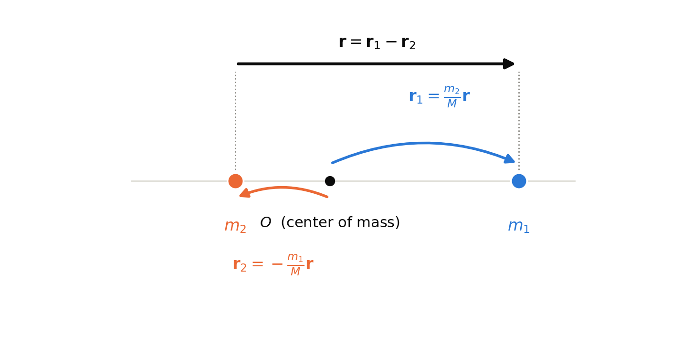
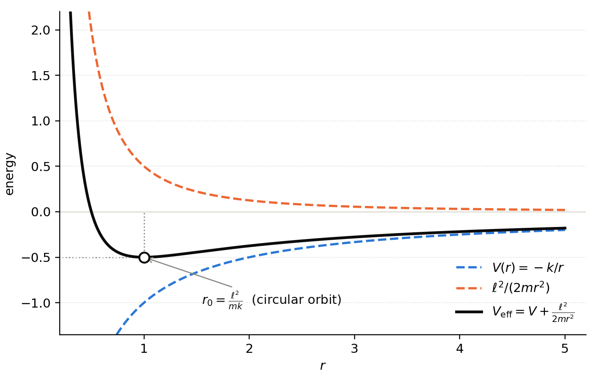
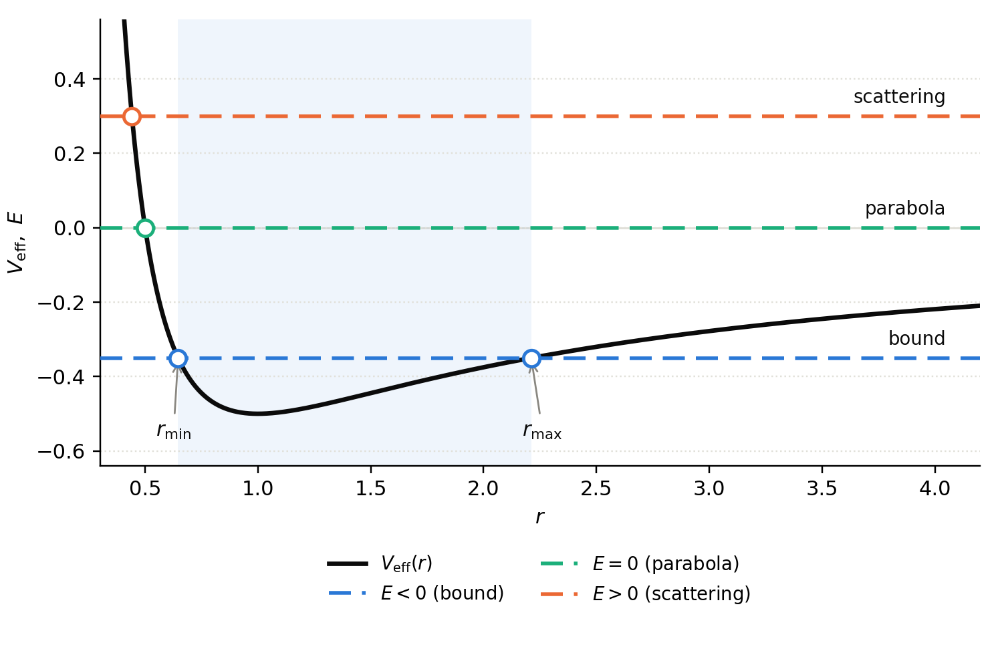
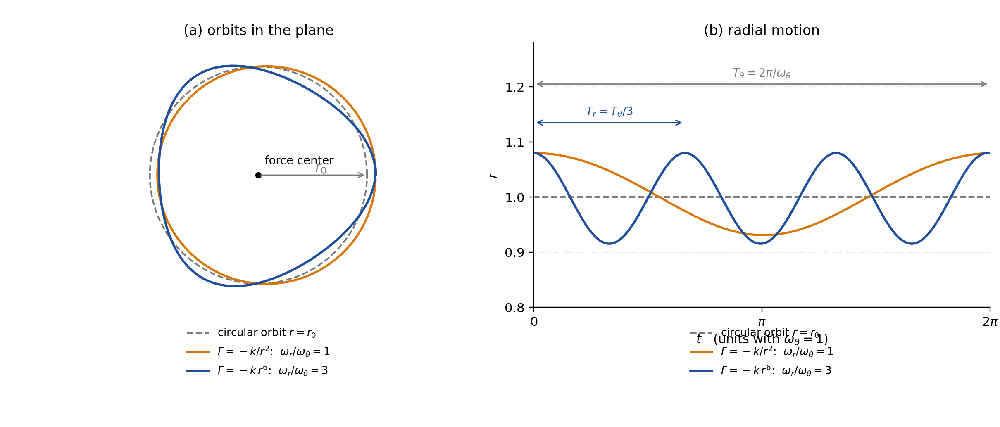
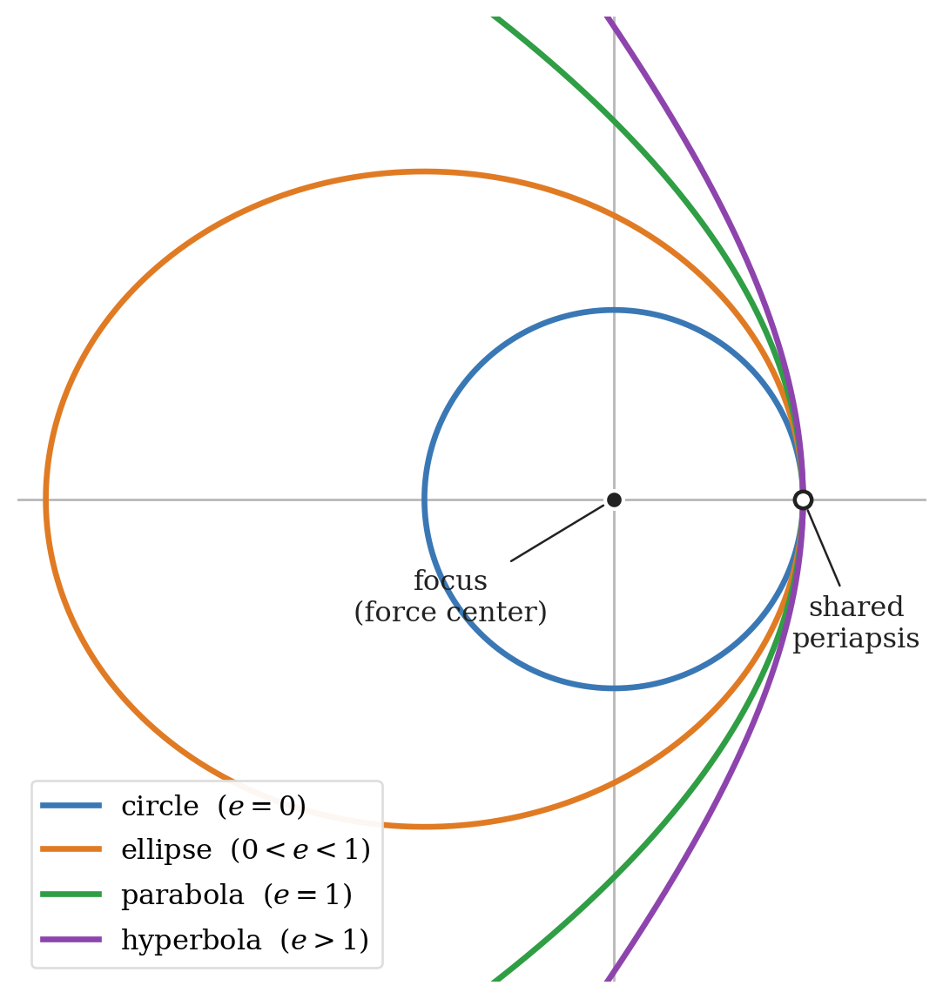
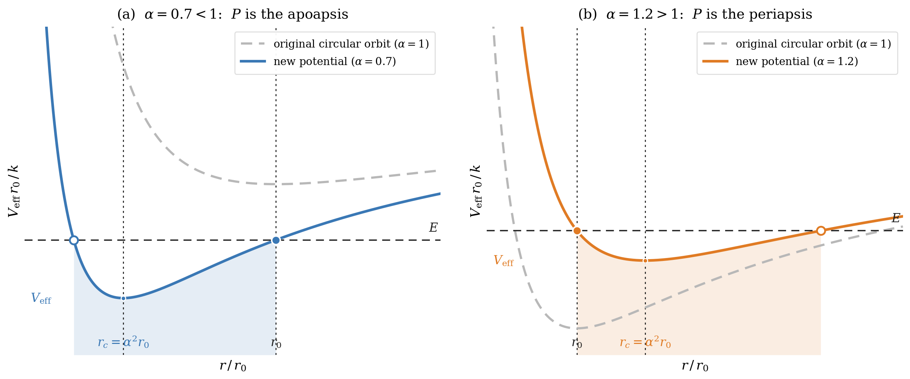
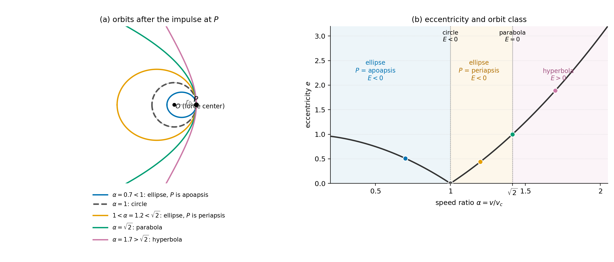

# Central Forces

## Table of Contents

1. [Central Forces and Their Potentials](#1-central-forces-and-their-potentials)
   - [1.1 Definition and Examples](#11-definition-and-examples)
   - [1.2 Conservative Central Forces](#12-conservative-central-forces)
2. [The Two-Body Problem and Reduced Mass](#2-the-two-body-problem-and-reduced-mass)
   - [2.1 Center-of-Mass and Relative Coordinates](#21-center-of-mass-and-relative-coordinates)
   - [2.2 The Equivalent One-Body Problem](#22-the-equivalent-one-body-problem)
3. [Angular Momentum and Planar Motion](#3-angular-momentum-and-planar-motion)
   - [3.1 Conservation of Angular Momentum](#31-conservation-of-angular-momentum)
   - [3.2 Polar Coordinates and the Cyclic Angle](#32-polar-coordinates-and-the-cyclic-angle)
   - [3.3 Areal Velocity and Kepler's Second Law](#33-areal-velocity-and-keplers-second-law)
4. [The Radial Equation and the Effective Potential](#4-the-radial-equation-and-the-effective-potential)
   - [4.1 The Radial Equation](#41-the-radial-equation)
   - [4.2 The Effective Potential](#42-the-effective-potential)
   - [4.3 Circular Orbits and Stability](#43-circular-orbits-and-stability)
5. [The Orbit Equation](#5-the-orbit-equation)
   - [5.1 Binet's Equation](#51-binets-equation)
   - [5.2 The First Integral of the Orbit](#52-the-first-integral-of-the-orbit)
6. [The Kepler Problem](#6-the-kepler-problem)
   - [6.1 The Inverse-Square Force](#61-the-inverse-square-force)
   - [6.2 Conic Sections and Eccentricity](#62-conic-sections-and-eccentricity)
   - [6.3 Energy, Semimajor Axis, and the Vis-Viva Equation](#63-energy-semimajor-axis-and-the-vis-viva-equation)
   - [6.4 Kepler's Third Law](#64-keplers-third-law)
   - [6.5 The Laplace–Runge–Lenz Vector](#65-the-laplace-runge-lenz-vector)
7. [A Tangential Impulse from a Circular Orbit](#7-a-tangential-impulse-from-a-circular-orbit)
8. [The Virial Theorem in Astrophysics](#8-the-virial-theorem-in-astrophysics)
   - [8.1 Time Averages and the Virial Theorem](#81-time-averages-and-the-virial-theorem)
   - [8.2 Power-Law Forces and Bound Orbits](#82-power-law-forces-and-bound-orbits)
   - [8.3 A System of Gravitating Particles](#83-a-system-of-gravitating-particles)
   - [8.4 Cluster Masses and Dark Matter](#84-cluster-masses-and-dark-matter)

---

## 1. Central Forces and Their Potentials

### 1.1 Definition and Examples

A **central force** (中心力) is a force on a particle that is always directed toward or away from a fixed point, called the **force center** (力心). Taking the force center as the origin, a central force has the form

$$
\mathbf F(\mathbf r)=F(r)\,\hat{\mathbf r},
\qquad
\hat{\mathbf r}=\frac{\mathbf r}{r}.
$$

The sign convention is important: $F(r)<0$ means an attractive force (toward the origin), while $F(r)>0$ means a repulsive force (away from the origin). If the magnitude $F$ depends only on the distance $r$, the force is **spherically symmetric** (球对称).

The standard examples are:

- **Newtonian gravitation** between point masses, $F=-Gm_1m_2/r^2$.
- **Coulomb's law** between point charges, $F=q_1q_2/(4\pi\varepsilon_0 r^2)$ (attractive for opposite signs, repulsive for like signs).
- **An isotropic spring** fixed at one end, $F=-\kappa(r-l_0)$ about the fixed point, where $\kappa$ is the spring constant and $l_0$ the natural length.

For a conservative central force, the potential energy depends only on $r$:

$$
V(\mathbf r)=V(r),
\qquad
F(r)=-\frac{dV}{dr}.
$$

> **Notation.** In this chapter a central force is always taken to be conservative unless stated otherwise. The force center is fixed in an inertial frame. The particle is a point mass.

---

### 1.2 Conservative Central Forces

For a central force, conservativity and spherical symmetry are equivalent; the proof separates into two implications.

1. If a central force is conservative, then $\mathbf F=-\nabla V$. Since $\mathbf F$ is radial, the gradient of $V$ has no angular component; hence $V$ cannot depend on the angles, and $V=V(r)$. The force magnitude is therefore independent of direction.
2. Conversely, if a central force is spherically symmetric, $F(\mathbf r)=F(r)\hat{\mathbf r}$, then $V(r)=-\int^r F(r')\,dr'$ is a function of $r$ alone, and $\mathbf F=-\nabla V$. The force is conservative.

---

## 2. The Two-Body Problem and Reduced Mass

### 2.1 Center-of-Mass and Relative Coordinates

Consider two point masses $m_1$ and $m_2$ with position vectors $\mathbf r_1$ and $\mathbf r_2$ measured in an inertial frame. Suppose the only force is their mutual interaction, and that the interaction potential depends only on the relative separation. Define

$$
M=m_1+m_2,
\qquad
\mathbf R=\frac{m_1\mathbf r_1+m_2\mathbf r_2}{M},
\qquad
\mathbf r=\mathbf r_1-\mathbf r_2.
$$

Then

$$
\mathbf r_1=\mathbf R+\frac{m_2}{M}\mathbf r,
\qquad
\mathbf r_2=\mathbf R-\frac{m_1}{M}\mathbf r.
$$

**Figure 1.** In the center-of-mass frame the center of mass is stationary at $O$. The relative coordinate $\mathbf r=\mathbf r_1-\mathbf r_2$ locates particle 1 relative to particle 2, so $\mathbf r_1=(m_2/M)\mathbf r$ and $\mathbf r_2=-(m_1/M)\mathbf r$. The drawing uses $m_1=1$ and $m_2=2$, hence $|\mathbf r_1|=(2/3)r$ and $|\mathbf r_2|=(1/3)r$.

For an isolated two-body system, translational invariance forbids the interaction potential from depending on $\mathbf r_1$ and $\mathbf r_2$ separately; it can depend only on their difference $\mathbf r=\mathbf r_1-\mathbf r_2$. A central interaction further restricts the dependence to the magnitude $r=|\mathbf r|$. Write

$$
U=U(r).
$$

**Derivation of the kinetic-energy separation.** Starting from

$$
T=\frac12 m_1\dot{\mathbf r}_1^{\,2}+\frac12 m_2\dot{\mathbf r}_2^{\,2},
$$

and using the coordinate relations above, the velocities are

$$
\dot{\mathbf r}_1=\dot{\mathbf R}+\frac{m_2}{M}\dot{\mathbf r},
\qquad
\dot{\mathbf r}_2=\dot{\mathbf R}-\frac{m_1}{M}\dot{\mathbf r}.
$$

Substituting into $T$ and expanding,

$$
\begin{aligned}
T={}&\frac12(m_1+m_2)\dot{\mathbf R}^{\,2} \\
&+\left(\frac{m_1m_2}{M}-\frac{m_1m_2}{M}\right)\dot{\mathbf R}\cdot\dot{\mathbf r} \\
&+\frac12\left(\frac{m_1m_2^2}{M^2}+\frac{m_2m_1^2}{M^2}\right)\dot{\mathbf r}^{\,2}.
\end{aligned}
$$

The cross term cancels. Since $M=m_1+m_2$,

$$
\frac{m_1m_2^2}{M^2}+\frac{m_2m_1^2}{M^2}
=\frac{m_1m_2(m_1+m_2)}{M^2}
=\frac{m_1m_2}{M}=\mu.
$$

Therefore

$$
\boxed{T=\frac12 M\dot{\mathbf R}^{\,2}+\frac12\mu\dot{\mathbf r}^{\,2}},
\qquad
\mu=\frac{m_1m_2}{m_1+m_2}.
$$

The kinetic energy therefore separates into center-of-mass and relative parts. The quantity $\mu$ is the **reduced mass** (约化质量); it is smaller than either mass and satisfies

$$
\frac{1}{\mu}=\frac{1}{m_1}+\frac{1}{m_2}.
$$

The Lagrangian is therefore

$$
L=\frac12 M\dot{\mathbf R}^{\,2}+\frac12\mu\dot{\mathbf r}^{\,2}-U(r).
$$

---

### 2.2 The Equivalent One-Body Problem

Because $L$ does not depend on $\mathbf R$, all three components of $\mathbf R$ are cyclic. The conjugate momentum is the total linear momentum,

$$
\mathbf P=M\dot{\mathbf R},
$$

and it is conserved. Thus the center of mass moves uniformly, and the center-of-mass motion decouples from the relative motion.

The relative coordinate satisfies the Euler–Lagrange equation

$$
\mu\ddot{\mathbf r}=-\nabla_{\mathbf r}U(r)=F(r)\,\hat{\mathbf r},
\qquad
F(r)=-\frac{dU}{dr}.
$$

This is precisely the equation of a single particle of mass $\mu$ moving in the fixed central field $U(r)$. The two-body motion about the center of mass is thereby reduced exactly to an equivalent one-body problem.

> **Note on the non-inertial interpretation.** If we use $m_2$ as the origin and describe the motion of $m_1$ relative to it, then this origin is generally accelerating, so it does not define an inertial frame. The reduced-mass formulation avoids this complication by rewriting the two-body problem in terms of the center-of-mass coordinate $\mathbf R$ and the relative coordinate $\mathbf r=\mathbf r_1-\mathbf r_2$. The relative motion then obeys $\mu\ddot{\mathbf r}=\mathbf F$.
>
> Thus, the reduced mass $\mu$ accounts for the fact that both particles accelerate under the same interaction. If $m_2\to\infty$, then $\mu\to m_1$, recovering the fixed-center limit. For finite $m_2$, the acceleration of $m_2$ contributes to the relative acceleration, and the effective inertia of the relative coordinate is reduced from $m_1$ to $\mu$.

> **Change of notation.** From this point on we describe the equivalent one-body problem. To avoid carrying $\mu$ through every formula, we write $m$ for the mass of the fictitious particle and $V(r)$ for the potential. For a genuine two-body problem, the reader should restore $m\to\mu$ and $V\to U$ at the end.

---

## 3. Angular Momentum and Planar Motion

### 3.1 Conservation of Angular Momentum

For a particle of mass $m$ at position $\mathbf r$ with momentum $\mathbf p=m\dot{\mathbf r}$, define the **angular momentum** (角动量) about the origin by

$$
\mathbf L=\mathbf r\times\mathbf p.
$$

Its time derivative is

$$
\dot{\mathbf L}=\dot{\mathbf r}\times\mathbf p+\mathbf r\times\dot{\mathbf p}
=\mathbf r\times\mathbf F,
$$

because $\dot{\mathbf r}\times\mathbf p=m\dot{\mathbf r}\times\dot{\mathbf r}=0$. For a central force, $\mathbf F$ is parallel to $\mathbf r$, so $\mathbf r\times\mathbf F=0$. Hence

$$
\boxed{\dot{\mathbf L}=0.}
$$

For a particle subject only to a central force, angular momentum is conserved. The conservation law requires only that **the force be central**; it does not require an inverse-square law.

Because $\mathbf L$ is a constant vector and $\mathbf r\cdot\mathbf L=\mathbf r\cdot(\mathbf r\times\mathbf p)=0$, the position vector is always perpendicular to the fixed direction of $\mathbf L$. Therefore the motion lies in a plane whose normal is $\mathbf L$.

If $\mathbf L=0$, then $\mathbf r$ is parallel to $\dot{\mathbf r}$, and the motion is along a straight line through the force center. Thus central-force motion is always planar: the plane is spanned by $\mathbf r$ and $\dot{\mathbf r}$, or is any plane containing the line of motion when $\mathbf L=0$.

---

### 3.2 Polar Coordinates and the Cyclic Angle

Choose polar coordinates $(r,\theta)$ in the plane of motion, with the force center at the origin. The velocity is

$$
\dot{\mathbf r}=\dot r\,\hat{\mathbf r}+r\dot\theta\,\hat{\boldsymbol\theta},
$$

so the kinetic energy is $\frac12m(\dot r^2+r^2\dot\theta^2)$. The Lagrangian is

$$
L=\frac12m\left(\dot r^2+r^2\dot\theta^2\right)-V(r).
$$

The angle $\theta$ does not appear in $L$: it is a **cyclic coordinate** (循环坐标). Its conjugate momentum is

$$
p_\theta=\frac{\partial L}{\partial\dot\theta}=mr^2\dot\theta.
$$

This canonical momentum is the angular momentum of the system. Since $\theta$ is cyclic,

$$
\dot p_\theta=\frac{d}{dt}\left(mr^2\dot\theta\right)=0,
\qquad
mr^2\dot\theta=\ell=\text{constant}.
$$

Here $\ell=|\mathbf L|$ is the constant magnitude of the angular momentum. Equivalently,

$$
\dot\theta=\frac{\ell}{mr^2}.
$$

Once $r(t)$ is known, $\theta(t)$ follows by quadrature (求积).

> **Remark on signs and dimensions.** $\ell$ may be positive or negative according to the sense of rotation; only $\ell^2$ enters the radial equation and the energy. Its dimensions are those of angular momentum, $[m][r]^2[t]^{-1}$.

---

### 3.3 Areal Velocity and Kepler's Second Law

In polar coordinates, a small angular displacement $d\theta$ sweeps out a triangle of area

$$
dA=\frac12 r^2\,d\theta.
$$

Therefore the **areal velocity** (面积速度) is

$$
\frac{dA}{dt}=\frac12r^2\dot\theta=\frac{\ell}{2m}.
$$

The right-hand side is constant because $\ell$ is constant. Angular-momentum conservation is therefore equivalent to the statement that **the radius vector sweeps out equal areas in equal times**. This is Kepler's second law, and it is a general property of central-force motion, not a special feature of the inverse-square law.

**Figure 2.** The area $dA=\tfrac12 r^2\,d\theta$ swept out by the radius vector in time $dt$. The transverse displacement is $r\,d\theta$, perpendicular to the radial direction.

In a two-body problem the areal velocity refers to the relative coordinate; with $m\to\mu$ it becomes $\ell/(2\mu)$. Equivalently, the relative position vector sweeps out equal areas in equal times. The areas swept out by the two individual bodies about the center of mass are scaled by $(m_2/M)^2$ and $(m_1/M)^2$, respectively, so they are equal to each other only when $m_1=m_2$.

---

## 4. The Radial Equation and the Effective Potential

### 4.1 The Radial Equation

The Euler–Lagrange equation for $r$ is

$$
\frac{d}{dt}\left(m\dot r\right)-mr\dot\theta^2=-\frac{dV}{dr}=F(r).
$$

Using the conserved angular momentum relation $\ell=mr^2\dot\theta$ to eliminate $\dot\theta$, we obtain the **radial equation** (径向方程)

$$
m\ddot r-\frac{\ell^2}{mr^3}=F(r),
$$

or equivalently

$$
m\ddot r=F(r)+\frac{\ell^2}{mr^3}.
$$

The second term is not an additional physical force; it is the centrifugal term that remains after the angular motion has been eliminated.

The total energy is conserved because the force is conservative and the Lagrangian has no explicit time dependence:

$$
E=\frac12m\left(\dot r^2+r^2\dot\theta^2\right)+V(r)
=\frac12m\dot r^2+\frac{\ell^2}{2mr^2}+V(r).
$$

---

### 4.2 The Effective Potential

Define the **effective potential** (有效势能)

$$
\boxed{V_{\text{eff}}(r)=V(r)+\frac{\ell^2}{2mr^2}.}
$$

Then the radial equation becomes

$$
m\ddot r=-\frac{dV_{\text{eff}}}{dr},
$$

and the energy becomes

$$
E=\frac12m\dot r^2+V_{\text{eff}}(r).
$$

The radial motion is therefore exactly the motion of a one-dimensional particle of mass $m$ in the potential $V_{\text{eff}}(r)$, restricted to $r>0$. This is the **equivalent one-dimensional problem** (等效一维问题).

The extra term

$$
\frac{\ell^2}{2mr^2}=\frac12 m r^2\dot\theta^2
$$

is the angular part of the kinetic energy.

**Figure 3.** The effective potential $V_{\text{eff}}(r)=V(r)+\ell^2/(2mr^2)$ for an attractive inverse-square force, shown as the sum of the gravitational potential $V(r)$ and the centrifugal term $\ell^2/(2mr^2)$. At large $r$ the attraction dominates; at small $r$ the centrifugal barrier dominates. The minimum at $r_0=\ell^2/(mk)$, where $V_{\text{eff}}(r_0)=-k/(2r_0)$, is the circular orbit. The figure uses $m=k=\ell=1$, so $r_0=1$ and $V_{\text{eff}}(r_0)=-1/2$.

For $\ell\neq0$ the centrifugal term diverges as $r\to0$. With $E$ finite, the radial kinetic energy satisfies $\tfrac12m\dot r^2=E-V_{\text{eff}}(r)\ge0$, so the particle cannot reach the force center. The barrier is thus a consequence of angular-momentum conservation: as $r$ decreases, $\dot\theta=\ell/(mr^2)$ grows, and the angular kinetic energy $\ell^2/(2mr^2)$ grows with it.

The qualitative classification of orbits now follows from the shape of $V_{\text{eff}}$:

- **Turning points.** Radial motion is possible only where $E\ge V_{\text{eff}}(r)$. The roots $E=V_{\text{eff}}(r)$ are the turning points, where the velocity is zero $\dot r=0$.
- **Circular orbit.** If the particle is placed at an extremum $r_0$ with $\dot r=0$, then $r=r_0$ for all time.
- **Bound orbit.** If the allowed interval of $r$ is bounded, the particle oscillates between a minimum radius (periapsis, 近拱点) and a maximum radius (apoapsis, 远拱点).
- **Unbound orbit.** If $E$ exceeds the asymptotic value of $V_{\text{eff}}$ at infinity, the particle escapes to $r\to\infty$.
- **Radial fall.** If $\ell=0$, then $V_{\text{eff}}=V$ and the centrifugal barrier is absent; an attractive force can pull the particle through the origin.

**Figure 4.** Energy levels and turning points for the same effective potential ($m=k=\ell=1$). Radial motion is allowed only where $E\ge V_{\text{eff}}(r)$, and the points where a horizontal energy line meets $V_{\text{eff}}$ are the turning points. Three cases are shown: $E<0$ (bound orbit; the shaded interval $r_{\min}\le r\le r_{\max}$ is classically allowed and has two turning points), $E=0$ (parabolic threshold, one turning point), and $E>0$ (scattering orbit, one turning point).

> **Caution.** The effective potential is a bookkeeping device for the radial coordinate only. It does not replace the full two-dimensional motion. After solving $r(t)$, one must still reconstruct $\theta(t)$ from $\dot\theta=\ell/(mr^2)$.

---

### 4.3 Circular Orbits and Stability

A circular orbit at radius $r_0$ requires $\dot r=0$ and $\ddot r=0$. From the radial equation $m\ddot r=F(r)+\ell^2/(mr^3)$,

$$
F(r_0)+\frac{\ell^2}{mr_0^3}=0,
\qquad\text{that is}\qquad
\boxed{F(r_0)=-\frac{\ell^2}{mr_0^3}.}
$$

Equivalently, the applied force provides exactly the centripetal acceleration required by the circular motion. The energy of the circular orbit is

$$
E_0=V_{\text{eff}}(r_0)=V(r_0)+\frac{\ell^2}{2mr_0^2}.
$$

To test stability, expand $V_{\text{eff}}$ about $r_0$. The circular orbit is stable if $r_0$ is a minimum:

$$
\left.\frac{d^2V_{\text{eff}}}{dr^2}\right|_{r_0}>0.
$$

Since $V_{\text{eff}}'=-F-\ell^2/(mr^3)$ and $\ell^2/(mr_0^3)=-F(r_0)$, differentiating gives

$$
V_{\text{eff}}''(r)=-F'(r)+\frac{3\ell^2}{mr^4},
$$

and evaluating at $r=r_0$ gives

$$
V_{\text{eff}}''(r_0)=-F'(r_0)+\frac{3\ell^2}{mr_0^4}
=-F'(r_0)-\frac{3F(r_0)}{r_0}.
$$

Thus stability requires

$$
F'(r_0)<-\frac{3F(r_0)}{r_0}.
$$

For an attractive force $F(r_0)<0$, this can be written as

$$
\left.\frac{d\ln|F|}{d\ln r}\right|_{r_0}>-3.
$$

For the power law

$$
F(r)=-kr^n,
\qquad k>0,
$$

the condition becomes $n>-3$. A power-law attractive force with $n>-3$ therefore admits stable circular orbits.

For small radial oscillations about $r_0$, write

$$
r(t)=r_0+x(t),
$$

where $x(t)$ is the small radial displacement from the circular orbit. Because $r_0$ is constant, $\ddot r=\ddot x$. The radial equation of motion is

$$
m\ddot r=F_{\text{eff}}(r)\equiv -V_{\text{eff}}'(r)=F(r)+\frac{\ell^2}{mr^3}.
$$

A circular orbit is an equilibrium point of the equivalent one-dimensional problem, so the effective force vanishes there:

$$
F_{\text{eff}}(r_0)=-V_{\text{eff}}'(r_0)=0,
$$

which is precisely the circular-orbit condition $F(r_0)=-\ell^2/(mr_0^3)$ derived above. For small displacements the restoring force is the linear term in the expansion of $F_{\text{eff}}$ about $r_0$:

$$
F_{\text{eff}}(r_0+x)
=F_{\text{eff}}(r_0)+F_{\text{eff}}'(r_0)\,x+O(x^2)
=-V_{\text{eff}}''(r_0)\,x+O(x^2),
$$

where $F_{\text{eff}}'=-V_{\text{eff}}''$ and the constant term vanishes by the equilibrium condition. Substituting $r=r_0+x$ into $m\ddot r=F_{\text{eff}}(r)$ gives

$$
m\ddot x=-V_{\text{eff}}''(r_0)\,x+O(x^2).
$$

Dropping the quadratic and higher-order terms leaves the **linearized equation of motion**

$$
\boxed{m\ddot x=-V_{\text{eff}}''(r_0)\,x,}
$$

which is the equation of a simple harmonic oscillator with effective stiffness $V_{\text{eff}}''(r_0)$. Comparing with the standard form $m\ddot x=-kx$ identifies the **radial oscillation frequency**

$$
\boxed{\omega_r^2=\frac{V_{\text{eff}}''(r_0)}{m}.}
$$

The solution is

$$
x(t)=A\cos(\omega_r t+\phi),
$$

so the orbit oscillates radially about the circular orbit with period $T_r=2\pi/\omega_r$. The amplitude $A$ is fixed by the initial energy.

For the power law $F=-kr^n$, substituting $F'=-knr^{n-1}$ and $\ell^2=mkr_0^{n+3}$ into the expression for $V_{\text{eff}}''(r_0)=-F'(r_0)+\frac{3\ell^2}{mr_0^4}$ gives

$$
V_{\text{eff}}''(r_0)=k(n+3)r_0^{n-1},
\qquad
\omega_r=\sqrt{\frac{k(n+3)r_0^{n-1}}{m}}.
$$

The angular momentum of the circular orbit is $\ell=\sqrt{mk}\,r_0^{(n+3)/2}$, so the angular velocity of the circular motion is

$$
\omega_\theta=\dot\theta=\frac{\ell}{mr_0^2}
=\sqrt{\frac{k}{m}}\,r_0^{(n-1)/2},
$$

and hence

$$
\frac{\omega_r}{\omega_\theta}=\sqrt{n+3}.
$$

Within this small-oscillation approximation the orbit closes after a finite number of radial oscillations exactly when $\omega_r/\omega_\theta$ is rational; otherwise successive pericenters precess and the orbit does not close.

Notice that, in this small-oscillation approximation, the frequency ratio is fixed by the force law rather than by the size of the perturbation: $\omega_r/\omega_\theta=\sqrt{n+3}$ depends only on $n$, while the initial radial displacement sets the amplitude $A$. Figure 5 compares two orbits with the same radial displacement under two different force laws.

**Figure 5.** A circular orbit and two perturbed orbits. The dashed grey circle is the unperturbed circular orbit $r=r_0$. Both coloured orbits start from the same radial displacement $r(0)=1.08\,r_0$ with zero radial velocity, each carrying the angular momentum of its own circular orbit. Blue: power-law force $F=-kr^6$, for which $\omega_r/\omega_\theta=\sqrt{n+3}=3$; the radius oscillates three times per revolution and the orbit nearly closes after one turn. Orange: inverse-square force $F=-k/r^2$, for which $\omega_r/\omega_\theta=1$; one radial oscillation coincides with one revolution, so the perturbed orbit is a closed ellipse with the force center at a focus. **Panel (b)** plots $r(t)$ over one revolution $T_\theta=2\pi/\omega_\theta$. The ratio is fixed by the force law through $n$; the perturbation amplitude sets only the size of the oscillation, not its frequency. The orbits are integrated exactly from the radial equation rather than from the linearized equation, so at the comparatively large amplitude used here the exact ratio for $n=6$ is $T_\theta/T_r\approx3.017$ instead of $3$. This confirms that the harmonic approximation is strictly valid only at small amplitude.

---

## 5. The Orbit Equation

### 5.1 Binet's Equation

For many purposes we want the shape of the orbit, $r(\theta)$, rather than $r(t)$. Use the angular-momentum relation to convert time derivatives into $\theta$ derivatives:

$$
\frac{d}{dt}=\dot\theta\frac{d}{d\theta}
=\frac{\ell}{mr^2}\frac{d}{d\theta}.
$$

Introduce the reciprocal radius

$$
u=\frac{1}{r}.
$$

Differentiating $u=1/r$ gives $dr=-u^{-2}du$, hence

$$
\frac{dr}{d\theta}=-\frac{1}{u^2}\frac{du}{d\theta},
\qquad
\dot r=\frac{dr}{dt}
=\frac{\ell}{mr^2}\frac{dr}{d\theta}
=-\frac{\ell}{m}\frac{du}{d\theta}.
$$

Differentiating once more,

$$
\ddot r
=\frac{\ell}{mr^2}\frac{d}{d\theta}\left(-\frac{\ell}{m}\frac{du}{d\theta}\right)
=-\frac{\ell^2u^2}{m^2}\frac{d^2u}{d\theta^2}.
$$

Substitute this expression for $\ddot r$ and $r=1/u$ into the radial equation:

$$
-\frac{\ell^2u^2}{m}\frac{d^2u}{d\theta^2}
-\frac{\ell^2u^3}{m}=F\!\left(\frac1u\right).
$$

Multiplying by $-m/(\ell^2u^2)$ gives **Binet's equation** (比内方程)

$$
\boxed{\frac{d^2u}{d\theta^2}+u
=-\frac{m}{\ell^2u^2}F\!\left(\frac1u\right).}
$$

If the force is written as $F=-dV/dr$, an equivalent form is

$$
\frac{d^2u}{d\theta^2}+u
=-\frac{m}{\ell^2}\frac{d}{du}V\!\left(\frac1u\right).
$$

The two forms are equivalent: the second follows from the first because $F=-dV/dr$ and $dV/dr=-u^2\,dV/du$.

---

### 5.2 The First Integral of the Orbit

A first integral follows directly from energy conservation. Using $\dot r=-(\ell/m)\,du/d\theta$ and $r=1/u$ in the energy equation,

$$
E=\frac{\ell^2}{2m}\left(\frac{du}{d\theta}\right)^2
+\frac{\ell^2u^2}{2m}+V\!\left(\frac1u\right).
$$

Therefore

$$
\boxed{\left(\frac{du}{d\theta}\right)^2
=\frac{2mE}{\ell^2}-\frac{2m}{\ell^2}V\!\left(\frac1u\right)-u^2.}
$$

This is the orbit first integral. Turning points of the orbit occur where $du/d\theta=0$ (the radial kinetic energy is zero), that is, where $E=V_{\text{eff}}(r)$. The first integral depends on $du/d\theta$ only through its square, so if $\theta=0$ is taken at a turning point, then $u(\theta)=u(-\theta)$: the orbit has the same shape on both sides of an apse (拱点，复数为 apsides).

> **Binet's equation or the first integral?** Both describe the same orbit and use the same conserved $\ell$; the choice is practical.
>
> - **Binet's equation** takes the force law as input and returns the orbit. It is a second-order equation whose two constants are fixed by the initial position and velocity.
> - **The first integral** takes $E$ and $\ell$ as input and gives $(du/d\theta)^2$ explicitly, so it is the natural tool for turning points, apsidal distances, the vis-viva relation, radial periods, scattering angles, and quadrature.
> - **They are equivalent.** Differentiating the first integral returns Binet's equation; integrating Binet's equation once returns the first integral. Both rest on angular-momentum conservation.

---

## 6. The Kepler Problem

### 6.1 The Inverse-Square Force

The **Kepler problem** (开普勒问题) is the motion under an attractive inverse-square force:

$$
F(r)=-\frac{k}{r^2},
\qquad
V(r)=-\frac{k}{r},
\qquad k>0.
$$

The inverse-square law is the principal solvable case of central-force motion. With $F=-ku^2$, Binet's equation becomes

$$
\frac{d^2u}{d\theta^2}+u=\frac{mk}{\ell^2}.
$$

This is a harmonic oscillator equation with a constant forcing term. Its general solution is

$$
u(\theta)=\frac{mk}{\ell^2}\left[1+e\cos(\theta-\theta')\right],
$$

where $e\ge0$ and $\theta'$ are constants of integration.

> **Derivation.** Let $K=mk/\ell^2$. The constant $u=K$ is a particular solution. Writing $u=K+v$ gives $v''+v=0$, whose general solution is $v=A\cos\theta+B\sin\theta$. Hence $u=K+A\cos\theta+B\sin\theta$. The two sinusoids combine into a single shifted cosine, $A\cos\theta+B\sin\theta=D\cos(\theta-\theta')$, with $D=\sqrt{A^2+B^2}$. Defining the dimensionless amplitude $e=D/K$ gives $u=K[1+e\cos(\theta-\theta')]$. The integration constants are therefore $e\ge0$ and the orientation angle $\theta'$.

In terms of $r=1/u$,

$$
\boxed{r(\theta)=\frac{p}{1+e\cos(\theta-\theta')},
\qquad
p=\frac{\ell^2}{mk}.}
$$

The constant $p$ is the **semi-latus rectum** (半通径) and $e$ is the **eccentricity** (偏心率). The angle $\theta'$ orients the orbit; choosing $\theta'=0$ places periapsis (近拱点) at $\theta=0$.

**Ellipse geometry from the orbit equation.** Set $\theta'=0$. At $\phi=0$ and $\phi=\pi$ the orbit equation gives

$$
r(0)=\frac{p}{1+e}=a-c,
\qquad
r(\pi)=\frac{p}{1-e}=a+c.
$$

Here $r(0)$ is the **periapsis** (近拱点), the closest point to the focus, and $r(\pi)$ is the **apoapsis** (远拱点), the farthest point. The **semi-major axis** $a$ is half the major axis, and the **focal distance** $c$ is the distance from the geometric center to either focus. Therefore

$$
\boxed{\frac{c}{a}=\frac{r(\pi)-r(0)}{r(\pi)+r(0)}=e.}
$$

The semi-latus rectum is $r(\pi/2)=p$, measured from the focus perpendicular to the major axis; since the focus is not the center, $p\neq b$.

For $0\le e<1$ the orbit is an **ellipse** (椭圆). With $\phi=\theta-\theta'$ and $x=r\cos\phi$, $y=r\sin\phi$, the orbit equation becomes $r+ex=p$, that is, $\sqrt{x^2+y^2}=p-ex$. Squaring and completing the square gives

$$
\frac{\left(x+\dfrac{pe}{1-e^2}\right)^2}{\left(\dfrac{p}{1-e^2}\right)^2}
+\frac{y^2}{\dfrac{p^2}{1-e^2}}=1,
$$

the standard form

$$
\frac{(x-x_c)^2}{a^2}+\frac{y^2}{b^2}=1,
\qquad
a=\frac{p}{1-e^2},
\quad
b=\frac{p}{\sqrt{1-e^2}},
\quad
x_c=-\frac{pe}{1-e^2}=-ae.
$$

An ellipse has the property that the sum of the distances from any point on it to the two foci is $2a$. At the top vertex $(-ae,b)$ both focal distances equal $\sqrt{c^2+b^2}$, so $2\sqrt{c^2+b^2}=2a$, hence

$$
c^2=a^2-b^2=\frac{p^2e^2}{(1-e^2)^2}=a^2e^2.
$$

Thus $e=c/a$ is the eccentricity, and the center lies at $x=-ae$. Again, the focus is at $x=0=(-ae+c,0)$: **the polar origin is a focus, not the center**.

**Figure 6.** Geometry of a bound Kepler ellipse with the force center at the focus $F$ (the origin). The geometric center is $C$, and $F'$ is the second focus; only $F$ is the force center. The semimajor axis $a$ runs from $C$ to the periapsis vertex, the semiminor axis $b$ from $C$ to the top vertex, and the focal distance $c$ from $C$ to $F$. The semi-latus rectum $p$ is the distance from $F$ to the curve perpendicular to the major axis; the full latus rectum is the chord of length $2p$. The dashed segment from $F$ to the top vertex has length $a$, so $CFT$ is a right triangle with $b^2+c^2=a^2$. The figure is drawn for $e=0.6$, with $a=1$, $b=0.8$, $c=0.6$, and $p=0.64$. The right vertex is the periapsis ($r_{\min}=a(1-e)$) and the left vertex is the apoapsis ($r_{\max}=a(1+e)$).

---

### 6.2 Conic Sections and Eccentricity

The orbit equation is the polar equation of a **conic section** (圆锥曲线) with one focus at the force center. The dimensionless constant $e$ is the **eccentricity** (偏心率); the orbit is therefore always a conic section.

To relate $e$ to the energy, evaluate the energy at periapsis, where $\dot r=0$ and $u=u_{\max}$. With $du/d\theta=0$ (the radial kinetic energy is zero),

$$
E=-\frac{k}{r}+\frac{\ell^2}{2mr^2}=-ku + \frac{\ell^2u^2}{2m}.
$$

At periapsis, the orbit equation gives $u_{\max}=(mk/\ell^2)(1+e)$. Substituting $u_{\max}$ into the energy and simplifying,

$$
E=\frac{mk^2}{2\ell^2}\left(e^2-1\right).
$$

Therefore

$$
\boxed{e=\sqrt{1+\frac{2E\ell^2}{mk^2}}.}
$$

The classification of orbits follows:

| Eccentricity | Energy | Orbit |
|---|---|---|
| $e>1$ | $E>0$ | hyperbola (双曲线) |
| $e=1$ | $E=0$ | parabola (抛物线) |
| $0<e<1$ | $E<0$ | ellipse (椭圆) |
| $e=0$ | $E=-\dfrac{mk^2}{2\ell^2}$ | circle (圆) |

**Figure 7.** The four classes of Kepler orbit drawn on one set of axes: circle ($e=0$), ellipse ($0<e<1$), parabola ($e=1$), and hyperbola ($e>1$). All four have the same force center, the focus at the origin, and the same periapsis distance $q$; their periapsis is therefore the common point on the far right where the curves meet. The semi-latus rectum is $p=q(1+e)$, which differs from orbit to orbit, so the curves coincide only at periapsis and separate elsewhere.

The circular case is the minimum of the effective potential for fixed $\ell$; its radius is

$$
r_0=\frac{\ell^2}{mk},
$$

obtained from the circular-orbit condition with $F=-k/r^2$.

---

### 6.3 Energy, Semimajor Axis, and the Vis-Viva Equation

For the bound ellipse, the semimajor axis $a$ is fixed by the energy alone:

$$
\boxed{a=-\frac{k}{2E}}.
$$

**Derivation from the turning points.** At either apsis, $\dot r=0$, so the radial kinetic energy vanishes. Substituting $du/d\theta=0$ and $V(1/u)=-ku$ into the orbit first integral of Section 5.2,

$$
\left(\frac{du}{d\theta}\right)^2
=\frac{2mE}{\ell^2}-\frac{2m}{\ell^2}V\!\left(\frac1u\right)-u^2,
$$

leaves

$$
E=\frac{\ell^2u^2}{2m}-ku.
$$

Rearranging this as a quadratic equation in $u$,

$$
u^2-\frac{2mk}{\ell^2}u-\frac{2mE}{\ell^2}=0.
$$

Its two roots are the reciprocal distances at the two apsides, $u_1=1/r_{\min}$ and $u_2=1/r_{\max}$. By Vieta's formulas applied to this quadratic, the roots satisfy

$$
u_1+u_2=\frac{2mk}{\ell^2},
\qquad
u_1u_2=-\frac{2mE}{\ell^2}.
$$

Because $u=1/r$, the sum of the apsidal distances is

$$
r_{\min}+r_{\max}
=\frac{1}{u_1}+\frac{1}{u_2}
=\frac{u_1+u_2}{u_1u_2}
=-\frac{k}{E}.
$$

From the geometry of Section 6.1, the focus lies between the two ends of the major axis at distances $a-c$ and $a+c$, so $r_{\min}+r_{\max}=2a$. Therefore

$$
2a=-\frac{k}{E}
\quad\Longrightarrow\quad
a=-\frac{k}{2E}.
$$

Since $a>0$ and $k>0$, this relation also shows that a bound ellipse requires $E<0$. The product of the roots gives the eccentricity as a by-product: from the orbit equation the roots are $u_1=(mk/\ell^2)(1+e)$ and $u_2=(mk/\ell^2)(1-e)$, so

$$
u_1u_2=\left(\frac{mk}{\ell^2}\right)^2(1-e^2)
=-\frac{2mE}{\ell^2}
\quad\Longrightarrow\quad
e=\sqrt{1+\frac{2E\ell^2}{mk^2}},
$$

in agreement with Section 6.2.

**Consistency check from the ellipse geometry.** Since $r_{\min}+r_{\max}=2a$ and $r_{\min,\max}=p/(1\pm e)$, the semimajor axis is

$$
a=\frac{p}{1-e^2}.
$$

Substituting $p=\ell^2/(mk)$ and $e^2=1+2E\ell^2/(mk^2)$ gives

$$
a=\frac{\ell^2/(mk)}{-\dfrac{2E\ell^2}{mk^2}}=-\frac{k}{2E},
$$

in agreement with the turning-point derivation.

Either way, we can now write the eccentricity in terms of $a$ by rearranging $a=p/(1-e^2)$:

$$
e=\sqrt{1-\frac{\ell^2}{mka}}.
$$

This is equivalent to $e^2=1+2E\ell^2/(mk^2)$ once $a=-k/(2E)$ is substituted.

The **vis-viva equation** (活力公式) follows from energy conservation. Since $E=\frac12mv^2-k/r$ and $E=-k/(2a)$,
$$
\frac12mv^2-\frac{k}{r}=-\frac{k}{2a},
$$

hence

$$
\boxed{v^2=\frac{k}{m}\left(\frac{2}{r}-\frac{1}{a}\right).}
$$

For a planet of negligible mass orbiting a star of mass $M_\star$, $k/m=GM_\star$, and the vis-viva equation becomes the familiar $v^2=GM_\star(2/r-1/a)$.

The vis-viva equation gives the speed at any point of the orbit in terms of the current distance $r$ and the semimajor axis $a$ alone. The object moves faster near the central body and slower far from it, so the equation provides orbital speeds without solving the full orbit.

> **Summary: how $e$, $E$, $\ell$, $k$, $a$, and $p$ fit together.** For $F=-k/r^2$ and $V=-k/r$, the orbit is fixed by the two dynamical constants $E$ and $\ell$; the geometric quantities $a$, $p$, and $e$ are functions of them.
>
> - **$k$ is a property of the system**, not of the orbit: for gravity, $k=Gm_1m_2$, with $m\to\mu$ in the relative-coordinate form of Section 6.4.
> - **$p$ is fixed by $\ell$ alone:** $p=\ell^2/(mk)$, equivalently $\ell=\sqrt{mkp}$.
> - **$a$ is fixed by $E$ alone:** $a=-k/(2E)$, equivalently $E=-k/(2a)$. With signed $a$ the formula covers all conics: $a>0$ for an ellipse, $a\to\infty$ for a parabola, $a<0$ for a hyperbola.
> - **$e$ mixes the two:** $e=\sqrt{1+2E\ell^2/(mk^2)}=\sqrt{1-p/a}$. Since $e\ge0$, it classifies the orbit: $e=0$ circle, $0<e<1$ ellipse, $e=1$ parabola, $e>1$ hyperbola; equivalently $E<0$, $E=0$, $E>0$.
> - **Geometry and dynamics are linked by** $p=a(1-e^2)$, that is, $\ell^2=mkp=mka(1-e^2)$. The apsidal distances are $r_{\min}=p/(1+e)=a(1-e)$ and $r_{\max}=p/(1-e)=a(1+e)$, the latter being finite only for $e<1$.

**Which relation to use.** Give the quantities you know, then read off the rest:

| If you know | Use | To get |
|---|---|---|
| $E,\ \ell$ | $a=-k/(2E)$, $p=\ell^2/(mk)$ | $a,\ p$, then $e=\sqrt{1-p/a}$ |
| $a,\ e$ | $p=a(1-e^2)$, $\ell^2=mkp$ | $p,\ \ell$, then $E=-k/(2a)$ |
| $p,\ e$ | $a=p/(1-e^2)$ | $a$, then $E=-k/(2a)$ |
| $r,\ v$ at one point | $E=\frac12mv^2-k/r$, $\ell=mrv_\perp$ | $E,\ \ell$ |
| $r,\ a$ (speed wanted) | vis-viva $v^2=\frac{k}{m}\left(\frac2r-\frac1a\right)$ | $v$ |

Here $\ell=|\mathbf L|$ and $v_\perp$ is the velocity component perpendicular to $\mathbf r$. For the circular orbit, $e=0$, and the relations collapse to $p=a=r_0$, $\ell^2=mkr_0$, and $E=-k/(2r_0)$.

---

### 6.4 Kepler's Third Law

By Kepler’s second law, the radius vector sweeps out equal areas in equal times. Therefore, the orbital period is the time required to sweep out the entire area of the ellipse at the constant areal velocity $\ell/(2m)$:
$$
\tau=\frac{2m}{\ell}A.
$$

The area of an ellipse is $A=\pi ab$, with $b=a\sqrt{1-e^2}$. Using $\ell^2/(mk)=a(1-e^2)$,

$$
b=a\sqrt{1-e^2}=\ell\sqrt{\frac{a}{mk}},
\qquad
A=\pi ab=\pi a^{3/2}\sqrt{\frac{\ell^2}{mk}}.
$$

Therefore

$$
\boxed{\tau^2=\frac{4\pi^2m}{k}a^3.}
$$

This establishes Kepler's third law: the square of the period is proportional to the cube of the semimajor axis.

For the gravitational two-body problem, restore $m\to\mu$ and $k=Gm_1m_2$: the force constant is unchanged, while the mass of the fictitious one-body particle becomes the reduced mass. Then

$$
\tau^2=\frac{4\pi^2\mu a^3}{Gm_1m_2}
=\frac{4\pi^2a^3}{G(m_1+m_2)}.
$$

When $m_2\gg m_1$, this reduces to $\tau^2\approx4\pi^2a^3/(Gm_2)$, the usual form of Kepler's third law for planets around the Sun. The exact two-body version retains the reduced mass through the factor $m_1+m_2$.

> The map from the two-body to the one-body problem of Section 2.2 changes the mass and the coordinate but leaves the force law untouched:
>
> - The force constant is unchanged: $k=Gm_1m_2$.
> - The one-body inertia is the reduced mass $\mu=m_1m_2/(m_1+m_2)$, not $m_1$.
> - The one-body coordinate is the separation $\mathbf r=\mathbf r_1-\mathbf r_2$; the equivalent orbit is this relative orbit, and its semimajor axis is the $a$ appearing in Kepler's third law.
>
> The center of mass moves uniformly, but in the center-of-mass frame the two bodies still orbit the CM at radii scaled by $m_2/M$ and $m_1/M$. Body 2, the force center of the equivalent problem, is at rest in that frame only in the limit $m_2\to\infty$, where $\mu\to m_1$. The relative-coordinate equation itself is exact for finite masses.

---

### 6.5 The Laplace–Runge–Lenz Vector

The Kepler problem has an additional conserved vector beyond $\mathbf L$ and $E$. Define the **Laplace–Runge–Lenz vector** (拉普拉斯–龙格–楞次矢量)

$$
\boxed{\mathbf A=\mathbf p\times\mathbf L-mk\,\hat{\mathbf r}.}
$$

For the inverse-square force, $\mathbf A$ is constant. To see this, start from

$$
\dot{\mathbf p}=F(r)\hat{\mathbf r}=-\frac{k}{r^2}\hat{\mathbf r}.
$$

Since $\mathbf L$ is constant,

$$
\frac{d}{dt}\left(\mathbf p\times\mathbf L\right)
=\dot{\mathbf p}\times\mathbf L
=-\frac{k}{r^2}\hat{\mathbf r}\times\mathbf L.
$$

Using $\mathbf L=m\mathbf r\times\dot{\mathbf r}$ and the triple-product identity $\hat{\mathbf r}\times(\mathbf r\times\dot{\mathbf r})=\mathbf r(\hat{\mathbf r}\cdot\dot{\mathbf r})-\dot{\mathbf r}(\hat{\mathbf r}\cdot\mathbf r)$,

$$
\hat{\mathbf r}\times(\mathbf r\times\dot{\mathbf r})
=\mathbf r\dot r-r\dot{\mathbf r}
=-r^2\frac{d\hat{\mathbf r}}{dt},
$$

where the last step uses $\mathbf r=r\hat{\mathbf r}$ and $\dot{\mathbf r}=\dot r\,\hat{\mathbf r}+r\,d\hat{\mathbf r}/dt$. Therefore

$$
\frac{d}{dt}\left(\mathbf p\times\mathbf L\right)
=-\frac{k}{r^2}\hat{\mathbf r}\times\mathbf L
=-\frac{mk}{r^2}\left[-r^2\frac{d\hat{\mathbf r}}{dt}\right]
=mk\frac{d\hat{\mathbf r}}{dt}.
$$

Since $\mathbf A=\mathbf p\times\mathbf L-mk\hat{\mathbf r}$, it follows that $\dot{\mathbf A}=0$: the LRL vector is conserved.

Two properties of $\mathbf A$ follow directly.

1. $\mathbf A\cdot\mathbf L=0$, because $\mathbf L$ is perpendicular to the orbital plane while both $\mathbf p\times\mathbf L$ and $\hat{\mathbf r}$ lie in that plane. Hence $\mathbf A$ lies in the orbital plane.
2. Its magnitude is $|\mathbf A|=mk e$, and it points toward periapsis.

The magnitude of $\mathbf A$ is derived as follows. At periapsis $\mathbf p$ is tangential so $|\mathbf p|=l/r_{\min}$. Since $\mathbf p$ is perpendicular to $\mathbf L$, the vector $\mathbf p\times\mathbf L$ is radial, and its magnitude is

$$
|\mathbf p\times\mathbf L|= |\mathbf p| \times|\mathbf L|=\frac{\ell^2}{r_{\min}}=mk(1+e),
$$

using $r_{\min}=\dfrac{p}{1+e}=\dfrac{\ell^2}{mk(1+e)}$. Therefore

$$
\mathbf A=\left[mk(1+e)-mk\right]\hat{\mathbf r}=mk e\,\hat{\mathbf r}.
$$

Thus the LRL vector encodes both the orientation and the eccentricity of the Kepler ellipse. It exists only for the inverse-square force; a general central force does not possess such an algebraic conserved vector. This extra symmetry is the deeper reason why Kepler orbits close: **the Laplace–Runge–Lenz vector tells us where the ellipse points and how stretched it is**.

**Figure 8.** The vectors $\mathbf p$, $\mathbf L$, and $\mathbf A$ at three positions on a Kepler orbit. The LRL vector $\mathbf A$ always points in the same direction (toward periapsis) and has magnitude $mk e$; at perihelion $|\mathbf p\times\mathbf L|=mk(1+e)$ and at aphelion $|\mathbf p\times\mathbf L|=mk(1-e)$.

---

## 7. A Tangential Impulse from a Circular Orbit

Let $P$ be the point of a circular orbit of radius $r_0$ at which the impulse is applied. A particle of mass $m$ moves under the attractive inverse-square force $F=-k/r^2$. An instantaneous tangential impulse at $P$ changes the speed from the circular value $v_c$ to $v=\alpha v_c$ with $\alpha>0$, without changing the particle's position or the direction of its velocity.

**Step 1: Circular speed.** From the circular-orbit condition with $F=-k/r_0^2$,
$$
\frac{k}{r_0^2}=\frac{\ell_c^2}{mr_0^3}
\quad\Longrightarrow\quad
\ell_c^2=mkr_0,
\qquad
v_c=\frac{\ell_c}{mr_0}=\sqrt{\frac{k}{mr_0}}.
$$

On the circular orbit $\dot r=0$, so the velocity is purely tangential and $v_c=r_0\dot\theta_c$. This is the same speed that enters the kinetic energy below.

> Using language familiar to high school students, the gravitational force $k/r_0^2$ provides the centripetal force $mv_c^2/r_0$. Since $\ell_c = mr_0v_c$, we have $\frac{k}{r_0^2} = \frac{mv_c^2}{r_0} = \frac{\ell_c^2}{mr_0^3}.$
>
> In this course, this is the same as saying that at $r_0$, the effective potential energy is stationary: the attractive central force is balanced by the outward effect of the angular barrier.

**Step 2: New constants.** After the impulse, the radius is still $r_0$ and the radial velocity is still zero, but
$$
\ell=\alpha\ell_c=\alpha\sqrt{mkr_0},
\qquad
E=\frac12m\alpha^2v_c^2-\frac{k}{r_0}
=\frac{k}{2r_0}\left(\alpha^2-2\right).
$$

**Step 3: Semimajor axis.** From the energy–semimajor-axis relation $a=-k/(2E)$,

$$
a=-\frac{k}{2E}=\frac{r_0}{2-\alpha^2}.
$$

For $E<0$ this is the ordinary semimajor axis. For $E>0$ ($\alpha>\sqrt2$) the right-hand side is negative: this is the signed semimajor axis of the hyperbola, and the positive semi-transverse axis is $|a|$.

**Step 4: Eccentricity.** Using the eccentricity–energy relation,

$$
e^2=1+\frac{2E\ell^2}{mk^2}
=1+\alpha^2\left(\alpha^2-2\right)
=\left(1-\alpha^2\right)^2,
$$

so

$$
\boxed{e=\left|1-\alpha^2\right|.}
$$

**Step 5: Interpretation.** Two independent signs control the classification: the sign of $E$ decides whether the orbit is bound, while the sign of the radial acceleration at $P$ decides whether $P$ is an apoapsis or a periapsis.

At $P$ the radial velocity is zero, so $P$ is a turning point. Using $F(r_0)=-k/r_0^2$ and $\ell^2=\alpha^2mkr_0$,

$$
\ddot r(P)
=\frac{F(r_0)}{m}+\frac{\ell^2}{m^2r_0^3}
=-\frac{k}{mr_0^2}+\frac{\alpha^2k}{mr_0^2}
=\frac{k}{mr_0^2}\left(\alpha^2-1\right).
$$

If $0<\alpha<1$, then $\ddot r(P)<0$: the particle is pulled inward from rest, so $r$ has a local maximum at $P$ and $P$ is the **apoapsis**. If $\alpha>1$, then $\ddot r(P)>0$: the particle moves outward from rest, so $P$ is the **periapsis**. At $\alpha=1$ the acceleration vanishes and the original circle is preserved.

The same conclusion follows from the effective potential. With the new angular momentum, the effective potential is

$$
V_{\text{eff}}(r)=-\frac{k}{r}+\frac{\ell^2}{2mr^2},
\qquad
V_{\text{eff}}'(r)=\frac{k}{r^2}-\frac{\ell^2}{mr^3}.
$$

Setting $V_{\text{eff}}'(r)=0$ gives the radius of the circular orbit that would have this angular momentum:

$$
r_c=\frac{\ell^2}{mk}=\alpha^2r_0.
$$

Since $V_{\text{eff}}''(r_c)=k/r_c^3>0$, $r_c$ is the bottom of the effective-potential well. The particle is at $r_0$ with $\dot r=0$, so $r_0$ is a turning point of the new radial motion. For $\alpha<1$, $r_c=\alpha^2r_0<r_0$, so the turning point lies on the outer side of the well and $r_0=r_{\max}$, making $P$ the apoapsis. For $\alpha>1$, $r_c>r_0$, so it lies on the inner side and $r_0=r_{\min}$, making $P$ the periapsis.

**Figure 9.** How the tangential impulse changes the effective potential. Units $m=k=r_0=1$, so $\ell_c^2=mkr_0=1$ and the new angular momentum is $\ell=\alpha\ell_c$, hence $\ell^2=\alpha^2$. The dashed grey curve is the original circular effective potential ($\alpha=1$), whose minimum is at $r_0$; the solid coloured curve is the new effective potential, whose minimum is at $r_c=\alpha^2r_0$ and whose value at $r_0$ equals the new energy $E=k(\alpha^2-2)/(2r_0)$. Because the particle is at $r_0$ with $\dot r=0$, $r_0$ is a turning point (filled dot). **(a)** $\alpha=0.7<1$: the bottom of the well moves inward to $r_c=\alpha^2r_0<r_0$, so the turning point $r_0$ lies on the outer side of the well; the particle consequently falls inward from rest, making $P$ the apoapsis ($r_0=r_{\max}$). The shaded interval $r_{\min}\le r\le r_0$ is the classically allowed region and the hollow dot marks $r_{\min}$. **(b)** $\alpha=1.2>1$: the bottom of the well moves outward to $r_c>r_0$, so the turning point $r_0$ lies on the inner side; the particle moves outward from rest, making $P$ the periapsis ($r_0=r_{\min}$), and the hollow dot marks $r_{\max}$. In both panels the horizontal dashed line is the new energy and the vertical dotted lines mark $r_c$ and $r_0$.

In summary:

- If $0<\alpha<1$, the speed is reduced and $E<0$. The impulse point $P$ is the apoapsis, $e=1-\alpha^2$, and the orbit is an ellipse inside the original circle with $r_{\max}=r_0$ and $r_{\min}=r_0\alpha^2/(2-\alpha^2)$.
- If $\alpha=1$, then $e=0$ and the orbit remains the original circle.
- If $1<\alpha<\sqrt2$, the speed is increased but $E$ is still negative. $P$ is the periapsis, $e=\alpha^2-1$, and the orbit is an ellipse outside the original circle with $r_{\min}=r_0$ and $r_{\max}=r_0\alpha^2/(2-\alpha^2)$.
- If $\alpha=\sqrt2$, then $E=0$ and $e=1$: the orbit is a parabola with $P$ at its pericenter.
- If $\alpha>\sqrt2$, then $E>0$ and $e>1$: the orbit is a hyperbola with $P$ at its pericenter.

The limiting case $\alpha=0$ gives $\ell=0$: the conic degenerates to a line segment, with $e=1$ and $a=r_0/2$, and the particle falls radially toward the force center.

**Figure 10.** The five cases for the speed ratio $\alpha=v/v_c$ after a tangential impulse at $P$ in a circular inverse-square orbit. **(a)** Representative orbits: $\alpha=0.7$ (blue, ellipse inside the circle with $P$ as apoapsis), $\alpha=1$ (grey dashed circle), $\alpha=1.2$ (orange, ellipse outside the circle with $P$ as periapsis), $\alpha=\sqrt2$ (green parabola), and $\alpha=1.7$ (purple hyperbola). All orbits pass through $P$ at distance $r_0$ from the force center $O$; parts that leave the frame are clipped. **(b)** Eccentricity $e=|1-\alpha^2|$ and the classification: $E<0$ for $\alpha<\sqrt2$ (ellipse), $E=0$ at $\alpha=\sqrt2$ (parabola), and $E>0$ for $\alpha>\sqrt2$ (hyperbola). The vertical dotted lines mark $\alpha=1$ (circle) and $\alpha=\sqrt2$ (parabolic threshold). The degenerate limit $\alpha=0$ ($\ell=0$, pure radial infall) is not one of the five cases and is not shown: panel (b) begins at $\alpha=0.2$.

---

## 8. The Virial Theorem in Astrophysics

A planet speeds up and slows down along an elliptical orbit, so its kinetic and potential energies change even though their sum is constant. The **virial theorem** (/ˈvɪriəl/维里定理) gives a simple relation between their **time averages**. The same idea applies to a cluster of stars or galaxies, even when the individual paths are too complicated to calculate. This makes the theorem useful for estimating how much mass holds a gravitational system together.

### 8.1 Time Averages and the Virial Theorem

We first consider the equivalent one-body problem: the particle has mass $m$, momentum $\mathbf p=m\dot{\mathbf r}$, and kinetic energy $T=\frac12m\dot{\mathbf r}^{\,2}$. Define the scalar

$$
\mathcal G=\mathbf p\cdot\mathbf r.
$$

Here $\mathcal G$ is an auxiliary quantity; $G$ without the calligraphic font remains Newton's gravitational constant. Since

$$
\mathcal G=m\mathbf r\cdot\dot{\mathbf r}
=\frac12\frac{d}{dt}(mr^2),
$$

it measures whether the particle's squared distance from the force center is increasing or decreasing. Differentiating once more and using $\dot{\mathbf p}=\mathbf F$,

$$
\frac{d\mathcal G}{dt}
=\dot{\mathbf p}\cdot\mathbf r+\mathbf p\cdot\dot{\mathbf r}
=\mathbf F\cdot\mathbf r+2T.
$$

We now define the **time average** (时间平均) of any quantity $f(t)$ over an interval $t_{\mathrm{av}}$ by

$$
\langle f\rangle_{t_{\mathrm{av}}}
=\frac{1}{t_{\mathrm{av}}}\int_0^{t_{\mathrm{av}}}f(t)\,dt.
$$

Averaging the derivative gives an endpoint difference:

$$
\frac{\mathcal G(t_{\mathrm{av}})-\mathcal G(0)}{t_{\mathrm{av}}}
=2\langle T\rangle_{t_{\mathrm{av}}}
+\langle\mathbf F\cdot\mathbf r\rangle_{t_{\mathrm{av}}}.
$$

For a periodic orbit, we can choose $t_{\mathrm{av}}=\tau$, the orbital period. The particle returns to the same position and momentum, so the left-hand side is exactly zero. More generally, if $\mathcal G$ stays bounded, its endpoint difference divided by an increasingly long averaging time tends to zero. Bounded positions and momenta are sufficient for this condition.

Writing $\langle\cdot\rangle$ for an average over a complete period or for the long-time limit when it exists, we obtain

$$
\boxed{2\langle T\rangle=-\langle\mathbf F\cdot\mathbf r\rangle.}
$$

For a conservative central force, $\mathbf F=-(dV/dr)\hat{\mathbf r}$ and $\mathbf r=r\hat{\mathbf r}$, so

$$
\boxed{2\langle T\rangle
=\left\langle r\frac{dV}{dr}\right\rangle.}
$$

The physical idea is that a bounded system cannot keep increasing or decreasing its size indefinitely. Over a sufficiently long time, the positive kinetic-energy contribution to $d\mathcal G/dt$ balances the contribution from the confining force.

> **Which energies enter?** Here $T=\frac12m(\dot r^2+r^2\dot\theta^2)$ includes both radial and angular motion, and $V$ is the physical potential energy. We do not replace $V$ by $V_{\text{eff}}$. The vanishing endpoint term must also be justified; it cannot simply be assumed for an escaping particle or a system undergoing sustained expansion or collapse.

---

### 8.2 Power-Law Forces and Bound Orbits

Use the same force-law convention as in Section 4.3:

$$
F(r)=-kr^n,
\qquad k>0.
$$

For $n\ne-1$, choose the additive constant in the potential so that

$$
V(r)=\frac{k}{n+1}r^{n+1}.
$$

Then

$$
r\frac{dV}{dr}=kr^{n+1}=(n+1)V,
$$

and the virial theorem becomes

$$
\boxed{2\langle T\rangle=(n+1)\langle V\rangle.}
$$

This relation applies when the averaging condition in Section 8.1 is satisfied.

Two useful examples are:

| Interaction | Potential energy | Virial relation |
|---|---|---|
| Inverse-square attraction, $n=-2$ | $V=-k/r$ | $2\langle T\rangle=-\langle V\rangle$ |
| Isotropic spring with zero natural length, $n=1$ | $V=\frac12\kappa r^2$ | $\langle T\rangle=\langle V\rangle$ |

For the spring we use $\kappa$, as in Section 1.1. The equality of average energies requires this purely quadratic potential; a spring with nonzero natural length has $V=\frac12\kappa(r-l_0)^2$ instead.

**Check for a circular Kepler orbit.** At radius $r_0$, the centripetal-force condition gives

$$
\frac{mv_c^2}{r_0}=\frac{k}{r_0^2}
\quad\Longrightarrow\quad
T=\frac{k}{2r_0},
\qquad
V=-\frac{k}{r_0}.
$$

Thus $2T=-V$ at every instant. **For an elliptical orbit, the same relation holds only after time averaging.**

**Average energies on a Kepler ellipse.** Since $E=T+V$ is conserved,

$$
E=\langle T\rangle+\langle V\rangle
=-\langle T\rangle
=\frac12\langle V\rangle.
$$

Combining this with $E=-k/(2a)$ from Section 6.3,

$$
\boxed{\langle T\rangle=\frac{k}{2a},
\qquad
\langle V\rangle=-\frac{k}{a},
\qquad
\left\langle\frac1r\right\rangle=\frac1a.}
$$

These averages depend on the semimajor axis $a$, even though the speed and distance vary around the ellipse. The last equality concerns the average of $1/r$; it does not say that $\langle r\rangle=a$. A time average gives more weight to parts of the orbit where the particle moves slowly, because the particle spends more time there.

For a genuine two-body system, restore $m\to\mu$ and $V\to U$, with $k=Gm_1m_2$. The kinetic energy $T=\frac12\mu\dot{\mathbf r}^{\,2}$ is then the total kinetic energy of the two bodies in their center-of-mass frame.

---

### 8.3 A System of Gravitating Particles

Now consider $N$ nonrelativistic particles interacting only through their mutual Newtonian gravity. We work in the inertial center-of-mass frame, so the kinetic energy describes motion within the system. Let

$$
T=\sum_i\frac12m_i\dot{\mathbf r}_i^{\,2},
\qquad
\mathcal G=\sum_i\mathbf p_i\cdot\mathbf r_i,
\qquad
\mathbf p_i=m_i\dot{\mathbf r}_i.
$$

Applying the same differentiation to each particle gives

$$
\frac{d\mathcal G}{dt}
=2T+\sum_i\mathbf r_i\cdot\mathbf F_i,
$$

where $\mathbf F_i$ is the net force on particle $i$. Under the same averaging condition as before,

$$
2\langle T\rangle
=-\left\langle\sum_i\mathbf r_i\cdot\mathbf F_i\right\rangle.
$$

To evaluate the force sum, first decompose the net force on each particle into the sum of pairwise forces:
$$
\mathbf F_i=\sum_{j\ne i}\mathbf F_{ij},
$$
where $\mathbf F_{ij}$ denotes the force on particle $i$ due to particle $j$. Hence
$$
\sum_i\mathbf r_i\cdot\mathbf F_i
=
\sum_i\mathbf r_i\cdot\sum_{j\ne i}\mathbf F_{ij}
=
\sum_i\sum_{j\ne i}\mathbf r_i\cdot\mathbf F_{ij}.
$$

Now group the double sum into distinct interacting pairs. Define
$$
\mathbf r_{ij}=\mathbf r_i-\mathbf r_j,
\qquad
r_{ij}=|\mathbf r_{ij}|,
\qquad
U_{ij}=-\frac{Gm_im_j}{r_{ij}}.
$$
For each unordered pair $(i,j)$, the two terms appearing in the double sum are
$$
\mathbf r_i\cdot\mathbf F_{ij}
+
\mathbf r_j\cdot\mathbf F_{ji}.
$$
Since
$$
\mathbf F_{ij}
=
-\frac{Gm_im_j}{r_{ij}^3}\mathbf r_{ij},
$$
and Newton's third law gives
$$
\mathbf F_{ji}=-\mathbf F_{ij},
$$
we have
$$
\begin{aligned}
\mathbf r_i\cdot\mathbf F_{ij}
+\mathbf r_j\cdot\mathbf F_{ji}
&=
\mathbf r_i\cdot\mathbf F_{ij}
-\mathbf r_j\cdot\mathbf F_{ij} \\
&=
(\mathbf r_i-\mathbf r_j)\cdot\mathbf F_{ij} \\
&=
\mathbf r_{ij}\cdot
\left(
-\frac{Gm_im_j}{r_{ij}^3}\mathbf r_{ij}
\right) \\
&=
-\frac{Gm_im_j}{r_{ij}} \\
&=
U_{ij}.
\end{aligned}
$$

Therefore,
$$
\begin{aligned}
\sum_i \mathbf r_i\cdot\mathbf F_i
&=
\sum_i\sum_{j\ne i}\mathbf r_i\cdot\mathbf F_{ij} \\
&=
\sum_{i<j}\mathbf r_i\cdot\mathbf F_{ij}
+
\sum_{j<i}\mathbf r_i\cdot\mathbf F_{ij} \\
&=
\sum_{i<j}\mathbf r_i\cdot\mathbf F_{ij}
+
\sum_{i<j}\mathbf r_j\cdot\mathbf F_{ji} \\
&=
\sum_{i<j}
\left(
\mathbf r_i\cdot\mathbf F_{ij}
+
\mathbf r_j\cdot\mathbf F_{ji}
\right) \\
&=
\sum_{i<j}U_{ij}
=
U .
\end{aligned}
$$
Here $\sum_{i<j}$ denotes a sum over all unordered pairs with $i<j$, not a nested sum. We have proved:
$$
\sum_i\mathbf r_i\cdot\mathbf F_i
=\sum_{i<j}U_{ij}=U,
$$

Thus an isolated, bounded gravitational system satisfies

$$
\boxed{2\langle T\rangle+\langle U\rangle=0,}
\qquad
\boxed{E=-\langle T\rangle=\frac12\langle U\rangle<0.}
$$

Each pairwise force is central, but the net force on a particle need not point toward the center of mass. The particles need not follow closed Kepler orbits for this result to hold.

---

### 8.4 Cluster Masses and Dark Matter

The virial theorem lets us estimate a cluster's mass from its size and the speeds of its members. For a cluster close to virial equilibrium, observations of many representative members can be used to estimate the averages, without following each orbit for a complete period.

Let $M=\sum_i m_i$ be the total cluster mass and $R_{\mathrm c}$ a characteristic cluster radius. Write the average potential energy approximately as

$$
\langle U\rangle\simeq-C\frac{GM^2}{R_{\mathrm c}},
$$

where $C$ is a positive, dimensionless factor determined by the mass distribution and by how $R_{\mathrm c}$ is defined. For example, a smooth uniform sphere with outer radius $R_{\mathrm c}$ has $C=3/5$.

It is useful to express the total kinetic energy in terms of a single characteristic speed for the whole cluster. Since kinetic energy is weighted by mass, the appropriate average is the mass-weighted mean-square speed. We therefore define
$$
v_{\mathrm{rms}}^2
=
\frac{1}{M}\sum_i m_i\langle v_i^2\rangle,
$$
so that
$$
\langle T\rangle
=
\frac12\sum_i m_i\langle v_i^2\rangle
=
\frac12 Mv_{\mathrm{rms}}^2.
$$

Substitution into $2\langle T\rangle+\langle U\rangle=0$ yields

$$
Mv_{\mathrm{rms}}^2
\simeq
C\frac{GM^2}{R_{\mathrm c}},
$$
and hence
$$
\boxed{
M\simeq\frac{R_{\mathrm c}v_{\mathrm{rms}}^2}{CG}
}.
$$
This relation shows that, for a cluster of fixed size, **a larger typical speed requires a larger total mass**. The reason is that stronger gravity is needed to keep faster-moving objects gravitationally bound.

This virial estimate provides a way to infer the mass of a galaxy cluster from its size and the motions of its members. In 1933, Fritz Zwicky used this idea for the Coma Cluster and found that **the galaxies were moving too fast to be bound by the mass visible in starlight alone**. The cluster therefore required much more gravitating matter than was directly observed. This was one of the earliest indications of **dark matter**.

At fixed size, the kinetic energy scales like $M$ while the gravitational binding energy scales like $M^2$, so a more massive system is bound more tightly.
