# Central Forces

**Reading material:** Chapter 3 of *Classical Mechanics* by Herbert Goldstein; Chapter 8 of *Classical Mechanics* by John R. Taylor; Chapter 5 of *Classical Mechanics* by David Tong; Chapter 7 of *Modern Classical Mechanics* by T. M. Helliwell; Chapter 7 of *Introduction to Classical Mechanics* by David Morin.

> 基于参考书编写的课程讲义。本章综合上述五本参考书对中心力问题的处理：先建立二体约化与角动量守恒，再导出有效势能与轨道方程，最后讨论开普勒轨道、闭轨条件与散射。文中标注为“自编例题”的算例不是原书例题。

## Table of Contents

1. [Central Forces and Their Potentials](#1-central-forces-and-their-potentials)
   - [1.1 Definition and Examples](#11-definition-and-examples)
   - [1.2 Conservative Central Forces](#12-conservative-central-forces)
2. [The Two-Body Problem and Reduced Mass](#2-the-two-body-problem-and-reduced-mass)
   - [2.1 Center-of-Mass and Relative Coordinates](#21-center-of-mass-and-relative-coordinates)
   - [2.2 The Equivalent One-Body Problem](#22-the-equivalent-one-body-problem)
3. [Angular Momentum and Planar Motion](#3-angular-momentum-and-planar-motion)
   - [3.1 Conservation of Angular Momentum](#31-conservation-of-angular-momentum)
   - [3.2 Polar Coordinates and the Cyclic Angle](#32-polar-coordinates-and-the-cyclic-angle)
   - [3.3 Areal Velocity and Kepler's Second Law](#33-areal-velocity-and-keplers-second-law)
4. [The Radial Equation and the Effective Potential](#4-the-radial-equation-and-the-effective-potential)
   - [4.1 The Radial Equation](#41-the-radial-equation)
   - [4.2 The Effective Potential](#42-the-effective-potential)
   - [4.3 Circular Orbits and Stability](#43-circular-orbits-and-stability)
5. [The Orbit Equation](#5-the-orbit-equation)
   - [5.1 Binet's Equation](#51-binets-equation)
   - [5.2 The First Integral of the Orbit](#52-the-first-integral-of-the-orbit)
6. [The Kepler Problem](#6-the-kepler-problem)
   - [6.1 The Inverse-Square Force](#61-the-inverse-square-force)
   - [6.2 Conic Sections and Eccentricity](#62-conic-sections-and-eccentricity)
   - [6.3 Energy, Semimajor Axis, and the Vis-Viva Equation](#63-energy-semimajor-axis-and-the-vis-viva-equation)
   - [6.4 Kepler's Third Law](#64-keplers-third-law)
   - [6.5 The Laplace–Runge–Lenz Vector](#65-the-laplace-runge-lenz-vector)
7. [Bertrand's Theorem and Closed Orbits](#7-bertrands-theorem-and-closed-orbits)
8. [Scattering in a Central Field](#8-scattering-in-a-central-field)
   - [8.1 Impact Parameter and Deflection Angle](#81-impact-parameter-and-deflection-angle)
   - [8.2 The Differential Cross Section and Rutherford Scattering](#82-the-differential-cross-section-and-rutherford-scattering)
9. [Limits, Counterexamples, and Assumptions](#9-limits-counterexamples-and-assumptions)
10. [Worked Examples](#10-worked-examples)
    - [10.1 A Tangential Impulse from a Circular Orbit](#101-a-tangential-impulse-from-a-circular-orbit)
    - [10.2 Circular Orbits in a Power-Law Potential](#102-circular-orbits-in-a-power-law-potential)
11. [Exercises](#11-exercises)
12. [Summary](#12-summary)
13. [Sources](#13-sources)

---

## 1. Central Forces and Their Potentials

### 1.1 Definition and Examples

A **central force** (中心力) is a force on a particle that is always directed toward or away from a fixed point, called the **force center** (力心). Taking the force center as the origin, a central force has the form

$$
\mathbf F(\mathbf r)=F(r)\,\hat{\mathbf r},
\qquad
\hat{\mathbf r}=\frac{\mathbf r}{r}.
$$

The sign convention is important: $F(r)<0$ means an attractive force (toward the origin), while $F(r)>0$ means a repulsive force (away from the origin). If the magnitude $F$ depends only on the distance $r$, the force is **spherically symmetric** (球对称).

The standard examples are:

- **Newtonian gravitation** between point masses, $F=-Gm_1m_2/r^2$.
- **Coulomb's law** between point charges, $F=q_1q_2/(4\pi\varepsilon_0 r^2)$ (attractive for opposite signs, repulsive for like signs).
- **An isotropic spring** fixed at one end, $F=-k(r-\ell_0)$ about the fixed point.

For a conservative central force, the potential energy depends only on $r$:

$$
V(\mathbf r)=V(r),
\qquad
F(r)=-\frac{dV}{dr}.
$$

> **Notation.** In this chapter a central force is always taken to be conservative unless stated otherwise. The force center is fixed in an inertial frame. The particle is a point mass.

---

### 1.2 Conservative Central Forces

The statement that conservative and spherically symmetric central forces coincide is worth separating into two implications.

1. If a central force is conservative, then $\mathbf F=-\nabla V$. Since $\mathbf F$ is radial, the gradient of $V$ has no angular component; hence $V$ cannot depend on the angles, and $V=V(r)$. The force magnitude is therefore independent of direction.
2. Conversely, if a central force is spherically symmetric, $F(\mathbf r)=F(r)\hat{\mathbf r}$, then $V(r)=-\int^r F(r')\,dr'$ is a function of $r$ alone, and $\mathbf F=-\nabla V$. The force is conservative.

---

## 2. The Two-Body Problem and Reduced Mass

### 2.1 Center-of-Mass and Relative Coordinates

Consider two point masses $m_1$ and $m_2$ with position vectors $\mathbf r_1$ and $\mathbf r_2$ measured in an inertial frame. Suppose the only force is their mutual interaction, and that the interaction potential depends only on the relative separation. Define

$$
M=m_1+m_2,
\qquad
\mathbf R=\frac{m_1\mathbf r_1+m_2\mathbf r_2}{M},
\qquad
\mathbf r=\mathbf r_1-\mathbf r_2.
$$

Then

$$
\mathbf r_1=\mathbf R+\frac{m_2}{M}\mathbf r,
\qquad
\mathbf r_2=\mathbf R-\frac{m_1}{M}\mathbf r.
$$

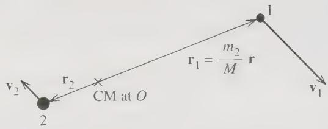

**Figure 1.** In the center-of-mass frame the center of mass is stationary at $O$; the relative position $\mathbf r=\mathbf r_1-\mathbf r_2$ is the position of particle 1 relative to particle 2, so $\mathbf r_1=(m_2/M)\mathbf r$. (Taylor, *Classical Mechanics*, Fig. 8.3.)

For an isolated system the potential can depend only on the relative coordinate: translational invariance forbids dependence on $\mathbf r_1$ and $\mathbf r_2$ separately. Because the force is central, the potential further depends only on the magnitude $r=|\mathbf r|$ [Taylor §8.1](/chapters/ch-79.html#b-p2566-b0004). Write

$$
U=U(r).
$$

**Derivation of the kinetic-energy separation.** Starting from

$$
T=\frac12 m_1\dot{\mathbf r}_1^{\,2}+\frac12 m_2\dot{\mathbf r}_2^{\,2},
$$

and using the coordinate relations above, the velocities are

$$
\dot{\mathbf r}_1=\dot{\mathbf R}+\frac{m_2}{M}\dot{\mathbf r},
\qquad
\dot{\mathbf r}_2=\dot{\mathbf R}-\frac{m_1}{M}\dot{\mathbf r}.
$$

Substituting into $T$ and expanding,

$$
\begin{aligned}
T={}&\frac12(m_1+m_2)\dot{\mathbf R}^{\,2} \\
&+\left(\frac{m_1m_2}{M}-\frac{m_1m_2}{M}\right)\dot{\mathbf R}\cdot\dot{\mathbf r} \\
&+\frac12\left(\frac{m_1m_2^2}{M^2}+\frac{m_2m_1^2}{M^2}\right)\dot{\mathbf r}^{\,2}.
\end{aligned}
$$

The cross term cancels. Since $M=m_1+m_2$,

$$
\frac{m_1m_2^2}{M^2}+\frac{m_2m_1^2}{M^2}
=\frac{m_1m_2(m_1+m_2)}{M^2}
=\frac{m_1m_2}{M}=\mu.
$$

Therefore

$$
\boxed{T=\frac12 M\dot{\mathbf R}^{\,2}+\frac12\mu\dot{\mathbf r}^{\,2}}.
$$

The kinetic energy separates into center-of-mass and relative parts:

$$
T=\frac12 M\dot{\mathbf R}^{\,2}+\frac12\mu\dot{\mathbf r}^{\,2},
\qquad
\mu=\frac{m_1m_2}{m_1+m_2}.
$$

The quantity $\mu$ is the **reduced mass** (约化质量). It is smaller than either $m_1$ or $m_2$, and it satisfies

$$
\frac{1}{\mu}=\frac{1}{m_1}+\frac{1}{m_2}.
$$

Helliwell defines the reduced mass in exactly this way and notes that it is less than either mass [Helliwell §7.2](/chapters/ch-41.html#b-p1109-b0001). The Lagrangian is therefore

$$
L=\frac12 M\dot{\mathbf R}^{\,2}+\frac12\mu\dot{\mathbf r}^{\,2}-U(r).
$$

---

### 2.2 The Equivalent One-Body Problem

Because $L$ does not depend on $\mathbf R$, all three components of $\mathbf R$ are cyclic. The conjugate momentum is the total linear momentum,

$$
\mathbf P=M\dot{\mathbf R},
$$

and it is conserved. Thus the center of mass moves uniformly, and the center-of-mass motion decouples from the relative motion [Taylor §8.3](/chapters/ch-79.html#b-p2569-b0003).

The relative coordinate satisfies the Euler–Lagrange equation

$$
\mu\ddot{\mathbf r}=-\nabla_{\mathbf r}U(r)=F(r)\,\hat{\mathbf r},
\qquad
F(r)=-\frac{dU}{dr}.
$$

This is precisely the equation of a single particle of mass $\mu$ moving in the fixed central field $U(r)$. The central-force motion of two bodies about their center of mass can always be reduced to an equivalent one-body problem [Goldstein §3.1](/chapters/ch-19.html#b-p0233-b0016).

> **Note on the non-inertial interpretation.** If we use $m_2$ as the origin and describe the motion of $m_1$ relative to it, then this origin is generally accelerating, so it does not define an inertial frame. The reduced-mass formulation avoids this complication by rewriting the two-body problem in terms of the center-of-mass coordinate $\mathbf R$ and the relative coordinate $\mathbf r=\mathbf r_1-\mathbf r_2$. The relative motion then obeys $\mu\ddot{\mathbf r}=\mathbf F$.
>
> Thus, the reduced mass $\mu$ accounts for the fact that both particles accelerate under the same interaction. If $m_2\to\infty$, then $\mu\to m_1$, recovering the fixed-center limit. For finite $m_2$, the acceleration of $m_2$ contributes to the relative acceleration, and the effective inertia of the relative coordinate is reduced from $m_1$ to $\mu$.

> **Change of notation.** From this point on we describe the equivalent one-body problem. To avoid carrying $\mu$ through every formula, we write $m$ for the mass of the fictitious particle and $V(r)$ for the potential. For a genuine two-body problem, the reader should restore $m\to\mu$ and $V\to U$ at the end.

---

## 3. Angular Momentum and Planar Motion

### 3.1 Conservation of Angular Momentum

For a particle of mass $m$ at position $\mathbf r$ with momentum $\mathbf p=m\dot{\mathbf r}$, define the **angular momentum** (角动量) about the origin by

$$
\mathbf L=\mathbf r\times\mathbf p.
$$

Its time derivative is

$$
\dot{\mathbf L}=\dot{\mathbf r}\times\mathbf p+\mathbf r\times\dot{\mathbf p}
=\mathbf r\times\mathbf F,
$$

because $\dot{\mathbf r}\times\mathbf p=m\dot{\mathbf r}\times\dot{\mathbf r}=0$. For a central force, $\mathbf F$ is parallel to $\mathbf r$, so $\mathbf r\times\mathbf F=0$. Hence

$$
\boxed{\dot{\mathbf L}=0.}
$$

If a particle is subject to a central force only, its angular momentum is conserved [Morin §7.1](/chapters/ch-61.html#b-p1819-b0001). The conservation law requires only that **the force be central**; it does not require an inverse-square law.

Because $\mathbf L$ is a constant vector and $\mathbf r\cdot\mathbf L=\mathbf r\cdot(\mathbf r\times\mathbf p)=0$, the position vector is always perpendicular to the fixed direction of $\mathbf L$. Therefore the motion lies in a plane whose normal is $\mathbf L$.

If $\mathbf L=0$, then $\mathbf r$ is parallel to $\dot{\mathbf r}$, and the motion is along a straight line through the force center. Goldstein summarizes both cases: central-force motion is always motion in a plane [Goldstein §3.2](/chapters/ch-19.html#b-p0234-b0005).

---

### 3.2 Polar Coordinates and the Cyclic Angle

Choose polar coordinates $(r,\theta)$ in the plane of motion, with the force center at the origin. The velocity is

$$
\dot{\mathbf r}=\dot r\,\hat{\mathbf r}+r\dot\theta\,\hat{\boldsymbol\theta},
$$

so the kinetic energy is $\frac12m(\dot r^2+r^2\dot\theta^2)$. The Lagrangian is

$$
L=\frac12m\left(\dot r^2+r^2\dot\theta^2\right)-V(r).
$$

The angle $\theta$ does not appear in $L$: it is a **cyclic coordinate** (循环坐标). Its conjugate momentum is

$$
p_\theta=\frac{\partial L}{\partial\dot\theta}=mr^2\dot\theta.
$$

Goldstein identifies this canonical momentum with the angular momentum of the system [Goldstein §3.2](/chapters/ch-19.html#b-p0234-b0009). Since $\theta$ is cyclic,

$$
\dot p_\theta=\frac{d}{dt}\left(mr^2\dot\theta\right)=0,
\qquad
mr^2\dot\theta=\ell=\text{constant}.
$$

Here $\ell=|\mathbf L|$ is the constant magnitude of the angular momentum. Equivalently,

$$
\dot\theta=\frac{\ell}{mr^2}.
$$

Once $r(t)$ is known, $\theta(t)$ follows by quadrature (求积).

> **Remark on signs and dimensions.** $\ell$ may be positive or negative according to the sense of rotation; only $\ell^2$ enters the radial equation and the energy. Its dimensions are those of angular momentum, $[m][r]^2[t]^{-1}$.

---

### 3.3 Areal Velocity and Kepler's Second Law

In polar coordinates, a small angular displacement $d\theta$ sweeps out a triangle of area

$$
dA=\frac12 r^2\,d\theta.
$$

Therefore the **areal velocity** (面积速度) is

$$
\frac{dA}{dt}=\frac12r^2\dot\theta=\frac{\ell}{2m}.
$$

The right-hand side is constant because $\ell$ is constant. Thus angular-momentum conservation is equivalent to the statement that **the radius vector sweeps out equal areas in equal times**. This is Kepler's second law, and Goldstein stresses that it is a general property of central-force motion, not a special feature of the inverse-square law [Goldstein §3.2](/chapters/ch-19.html#b-p0235-b0008).

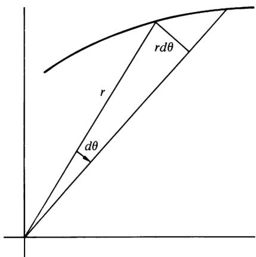

**Figure 2.** The area $dA=\tfrac12 r^2\,d\theta$ swept out by the radius vector in a time $dt$. The transverse displacement is $r\,d\theta$, perpendicular to the radial direction. (Goldstein, *Classical Mechanics*, Fig. 3.2.)

In a two-body problem the areal velocity refers to the relative coordinate; with $m\to\mu$ it becomes $\ell/(2\mu)$. Equivalently, the relative position vector sweeps out equal areas in equal times. The areas swept out by the two individual bodies about the center of mass are scaled by $(m_2/M)^2$ and $(m_1/M)^2$, respectively, so they are equal to each other only when $m_1=m_2$.

---

## 4. The Radial Equation and the Effective Potential

### 4.1 The Radial Equation

The Euler–Lagrange equation for $r$ is

$$
\frac{d}{dt}\left(m\dot r\right)-mr\dot\theta^2=-\frac{dV}{dr}=F(r).
$$

Using the conserved angular momentum relation $\ell=mr^2\dot\theta$ to eliminate $\dot\theta$, we obtain the **radial equation** (径向方程)

$$
m\ddot r-\frac{\ell^2}{mr^3}=F(r),
$$

or equivalently

$$
m\ddot r=F(r)+\frac{\ell^2}{mr^3}.
$$

The second term is not an additional physical force; it is the centrifugal term that remains after the angular motion has been eliminated.

The total energy is conserved because the force is conservative and the Lagrangian has no explicit time dependence:

$$
E=\frac12m\left(\dot r^2+r^2\dot\theta^2\right)+V(r)
=\frac12m\dot r^2+\frac{\ell^2}{2mr^2}+V(r).
$$

---

### 4.2 The Effective Potential

Define the **effective potential** (有效势能)

$$
\boxed{V_{\text{eff}}(r)=V(r)+\frac{\ell^2}{2mr^2}.}
$$

Then the radial equation becomes

$$
m\ddot r=-\frac{dV_{\text{eff}}}{dr},
$$

and the energy becomes

$$
E=\frac12m\dot r^2+V_{\text{eff}}(r).
$$

The radial motion is therefore exactly the motion of a one-dimensional particle of mass $m$ in the potential $V_{\text{eff}}(r)$, restricted to $r>0$. This is the **equivalent one-dimensional problem** (等效一维问题).

The extra term

$$
\frac{\ell^2}{2mr^2}=\frac12 m r^2\dot\theta^2
$$

is the angular part of the kinetic energy.

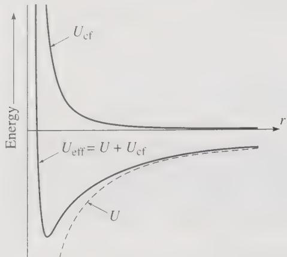

**Figure 3.** The effective potential $V_{\text{eff}}(r)=V(r)+\ell^2/(2mr^2)$ for an attractive inverse-square force, shown as the sum of the gravitational potential $V(r)$ and the centrifugal term $\ell^2/(2mr^2)$. At large $r$ the attraction dominates; at small $r$ the centrifugal barrier dominates. (Taylor, *Classical Mechanics*, Fig. 8.4.)

The extra term in the effective potential, **the angular-momentum barrier**, comes from the angular part of the kinetic energy; as the particles get close, **angular-momentum conservation forces the angular velocity to increase**, which raises the kinetic energy and prevents the particles from getting too close (**as the total energy is finite**).

The qualitative classification of orbits now follows from the shape of $V_{\text{eff}}$:

- **Turning points.** Radial motion is possible only where $E\ge V_{\text{eff}}(r)$. The roots $E=V_{\text{eff}}(r)$ are the turning points, where the velocity is zero $\dot r=0$.
- **Circular orbit.** If $E$ equals the value of $V_{\text{eff}}$ at an extremum $r_0$, then $r=r_0$ for all time.
- **Bound orbit.** If the allowed interval of $r$ is bounded, the particle oscillates between a minimum radius (periapsis, 近日点) and a maximum radius (apoapsis, 远日点).
- **Unbound orbit.** If $E$ exceeds the asymptotic value of $V_{\text{eff}}$ at infinity, the particle escapes to $r\to\infty$.
- **Radial fall.** If $\ell=0$, then $V_{\text{eff}}=V$ and the centrifugal barrier is absent; an attractive force can pull the particle through the origin.

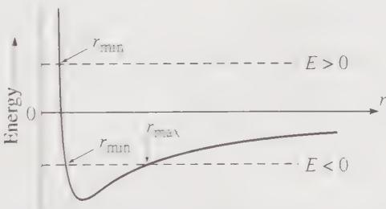

**Figure 4.** For a given energy $E$, radial motion is allowed only where $E\ge V_{\text{eff}}(r)$. For $E>0$ there is one turning point $r_{\min}$ (scattering orbit); for $E<0$ the motion is confined between $r_{\min}$ and $r_{\max}$ (bound orbit). (Taylor, *Classical Mechanics*, Fig. 8.5.)

> **Caution.** The effective potential is a bookkeeping device for the radial coordinate only. It does not replace the full two-dimensional motion. After solving $r(t)$, one must still reconstruct $\theta(t)$ from $\dot\theta=\ell/(mr^2)$.

---

### 4.3 Circular Orbits and Stability

A circular orbit at radius $r_0$ requires $\dot r=0$ and $\ddot r=0$. From the radial equation $m\ddot r=F(r)+\ell^2/(mr^3)$,

$$
F(r_0)+\frac{\ell^2}{mr_0^3}=0,
\qquad\text{that is}\qquad
\boxed{F(r_0)=-\frac{\ell^2}{mr_0^3}.}
$$

Equivalently, the applied force balances the centrifugal term. The energy of the circular orbit is

$$
E_0=V_{\text{eff}}(r_0)=V(r_0)+\frac{\ell^2}{2mr_0^2}.
$$

Goldstein obtains the same condition and calls it the elementary condition for a circular orbit: the applied central force provides the required centripetal acceleration (向心加速度) [Goldstein §3.3](/chapters/ch-19.html#b-p0242-b0004).

To test stability, expand $V_{\text{eff}}$ about $r_0$. The orbit is stable if $r_0$ is a minimum:

$$
\left.\frac{d^2V_{\text{eff}}}{dr^2}\right|_{r_0}>0.
$$

Since $V_{\text{eff}}'=-F-\ell^2/(mr^3)$ and $\ell^2/(mr_0^3)=-F(r_0)$, differentiating gives

$$
V_{\text{eff}}''(r)=-F'(r)+\frac{3\ell^2}{mr^4},
$$

and evaluating at $r=r_0$ gives

$$
V_{\text{eff}}''(r_0)=-F'(r_0)+\frac{3\ell^2}{mr_0^4}
=-F'(r_0)-\frac{3F(r_0)}{r_0}.
$$

Thus stability requires

$$
F'(r_0)<-\frac{3F(r_0)}{r_0}.
$$

For an attractive force $F(r_0)<0$, this can be written as

$$
\left.\frac{d\ln|F|}{d\ln r}\right|_{r_0}>-3.
$$

For the power law

$$
F(r)=-kr^n,
\qquad k>0,
$$

the condition becomes $n>-3$. A power-law attractive potential varying more slowly than $1/r^2$ is therefore capable of stable circular orbits [Goldstein §3.6](/chapters/ch-19.html#b-p0252-b0002).

For small radial oscillations about $r_0$, write $r=r_0+x$. Then

$$
m\ddot x=-V_{\text{eff}}''(r_0)\,x,
\qquad
\omega_r^2=\frac{V_{\text{eff}}''(r_0)}{m}.
$$

For the power law $F=-kr^n$, substituting $F'=-knr^{n-1}$ and $\ell^2=mkr_0^{n+3}$ into the expression for $V_{\text{eff}}''(r_0)$ gives

$$
V_{\text{eff}}''(r_0)=k(n+3)r_0^{n-1},
\qquad
\omega_r=\sqrt{\frac{k(n+3)r_0^{n-1}}{m}}.
$$

The angular momentum of the circular orbit is $\ell=\sqrt{mk}\,r_0^{(n+3)/2}$, so the angular velocity of the circular motion is

$$
\omega_\theta=\dot\theta=\frac{\ell}{mr_0^2}
=\sqrt{\frac{k}{m}}\,r_0^{(n-1)/2},
$$

and hence

$$
\frac{\omega_r}{\omega_\theta}=\sqrt{n+3}.
$$

The orbit is closed after one radial oscillation only if **$\omega_r/\omega_\theta$ is rational**; otherwise the successive pericenters precess. This observation is the seed of Bertrand's theorem in Section 7.

---

## 5. The Orbit Equation

### 5.1 Binet's Equation

For many purposes we want the shape of the orbit, $r(\theta)$, rather than $r(t)$. Use the angular-momentum relation to convert time derivatives into $\theta$ derivatives:

$$
\frac{d}{dt}=\dot\theta\frac{d}{d\theta}
=\frac{\ell}{mr^2}\frac{d}{d\theta}.
$$

Introduce the reciprocal radius

$$
u=\frac{1}{r}.
$$

It is easy to get $dr = -\frac{1}{u^2}du$.

Then
$$
\frac{dr}{d\theta}=-\frac{1}{u^2}\frac{du}{d\theta},
\qquad
\dot r=\frac{dr}{dt}
=\frac{\ell}{mr^2}\frac{dr}{d\theta}
=-\frac{\ell}{m}\frac{du}{d\theta}.
$$

Differentiating once more,

$$
\ddot r
=\frac{\ell}{mr^2}\frac{d}{d\theta}\left(-\frac{\ell}{m}\frac{du}{d\theta}\right)
=-\frac{\ell^2u^2}{m^2}\frac{d^2u}{d\theta^2}.
$$

Substitute this expression for $\ddot r$ and $r=1/u$ into the radial equation:

$$
-\frac{\ell^2u^2}{m}\frac{d^2u}{d\theta^2}
-\frac{\ell^2u^3}{m}=F\!\left(\frac1u\right).
$$

Multiplying by $-m/(\ell^2u^2)$ gives **Binet's equation** (比内方程)

$$
\boxed{\frac{d^2u}{d\theta^2}+u
=-\frac{m}{\ell^2u^2}F\!\left(\frac1u\right).}
$$

If the force is written as $F=-dV/dr$, an equivalent form is

$$
\frac{d^2u}{d\theta^2}+u
=-\frac{m}{\ell^2}\frac{d}{du}V\!\left(\frac1u\right).
$$

Goldstein obtains this second-order orbit equation after substituting $u=1/r$ and expressing the result in terms of the potential [Goldstein §3.5](/chapters/ch-19.html#b-p0249-b0005).

---

### 5.2 The First Integral of the Orbit

A first integral follows directly from energy conservation. Using $\dot r=-(\ell/m)\,du/d\theta$ and $r=1/u$ in the energy equation,

$$
E=\frac{\ell^2}{2m}\left(\frac{du}{d\theta}\right)^2
+\frac{\ell^2u^2}{2m}+V\!\left(\frac1u\right).
$$

Therefore

$$
\boxed{\left(\frac{du}{d\theta}\right)^2
=\frac{2mE}{\ell^2}-\frac{2m}{\ell^2}V\!\left(\frac1u\right)-u^2.}
$$

This is the orbit first integral. Turning points of the orbit occur where $du/d\theta=0$ (the radial kinetic energy is zero), that is, where $E=V_{\text{eff}}(r)$. The orbit equation is symmetric about two adjacent turning points: if $u(\theta)$ solves the first integral, so does $u(-\theta)$, so the orbit has the same shape on both sides of an apse (拱点，复数为apsis). Goldstein proves this symmetry and then integrates the first integral by quadrature [Goldstein §3.5](/chapters/ch-19.html#b-p0249-b0007).

---

## 6. The Kepler Problem

### 6.1 The Inverse-Square Force

The **Kepler problem** (开普勒问题) is the motion under an attractive inverse-square force:

$$
F(r)=-\frac{k}{r^2},
\qquad
V(r)=-\frac{k}{r},
\qquad k>0.
$$

Goldstein calls the inverse-square law the most important of all central-force laws and treats it in detail [Goldstein §3.7](/chapters/ch-19.html#b-p0254-b0008). With $F=-ku^2$, Binet's equation becomes

$$
\frac{d^2u}{d\theta^2}+u=\frac{mk}{\ell^2}.
$$

This is a harmonic oscillator equation with a constant displacement. Its general solution is

$$
u(\theta)=\frac{mk}{\ell^2}\left[1+e\cos(\theta-\theta')\right],
$$

where $e\ge0$ and $\theta'$ are constants of integration. 

>Let $C=\frac{mk}{\ell^2}.$ Binet's equation becomes
>\[
>\frac{d^2u}{d\theta^2}+u=C.
>\]
>A constant solution is $u=C$: its second derivative is zero, so it satisfies the equation.
>
>Now write $u(\theta)=C+v(\theta).$
>
>Substituting gives $\frac{d^2v}{d\theta^2}+C+v=C,$
>
>and therefore
>\[
>\frac{d^2v}{d\theta^2}+v=0
>\]
>This is the harmonic oscillator equation, whose general solution is $v(\theta)=A\cos\theta+B\sin\theta.$
>
>Thus, $u(\theta)=C+A\cos\theta+B\sin\theta.$
>
>Here the “oscillation” is **with respect to the angle $\theta$**, not necessarily with respect to time.
>
>Any combination $A\cos\theta+B\sin\theta$ can be written as a single shifted cosine: $A\cos\theta+B\sin\theta =D\cos(\theta-\theta'),$
>
>because $D\cos(\theta-\theta') =D\cos\theta'\cos\theta+D\sin\theta'\sin\theta.$
>
>So $A=D\cos\theta'$ and $B=D\sin\theta'$. Defining the dimensionless amplitude $e=D/C$, we obtain
>\[
>\boxed{ u(\theta)=\frac{mk}{\ell^2} \left[1+e\cos(\theta-\theta')\right]. }
>\]
>The two arbitrary constants are now $e$ and $\theta'$, instead of $A$ and $B$.
>
>

In terms of $r=1/u$,

$$
\boxed{r(\theta)=\frac{p}{1+e\cos(\theta-\theta')},
\qquad
p=\frac{\ell^2}{mk}.}
$$

The constant $p$ is the **semi-latus rectum** (半通径) and $e$ is the **eccentricity** (偏心率). The angle $\theta'$ orients the orbit; choosing $\theta'=0$ places periapsis (近拱点) at $\theta=0$.

>Assume $\theta'=0$. The distances from the focus to the two ends of the ellipse are
>
>$r(0)=\frac{p}{1+e}=a-c,\qquad r(\pi)=\frac{p}{1-e}=a+c.$
>
>Here, $r(0)$ is the **periapsis** (近拱点), the closest point to the focus, and $r(\pi)$ is the **apoapsis** (远拱点), the farthest point from the focus. $a$ is the **semi-major axis** of the ellipse. It is half of the longest width of the ellipse, measured from the center to either end along the major axis. $c$ is the **focal distance**. It is the distance from the center of the ellipse to one focus.
>
>Thus the geometric eccentricity is
>
>$\boxed{\frac{c}{a} =\frac{r(\pi)-r(0)}{r(\pi)+r(0)} =e.}$
>
>Meanwhile, $r(\pi/2)=p$ is the distance perpendicular to the major axis **from the focus**, not the center, so it is not $b$.

> This is an **ellipse provided $0\le e<1$ and $p>0$**. Here, $e$ is the *eccentricity*, and $\theta'$ just rotates the curve.
>
> Measure the angle from the direction $\theta'$, setting $\phi=\theta-\theta',\qquad x=r\cos\phi,\qquad y=r\sin\phi.$
>
> Then $r=\sqrt{x^2+y^2}$, so
> \[
> r=\frac{p}{1+e\cos\phi} \quad\Longrightarrow\quad r+ex=p.
> \]
>
> $$
> \sqrt{x^2+y^2}=p-ex.
> $$
>
> Squaring and rearranging gives $(1-e^2)x^2+y^2+2pex=p^2.$
>
> For $e<1$, completing the square yields
> \[
> (1-e^2)\left(x+\frac{pe}{1-e^2}\right)^2+y^2 =\frac{p^2}{1-e^2}.
> \]
> Dividing through,
> \[
> \boxed{ \frac{\left(x+\dfrac{pe}{1-e^2}\right)^2} {\left(\dfrac{p}{1-e^2}\right)^2} + \frac{y^2}{\dfrac{p^2}{1-e^2}} =1. }
> \]
> This is exactly the standard equation of an ellipse,
> \[
> \frac{(x-x_c)^2}{a^2}+\frac{y^2}{b^2}=1,
> \]
> with $a=\frac{p}{1-e^2}, \qquad b=\frac{p}{\sqrt{1-e^2}}, \qquad x_c=-\frac{pe}{1-e^2}=-ae.$
>
> An ellipse has the property that the sum of the distances from any point on it to the two foci is $2a$.
>
> The two foci lie on the horizontal major axis, at $(-c,0)$ and $(c,0)$.
>
> At the top point $(0,b)$, both distances are $\sqrt{c^2+b^2}$. Therefore,
>
> $2\sqrt{c^2+b^2}=2a \quad\Longrightarrow\quad c^2=a^2-b^2.$
>
> The distance from the center to either focus is
>
> $c^2=a^2-b^2=\frac{p^2e^2}{(1-e^2)^2} =a^2e^2$
>
> It is now easy to see $e$ is the **eccentricity** (偏心率).
>
> Since the center is at $(-ae,0)$, one focus is at $(-ae+c,0)=(0,0).$
>
> So **the polar origin is a focus, not the center**. 

---

### 6.2 Conic Sections and Eccentricity

The orbit equation is the polar equation of a **conic section** (圆锥曲线) with one focus at the force center. The dimensionless constant $e$ is the **eccentricity** (偏心率). Goldstein compares the integrated orbit with the general conic equation and concludes that the orbit is always a conic section [Goldstein §3.7](/chapters/ch-19.html#b-p0256-b0006).

To relate $e$ to the energy, evaluate the energy at periapsis, where $\dot r=0$ and $u=u_{\max}$. With $du/d\theta=0$ (the radial kinetic energy is zero),

$$
E=-\frac{k}{r}+\frac{\ell^2}{2mr^2}=-ku + \frac{\ell^2u^2}{2m}.
$$

At periapsis, the orbit equation gives $u_{\max}=(mk/\ell^2)(1+e)$. Substituting $u_{\max}$ into the energy and simplifying,

$$
E=\frac{mk^2}{2\ell^2}\left(e^2-1\right).
$$

Therefore

$$
\boxed{e=\sqrt{1+\frac{2E\ell^2}{mk^2}}.}
$$

The classification of orbits follows:

| Eccentricity | Energy | Orbit |
|---|---|---|
| $e>1$ | $E>0$ | hyperbola (双曲线) |
| $e=1$ | $E=0$ | parabola (抛物线) |
| $0<e<1$ | $E<0$ | ellipse (椭圆) |
| $e=0$ | $E=-\dfrac{mk^2}{2\ell^2}$ | circle (圆) |

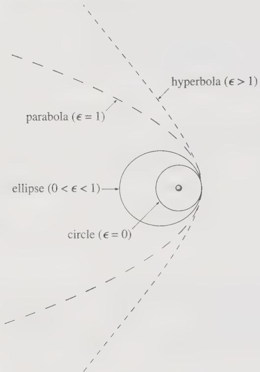

**Figure 5.** The four classes of Kepler orbit: circle ($e=0$), ellipse ($0<e<1$), parabola ($e=1$), and hyperbola ($e>1$). The four orbits are drawn with the same periapsis distance and the same direction of closest approach. (Taylor, *Classical Mechanics*, Fig. 8.11.)

The circular case is the minimum of the effective potential for fixed $\ell$; its radius is

$$
r_0=\frac{\ell^2}{mk},
$$

obtained from the circular-orbit condition with $F=-k/r^2$.

---

### 6.3 Energy, Semimajor Axis, and the Vis-Viva Equation

For the bound ellipse, the semimajor axis $a$ is fixed by the energy alone:

$$
\boxed{a=-\frac{k}{2E}}.
$$

**Derivation from the turning points.** At either apsis, $\dot r=0$, so the radial kinetic energy vanishes. Substituting $du/d\theta=0$ and $V(1/u)=-ku$ into the orbit first integral of Section 5.2,
$$
\left(\frac{du}{d\theta}\right)^2
=\frac{2mE}{\ell^2}-\frac{2m}{\ell^2}V\!\left(\frac1u\right)-u^2,
$$

leaves

$$
E=\frac{\ell^2u^2}{2m}-ku.
$$

Rearranging this as a quadratic equation in $u$,

$$
u^2-\frac{2mk}{\ell^2}u-\frac{2mE}{\ell^2}=0.
$$

Its two roots are the reciprocal distances at the two apsides, $u_1=1/r_{\min}$ and $u_2=1/r_{\max}$. By Vieta's formulas (韦达定理),

$$
u_1+u_2=\frac{2mk}{\ell^2},
\qquad
u_1u_2=-\frac{2mE}{\ell^2}.
$$

>For a quadratic equation
>
>$ax^2+bx+c=0$
>
>with roots $r_1$ and $r_2$, **Vieta’s formulas** say
>
>$r_1+r_2=-\frac{b}{a},\qquad r_1r_2=\frac{c}{a}.$
>
>
>

Because $u=1/r$, the sum of the apsidal distances is

$$
r_{\min}+r_{\max}
=\frac{1}{u_1}+\frac{1}{u_2}
=\frac{u_1+u_2}{u_1u_2}
=-\frac{k}{E}.
$$

From the geometry of Section 6.1, the focus lies between the two ends of the major axis at distances $a-c$ and $a+c$, so $r_{\min}+r_{\max}=2a$. Therefore

$$
2a=-\frac{k}{E}
\quad\Longrightarrow\quad
a=-\frac{k}{2E}.
$$

Since $a>0$ and $k>0$, this relation also shows that a bound ellipse requires $E<0$. The product of the roots gives the eccentricity as a by-product: from the orbit equation the roots are $u_1=(mk/\ell^2)(1+e)$ and $u_2=(mk/\ell^2)(1-e)$, so

$$
u_1u_2=\left(\frac{mk}{\ell^2}\right)^2(1-e^2)
=-\frac{2mE}{\ell^2}
\quad\Longrightarrow\quad
e=\sqrt{1+\frac{2E\ell^2}{mk^2}},
$$

in agreement with Section 6.2. Goldstein derives $a=-k/(2E)$ from the same turning-point equation [Goldstein §3.7](/chapters/ch-19.html#b-p0257-b0008).

**Derivation from the ellipse geometry.** With $\theta'=0$ in the orbit equation, the apsidal distances are

$$
r_{\min}=\frac{p}{1+e},
\qquad
r_{\max}=\frac{p}{1-e}.
$$

Their sum is the major axis $2a$:

$$
2a=r_{\min}+r_{\max}
=\frac{p}{1+e}+\frac{p}{1-e}
=\frac{2p}{1-e^2},
$$

hence

$$
a=\frac{p}{1-e^2}.
$$

Now substitute $p=\ell^2/(mk)$ and $e^2=1+2E\ell^2/(mk^2)$:

$$
a=\frac{\ell^2/(mk)}{1-\left(1+\dfrac{2E\ell^2}{mk^2}\right)}
=\frac{\ell^2/(mk)}{-\dfrac{2E\ell^2}{mk^2}}
=-\frac{k}{2E}.
$$

The two routes give the same result. Either way, we can now write the eccentricity in terms of $a$ by rearranging $a=p/(1-e^2)$:

$$
e=\sqrt{1-\frac{\ell^2}{mka}}.
$$

This is equivalent to $e^2=1+2E\ell^2/(mk^2)$ once $a=-k/(2E)$ is substituted. 

Rearranging $p=a(1-e^2)$ with $p=\ell^2/(mk)$ gives the useful combination
$$
\frac{\ell^2}{mk}=a(1-e^2),
$$

so the orbit equation becomes

$$
r(\theta)=\frac{a(1-e^2)}{1+e\cos(\theta-\theta')}.
$$

At periapsis and apoapsis,

$$
r_{\min}=a(1-e),
\qquad
r_{\max}=a(1+e).
$$

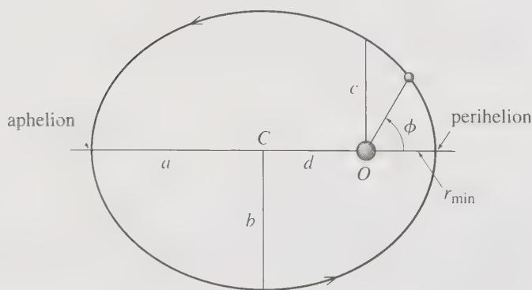

**Figure 6.** A bound Kepler orbit is an ellipse with the force center at one focus $O$, not at the geometric center $C$. Here $a$ and $b$ are the semimajor and semiminor axes, the semi-latus rectum $p=\ell^2/(mk)$ is the value of $r$ at $\phi=90^\circ$, and $r_{\min}=a(1-e)$, $r_{\max}=a(1+e)$ are the periapsis and apoapsis distances. (Taylor, *Classical Mechanics*, Fig. 8.10.)

The **vis-viva equation** (活力公式) follows from energy conservation. Since $E=\frac12mv^2-k/r$ and $E=-k/(2a)$,

$$
\frac12mv^2-\frac{k}{r}=-\frac{k}{2a},
$$

hence

$$
\boxed{v^2=\frac{k}{m}\left(\frac{2}{r}-\frac{1}{a}\right).}
$$

For a planet of negligible mass orbiting a star of mass $M_\star$, $k/m=GM_\star$, and the vis-viva equation becomes the familiar $v^2=GM_\star(2/r-1/a)$.

The **vis-viva equation** gives the speed of an object at any point along its orbit. It shows that the speed depends only on the object’s current distance $r$ from the central body and the semi-major axis $a$ of the orbit. When the object is closer to the central body, it moves faster; when it is farther away, it moves slower. Thus, the equation is a quick way to compute orbital speed without solving the full orbit.

---

### 6.4 Kepler's Third Law

The orbital period is the time required to sweep out the area of the ellipse at the constant areal velocity $\ell/(2m)$:

$$
\tau=\frac{2m}{\ell}A.
$$

The area of an ellipse is $A=\pi ab$, with $b=a\sqrt{1-e^2}$. Using $\ell^2/(mk)=a(1-e^2)$,

$$
A=\pi a^{3/2}\sqrt{\frac{\ell^2}{mk}}.
$$

Therefore

$$
\boxed{\tau^2=\frac{4\pi^2m}{k}a^3.}
$$

Goldstein obtains the same result by integrating the radial equation [Goldstein §3.8](/chapters/ch-19.html#b-p0261-b0015) and states that the square of the period is proportional to the cube of the major axis [Goldstein §3.8](/chapters/ch-19.html#b-p0263-b0002).

For the gravitational two-body problem, restore $m\to\mu$ and $k=Gm_1m_2$. Then

$$
\tau^2=\frac{4\pi^2\mu a^3}{Gm_1m_2}
=\frac{4\pi^2a^3}{G(m_1+m_2)}.
$$

When $m_2\gg m_1$, this reduces to $\tau^2\approx4\pi^2a^3/(Gm_2)$, which is the usual form of Kepler's third law for planets around the Sun. Goldstein emphasizes that the exact two-body version requires the reduced mass [Goldstein §3.8](/chapters/ch-19.html#b-p0263-b0002).

---

### 6.5 The Laplace–Runge–Lenz Vector

The Kepler problem has an additional conserved vector beyond $\mathbf L$ and $E$. Define the **Laplace–Runge–Lenz vector** (拉普拉斯–龙格–楞次矢量)

$$
\boxed{\mathbf A=\mathbf p\times\mathbf L-mk\,\hat{\mathbf r}.}
$$

For the inverse-square force, $\mathbf A$ is constant. To see this, start from

$$
\dot{\mathbf p}=F(r)\hat{\mathbf r}=-\frac{k}{r^2}\hat{\mathbf r}.
$$

Since $\mathbf L$ is constant,

$$
\frac{d}{dt}\left(\mathbf p\times\mathbf L\right)
=\dot{\mathbf p}\times\mathbf L
=-\frac{k}{r^2}\hat{\mathbf r}\times\mathbf L.
$$

Using $\mathbf L=m\mathbf r\times\dot{\mathbf r}$ and the vector identity for $\hat{\mathbf r}\times(\mathbf r\times\dot{\mathbf r})$, one finds

$$
\frac{d}{dt}\left(\mathbf p\times\mathbf L\right)
=mk\frac{d\hat{\mathbf r}}{dt}.
$$

Hence the right-hand side of the definition of $\mathbf A$ has zero time derivative, so $\mathbf A$ is conserved. Goldstein carries out this algebra explicitly [Goldstein §3.9](/chapters/ch-19.html#b-p0265-b0005).

> Use the vector triple product identity
>
> $\mathbf A\times(\mathbf B\times \mathbf C) = \mathbf B(\mathbf A\cdot \mathbf C) - \mathbf C(\mathbf A\cdot \mathbf B).$
>
> Here take
>
> $\mathbf A=\hat{\mathbf r},\qquad \mathbf B=\mathbf r,\qquad \mathbf C=\dot{\mathbf r}.$
>
> Then
>
> $\hat{\mathbf r}\times(\mathbf r\times \dot{\mathbf r}) = \mathbf r(\hat{\mathbf r}\cdot \dot{\mathbf r}) - \dot{\mathbf r}(\hat{\mathbf r}\cdot \mathbf r).$
>
> Now use $\mathbf r=r\hat{\mathbf r},$ $\hat{\mathbf r}\cdot \mathbf r=r,$ and $\hat{\mathbf r}\cdot \dot{\mathbf r}=\dot r.$
>
> Therefore, $\hat{\mathbf r}\times(\mathbf r\times \dot{\mathbf r}) = \mathbf r \dot r-r\dot{\mathbf r}.$
>
> Since $\mathbf r=r\hat{\mathbf r}$, $\mathbf r \dot r = r\dot r\,\hat{\mathbf r}.$
>
> Also, $\dot{\mathbf r} = \dot r\,\hat{\mathbf r}+r\dot{\hat{\mathbf r}}.$
>
> Thus, $r\dot{\mathbf r} = r\dot r\,\hat{\mathbf r}+r^2\dot{\hat{\mathbf r}}.$
>
> So $\mathbf r\dot r-r\dot{\mathbf r} = r\dot r\,\hat{\mathbf r} - \left(r\dot r\,\hat{\mathbf r}+r^2\dot{\hat{\mathbf r}}\right).$
>
> Hence $\hat{\mathbf r}\times(\mathbf r\times \dot{\mathbf r}) = -r^2\dot{\hat{\mathbf r}}.$
>
> Now substitute this into the expression: $-\frac{k}{r^2}\hat{\mathbf r}\times \mathbf L = -\frac{k}{r^2}\hat{\mathbf r}\times \left(m\mathbf r\times\dot{\mathbf r}\right).$
>
> So $-\frac{k}{r^2}\hat{\mathbf r}\times \mathbf L = -\frac{mk}{r^2} \left[ \hat{\mathbf r}\times(\mathbf r\times\dot{\mathbf r}) \right].$
>
> Using the result above, $-\frac{mk}{r^2} \left(-r^2\dot{\hat{\mathbf r}}\right) = mk\dot{\hat{\mathbf r}}.$
>
> Therefore,
>
> $\boxed{ \frac{d}{dt}\left(\mathbf p\times\mathbf L\right) = mk\frac{d\hat{\mathbf r}}{dt} }.$

Two properties of $\mathbf A$ are important:

1. $\mathbf A\cdot\mathbf L=0$, so $\mathbf A$ lies in the orbital plane.
2. Its magnitude is $|\mathbf A|=mk e$; it points toward periapsis.

Thus the LRL vector encodes both the orientation and the eccentricity of the Kepler ellipse. It exists only for the inverse-square force; a general central force does not possess such an algebraic conserved vector. This extra symmetry is the deeper reason why Kepler orbits close.  In simple words, **the Laplace–Runge–Lenz vector tells us where the ellipse points and how stretched it is**.

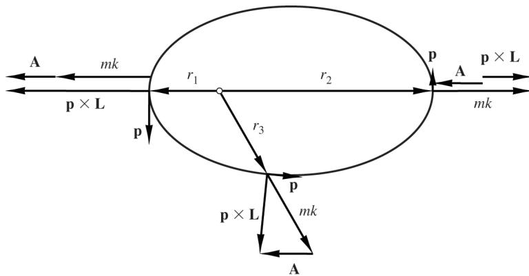

**Figure 7.** The vectors $\mathbf p$, $\mathbf L$, and $\mathbf A$ at three positions on a Kepler orbit. The LRL vector $\mathbf A$ always points in the same direction (toward periapsis) and has magnitude $mk e$; at perihelion $|\mathbf p\times\mathbf L|=mk(1+e)$ and at aphelion $|\mathbf p\times\mathbf L|=mk(1-e)$. (Goldstein, *Classical Mechanics*, Fig. 3.18.)

---

## 7. Bertrand's Theorem and Closed Orbits

A **closed orbit** (闭轨道) is one that eventually retraces its own path. Circular orbits are trivially closed. The nontrivial question is: for which central forces are *all* bound orbits closed?

Goldstein frames the problem exactly this way: it is possible to derive a theorem on the types of attractive central forces that lead to closed orbits, that is, orbits in which the particle eventually retraces its own footsteps [Goldstein §3.6](/chapters/ch-19.html#b-p0251-b0003). The answer is **Bertrand's theorem** (贝特朗定理):

> **Bertrand's theorem.** The only central forces that result in closed orbits for all bound particles are the inverse-square law and Hooke's law.

Goldstein states the theorem in precisely this form [Goldstein §3.6](/chapters/ch-19.html#b-p0254-b0004).

For the power-law family $F=-kr^n$, the two cases are:

- $n=-2$: the inverse-square law, $F=-k/r^2$.
- $n=1$: Hooke's law, $F=-kr$.

The inverse-square orbits are ellipses with the force center at a focus. The Hooke-law orbits are ellipses with the force center at the center of the ellipse. Both families are closed for all bound energies.

The near-circular analysis of Section 4.3 explains the mechanism. For a power law, the radial and angular frequencies satisfy $\omega_r/\omega_\theta=\sqrt{n+3}$. A near-circular orbit closes only when this ratio is rational, and the apsidal angle is

$$
\Delta\theta_{\text{apse}}=\frac{\pi}{\sqrt{n+3}}.
$$

The angular advance between successive pericenters is $\pi/\sqrt{n+3}$, so the precession per radial cycle, measured relative to $2\pi$, is

$$
\Delta\theta_{\text{prec}}=2\pi\left(\frac{1}{\sqrt{n+3}}-1\right).
$$

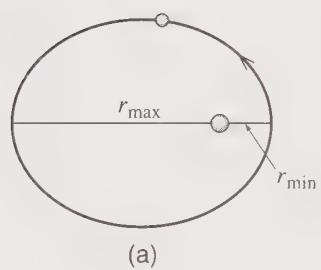

**Figure 8(a).** For any inverse-square force, $r$ returns from $r_{\min}$ to $r_{\max}$ and back to $r_{\min}$ in exactly the time required for the angle to advance by $360^\circ$, so the orbit closes after one revolution. (Taylor, *Classical Mechanics*, Fig. 8.7a.)

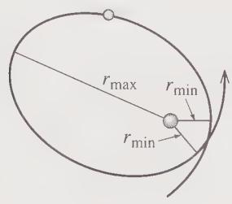

**Figure 8(b).** For a general central force the radial period differs from the angular period, so the orbit does not close after one revolution; here the radial cycle repeats while the angle advances by about $330^\circ$. (Taylor, *Classical Mechanics*, Fig. 8.7b.)

The orbit closes after a finite number of radial cycles exactly when $\sqrt{n+3}$ is rational. For $n=-2$, $\sqrt{n+3}=1$ and the apsidal angle is $\pi$: the orbit closes after one revolution. For $n=1$, $\sqrt{n+3}=2$ and the apsidal angle is $\pi/2$: the orbit closes after two radial cycles, which is the familiar centered ellipse of the isotropic oscillator. In both Bertrand cases the net precession over the full closed cycle is zero.

> **Limits of the statement.** Bertrand's theorem concerns attractive, analytic central forces and *all* bound orbits. A particular near-circular orbit can be closed for a rational frequency ratio even when the force law is not one of the two Bertrand cases. The theorem does not say that every individual orbit of every other force law is open; it says that the force law cannot make *all* bound orbits closed.

---

## 8. Scattering in a Central Field

### 8.1 Impact Parameter and Deflection Angle

In a scattering problem a particle comes in from infinity with speed $v_0$ and **impact parameter** (碰撞参数) $b$, the perpendicular distance between the initial velocity line and the force center. Its energy and angular momentum are

$$
E=\frac12mv_0^2,
\qquad
\ell=mv_0b=b\sqrt{2mE}.
$$

Goldstein defines the impact parameter in this way and writes $\ell=mv_0s$, using $s$ for the impact parameter [Goldstein §3.10](/chapters/ch-19.html#b-p0269-b0003). We use $b$ here and note that Goldstein's $s$ is the same quantity.

For a repulsive central potential, the particle reaches a distance of closest approach $r_m$ and then recedes. The angle between the incoming and outgoing asymptotes is the **scattering angle** (散射角) $\Theta$. Goldstein writes

$$
\Theta=\pi-2\Psi,
$$

where

$$
\Psi=\int_{r_m}^{\infty}
\frac{dr}{r^2\sqrt{\dfrac{2mE}{\ell^2}-\dfrac{2mV}{\ell^2}-\dfrac{1}{r^2}}}.
$$

In terms of the impact parameter,

$$
\Theta(b)=\pi-2\int_{r_m}^{\infty}
\frac{b\,dr}{r\sqrt{r^2\left(1-\dfrac{V(r)}{E}\right)-b^2}}.
$$

Goldstein gives these expressions [Goldstein §3.10](/chapters/ch-19.html#b-p0270-b0008). The closest-approach radius $r_m$ is the relevant root of

$$
E=V_{\text{eff}}(r_m)=V(r_m)+\frac{\ell^2}{2mr_m^2}.
$$

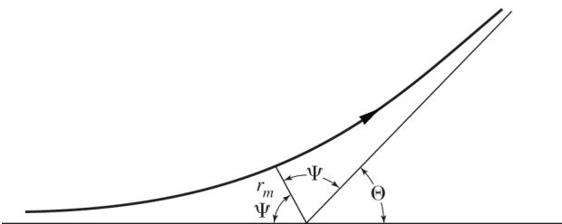

**Figure 9.** Geometry of repulsive scattering. The particle approaches from infinity, reaches the distance of closest approach $r_m$, and recedes. The angle $\Psi$ is measured between $r_m$ and the symmetry axis, and the scattering angle is $\Theta=\pi-2\Psi$. (Goldstein, *Classical Mechanics*, Fig. 3.20.)

For an attractive potential, the same formulas apply with the sign of $V$ reversed, but additional phenomena such as orbiting and glory scattering can occur.

---

### 8.2 The Differential Cross Section and Rutherford Scattering

Let $I$ be the incident flux (particles per unit area per unit time). The number of particles scattered into a solid angle $d\Omega$ per unit time is $I\,\sigma(\Theta)\,d\Omega$, where $\sigma(\Theta)$ is the **differential cross section** (微分散射截面). Since particles with impact parameters between $b$ and $b+db$ scatter into angles between $\Theta$ and $\Theta+d\Theta$,

$$
2\pi I b\,|db|=2\pi I\,\sigma(\Theta)\sin\Theta\,|d\Theta|.
$$

Hence

$$
\boxed{\sigma(\Theta)=\frac{b}{\sin\Theta}\left|\frac{db}{d\Theta}\right|.}
$$

Goldstein derives this relation from the conservation of particle number [Goldstein §3.10](/chapters/ch-19.html#b-p0269-b0005).

For the repulsive Coulomb problem,

$$
F(r)=\frac{\kappa}{r^2},
\qquad
V(r)=\frac{\kappa}{r},
\qquad \kappa>0,
$$

where $\kappa=ZZ'e^2$ in Gaussian units, or $\kappa=ZZ'e^2/(4\pi\varepsilon_0)$ in SI units. The orbit is a hyperbola with eccentricity

$$
e=\sqrt{1+\left(\frac{2Eb}{\kappa}\right)^2},
$$

and the scattering angle satisfies

$$
\sin\frac{\Theta}{2}=\frac{1}{e}.
$$

Combining these two relations gives

$$
\boxed{b=\frac{\kappa}{2E}\cot\frac{\Theta}{2}.}
$$

Then

$$
\left|\frac{db}{d\Theta}\right|
=\frac{\kappa}{4E}\csc^2\frac{\Theta}{2},
$$

and substituting into the cross-section formula yields the **Rutherford scattering cross section** (卢瑟福散射截面):

$$
\boxed{\sigma(\Theta)=\left(\frac{\kappa}{4E}\right)^2
\csc^4\frac{\Theta}{2}.}
$$

Goldstein derives this famous result and notes that the nonrelativistic quantum-mechanical cross section is identical to the classical one [Goldstein §3.10](/chapters/ch-19.html#b-p0272-b0003).

Several features deserve comment:

- The cross section is strongly forward-peaked: $\sigma\to\infty$ as $\Theta\to0$.
- The total cross section $\sigma_T=\int\sigma(\Theta)\,d\Omega$ diverges for a pure Coulomb potential [Goldstein §3.10](/chapters/ch-19.html#b-p0272-b0006). In a physical plasma or solid, screening cuts off the potential at large distances and makes $\sigma_T$ finite.
- At $\Theta=\pi$ (backscattering), $b=0$: a head-on collision reverses the particle.
- For a given energy, the deflection at $90^\circ$ occurs at $b=\kappa/(2E)$.

Goldstein also discusses attractive scattering, where the effective potential can produce orbiting and non-monotonic deflection; in those cases several impact parameters may lead to the same scattering angle, and the cross section must be summed over branches [Goldstein §3.10](/chapters/ch-19.html#b-p0275-b0002) [Goldstein §3.10](/chapters/ch-19.html#b-p0275-b0005).

---

## 10. Worked Examples

The following examples are **self-authored** (自编例题). They are not taken from the reference books, although they use the general results derived above.

### 10.1 A Tangential Impulse from a Circular Orbit

A particle of mass $m$ moves in a circular orbit of radius $r_0$ under an attractive inverse-square force $F=-k/r^2$. At one instant a tangential impulse changes its speed from the circular value $v_c$ to $v=\alpha v_c$, without changing its position or the direction of its velocity.

**Step 1: Circular speed.** From the circular-orbit condition with $F=-k/r_0^2$,

$$
\frac{k}{r_0^2}=\frac{\ell_c^2}{mr_0^3}
\quad\Longrightarrow\quad
\ell_c^2=mkr_0,
\qquad
v_c=\frac{\ell_c}{mr_0}=\sqrt{\frac{k}{mr_0}}.
$$

**Step 2: New constants.** After the impulse, the radius is still $r_0$ and the radial velocity is still zero, but

$$
\ell=\alpha\ell_c=\alpha\sqrt{mkr_0},
\qquad
E=\frac12m\alpha^2v_c^2-\frac{k}{r_0}
=\frac{k}{2r_0}\left(\alpha^2-2\right).
$$

**Step 3: Semimajor axis.** From the energy–semimajor-axis relation $a=-k/(2E)$,

$$
a=-\frac{k}{2E}=\frac{r_0}{2-\alpha^2}.
$$

**Step 4: Eccentricity.** Using the eccentricity–energy relation,

$$
e^2=1+\frac{2E\ell^2}{mk^2}
=1+\alpha^2\left(\alpha^2-2\right)
=\left(1-\alpha^2\right)^2,
$$

so

$$
\boxed{e=\left|1-\alpha^2\right|.}
$$

**Step 5: Interpretation.**

- If $\alpha=1$, then $e=0$: the orbit remains circular.
- If $0<\alpha<1$, the speed is reduced, the burn point becomes the apoapsis, and $e=1-\alpha^2$. The orbit is an ellipse with $r_{\max}=r_0$.
- If $1<\alpha<\sqrt2$, the speed is increased but the energy is still negative; the burn point becomes the periapsis, and $e=\alpha^2-1$. The orbit is an ellipse with $r_{\min}=r_0$.
- If $\alpha=\sqrt2$, then $E=0$ and $e=1$: the orbit is a parabola.
- If $\alpha>\sqrt2$, then $E>0$ and $e>1$: the orbit is a hyperbola.

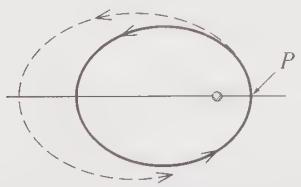

**Figure 10(a).** Changing a circular orbit by a forward tangential impulse at $P$: the speed increases, $P$ remains the periapsis, and the new orbit is a larger ellipse drawn dashed outside the original solid orbit. (Taylor, *Classical Mechanics*, Fig. 8.12a.)

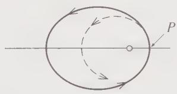

**Figure 10(b).** A backward tangential impulse at $P$: the speed decreases and the new orbit is a smaller ellipse drawn dashed inside the original orbit. For the right impulse the new orbit becomes circular; a still stronger backward impulse makes $P$ the apoapsis. (Taylor, *Classical Mechanics*, Fig. 8.12b.)

**Checks.** At $\alpha=1$, the semimajor axis is $a=r_0$ and the eccentricity is $e=0$, consistent with the original circle. At $\alpha\to\sqrt2$, $a\to\infty$ and $e\to1$, consistent with the parabolic threshold. The periapsis and apoapsis formulas reproduce $r_0$ in both the $\alpha<1$ and $\alpha>1$ cases, as they must because the burn point is a turning point.

---

### 10.2 Circular Orbits in a Power-Law Potential

Consider the attractive power-law force

$$
F(r)=-kr^n,
\qquad k>0,
\qquad n\ne-1.
$$

Its potential, with the zero chosen at infinity when $n<-1$, is

$$
V(r)=\frac{k}{n+1}r^{n+1}.
$$

**Step 1: Circular radius.** The circular-orbit condition gives

$$
kr_0^n=\frac{\ell^2}{mr_0^3}
\quad\Longrightarrow\quad
\boxed{\ell^2=mkr_0^{n+3}.}
$$

**Step 2: Energy.** Substituting the circular-orbit angular momentum into the energy of the circular orbit,

$$
E=\frac{k}{n+1}r_0^{n+1}+\frac{k}{2}r_0^{n+1}
=\boxed{\frac{k(n+3)}{2(n+1)}r_0^{n+1}.}
$$

**Step 3: Stability.** From the stability condition $n>-3$, the orbit is stable for $n>-3$. The second derivative of the effective potential is

$$
V_{\text{eff}}''(r_0)=k(n+3)r_0^{n-1}.
$$

**Step 4: Frequencies.** The radial and angular frequencies are

$$
\omega_r^2=\frac{k(n+3)r_0^{n-1}}{m},
\qquad
\omega_\theta^2=\frac{k}{m}r_0^{n-1},
\qquad
\frac{\omega_r}{\omega_\theta}=\sqrt{n+3}.
$$

**Step 5: Special cases.**

- **Inverse-square law, $n=-2$.** Then $\ell^2=mkr_0$, $E=-k/(2r_0)$, and $\omega_r/\omega_\theta=1$. The circular orbit is stable, and the near-circular orbit closes after one revolution.
- **Hooke's law, $n=1$.** Then $\ell^2=mkr_0^4$, $E=kr_0^2$, and $\omega_r/\omega_\theta=2$. The near-circular orbit closes after two radial oscillations, corresponding to the centered ellipse.
- **Constant force, $n=0$.** Then $\ell^2=mkr_0^3$, $E=3kr_0/2$, and $\omega_r/\omega_\theta=\sqrt3$. The ratio is irrational, so near-circular orbits do not close; the pericenters precess.

**Checks.** For $n=-2$, the circular energy is $E=-k/(2r_0)$, in agreement with $a=r_0$ for a circular orbit. For $n=1$, the potential is $V=\frac12kr^2$ and the circular energy is $E=kr_0^2$, which equals $V(r_0)+\frac12mv_\theta^2$ because the kinetic and potential contributions are equal for a circular Hooke orbit.

---

## 12. Summary

The central-force problem is solvable because two conservation laws reduce it to one effective dimension.

- **Two-body reduction.** An isolated pair with a mutual central potential reduces to a one-body problem with the reduced mass $\mu=m_1m_2/(m_1+m_2)$:
  $$
  \mu\ddot{\mathbf r}=F(r)\hat{\mathbf r}.
  $$
- **Angular momentum.** A central force exerts no torque about the force center, so
  $$
  \boxed{\mathbf L=\mathbf r\times\mathbf p=\text{constant}.}
  $$
  The motion is planar, and the areal velocity is constant:
  $$
  \boxed{\frac{dA}{dt}=\frac{\ell}{2m}.}
  $$
- **Effective potential.** The radial motion is one-dimensional:
  $$
  \boxed{V_{\text{eff}}(r)=V(r)+\frac{\ell^2}{2mr^2},
  \qquad
  m\ddot r=-\frac{dV_{\text{eff}}}{dr}.}
  $$
- **Orbit equation.** With $u=1/r$,
  $$
  \boxed{\frac{d^2u}{d\theta^2}+u
  =-\frac{m}{\ell^2u^2}F\!\left(\frac1u\right).}
  $$
- **Kepler orbits.** For $F=-k/r^2$,
  $$
  \boxed{r=\frac{p}{1+e\cos(\theta-\theta')},
  \qquad
  p=\frac{\ell^2}{mk},
  \qquad
  e=\sqrt{1+\frac{2E\ell^2}{mk^2}}.}
  $$
  The orbit is an ellipse for $E<0$, a parabola for $E=0$, and a hyperbola for $E>0$.
- **Energy and period.** For the ellipse,
  $$
  \boxed{a=-\frac{k}{2E},
  \qquad
  v^2=\frac{k}{m}\left(\frac{2}{r}-\frac{1}{a}\right),
  \qquad
  \tau^2=\frac{4\pi^2m}{k}a^3.}
  $$
  For gravity, $m\to\mu$, $k=Gm_1m_2$, and $\tau^2=4\pi^2a^3/[G(m_1+m_2)]$.
- **Bertrand's theorem.** The only central forces that close all bound orbits are the inverse-square law and Hooke's law.
- **Scattering.** For a repulsive Coulomb potential,
  $$
  \boxed{\sigma(\Theta)=\left(\frac{\kappa}{4E}\right)^2
  \csc^4\frac{\Theta}{2}.}
  $$

The derivations assume point masses, an isolated two-body system, a conservative central potential, and nonrelativistic mechanics. Relativistic precession, many-body perturbations, and dissipative effects require separate treatment.

---

## 13. Sources

The page numbers below are PDF physical pages as indexed in the reading edition; the clickable anchors point to the exact source paragraphs.

### Primary treatments of the central-force problem

- **Herbert Goldstein, *Classical Mechanics*, Chapter 3, “The Central Force Problem.”** Two-body reduction [p. 89–90](/chapters/ch-19.html#b-p0232-b0002); angular momentum and planar motion [p. 91](/chapters/ch-19.html#b-p0234-b0005); areal velocity [p. 92](/chapters/ch-19.html#b-p0235-b0008); effective potential [p. 96](/chapters/ch-19.html#b-p0239-b0001); orbit equation [p. 106](/chapters/ch-19.html#b-p0249-b0005); Bertrand's theorem [p. 108–111](/chapters/ch-19.html#b-p0254-b0004); Kepler orbits [p. 111–116](/chapters/ch-19.html#b-p0256-b0006); Kepler's third law [p. 118–120](/chapters/ch-19.html#b-p0261-b0015); LRL vector [p. 121–123](/chapters/ch-19.html#b-p0265-b0005); scattering and Rutherford cross section [p. 125–132](/chapters/ch-19.html#b-p0272-b0003); three-body problem [p. 140](/chapters/ch-19.html#b-p0283-b0002).
- **John R. Taylor, *Classical Mechanics*, Chapter 8, “Two-Body Central-Force Problems.”** Central-force definition and conservative/spherically-symmetric equivalence [§4.8, p. 148–164](/chapters/ch-75.html#b-p2406-b0003); relative coordinate and reduced mass [§8.2, p. 310](/chapters/ch-79.html#b-p2567-b0004); equations of motion [§8.3, p. 312–315](/chapters/ch-79.html#b-p2569-b0003); equivalent one-dimensional problem [§8.4, p. 315–320](/chapters/ch-79.html#b-p2575-b0002); orbit equation [§8.5, p. 320–323](/chapters/ch-79.html#b-p2577-b0005); Kepler orbits [§8.6, p. 323–330](/chapters/ch-79.html#b-p2580-b0003).
- **David Tong, *Classical Mechanics*.** Central force and angular-momentum conservation in Chapter 2, “Forces” [§2.2.3, p. 65](/chapters/ch-94.html#b-p3130-b0006); polar coordinates and the effective potential in Chapter 5, “The Two-Body Problem” [§5.3, p. 191–195](/chapters/ch-97.html#b-p3256-b0002); angular-momentum barrier [p. 195](/chapters/ch-97.html#b-p3260-b0001); orbit equation [§5.4, p. 201–203](/chapters/ch-97.html#b-p3268-b0004); Kepler problem [§5.4.1, p. 203–211](/chapters/ch-97.html#b-p3269-b0002).
- **T. M. Helliwell, *Modern Classical Mechanics*, Chapter 7, “Central Forces.”** Definition of a central force [§7.1, p. 297](/chapters/ch-41.html#b-p1105-b0005); two-body problem and reduced mass [§7.2, p. 299–302](/chapters/ch-41.html#b-p1109-b0001); effective potential [§7.3, p. 302–306](/chapters/ch-41.html#b-p1110-b0004); orbit shapes [§7.4, p. 306–312](/chapters/ch-41.html#b-p1114-b0008); Bertrand's theorem [§7.5, p. 315](/chapters/ch-41.html#b-p1123-b0002).
- **David Morin, *Introduction to Classical Mechanics*, Chapter 7, “Central forces.”** Definition and conservation of angular momentum [§7.1, p. 300–301](/chapters/ch-61.html#b-p1818-b0006); effective potential [§7.2, p. 302–304](/chapters/ch-61.html#b-p1820-b0001); solving the equations of motion [§7.3, p. 304–306](/chapters/ch-61.html#b-p1822-b0012); gravity and Kepler's laws [§7.4, p. 306–312](/chapters/ch-61.html#b-p1824-b0002).

### Cross-book relations used in this chapter

The knowledge graph links these treatments as follows. They are navigation aids, not proofs that the books use identical assumptions or notation.

- Central force motion explains angular-momentum conservation [Goldstein relation `edge-bd34d57abd0b96d6c812`].
- The two-body problem is used for central-force motion [Goldstein relation `edge-baeadc61b16b516bf2dc`].
- The Kepler problem requires a central force [Goldstein relation `edge-89a5b4eaf6c4345a6ddc`; Taylor relation `edge-14380a1f68e04c0674ec`; Tong relation `edge-02bc7760aa096fff626a`].
- Effective potential is used for central-force motion [Helliwell relation `edge-c8bccab315d19e613b9c`; Taylor relation `edge-448d864dcee077267852`].
- Scattering and gravitation are used for central-force motion [Goldstein relations `edge-4cd8c9d60acbb2da466c`, `edge-bcb515e6c79d68cc7330`].
- The LRL vector is used for the Kepler problem [Goldstein relation `edge-4358763862f53559c0e5`; Tong relation `edge-6d794c434c6e0a984401`].

### Editorial note

The original Markdown, PDFs, images, source IDs, and published chapter IDs of the five reference books are preserved. This chapter is newly authored lecture material; the quoted sentences are attributed to their source paragraphs, while the derivations, self-authored examples, and exercises are the author's exposition. No page number, graph ID, quotation, or review conclusion in this chapter is fabricated.
