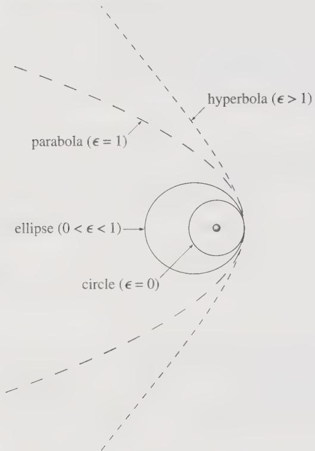
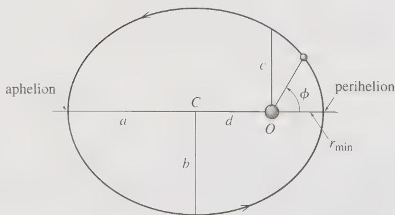

# Conic Sections and the Kepler Orbit Equation

**Reading material:** Section 8.6 of *Classical Mechanics* by John R. Taylor; §3.7 of *Classical Mechanics* by Herbert Goldstein.

## Table of Contents

1. [The Orbit Equation as a Conic](#1-the-orbit-equation-as-a-conic)
2. [Focus, Directrix, and the Meaning of p and e](#2-focus-directrix-and-the-meaning-of-p-and-e)
3. [The Four Eccentricity Cases](#3-the-four-eccentricity-cases)
   - [3.1 Circle](#31-circle)
   - [3.2 Ellipse](#32-ellipse)
   - [3.3 Parabola](#33-parabola)
   - [3.4 Hyperbola](#34-hyperbola)
4. [Cartesian Forms and Standard Parameters](#4-cartesian-forms-and-standard-parameters)
5. [Eccentricity and Energy](#5-eccentricity-and-energy)
6. [Summary](#6-summary)

---

## 1. The Orbit Equation as a Conic

The integrated orbit of the Kepler problem is

$$
\boxed{r(\theta)=\frac{p}{1+e\cos(\theta-\theta')},
\qquad
p=\frac{\ell^2}{mk}.}
$$

The origin is the force center, and the force is $F(r)=-k/r^2$ with $k>0$. The mass is $m$ and $\ell=|\mathbf L|$ is the constant angular momentum. The equation contains three constants:

- $p>0$, the **semi-latus rectum** (半通径), fixed by the angular momentum through $p=\ell^2/(mk)$;
- $e\ge0$, the dimensionless **eccentricity** (偏心率), which selects the type of conic;
- $\theta'$, the direction of the **periapsis** (近拱点), which only rotates the curve about the focus.

Because $\theta'$ fixes only the orientation, measure the polar angle from the periapsis direction:

$$
\phi=\theta-\theta',
\qquad
x=r\cos\phi,
\qquad
y=r\sin\phi.
$$

In these coordinates the orbit equation depends on $e$ alone:

$$
\boxed{r(\phi)=\frac{p}{1+e\cos\phi}.}
$$

> **Convention.** The polar axis $\phi=0$ points to the periapsis, so $r(0)=p/(1+e)$ is the distance of closest approach for every $e\ge0$. The polar origin is the focus, not the geometric center of the curve.

Three facts follow at once from the denominator:

1. Since $\cos\phi\le1$, the denominator is largest at $\phi=0$; therefore $r$ is smallest at periapsis.
2. At $\phi=\pm\pi/2$, $\cos\phi=0$ and $r=p$ for every $e$. Thus $p$ is the distance from the focus to the conic perpendicular to the axis, and the chord through the focus in that direction — the **latus rectum** (通径) — has length $2p$.
3. The denominator vanishes only when $e\ge1$ and $\cos\phi=-1/e$. That vanishing is the dividing line between bounded and unbounded curves.

------

## 2. Focus, Directrix, and the Meaning of p and e

Rewrite the orbit equation as

$$
r+e\,r\cos\phi=p.
$$

Since $x=r\cos\phi$,

$$
r=p-ex.
$$

Set $d=p/e$, so that $p=ed$. Then

$$
r=e(d-x).
$$

The left side is the distance from a point on the curve to the focus at the origin. The right side is $e$ times the horizontal distance from that point to the vertical line $x=d$. Therefore the conic is the locus of points whose distance to the focus is $e$ times their distance to the line $x=d$. The line is the **directrix** (准线), and

$$
d=\frac{p}{e}
$$

is the distance from the focus to the directrix.

- For $0<e<1$, a point on the curve is closer to the focus than to the directrix, and the curve is closed.
- For $e=1$, the two distances are equal: this is the definition of a parabola.
- For $e>1$, the directrix distance grows more slowly than the focus distance as the curve recedes; the curve is open.
- At $e=0$ the construction degenerates, since $d\to\infty$: the focus-distance condition alone fixes a circle.

> **Why $p$ is the natural scale.** The energy fixes only $e$ (Section 5), while the angular momentum fixes $p$. For fixed $\ell$, all conics of the family share the same $p$ and differ only in $e$.

------

## 3. The Four Eccentricity Cases

Fig. 8.11 of Taylor draws the four classes with the same periapsis distance:

**Figure 1.** The four classes of Kepler orbit: circle ($e=0$), ellipse ($0<e<1$), parabola ($e=1$), and hyperbola ($e>1$), drawn with the same periapsis distance and the same direction of closest approach. (Taylor, *Classical Mechanics*, Fig. 8.11.)

### 3.1 Circle

At $e=0$,

$$
r(\phi)=p
$$

for every $\phi$. The distance from the focus is constant, so the curve is a **circle** (圆) of radius $p$ centered on the force center. The two foci coincide at the center, every direction is a periapsis, and $\theta'$ has no geometric meaning.

The circle is the minimum-energy orbit for a given $\ell$; see Section 5.

------

### 3.2 Ellipse

For $0<e<1$ the denominator never vanishes, because $e\cos\phi>-1$. The curve is an **ellipse** (椭圆). The radial distance oscillates between two finite values:

$$
r_{\min}=r(0)=\frac{p}{1+e},
\qquad
r_{\max}=r(\pi)=\frac{p}{1-e}.
$$

The points $\phi=0$ and $\phi=\pi$ are the **periapsis** (近拱点) and **apoapsis** (远拱点). Their sum is the major axis:

$$
2a=r_{\min}+r_{\max}
=\frac{p}{1+e}+\frac{p}{1-e}
=\frac{2p}{1-e^2}.
$$

Hence the **semimajor axis** (半长轴) and **semiminor axis** (半短轴) are

$$
\boxed{a=\frac{p}{1-e^2},
\qquad
b=\frac{p}{\sqrt{1-e^2}},
\qquad
c=ae.}
$$

Here $c$ is the focal distance, the distance from the center to either focus, and

$$
e=\frac{c}{a}
$$

is the geometric definition of eccentricity. The center sits at $x=-ae$ in the focus-centered frame, so the focus at the origin is one of the two foci. The ellipse is bounded:

$$
\frac{p}{1+e}\le r\le\frac{p}{1-e}.
$$

As $e\to0$, $a\to p$ and $b\to p$: the ellipse shrinks onto the circle. As $e\to1^-$, $r_{\max}\to\infty$ while $r_{\min}\to p/2$: the far side of the ellipse recedes and the curve approaches a parabola.

**Figure 2.** A bound Kepler orbit is an ellipse with the force center at one focus $O$, not at the geometric center $C$. Here $a$ and $b$ are the semimajor and semiminor axes, the semi-latus rectum $p$ is the value of $r$ at $\phi=90^\circ$, and $r_{\min}=a(1-e)$, $r_{\max}=a(1+e)$. (Taylor, *Classical Mechanics*, Fig. 8.10.)

------

### 3.3 Parabola

At $e=1$,

$$
r(\phi)=\frac{p}{1+\cos\phi}
=\frac{p}{2\cos^2(\phi/2)}.
$$

The denominator vanishes at $\phi=\pm\pi$, so $r\to\infty$ in those directions. The curve is a **parabola** (抛物线), open toward negative $x$, with a single apsis

$$
r_{\min}=r(0)=\frac{p}{2}.
$$

There is no apoapsis and no finite semimajor axis. The parameter $p$ is twice the focal length: the vertex lies halfway between the focus at the origin and the directrix at $x=p$.

The parabola is the marginal case between bound and unbound motion. A particle on it reaches infinity with zero speed, which corresponds to $E=0$.

------

### 3.4 Hyperbola

For $e>1$ the denominator is positive only when

$$
\cos\phi>-\frac1e.
$$

Define the limiting angle

$$
\phi_\infty=\arccos\!\left(-\frac1e\right)
=\pi-\arccos\!\left(\frac1e\right),
\qquad
\frac{\pi}{2}<\phi_\infty<\pi.
$$

Then $r$ is finite on the interval $-\phi_\infty<\phi<\phi_\infty$ and diverges as $\phi\to\pm\phi_\infty$. The curve is a **hyperbola** (双曲线); its **asymptotes** (渐近线) lie in the two limiting directions $\phi=\pm\phi_\infty$. Only one branch is traced with $r>0$: the branch containing the focus, opening away from the periapsis.

There is a single apsis,

$$
r_{\min}=r(0)=\frac{p}{1+e},
$$

and the standard parameters are

$$
\boxed{a=\frac{p}{e^2-1},
\qquad
b=\frac{p}{\sqrt{e^2-1}},
\qquad
c=ae.}
$$

Here $a$ is the **transverse semiaxis** (实半轴) and $e=c/a$. For the ellipse, $c^2=a^2-b^2$; for the hyperbola, $c^2=a^2+b^2$.

The vertex of the physical branch is at $x=r_{\min}=p/(1+e)$, while the center is at $x=ae$. The second branch, at $x\ge a(e+1)$, is not reached by a particle that comes in from infinity, passes periapsis, and escapes; it corresponds to negative $r$ in the polar representation.

> **Scattering.** The repulsive Coulomb orbit is the branch of this hyperbola with the force center at the focus. The particle comes from infinity, reaches $r_{\min}$, and recedes along the other asymptote. The angle between the asymptotes determines the scattering angle; see Section 8 of the central-force chapter.

------

## 4. Cartesian Forms and Standard Parameters

To obtain the standard Cartesian equations, start from $r=p-ex$ and write $r=\sqrt{x^2+y^2}$:

$$
\sqrt{x^2+y^2}=p-ex.
$$

Squaring gives the single equation

$$
(1-e^2)x^2+y^2+2pex-p^2=0,
$$

which contains all four cases. Completing the square differs according to the sign of $1-e^2$.

**Circle, $e=0$.** The equation reduces to

$$
x^2+y^2=p^2.
$$

**Ellipse, $0<e<1$.** Since $1-e^2>0$, complete the square in $x$:

$$
(1-e^2)\left(x+\frac{pe}{1-e^2}\right)^2+y^2
=\frac{p^2}{1-e^2}.
$$

Dividing through,

$$
\frac{(x+ae)^2}{a^2}+\frac{y^2}{b^2}=1,
\qquad
a=\frac{p}{1-e^2},
\quad
b=\frac{p}{\sqrt{1-e^2}}.
$$

The center is at $x=-ae$, as expected.

**Parabola, $e=1$.** The quadratic term in $x$ disappears:

$$
y^2+2px-p^2=0
\quad\Longrightarrow\quad
y^2=-2p\left(x-\frac{p}{2}\right).
$$

This is a parabola with vertex at $x=p/2$, focus at the origin, and directrix $x=p$.

**Hyperbola, $e>1$.** Now $e^2-1>0$. Multiplying by $-1$ and completing the square,

$$
(e^2-1)\left(x-\frac{pe}{e^2-1}\right)^2-y^2
=\frac{p^2}{e^2-1},
$$

so

$$
\frac{(x-ae)^2}{a^2}-\frac{y^2}{b^2}=1,
\qquad
a=\frac{p}{e^2-1},
\quad
b=\frac{p}{\sqrt{e^2-1}}.
$$

The center is at $x=ae$, and the branch containing the focus is the left branch $x\le a(e-1)=p/(e+1)$.

The table collects the geometric parameters.

| $e$ | Conic | $r_{\min}$ | $r_{\max}$ | $a$ | $b$ |
|---|---|---|---|---|---|
| $0$ | circle | $p$ | $p$ | $p$ | $p$ |
| $0<e<1$ | ellipse | $\dfrac{p}{1+e}$ | $\dfrac{p}{1-e}$ | $\dfrac{p}{1-e^2}$ | $\dfrac{p}{\sqrt{1-e^2}}$ |
| $1$ | parabola | $\dfrac{p}{2}$ | $\infty$ | — | — |
| $e>1$ | hyperbola | $\dfrac{p}{1+e}$ | $\infty$ | $\dfrac{p}{e^2-1}$ | $\dfrac{p}{\sqrt{e^2-1}}$ |

------

## 5. Eccentricity and Energy

Evaluating the energy at periapsis in the central-force chapter gives

$$
E=\frac{mk^2}{2\ell^2}\left(e^2-1\right).
$$

Using $p=\ell^2/(mk)$, this becomes

$$
\boxed{E=\frac{k}{2p}\left(e^2-1\right).}
$$

Since $k>0$ and $p>0$, the sign of the energy is the sign of $e^2-1$:

| Eccentricity | Energy | Conic | Motion |
|---|---|---|---|
| $e=0$ | $E=-\dfrac{k}{2p}$ | circle | bound |
| $0<e<1$ | $E<0$ | ellipse | bound |
| $e=1$ | $E=0$ | parabola | marginal |
| $e>1$ | $E>0$ | hyperbola | unbound |

For the ellipse, $p/a=1-e^2$, so

$$
E=-\frac{k}{2a},
$$

which is the energy–semimajor-axis relation derived in Section 6.3 of the central-force chapter. For the hyperbola, $p/a=e^2-1$, so

$$
E=+\frac{k}{2a}.
$$

If $a$ is allowed to be signed — positive for the ellipse and negative for the hyperbola, $a=-p/(e^2-1)$ — both cases collapse to the single relation

$$
E=-\frac{k}{2a}.
$$

For fixed $\ell$, $p$ is fixed and the circular orbit has the minimum energy $E=-k/(2p)$. Raising the energy increases $e$; the conic changes from ellipse to parabola to hyperbola as $E$ passes through zero.

------

## 6. Summary

The Kepler orbit equation

$$
\boxed{r(\theta)=\frac{p}{1+e\cos(\theta-\theta')},
\qquad
p=\frac{\ell^2}{mk}.}
$$

is the polar equation of a conic with one focus at the force center. The parameter $p$ sets the scale and $e$ sets the shape:

- **Circle** ($e=0$): $r=p$ for all angles; center at the focus; minimum energy for given $\ell$.
- **Ellipse** ($0<e<1$): bounded orbit with $r_{\min}=p/(1+e)$ and $r_{\max}=p/(1-e)$; $a=p/(1-e^2)$, $b=p/\sqrt{1-e^2}$, $c=ae$.
- **Parabola** ($e=1$): $r=p/(1+\cos\phi)$; one apsis at $r=p/2$; $E=0$; escapes to infinity with zero speed.
- **Hyperbola** ($e>1$): one apsis at $r=p/(1+e)$; asymptotes at $\phi=\pm\arccos(-1/e)$; $E>0$; unbound.

The eccentricity and the energy are related by

$$
\boxed{E=\frac{k}{2p}\left(e^2-1\right)},
$$

so $E<0$, $E=0$, and $E>0$ correspond respectively to $e<1$, $e=1$, and $e>1$.
