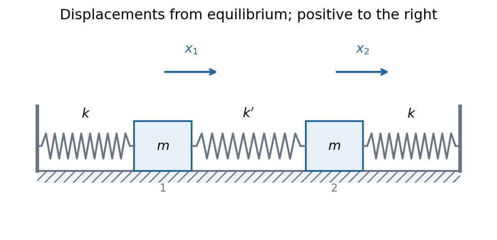
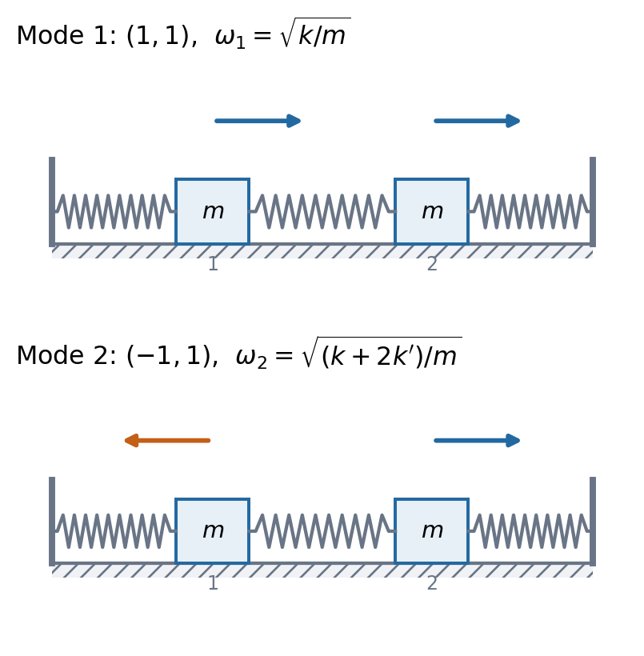
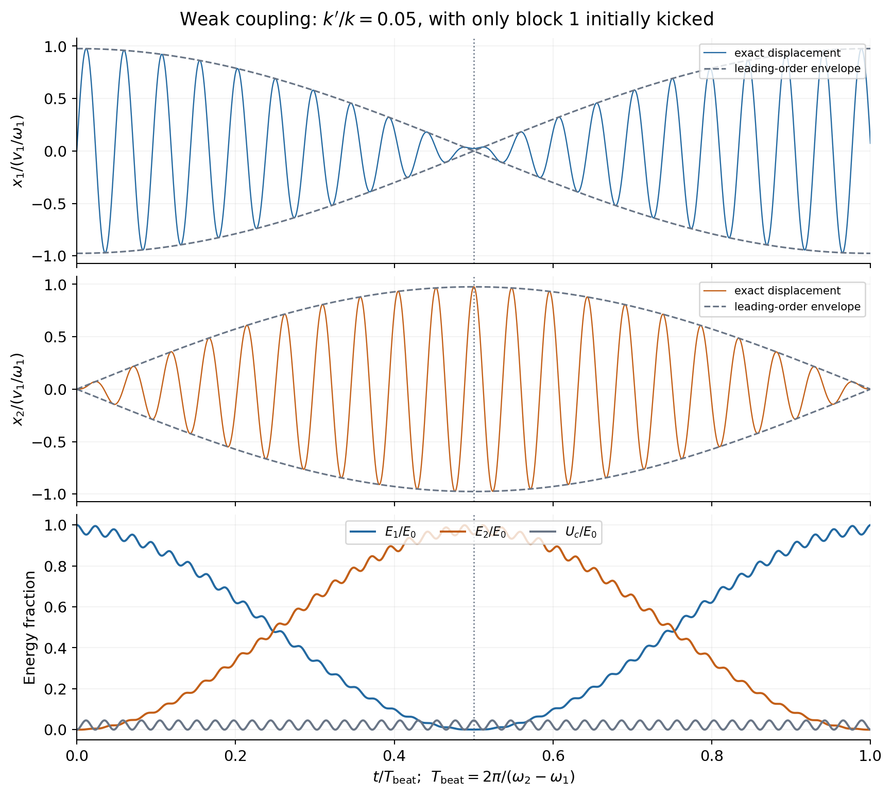
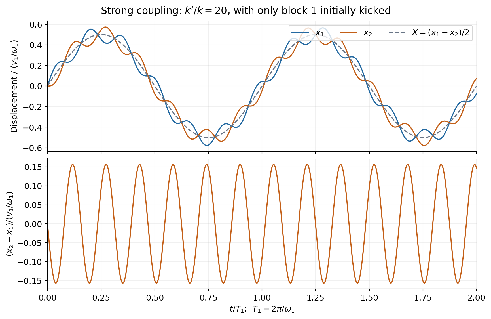
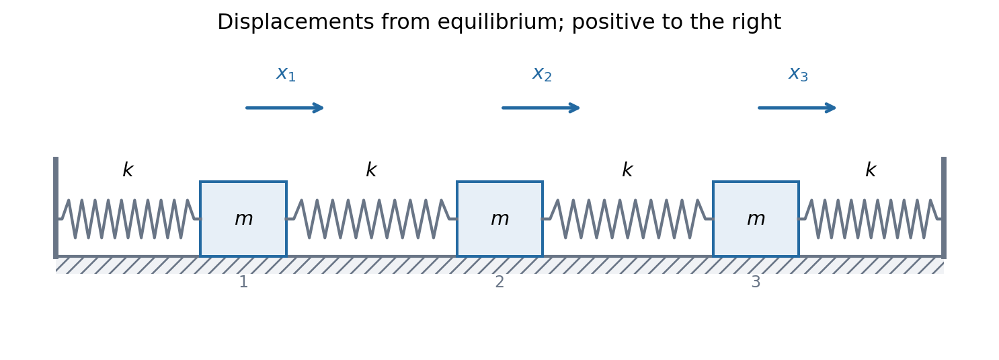
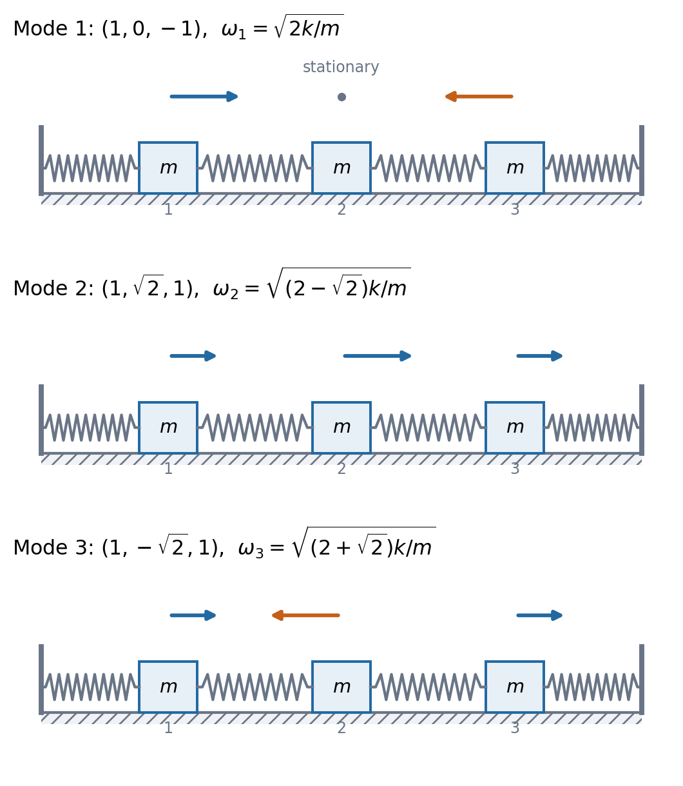
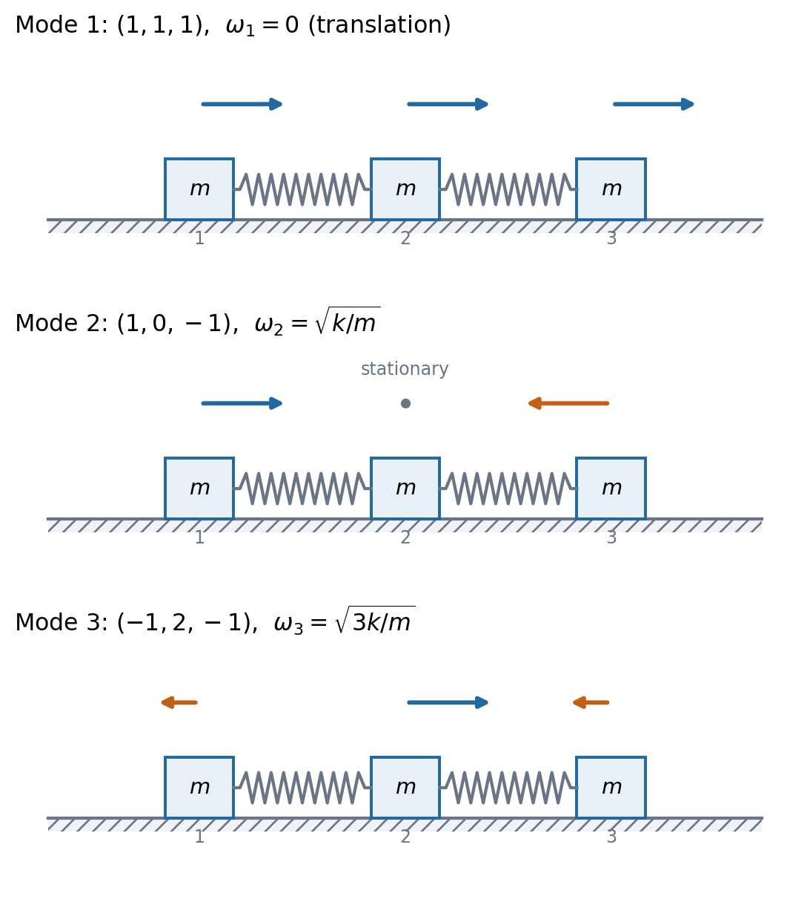

# Coupled Oscillators

## Table of Contents

- [1. Two Blocks and Three Springs](#1-two-blocks-and-three-springs)
  - [1.1 Lagrangian and Equations of Motion](#11-lagrangian-and-equations-of-motion)
  - [1.2 Decoupling the Equations](#12-decoupling-the-equations)
  - [1.3 Complex Solutions and Real Motion](#13-complex-solutions-and-real-motion)
  - [1.4 The Two Normal Modes](#14-the-two-normal-modes)
- [2. Normal Modes as an Eigenvalue Problem](#2-normal-modes-as-an-eigenvalue-problem)
  - [2.1 Characteristic Frequencies](#21-characteristic-frequencies)
  - [2.2 Eigenvectors and Orthogonality](#22-eigenvectors-and-orthogonality)
- [3. A Particular Initial-Value Problem (Optional)](#3-a-particular-initial-value-problem-optional)
- [4. Weak Coupling (Optional)](#4-weak-coupling-optional)
- [5. Strong Coupling (Optional)](#5-strong-coupling-optional)
- [6. Three Blocks and Four Springs](#6-three-blocks-and-four-springs)
  - [6.1 Equations of Motion](#61-equations-of-motion)
  - [6.2 Characteristic Frequencies](#62-characteristic-frequencies)
  - [6.3 Normal Modes and General Solution](#63-normal-modes-and-general-solution)
- [7. No Walls](#7-no-walls)
  - [7.1 Equations of Motion](#71-equations-of-motion)
  - [7.2 Characteristic Frequencies](#72-characteristic-frequencies)
  - [7.3 Normal Modes](#73-normal-modes)
- [9. Worked Problems](#9-worked-problems)
  - [9.1 Two Free Masses and One Spring](#91-two-free-masses-and-one-spring)
  - [9.2 Unequal Masses Between Walls](#92-unequal-masses-between-walls)
- [10. Test Yourself](#10-test-yourself)
  - [10.1 A Stiffer Central Spring](#101-a-stiffer-central-spring)
  - [10.2 The Double Pendulum](#102-the-double-pendulum)

---

## 1. Two Blocks and Three Springs

### 1.1 Lagrangian and Equations of Motion

Two blocks, each of mass $m$, slide on a frictionless horizontal surface. Each outer spring has spring constant $k>0$, and the middle spring has spring constant $k'>0$. At equilibrium all three springs are unstretched. We take both displacements $x_1,x_2$ as positive to the right.

**Figure 1:** Equilibrium configuration of two blocks on a frictionless horizontal surface and displacement conventions. The arrows define positive coordinates, not a particular normal mode.

The middle spring changes length by $x_2-x_1$. The right spring changes length by $-x_2$, but its energy depends on the square. Therefore

$$
T=\frac{m}{2}(\dot x_1^2+\dot x_2^2),
\qquad
U=\frac{k}{2}x_1^2+\frac{k'}{2}(x_2-x_1)^2+\frac{k}{2}x_2^2,
$$

$$
\boxed{L=T-U
=\frac{m}{2}(\dot x_1^2+\dot x_2^2)
-\frac{k}{2}(x_1^2+x_2^2)-\frac{k'}{2}(x_2-x_1)^2.}
$$

Applying $d(\partial L/\partial\dot x_i)/dt=\partial L/\partial x_i$ gives

$$
\boxed{
\begin{aligned}
m\ddot x_1&=-kx_1+k'(x_2-x_1),\\
m\ddot x_2&=-kx_2-k'(x_2-x_1).
\end{aligned}}
$$

The middle spring exerts equal and opposite forces. Each acceleration depends on both displacements, so the equations are **coupled (耦合)**. We seek coordinates in which each equation contains only one unknown function.

------

### 1.2 Decoupling the Equations

Adding the two equations eliminates the coupling force; subtracting the first from the second isolates the relative displacement:

$$
\begin{aligned}
m(\ddot x_1+\ddot x_2)&=-k(x_1+x_2),\\
m(\ddot x_2-\ddot x_1)&=-(k+2k')(x_2-x_1).
\end{aligned}
$$

Introduce the sum and difference coordinates

$$
\eta_1=x_1+x_2,\qquad \eta_2=x_2-x_1,
\qquad
x_1=\frac{\eta_1-\eta_2}{2},\quad
x_2=\frac{\eta_1+\eta_2}{2}.
$$

Then

$$
\boxed{
\ddot\eta_1+\omega_1^2\eta_1=0,
\qquad
\ddot\eta_2+\omega_2^2\eta_2=0,
\qquad
\omega_1^2=\frac{k}{m},\quad
\omega_2^2=\frac{k+2k'}{m}.}
$$

This is **decoupling (解耦)**: the collective coordinate $\eta_1$ and the relative coordinate $\eta_2$ each obey a simple harmonic oscillator equation. For equal masses, $\eta_1/2$ is the displacement of the center of mass; $\eta_2$ is the extension of the middle spring.

The Lagrangian also separates:

$$
L=\frac{m}{4}(\dot\eta_1^2+\dot\eta_2^2)
-\frac{k}{4}\eta_1^2-\frac{k+2k'}{4}\eta_2^2.
$$

The factors of $1/4$ follow from the coordinate transformation. We will introduce normalized coordinates in Section 2.2 so that the kinetic energy again has the familiar coefficient $m/2$.

------

### 1.3 Complex Solutions and Real Motion

For each $j=1,2$, the real solution is

$$
\eta_j(t)=A_j\cos\omega_jt+B_j\sin\omega_jt,
\qquad
A_j=\eta_j(0),\quad B_j=\frac{\dot\eta_j(0)}{\omega_j}.
$$

Equivalently, we may write

$$
\eta_j(t)=\operatorname{Re}\!\left(c_j e^{i\omega_jt}\right),
\qquad c_j=A_j-iB_j.
$$

Indeed,

$$
(A_j-iB_j)e^{i\omega_jt}
=A_j\cos\omega_jt+B_j\sin\omega_jt
+i\bigl(A_j\sin\omega_jt-B_j\cos\omega_jt\bigr).
$$

Complex notation is a compact way to store amplitude and phase. Because the equations are linear with real coefficients, the real and imaginary parts separately satisfy them. The **physical displacement is real**; we take the real part at the end.

There are four real constants, as required for two second-order equations. Substitution of $c_je^{i\omega_jt}$ into the decoupled equations recovers

$$
(k-m\omega_1^2)c_1=0,
\qquad
(k+2k'-m\omega_2^2)c_2=0.
$$

A nonzero mode amplitude therefore requires

$$
\boxed{\omega_1=\sqrt{\frac{k}{m}},\qquad
\omega_2=\sqrt{\frac{k+2k'}{m}}.}
$$

------

### 1.4 The Two Normal Modes

The decoupled equations tell us that **$\eta_1$ and $\eta_2$ can oscillate independently**, each at its own frequency. What do these two independent oscillations look like in terms of the actual blocks? Recall that

$$
x_1=\frac{\eta_1-\eta_2}{2},\qquad
x_2=\frac{\eta_1+\eta_2}{2}.
$$

If both $\eta_1$ and $\eta_2$ oscillate, each block's motion generally contains both frequencies. To understand the **two basic patterns**, we first let **one normal coordinate oscillate at a time**. Each resulting pattern is a **normal mode**: the blocks oscillate at a single frequency, with fixed relative amplitudes and phases. 

**Mode 1: collective motion.** Imagine moving both blocks the same distance to the right and releasing them from rest. Initially $x_1=x_2$ and $\dot x_1=\dot x_2=0$, so the relative coordinate $\eta_2=x_2-x_1$ and its velocity are both zero. Thus $\eta_2$ remains zero, while $\eta_1$ oscillates. Substitution gives
$$
x_1=x_2=\frac{\eta_1}{2},\qquad \omega_1=\sqrt{k/m}.
$$

**The blocks move together with equal amplitudes, always in phase (同相位)**. Their separation stays constant, so the middle spring remains unstretched and exerts no force. Each block feels only its outer spring, explaining why $\omega_1$ is independent of $k'$. More generally, this mode requires equal initial displacements and equal initial velocities; the common initial velocity need not be zero.

**Mode 2: relative motion.** Now imagine moving the blocks **equal distances in opposite directions** and releasing them from rest. Initially $x_2=-x_1$ and both velocities vanish, so the collective coordinate $\eta_1=x_1+x_2$ and its velocity are both zero. Thus $\eta_1$ remains zero, while $\eta_2$ oscillates. This gives
$$
x_2=-x_1=\frac{\eta_2}{2},\qquad \omega_2=\sqrt{(k+2k')/m}.
$$

The blocks move with equal amplitudes in opposite directions; they are therefore **out of phase (反相位)**, while their center of mass remains fixed. When block 1 has displacement $x_1$, block 2 has displacement $-x_1$, so the middle spring changes length by $-2x_1$. The restoring force on block 1 is consequently $-(k+2k')x_1$. The middle spring now contributes to the restoring force, making this mode faster than mode 1. More generally, this mode requires equal-and-opposite initial displacements and equal-and-opposite initial velocities.

**Figure 2:** Normal modes of two blocks on a frictionless horizontal surface. Arrows show relative signed displacements in each mode, with lengths proportional to amplitudes. Both arrows reverse together after half a cycle.

For **arbitrary** initial conditions, both normal coordinates can be excited. The resulting motion is a **superposition (叠加)** of these two modes: at each instant, add the collective and relative contributions using the formulas for $x_1,x_2$ above. For example, displacing only block 1 by $d$ and releasing both blocks from rest gives $\eta_1(0)=d$ and $\eta_2(0)=-d$, so both modes are present. A pure mode occurs only when the initial displacements **and** velocities leave the other normal coordinate unexcited.

> **Limiting check.** As $k'\to0$, both frequencies approach $\sqrt{k/m}$. The two independent blocks have the same frequency, so the eigenvalue is **degenerate (简并)**. 

**中文小结：** 我们通过设置初始条件，使某一个简正坐标满足 $\eta_j(0)=0$ 且 $\dot\eta_j(0)=0$。由于两个简正坐标的运动方程已经解耦，这个 $\eta_j$ 将始终为零，即相应的模式没有被激发；此时若另一个模式被激发，系统就只做这一种简正模式（normal mode）的运动。简正模式的特点是：各滑块的速度大小和方向可以不同，但它们以**同一个振动频率**同步振动，彼此保持固定的振幅比例和相位关系。这里的“同步”也包括反相运动；每经过一个共同的周期 $T=2\pi/\omega$，所有滑块都会同时回到各自的初始位置，并恢复各自的初始速度。

------

## 2. Normal Modes as an Eigenvalue Problem

### 2.1 Characteristic Frequencies

Adding and subtracting worked because the two-block system has exchange symmetry. For larger or unequal-mass systems, a matrix formulation provides a systematic method.

Define the displacement vector, **mass matrix (质量矩阵)**, and **stiffness matrix (刚度矩阵)**:

$$
\mathbf x=\begin{pmatrix}x_1\\x_2\end{pmatrix},\qquad
\mathbf M=m\mathbf I,\qquad
\mathbf K=\begin{pmatrix}k+k'&-k'\\-k'&k+k'\end{pmatrix}.
$$

Then the equations become

$$
\mathbf M\ddot{\mathbf x}+\mathbf K\mathbf x=0.
$$

To see explicitly how this matrix equation contains the two equations of motion, write out the matrices and vectors:

$$
\begin{pmatrix}m&0\\0&m\end{pmatrix}
\begin{pmatrix}\ddot x_1\\\ddot x_2\end{pmatrix}
+\begin{pmatrix}k+k'&-k'\\-k'&k+k'\end{pmatrix}
\begin{pmatrix}x_1\\x_2\end{pmatrix}
=\begin{pmatrix}0\\0\end{pmatrix}.
$$

Multiplying each row by the corresponding column vector gives

$$
\begin{cases}
m\ddot x_1+(k+k')x_1-k'x_2=0,\\
m\ddot x_2-k'x_1+(k+k')x_2=0.
\end{cases}
$$

The first row describes block 1, and the second describes block 2. Moving the spring terms to the right recovers exactly the equations from Section 1.1:

$$
\begin{aligned}
m\ddot x_1&=-(k+k')x_1+k'x_2=-kx_1+k'(x_2-x_1),\\
m\ddot x_2&=k'x_1-(k+k')x_2=-kx_2-k'(x_2-x_1).
\end{aligned}
$$

Thus the matrix form is a compact way to write both coupled equations together; the off-diagonal entries $-k'$ encode the coupling between the blocks.

Try a mode $\mathbf x(t)=\operatorname{Re}(\mathbf b e^{i\omega t})$. Its amplitude vector must satisfy

$$
\boxed{(\mathbf K-\omega^2\mathbf M)\mathbf b=0.}
$$

A nonzero $\mathbf b$ exists only when the coefficient matrix is singular:

$$
\boxed{\det(\mathbf K-\omega^2\mathbf M)=0.}
$$

This is the **characteristic equation (特征方程)**, also called the secular equation. Here it is

$$
\begin{aligned}
0&=(k+k'-m\omega^2)^2-(k')^2\\
&=(k-m\omega^2)(k+2k'-m\omega^2).
\end{aligned}
$$

Thus we recover $\omega_1^2=k/m$ and $\omega_2^2=(k+2k')/m$.

> **What is the eigenvalue?** The eigenvalues of $\mathbf K/m$ are $\omega_j^2$, not $\omega_j$. The nonnegative square roots are the **eigenfrequencies (本征频率)**.

**中文 Notes：如何构造刚度矩阵 $\mathbf K$？**

对于本节这种沿同一直线运动、各位移坐标正方向一致的弹簧—滑块系统，可以从零矩阵开始，把每根弹簧的贡献逐一加进去：

- 若劲度系数为 $s$ 的弹簧连接滑块 $i$ 与固定墙，只给 $K_{ii}$ 加上 $s$。
- 若劲度系数为 $s$ 的弹簧连接滑块 $i$ 与滑块 $j$，给 $K_{ii}$、$K_{jj}$ 各加上 $s$，给 $K_{ij}$、$K_{ji}$ 各加上 $-s$。

因此，**对角元是连接该滑块的所有弹簧劲度系数之和；非对角元是直接连接这两个滑块的弹簧劲度系数之和的负值，没有直接连接就写零。** 本节两个滑块各连接一根 $k$ 弹簧和一根 $k'$ 弹簧，彼此之间由 $k'$ 弹簧连接，所以

$$
\mathbf K=
\underbrace{\begin{pmatrix}k&0\\0&0\end{pmatrix}}_{\text{左侧弹簧}}
+\underbrace{\begin{pmatrix}k'&-k'\\-k'&k'\end{pmatrix}}_{\text{中间弹簧}}
+\underbrace{\begin{pmatrix}0&0\\0&k\end{pmatrix}}_{\text{右侧弹簧}}
=\begin{pmatrix}k+k'&-k'\\-k'&k+k'\end{pmatrix}.
$$

**从势能理解这些规则。** 连接滑块 $i,j$ 的弹簧伸长量为 $x_j-x_i$，其势能为

$$
U_{ij}=\frac12s(x_j-x_i)^2
=\frac12s x_i^2+\frac12s x_j^2-sx_ix_j.
$$

两个平方项分别贡献对角元，交叉项贡献两个对称的非对角元；连接固定墙的弹簧则只有 $\tfrac12s x_i^2$。把所有弹簧的势能相加，就可以写成

$$
\boxed{U=\frac12\mathbf x^{\mathsf T}\mathbf K\mathbf x.}
$$

例如，本节的势能展开为

$$
U=\frac12k x_1^2+\frac12k'(x_2-x_1)^2+\frac12k x_2^2
=\frac12(k+k')x_1^2-k'x_1x_2+\frac12(k+k')x_2^2.
$$

注意，对于对称矩阵，$\tfrac12\mathbf x^{\mathsf T}\mathbf K\mathbf x$ 中的交叉项为 $\tfrac12(K_{12}+K_{21})x_1x_2=K_{12}x_1x_2$，所以这里应读出 $K_{12}=K_{21}=-k'$。再对势能求导，就得到回复力和运动方程：

$$
F_i=-\frac{\partial U}{\partial x_i}=-\sum_jK_{ij}x_j,
\qquad
\mathbf M\ddot{\mathbf x}=-\mathbf K\mathbf x.
$$

更一般地，以平衡位置为位移原点，将光滑势能展开到二阶，有

$$
U\simeq U_{\rm eq}+\frac12\mathbf x^{\mathsf T}\mathbf K\mathbf x,
\qquad
\boxed{K_{ij}=\left.\frac{\partial^2U}{\partial x_i\partial x_j}\right|_{\rm eq}.}
$$

平衡处的一阶导数为零，因此没有线性项。刚度矩阵描述的是**势能在平衡位置附近的曲率**；这个定义也适用于更一般的小振动问题，而前面的“逐根弹簧相加”规则适用于所述的一维弹簧系统。写完后可以检查：$\mathbf K$ 应当对称。

------

### 2.2 Eigenvectors and Orthogonality

To find the relative amplitudes of the blocks in each mode, return to the amplitude equation

$$
\boxed{(\mathbf K-\omega^2\mathbf M)\mathbf b=0.}
$$

For our two equal masses, this equation explicitly reads

$$
\left[
\begin{pmatrix}k+k'&-k'\\-k'&k+k'\end{pmatrix}
-\omega^2\begin{pmatrix}m&0\\0&m\end{pmatrix}
\right]
\begin{pmatrix}b_1\\b_2\end{pmatrix}
=\begin{pmatrix}0\\0\end{pmatrix},
$$

or, combining the matrices,

$$
\begin{pmatrix}
k+k'-m\omega^2&-k'\\
-k'&k+k'-m\omega^2
\end{pmatrix}
\begin{pmatrix}b_1\\b_2\end{pmatrix}
=\begin{pmatrix}0\\0\end{pmatrix}.
$$

At $\omega=\omega_1$, we have $m\omega_1^2=k$, so

$$
k'\begin{pmatrix}1&-1\\-1&1\end{pmatrix}
\begin{pmatrix}b_1\\b_2\end{pmatrix}
=\begin{pmatrix}0\\0\end{pmatrix}
\quad\Longrightarrow\quad b_1=b_2.
$$

At $\omega=\omega_2$, we have $m\omega_2^2=k+2k'$, so

$$
-k'\begin{pmatrix}1&1\\1&1\end{pmatrix}
\begin{pmatrix}b_1\\b_2\end{pmatrix}
=\begin{pmatrix}0\\0\end{pmatrix}
\quad\Longrightarrow\quad b_1=-b_2.
$$

Thus the first mode has equal amplitudes with the same sign, while the second has equal amplitudes with opposite signs, in agreement with Section 1.4. A convenient pair of normalized **eigenvectors (本征向量)** is

$$
\boxed{
\mathbf e_{(1)}=\frac{1}{\sqrt2}\begin{pmatrix}1\\1\end{pmatrix},
\qquad
\mathbf e_{(2)}=\frac{1}{\sqrt2}\begin{pmatrix}-1\\1\end{pmatrix}.}
$$

The overall sign of an eigenvector is arbitrary. Its component ratios describe the mode shape, while an independent scalar coefficient specifies the amplitude.

These vectors satisfy **orthonormality(正交归一)**:

$$
\mathbf e_{(i)}^{\mathsf T}\mathbf e_{(j)}=\delta_{ij},
$$

where $\mathsf T$ denotes transpose and $\delta_{ij}$ is the Kronecker delta.

We expand the displacement in this basis and define the **normal coordinates (简正坐标)** by projection:

$$
\mathbf x=q_1\mathbf e_{(1)}+q_2\mathbf e_{(2)},
\qquad q_j=\mathbf e_{(j)}^{\mathsf T}\mathbf x.
$$

In particular,

$$
q_1=\frac{x_1+x_2}{\sqrt2}=\frac{\eta_1}{\sqrt2},\qquad
q_2=\frac{x_2-x_1}{\sqrt2}=\frac{\eta_2}{\sqrt2}.
$$

>**投影与简正坐标** 这里用到的都是线性代数的基本内容。同一个矢量可以在不同的基底下表示。在以两个滑块位移为坐标的二维配置空间中，$\mathbf x=(x_1,x_2)^{\mathsf T}$ 是原来笛卡尔坐标下的位移矢量；两个归一化本征矢 $\mathbf e_{(1)},\mathbf e_{(2)}$ 则构成一组新的正交基。把 $\mathbf x$ 分别投影到这两个本征矢上，就得到 $q_1=\mathbf e_{(1)}^{\mathsf T}\mathbf x$ 和 $q_2=\mathbf e_{(2)}^{\mathsf T}\mathbf x$。因此，**$q_1,q_2$ 就是两个本征矢在展开式 $\mathbf x=q_1\mathbf e_{(1)}+q_2\mathbf e_{(2)}$ 中的权重，也就是新基底下的坐标分量**。这些权重可以为正、为负或为零，并随时间变化

Place the two normalized eigenvectors in the columns of a matrix:

$$
\boxed{
\mathbf S=(\mathbf e_{(1)},\mathbf e_{(2)})
=\frac{1}{\sqrt2}\begin{pmatrix}1&-1\\1&1\end{pmatrix},
\qquad
\mathbf S^{\mathsf T}=\frac{1}{\sqrt2}\begin{pmatrix}1&1\\-1&1\end{pmatrix}.}
$$

The change of coordinates and its inverse are

$$
\mathbf x=\mathbf S\mathbf q,\qquad
\mathbf q=\mathbf S^{\mathsf T}\mathbf x,
\qquad
\mathbf q=\begin{pmatrix}q_1\\q_2\end{pmatrix}.
$$

Because the columns of $\mathbf S$ are orthonormal, $\mathbf S^{-1}=\mathbf S^{\mathsf T}$. Each column is also an eigenvector of $\mathbf K$, so we have two separate equations:

$$
\mathbf K\mathbf e_{(1)}=m\omega_1^2\mathbf e_{(1)},
\qquad
\mathbf K\mathbf e_{(2)}=m\omega_2^2\mathbf e_{(2)}.
$$

To combine them, recall that multiplying a matrix on the left acts on each of its columns. Since $\mathbf S=(\mathbf e_{(1)},\mathbf e_{(2)})$,

$$
\begin{aligned}
\mathbf K\mathbf S
&=\mathbf K(\mathbf e_{(1)},\mathbf e_{(2)})\\
&=(\mathbf K\mathbf e_{(1)},\mathbf K\mathbf e_{(2)})\\
&=(m\omega_1^2\mathbf e_{(1)},\;m\omega_2^2\mathbf e_{(2)}).
\end{aligned}
$$

Now recall a second matrix-multiplication rule: **multiplying on the right by a diagonal matrix scales each column by the corresponding diagonal entry**. Thus the same pair of columns can be written as

$$
(\mathbf e_{(1)},\mathbf e_{(2)})
\begin{pmatrix}m\omega_1^2&0\\0&m\omega_2^2\end{pmatrix}
=(m\omega_1^2\mathbf e_{(1)},\;m\omega_2^2\mathbf e_{(2)}).
$$

The two products have identical columns, so they are equal. Denoting this diagonal matrix by $\mathbf D$, we obtain

$$
\mathbf K\mathbf S=\mathbf S\mathbf D,
\qquad
\mathbf D=\begin{pmatrix}k&0\\0&k+2k'\end{pmatrix}
=m\begin{pmatrix}\omega_1^2&0\\0&\omega_2^2\end{pmatrix}.
$$

Multiplying on the left by $\mathbf S^{\mathsf T}$ therefore yields

$$
\mathbf S^{\mathsf T}\mathbf S=\mathbf I,
\qquad
\mathbf S^{\mathsf T}\mathbf K\mathbf S
=m\begin{pmatrix}\omega_1^2&0\\0&\omega_2^2\end{pmatrix}.
$$

> **如何理解这个对角化？** 可以把它理解为：在描述两个滑块位移的空间中，改用两个本征矢作为新的坐标轴。同一个位移矢量，原来用 $(x_1,x_2)$ 表示，现在用 $(q_1,q_2)$ 表示；物理系统没有改变，只是换了一套坐标。$\mathbf S^{\mathsf T}\mathbf K\mathbf S$ 就是刚度矩阵在这套新坐标下的表示。
>
> 为什么换完坐标就变成了对角矩阵？因为沿某个本征矢的位移，经过 $\mathbf K$ 作用后，仍然沿着这个本征矢，只是乘上了对应的本征值。因此，在新坐标下，$q_1$ 只对应 $m\omega_1^2q_1$，$q_2$ 只对应 $m\omega_2^2q_2$，两者不再混合，所以非对角元为零。由于 $\mathbf S^{-1}=\mathbf S^{\mathsf T}$，这个换基过程就是线性代数中的**正交相似变换（orthogonal similarity transformation）**。下面把同样的坐标变换代入运动方程，就能直接看到两个简正坐标如何解耦。

**The equations of motion become diagonal as well.** Since $\mathbf S$ is constant in time, $\ddot{\mathbf x}=\mathbf S\ddot{\mathbf q}$. Substitute this into $\mathbf M\ddot{\mathbf x}+\mathbf K\mathbf x=0$, then multiply the entire equation on the left by $\mathbf S^{\mathsf T}$:

$$
\mathbf M\mathbf S\ddot{\mathbf q}+\mathbf K\mathbf S\mathbf q=0
\quad\Longrightarrow\quad
(\mathbf S^{\mathsf T}\mathbf M\mathbf S)\ddot{\mathbf q}
+(\mathbf S^{\mathsf T}\mathbf K\mathbf S)\mathbf q=0.
$$

Here $\mathbf M=m\mathbf I$, so $\mathbf S^{\mathsf T}\mathbf M\mathbf S=m\mathbf I$. The transformed equation is explicitly

$$
\begin{pmatrix}m&0\\0&m\end{pmatrix}
\begin{pmatrix}\ddot q_1\\\ddot q_2\end{pmatrix}
+\begin{pmatrix}k&0\\0&k+2k'\end{pmatrix}
\begin{pmatrix}q_1\\q_2\end{pmatrix}
=\begin{pmatrix}0\\0\end{pmatrix},
$$

or, row by row,

$$
\boxed{
\begin{aligned}
m\ddot q_1+kq_1&=0,\\
m\ddot q_2+(k+2k')q_2&=0.
\end{aligned}}
$$

Each equation contains only one normal coordinate: the motion is now **decoupled (解耦)**.

The same coordinate substitution simplifies the Lagrangian:

$$
\begin{aligned}
L&=\frac12\dot{\mathbf x}^{\mathsf T}\mathbf M\dot{\mathbf x}
-\frac12\mathbf x^{\mathsf T}\mathbf K\mathbf x\\
&=\frac12\dot{\mathbf q}^{\mathsf T}(\mathbf S^{\mathsf T}\mathbf M\mathbf S)\dot{\mathbf q}
-\frac12\mathbf q^{\mathsf T}(\mathbf S^{\mathsf T}\mathbf K\mathbf S)\mathbf q.
\end{aligned}
$$

The Lagrangian is therefore the sum of two independent harmonic-oscillator Lagrangians:

$$
\boxed{L=\sum_{j=1}^{2}\frac{m}{2}
\left(\dot q_j^2-\omega_j^2q_j^2\right),
\qquad \ddot q_j+\omega_j^2q_j=0.}
$$

Each mode has a separately conserved energy,

$$
\mathcal E_j=\frac{m}{2}\left(\dot q_j^2+\omega_j^2q_j^2\right),
\qquad E=\mathcal E_1+\mathcal E_2.
$$

**Reconstructing the full motion.** The main result is that once we have solved for the independent normal coordinates $q_j(t)$, we also know the original motion $\mathbf x(t)$. For $\omega_j>0$, each decoupled equation has the familiar solution

$$
q_j(t)=q_j(0)\cos\omega_jt
+\frac{\dot q_j(0)}{\omega_j}\sin\omega_jt,
$$

where the initial values are obtained by projection:

$$
q_j(0)=\mathbf e_{(j)}^{\mathsf T}\mathbf x(0),
\qquad
\dot q_j(0)=\mathbf e_{(j)}^{\mathsf T}\dot{\mathbf x}(0).
$$

The eigenvectors are fixed, so the full time-dependent displacement is simply their linear combination with the now-known coefficients $q_j(t)$:

$$
\boxed{
\mathbf x(t)=\sum_j q_j(t)\mathbf e_{(j)}
=\frac{q_1(t)}{\sqrt2}\begin{pmatrix}1\\1\end{pmatrix}
+\frac{q_2(t)}{\sqrt2}\begin{pmatrix}-1\\1\end{pmatrix}.}
$$

**简正模式、本征值问题与基底展开。** 简正模式与线性代数中的本征值问题密切相关。对于本节的等质量系统，基本思路是：先在原来的位移坐标 $(x_1,x_2)$ 下写出刚度矩阵 $\mathbf K$，再将其对角化，求出本征值和本征矢。$\mathbf K$ 的本征值是 $m\omega_j^2$，因此可以确定各模式的振动频率 $\omega_j$；本征矢 $\mathbf e_{(j)}$ 则给出相应模式的**振动形状**，其各分量表示不同滑块的相对振幅和正负关系。

**这些本征矢都是用原来的笛卡尔位移坐标表示的**，但它们本身又构成了位移空间的一组新基底。因此，本节线性模型中的任意振动都可以写成这些模式形状的线性组合：
$$
\mathbf x(t)=\sum_j q_j(t)\mathbf e_{(j)},
\qquad q_j(t)=\mathbf e_{(j)}^{\mathsf T}\mathbf x(t).
$$

这就是把原坐标下的位移矢量投影到简正模式基底上。由于本征矢已经正交归一，点积直接给出投影系数 $q_j(t)$，也就是简正坐标。这里的“权重”是**有正负、随时间变化的展开系数**，不宜理解为固定的百分比或能量占比。

具体激发哪些模式、各模式以多大的振幅和怎样的相位振动，由**初始位移和初始速度共同决定**。将它们分别投影到各本征矢上，得到

$$
q_j(0)=\mathbf e_{(j)}^{\mathsf T}\mathbf x(0),
\qquad
\dot q_j(0)=\mathbf e_{(j)}^{\mathsf T}\dot{\mathbf x}(0),
$$

本节最重要的结果是上面给出的 $\mathbf x(t)$ 通解：**求出各个 $q_j(t)$，就得到了线性组合中全部随时间变化的系数，再乘上相应的本征矢并相加，就得到了最终的 $\mathbf x(t)$。** 通解方括号中的余弦项和正弦项合起来正是 $q_j(t)$，分别由初始位移投影和初始速度投影确定。因此，实际求解过程就是“投影初始条件 → 独立求解各个 $q_j(t)$ → 线性组合还原 $\mathbf x(t)$”，不需要再求解原来的耦合方程。若某个模式的两个初始投影都为零，该模式就没有被激发。

**系统的质量和弹簧参数决定“有哪些模式及其频率”，初始条件决定“这些模式如何参与本次运动”。** 对于质量不相等的系统，应求解广义本征值问题 $\mathbf K\mathbf b_j=\omega_j^2\mathbf M\mathbf b_j$，并使用质量加权的投影；本节的普通正交投影适用于 $\mathbf M=m\mathbf I$ 的情形。

------

## 3. A Particular Initial-Value Problem (Optional)

Suppose both blocks start at equilibrium, but with specified velocities:

$$
x_1(0)=x_2(0)=0,\qquad
\dot x_1(0)=v_1,\qquad \dot x_2(0)=v_2.
$$

**Step 1: project the initial data onto the modes.**

Because $q_1=\frac{x_1+x_2}{\sqrt2}=\frac{\eta_1}{\sqrt2},\qquad q_2=\frac{x_2-x_1}{\sqrt2}=\frac{\eta_2}{\sqrt2}:$
$$
q_1(0)=q_2(0)=0,\qquad
\dot q_1(0)=\frac{v_1+v_2}{\sqrt2},\qquad
\dot q_2(0)=\frac{v_2-v_1}{\sqrt2}.
$$

**Step 2: evolve each independent oscillator.**

Becasue $q_j(t)=q_j(0)\cos\omega_jt +\frac{\dot q_j(0)}{\omega_j}\sin\omega_jt,$
$$
q_1(t)=\frac{v_1+v_2}{\sqrt2\,\omega_1}\sin\omega_1t,
\qquad
q_2(t)=\frac{v_2-v_1}{\sqrt2\,\omega_2}\sin\omega_2t.
$$

**Step 3: reconstruct the physical displacements.** Since $x_1=(q_1-q_2)/\sqrt2$ and $x_2=(q_1+q_2)/\sqrt2$,

$$
\boxed{
\begin{aligned}
x_1(t)&=\frac{v_1+v_2}{2\omega_1}\sin\omega_1t
+\frac{v_1-v_2}{2\omega_2}\sin\omega_2t,\\
x_2(t)&=\frac{v_1+v_2}{2\omega_1}\sin\omega_1t
-\frac{v_1-v_2}{2\omega_2}\sin\omega_2t.
\end{aligned}}
$$

The initial conditions follow immediately by evaluating these expressions and their first derivatives at $t=0$. If $v_1=v_2$, only mode 1 is present; if $v_1=-v_2$, only mode 2 is present.

We will use the special case in which **only block 1 receives an initial kick**, $v_1\ne0$, $v_2=0$:

$$
\boxed{
\begin{aligned}
x_1(t)&=\frac{v_1}{2}\left(\frac{\sin\omega_1t}{\omega_1}
+\frac{\sin\omega_2t}{\omega_2}\right),\\
x_2(t)&=\frac{v_1}{2}\left(\frac{\sin\omega_1t}{\omega_1}
-\frac{\sin\omega_2t}{\omega_2}\right).
\end{aligned}}
$$

These formulas are exact for any positive $k'$ within our ideal model. Define

$$
\bar\omega=\frac{\omega_1+\omega_2}{2},\qquad
\Delta\omega=\frac{\omega_2-\omega_1}{2}.
$$

We use $\bar\omega$ for the mean frequency, reserving $\omega$ without a subscript for a trial frequency in an eigenvalue equation. Notice that $\Delta\omega$ is **half** the frequency splitting.

------

## 4. Weak Coupling (Optional)

For **weak coupling (弱耦合)**, let $\epsilon=k'/k\ll1$. The frequencies are close:

$$
\omega_2=\omega_1\sqrt{1+2\epsilon}
=\omega_1\left(1+\epsilon-\frac{\epsilon^2}{2}+\cdots\right),
$$

$$
\Delta\omega\simeq\frac{\omega_1\epsilon}{2},\qquad
\bar\omega\simeq\omega_1\left(1+\frac{\epsilon}{2}\right),\qquad
\Delta\omega\ll\bar\omega.
$$

For the single-kick initial condition of Section 3, approximate the two amplitude denominators by $\bar\omega$, while keeping the two frequencies distinct in the phases:

$$
x_{1,2}(t)\simeq\frac{v_1}{2\bar\omega}
\left\{\sin[(\bar\omega-\Delta\omega)t]
\mathbin{\pm}\sin[(\bar\omega+\Delta\omega)t]\right\}.
$$

The upper sign gives $x_1$ and the lower sign gives $x_2$. Using

$$
\sin A+\sin B=2\sin\frac{A+B}{2}\cos\frac{A-B}{2},\qquad
\sin A-\sin B=2\cos\frac{A+B}{2}\sin\frac{A-B}{2},
$$

we obtain

$$
\boxed{
\begin{aligned}
x_1(t)&\simeq\frac{v_1}{\bar\omega}
\underbrace{\cos(\Delta\omega t)}_{\text{slow modulation}}
\underbrace{\sin(\bar\omega t)}_{\text{fast oscillation}},\\
x_2(t)&\simeq-\frac{v_1}{\bar\omega}
\underbrace{\sin(\Delta\omega t)}_{\text{slow modulation}}
\underbrace{\cos(\bar\omega t)}_{\text{fast oscillation}}.
\end{aligned}}
$$

This slow modulation is **beating (拍)**. The nonnegative amplitude envelopes are approximately

$$
\mathcal A_1(t)=\frac{|v_1|}{\bar\omega}|\cos(\Delta\omega t)|,
\qquad
\mathcal A_2(t)=\frac{|v_1|}{\bar\omega}|\sin(\Delta\omega t)|.
$$

The first approximate transfer of motion from block 1 to block 2 occurs when $\Delta\omega t=\pi/2$. The envelope returns to block 1 at $\Delta\omega t=\pi$:

$$
\boxed{
t_{\rm transfer}=\frac{\pi}{2\Delta\omega}
=\frac{\pi}{\omega_2-\omega_1}
\simeq\frac{\pi k}{\omega_1k'},\qquad
T_{\rm beat}=\frac{\pi}{\Delta\omega}
=\frac{2\pi}{\omega_2-\omega_1}
\simeq\frac{2\pi k}{\omega_1k'}.}
$$

$T_{\rm beat}$ is the period of the amplitude magnitude and of the leading energy exchange. The full displacement need not repeat then, since the fast phase may not have returned to its original value. As $k'\to0$, the transfer time diverges: uncoupled blocks do not exchange energy.

**Where is the energy?** Assign to each block its kinetic energy and its own outer-spring energy, and keep the coupling-spring energy separate:

$$
E_1=\frac{m}{2}\dot x_1^2+\frac{k}{2}x_1^2,\qquad
E_2=\frac{m}{2}\dot x_2^2+\frac{k}{2}x_2^2,\qquad
U_c=\frac{k'}{2}(x_2-x_1)^2.
$$

Their exact rates are

$$
\dot E_1=k'(x_2-x_1)\dot x_1,\qquad
\dot E_2=-k'(x_2-x_1)\dot x_2,\qquad
\dot E_1+\dot E_2+\dot U_c=0.
$$

Thus $E=E_1+E_2+U_c=E_0=mv_1^2/2$ is exactly conserved. To leading order in weak coupling, averaging over a few fast cycles while holding the slow modulation nearly fixed gives

$$
\boxed{\langle E_1\rangle\simeq E_0\cos^2(\Delta\omega t),\qquad
\langle E_2\rangle\simeq E_0\sin^2(\Delta\omega t).}
$$

The block energies exchange, whereas the **normal-mode energies** $\mathcal E_1,\mathcal E_2$ remain constant. These are two different ways of describing the same motion.

**Figure 3:** Single-kick motion for $k'/k=0.05$. Solid displacement curves and all three energy curves use the exact solution; dashed envelopes use the leading approximation. The dotted vertical line marks $t_{\rm transfer}=T_{\rm beat}/2$. Displacements are scaled by $v_1/\omega_1$, with $v_1>0$ in the plot.

> **Accuracy of the envelope picture.** Replacing $1/\omega_1$ and $1/\omega_2$ by $1/\bar\omega$ introduces small corrections. An envelope zero therefore does not imply that a block is exactly at rest in the exact solution. For example, the leading formula for $x_2$ has $\dot x_2(0)=-v_1\Delta\omega/\bar\omega$, a small error that the exact solution removes. For long-time plots we retain the exact frequencies inside the phases, since errors in frequency accumulate with time.

------

## 5. Strong Coupling (Optional)

For **strong coupling (强耦合)**, $k'\gg k$. The two time scales are now widely separated:

$$
\omega_1=\sqrt{\frac{k}{m}},\qquad
\omega_2\simeq\sqrt{\frac{2k'}{m}}\gg\omega_1.
$$

For the same single-kick initial condition,

$$
x_{1,2}(t)=\frac{v_1}{2\omega_1}\sin\omega_1t
\mathbin{\pm}\frac{v_1}{2\omega_2}\sin\omega_2t.
$$

The ratio of the fast displacement amplitude to the slow one is

$$
\boxed{\frac{\omega_1}{\omega_2}
=\sqrt{\frac{k}{k+2k'}}\simeq\sqrt{\frac{k}{2k'}}\ll1.}
$$

The blocks therefore move almost together, with a small, rapid relative vibration. This is especially clear in the center-of-mass and relative coordinates:

$$
X=\frac{x_1+x_2}{2}=\frac{v_1}{2\omega_1}\sin\omega_1t,
\qquad
r=x_2-x_1=-\frac{v_1}{\omega_2}\sin\omega_2t.
$$

**Figure 4:** Exact single-kick motion for $k'/k=20$. The dashed curve is the slow center-of-mass motion; the lower panel isolates the relative displacement. Both panels use the displacement scale $v_1/\omega_1$.

**Small displacement does not mean small energy.** For these initial conditions,

$$
\mathcal E_1=\frac{m}{2}\dot q_1(0)^2=\frac{mv_1^2}{4},\qquad
\mathcal E_2=\frac{m}{2}\dot q_2(0)^2=\frac{mv_1^2}{4}.
$$

Each mode carries half the initial energy, even when the fast mode has a much smaller displacement amplitude. Its high frequency compensates for its small amplitude.

**弱耦合与强耦合。** 两种情况都可以用同一组简正模式来理解：同相模式的频率为 $\omega_1=\sqrt{k/m}$，反相模式的频率为 $\omega_2=\sqrt{(k+2k')/m}$。改变中间弹簧的劲度系数 $k'$，不会改变这两个模式的振动形状，但会改变它们的频率间隔。下面比较的是第 4、5 节采用的同一初始条件：两个滑块从平衡位置出发，只有滑块 1 获得初速度 $v_1$。

**弱耦合（$k'\ll k$）：两个接近的频率叠加，产生拍。** 各滑块的快速振动带有缓慢变化的振幅包络。最初主要是滑块 1 运动，随后滑块 2 的振幅逐渐增大、滑块 1 的振幅逐渐减小，再反过来。能量也在两个滑块之间缓慢交换，第一次近似转移所需的时间为 $t_{\rm transfer}=\pi/(\omega_2-\omega_1)$；耦合越弱，频率差越小，转移越慢。这里交换的是两个滑块及各自外侧弹簧的能量，两个简正模式的能量则分别保持不变。

**强耦合（$k'\gg k$）：慢的集体运动叠加快的相对振动。** 此时 $\omega_2\gg\omega_1$，两个频率相差很大。对于上述初始条件，两个滑块的位移主要表现为一起缓慢振动，其上叠加振幅较小、方向相反的快速振动；质心以 $\omega_1$ 振动，而两滑块之间的距离以 $\omega_2$ 快速变化。每个滑块的快速位移分量与慢速位移分量的振幅比为 $\omega_1/\omega_2\ll1$。但**位移振幅小不等于模式能量小**：在这个例子中，两个模式始终各占总能量的一半，高频模式的较高频率补偿了它较小的位移振幅。

弱耦合的特点是**频率接近、出现慢拍与缓慢的能量交换**；强耦合在本例中的特点是**频率分离、慢的同相运动上叠加小幅快速反相振动**。

------

## 6. Three Blocks and Four Springs

### 6.1 Equations of Motion

Three equal masses $m$ are connected by four identical springs $k$ between fixed walls. As before, $x_i$ denotes displacement from equilibrium to the right.

**Figure 5:** Three blocks on a frictionless horizontal surface with fixed ends. Each end block is attached to one wall spring and one internal spring.

The kinetic and potential energies are

$$
T=\frac{m}{2}(\dot x_1^2+\dot x_2^2+\dot x_3^2),
$$

$$
U=\frac{k}{2}\left[x_1^2+(x_2-x_1)^2+(x_3-x_2)^2+x_3^2\right].
$$

Lagrange's equations give

$$
\begin{aligned}
m\ddot x_1&=-kx_1+k(x_2-x_1)=-2kx_1+kx_2,\\
m\ddot x_2&=-k(x_2-x_1)+k(x_3-x_2)=kx_1-2kx_2+kx_3,\\
m\ddot x_3&=-kx_3-k(x_3-x_2)=kx_2-2kx_3.
\end{aligned}
$$

Thus $\mathbf M=m\mathbf I$ and

$$
\mathbf K=k\begin{pmatrix}
2&-1&0\\-1&2&-1\\0&-1&2
\end{pmatrix}.
$$

The diagonal entry for each block is the sum of its attached spring constants. Each off-diagonal $-k$ represents a spring connecting two neighboring blocks. This provides a useful check on the matrix before computing its determinant.

------

### 6.2 Characteristic Frequencies

The mode equation is

$$
\begin{pmatrix}
2k-m\omega^2&-k&0\\
-k&2k-m\omega^2&-k\\
0&-k&2k-m\omega^2
\end{pmatrix}\mathbf b=0.
$$

Let $a=2k-m\omega^2$. Expanding the determinant along its first row gives

$$
\det(\mathbf K-m\omega^2\mathbf I)
=a(a^2-k^2)-k^2a
=a(a^2-2k^2)=0.
$$

Consequently, $a=0$ or $a=\pm\sqrt2\,k$, yielding

$$
\boxed{
\omega_1=\sqrt{\frac{2k}{m}},\qquad
\omega_2=\sqrt{\frac{(2-\sqrt2)k}{m}},\qquad
\omega_3=\sqrt{\frac{(2+\sqrt2)k}{m}}.}
$$

We retain the original lecture and Helliwell mode labels: **$\omega_2<\omega_1<\omega_3$** in this section. All three frequencies are positive because the walls prevent a free translation of the entire chain.

------

### 6.3 Normal Modes and General Solution

We substitute each frequency into the mode equation.

- For $\omega_1^2=2k/m$, the first row gives $b_2=0$, and the second gives $b_3=-b_1$.
- For $\omega_2^2=(2-\sqrt2)k/m$, the first row gives $b_2=\sqrt2\,b_1$, and the third gives $b_3=b_1$.
- For $\omega_3^2=(2+\sqrt2)k/m$, the first row gives $b_2=-\sqrt2\,b_1$, and the third gives $b_3=b_1$.

Normalized mode shapes are therefore

$$
\boxed{
\mathbf e_{(1)}=\frac{1}{\sqrt2}\begin{pmatrix}1\\0\\-1\end{pmatrix},\qquad
\mathbf e_{(2)}=\frac12\begin{pmatrix}1\\\sqrt2\\1\end{pmatrix},\qquad
\mathbf e_{(3)}=\frac12\begin{pmatrix}1\\-\sqrt2\\1\end{pmatrix}.}
$$

**Figure 6:** Fixed-end mode shapes on a frictionless horizontal surface. Arrows represent signed displacements, with relative lengths drawn to scale within each row. The dot in mode 1 marks a stationary middle block. Mode 2 has the lowest frequency; mode 3 has the highest.

In mode 1, the forces on the middle block cancel. Each outer block feels two springs while the middle block remains at rest, giving effective stiffness $2k$. The lowest-frequency mode moves all blocks in phase; the highest-frequency mode alternates signs between neighboring blocks and stretches the internal springs more strongly for a given overall displacement norm.

The eigenvectors satisfy $\mathbf e_{(i)}^{\mathsf T}\mathbf e_{(j)}=\delta_{ij}$. Hence

$$
\mathbf x(t)=\sum_{j=1}^{3}q_j(t)\mathbf e_{(j)},
\qquad
q_j(t)=a_j\cos\omega_jt+b_j\sin\omega_jt,
$$

$$
a_j=\mathbf e_{(j)}^{\mathsf T}\mathbf x(0),\qquad
b_j=\frac{\mathbf e_{(j)}^{\mathsf T}\dot{\mathbf x}(0)}{\omega_j}.
$$

There are six real integration constants, matching the three initial positions and three initial velocities. In complex notation,

$$
\mathbf x(t)=\operatorname{Re}\!\left[
\sum_{j=1}^{3}C_j\mathbf e_{(j)}e^{i\omega_jt}
\right],\qquad C_j=a_j-ib_j.
$$

> **Symmetry check.** Displacing only the middle block and releasing from rest gives $\mathbf x(0)=(0,d,0)^{\mathsf T}$ and $\dot{\mathbf x}(0)=0$. Since its projection onto $\mathbf e_{(1)}$ is zero, mode 1 is absent. The two outer blocks then have equal displacements at all times.

------

## 7. No Walls

### 7.1 Equations of Motion

Remove both walls and both outer springs, leaving the three equal masses connected only to one another. The potential energy becomes

$$
U=\frac{k}{2}\left[(x_2-x_1)^2+(x_3-x_2)^2\right].
$$

The equations of motion are

$$
\begin{aligned}
m\ddot x_1&=k(x_2-x_1),\\
m\ddot x_2&=-k(x_2-x_1)+k(x_3-x_2),\\
m\ddot x_3&=-k(x_3-x_2),
\end{aligned}
$$

with

$$
\boxed{\mathbf K=k\begin{pmatrix}
1&-1&0\\-1&2&-1\\0&-1&1
\end{pmatrix}.}
$$

The two end diagonal entries have changed from $2k$ to $k$. Every row now sums to zero: equal displacement of all three masses leaves every spring length unchanged. Adding the equations gives

$$
\frac{d}{dt}\left[m(\dot x_1+\dot x_2+\dot x_3)\right]=0.
$$

There is no external horizontal force, so total momentum is conserved.

------

### 7.2 Characteristic Frequencies

Writing $\lambda=m\omega^2$ makes the determinant easier to read:

$$
\begin{aligned}
\det(\mathbf K-\lambda\mathbf I)
&=(k-\lambda)\left[(2k-\lambda)(k-\lambda)-2k^2\right]\\
&=(k-\lambda)\lambda(\lambda-3k).
\end{aligned}
$$

Its roots are $\lambda=0,k,3k$, so

$$
\boxed{\omega_1=0,\qquad
\omega_2=\sqrt{\frac{k}{m}},\qquad
\omega_3=\sqrt{\frac{3k}{m}}.}
$$

Unlike the fixed-end chain, this system has a **zero-frequency mode (零频模)**. It represents free collective translation, not an oscillation with a finite period.

------

### 7.3 Normal Modes

Substitution into the amplitude equation gives

$$
\boxed{
\mathbf e_{(1)}=\frac{1}{\sqrt3}\begin{pmatrix}1\\1\\1\end{pmatrix},\qquad
\mathbf e_{(2)}=\frac{1}{\sqrt2}\begin{pmatrix}1\\0\\-1\end{pmatrix},\qquad
\mathbf e_{(3)}=\frac{1}{\sqrt6}\begin{pmatrix}-1\\2\\-1\end{pmatrix}.}
$$

**Figure 7:** Modes without walls on a frictionless horizontal surface. Mode 1 is a common translation. In mode 2 the middle block is stationary. In mode 3 the outer blocks move in the same direction, opposite to the middle block, whose displacement amplitude is twice as large.

For mode 2, each outer block oscillates against a single spring with the middle block fixed, so $\omega_2^2=k/m$. For mode 3, if the left block has displacement $-a$, the middle block has displacement $2a$; the connecting spring extends by $3a$, giving $\omega_3^2=3k/m$.

Both nonzero-frequency mode shapes have components that sum to zero. Their center of mass therefore remains fixed. For mode 1,

$$
q_1=\mathbf e_{(1)}^{\mathsf T}\mathbf x
=\frac{x_1+x_2+x_3}{\sqrt3}
=\sqrt3\,X_{\rm CM},\qquad
\ddot q_1=0.
$$

Its complete solution is

$$
q_1(t)=q_1(0)+\dot q_1(0)t.
$$

Thus the full initial-value solution is

$$
\boxed{
\begin{aligned}
\mathbf x(t)={}&\bigl[q_1(0)+\dot q_1(0)t\bigr]\mathbf e_{(1)}\\
&+\sum_{j=2}^{3}\mathbf e_{(j)}
\left[q_j(0)\cos\omega_jt+
\frac{\dot q_j(0)}{\omega_j}\sin\omega_jt\right].
\end{aligned}}
$$

All initial modal coordinates and velocities are obtained by projection, just as before. The zero-mode energy is purely kinetic:

$$
\mathcal E_1=\frac{m}{2}\dot q_1^2
=\frac12(3m)\dot X_{\rm CM}^{\,2}.
$$

A term $C_1e^{i0t}$ describes only a constant displacement and misses uniform center-of-mass motion. Equivalently, the real solution has the regular limit $\sin(\omega t)/\omega\to t$ as $\omega\to0$.

We have three degrees of freedom: one translation and two internal vibrations. Removing the walls restores translation symmetry and introduces the zero mode.

------

## 9. Worked Problems 

### 9.1 Two Free Masses and One Spring

**Problem.** Two blocks of masses $m$ and $M$ are connected by a single spring of spring constant $k$ and move on a frictionless table. Beginning with the Lagrangian, find the oscillation frequency in terms of the reduced mass $\mu=mM/(m+M)$. Explain the special case $M=m$ in which the center of the spring remains at rest.

**Step 1: write the Lagrangian.** Let $x_1,x_2$ denote displacements from a reference configuration with the spring unstretched. The spring extension is $r=x_2-x_1$, so

$$
L=\frac12m\dot x_1^2+\frac12M\dot x_2^2
-\frac12k(x_2-x_1)^2.
$$

**Step 2: separate translation and relative motion.** Introduce the center-of-mass displacement

$$
R=\frac{mx_1+Mx_2}{m+M},\qquad r=x_2-x_1.
$$

Solving for the original coordinates gives

$$
x_1=R-\frac{M}{m+M}r,\qquad
x_2=R+\frac{m}{m+M}r.
$$

Substituting their velocities into $T$, the $\dot R\dot r$ cross terms cancel:

$$
\begin{aligned}
T&=\frac12m\left(\dot R-\frac{M}{m+M}\dot r\right)^2
+\frac12M\left(\dot R+\frac{m}{m+M}\dot r\right)^2\\
&=\frac12(m+M)\dot R^2+\frac12\mu\dot r^2,
\qquad \mu=\frac{mM}{m+M}.
\end{aligned}
$$

Hence

$$
L=\frac12(m+M)\dot R^2+\frac12\mu\dot r^2-\frac12kr^2.
$$

**Step 3: obtain the independent motions.** Lagrange's equations give

$$
(m+M)\ddot R=0,\qquad \mu\ddot r+kr=0.
$$

Therefore

$$
\boxed{\omega_{\rm translation}=0,\qquad
\omega_{\rm vibration}=\sqrt{\frac{k}{\mu}}
=\sqrt{k\left(\frac1m+\frac1M\right)}.}
$$

The general motion is

$$
R(t)=R_0+V_0t,\qquad
r(t)=r_0\cos\omega_{\rm vibration}t
+\frac{\dot r_0}{\omega_{\rm vibration}}\sin\omega_{\rm vibration}t.
$$

In the pure vibrational mode $R=0$, so the displacement ratio satisfies

$$
mx_1+Mx_2=0,\qquad \frac{x_2}{x_1}=-\frac{m}{M}.
$$

The heavier mass moves less, ensuring a stationary center of mass. A translation mode has shape $(1,1)^{\mathsf T}$, and a vibrational mode can be represented by $(-M,m)^{\mathsf T}$. These vectors are orthogonal with respect to $\operatorname{diag}(m,M)$.

**Step 4: check the equal-mass limit.** If $M=m$, then $\mu=m/2$ and

$$
\boxed{\omega_{\rm vibration}=\sqrt{\frac{2k}{m}}.}
$$

In the center-of-mass rest frame the blocks move equally and oppositely, and the midpoint of the spring stays fixed. Each block effectively stretches half of a uniform spring; a half-length spring has stiffness $2k$, giving exactly $\sqrt{2k/m}$. If the center of mass has nonzero initial velocity, the same vibration is superposed on uniform translation. As a second check, $M\to\infty$ gives $\mu\to m$ and $\omega\to\sqrt{k/m}$.

------

### 9.2 Unequal Masses Between Walls

**Problem.** Two blocks of masses $m$ and $2m$ are connected in a line by three identical springs, each of spring constant $k$. The outer springs attach to fixed walls. Find the normal-mode frequencies. We also determine the relative amplitudes to interpret the modes.

**Step 1: identify the kinetic and potential energies.** Let $x_1$ be the displacement of mass $m$ and $x_2$ that of mass $2m$, both positive to the right. Then

$$
L=\frac12m\dot x_1^2+\frac12(2m)\dot x_2^2
-\frac{k}{2}\left[x_1^2+(x_2-x_1)^2+x_2^2\right].
$$

Consequently,

$$
\mathbf M=m\begin{pmatrix}1&0\\0&2\end{pmatrix},\qquad
\mathbf K=k\begin{pmatrix}2&-1\\-1&2\end{pmatrix}.
$$

The equations are $m\ddot x_1=-2kx_1+kx_2$ and $2m\ddot x_2=kx_1-2kx_2$. The mass matrix is not proportional to the identity.

**Step 2: form and solve the characteristic equation.** A nonzero mode amplitude requires

$$
0=\det(\mathbf K-\omega^2\mathbf M)
=(2k-m\omega^2)(2k-2m\omega^2)-k^2.
$$

Define the dimensionless eigenvalue $\lambda=m\omega^2/k$. Dividing by $k^2$ gives

$$
(2-\lambda)(2-2\lambda)-1=0
\quad\Longrightarrow\quad 2\lambda^2-6\lambda+3=0.
$$

Thus

$$
\lambda_-=\frac{3-\sqrt3}{2},\qquad
\lambda_+=\frac{3+\sqrt3}{2},
$$

and the requested frequencies are

$$
\boxed{
\omega_-=\sqrt{\frac{k}{2m}(3-\sqrt3)},\qquad
\omega_+=\sqrt{\frac{k}{2m}(3+\sqrt3)}.}
$$

**Step 3: find the mode shapes.** The first row of the mode equation is

$$
(2-\lambda)b_1-b_2=0,
\qquad \frac{b_2}{b_1}=2-\lambda.
$$

Choosing $b_1=1$, we may use

$$
\boxed{
\mathbf b_- =\begin{pmatrix}1\\(1+\sqrt3)/2\end{pmatrix},\qquad
\mathbf b_+ =\begin{pmatrix}1\\(1-\sqrt3)/2\end{pmatrix}.}
$$

The lower-frequency mode is in phase; the higher-frequency mode is out of phase. Unlike the equal-mass case, their displacement magnitudes are unequal. A larger mass does not by itself guarantee a smaller displacement in every mode of a system attached to walls; the forces and the mode shape must be solved together.

**Step 4: check orthogonality and dimensions.** If $r_\pm=(1\mp\sqrt3)/2$ denotes the second component of $\mathbf b_\pm$, then $r_-r_+=-1/2$. Hence

$$
\mathbf b_-^{\mathsf T}\mathbf M\mathbf b_+
=m\bigl(1+2r_-r_+\bigr)=0,
$$

whereas $\mathbf b_-^{\mathsf T}\mathbf b_+=1/2\ne0$. This explicitly demonstrates mass-weighted orthogonality. Both $\omega_\pm^2$ are positive and have units $k/m$, as required for stable oscillations.

------

## 10. Test Yourself

### 10.1 A Stiffer Central Spring

**Problem.** Two equal masses $m$ lie between fixed walls. The two outer springs have spring constant $k$, and the central spring has spring constant $2k$. Find the eigenfrequencies and normalized eigenvectors.

Use $x_1,x_2$ measured to the right from equilibrium. State which mode is in phase, which is out of phase, and why only one frequency depends on the central spring.

**Hints.** Identify the parameter $k'$ of Section 1 for this system. You can either add and subtract the equations of motion or solve $\det(\mathbf K-m\omega^2\mathbf I)=0$. Normalize each eigenvector using $\mathbf e^{\mathsf T}\mathbf e=1$. As a physical check, examine whether the central spring changes length in each mode.

------

### 10.2 The Double Pendulum

**Problem.** A lower point mass $m$ hangs from an upper point mass $M$, forming a double pendulum. Both links have length $\ell$ and are massless; the upper link is attached to a fixed support. Motion is in a vertical plane under uniform gravity $g$. Let $\theta_1$ and $\theta_2$ be the angles of the upper and lower links measured from the downward vertical. For small-amplitude motion, find the normal-mode frequencies and the angular amplitude ratio $\theta_2/\theta_1$ in each mode.

Both angles are absolute angles relative to the vertical, not the angle between the links. To interpret the motions of the masses, also express the ratio of their horizontal displacement amplitudes.

**Hint 1: expand the energies to quadratic order.** With the pivot as origin and the vertical coordinate positive upward, the two positions are

$$
\begin{aligned}
x_M&=\ell\sin\theta_1,&
y_M&=-\ell\cos\theta_1,\\
x_m&=\ell(\sin\theta_1+\sin\theta_2),&
y_m&=-\ell(\cos\theta_1+\cos\theta_2).
\end{aligned}
$$

Form $T=\tfrac12M(\dot x_M^2+\dot y_M^2)+\tfrac12m(\dot x_m^2+\dot y_m^2)$ and $U=Mgy_M+mgy_m$. Keep only terms quadratic in the small angles and velocities, dropping the constant part of $U$. The lower mass inherits motion from both links, so a $\dot\theta_1\dot\theta_2$ term survives in $T$.

**Hint 2: use a generalized eigenvalue problem.** Read off the matrices from

$$
L^{(2)}=\frac12\dot{\boldsymbol\theta}^{\mathsf T}
\mathbf M_\theta\dot{\boldsymbol\theta}
-\frac12\boldsymbol\theta^{\mathsf T}
\mathbf K_\theta\boldsymbol\theta,
\qquad
\boldsymbol\theta=\begin{pmatrix}\theta_1\\\theta_2\end{pmatrix}.
$$

Solve $\det(\mathbf K_\theta-\omega^2\mathbf M_\theta)=0$. Using $\lambda=\omega^2\ell/g$ reduces the algebra to a dimensionless quadratic. Do not discard the off-diagonal entries of $\mathbf M_\theta$.

**Hint 3: distinguish angles from mass displacements.** If a mode has angular amplitudes $(a_1,a_2)$, then the horizontal amplitudes are $\ell a_1$ for the upper mass and $\ell(a_1+a_2)$ for the lower mass. Use a row of the mode equation to find $a_2/a_1$, and then interpret the corresponding mass motions. Check that both squared frequencies are positive for $M,m>0$ and that the matrices have the correct dimensions.
