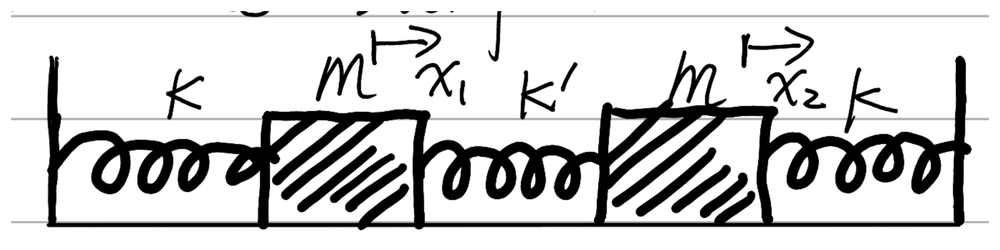
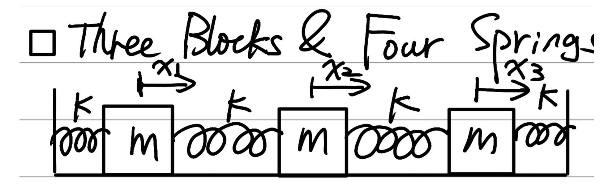
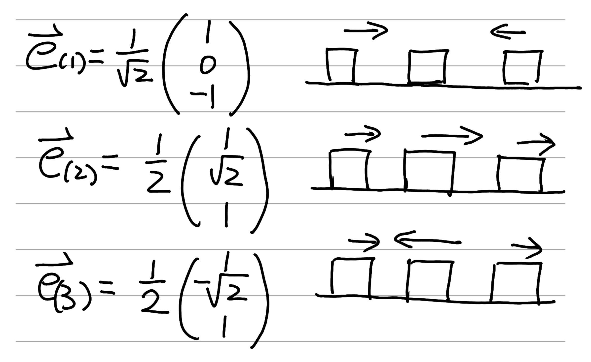
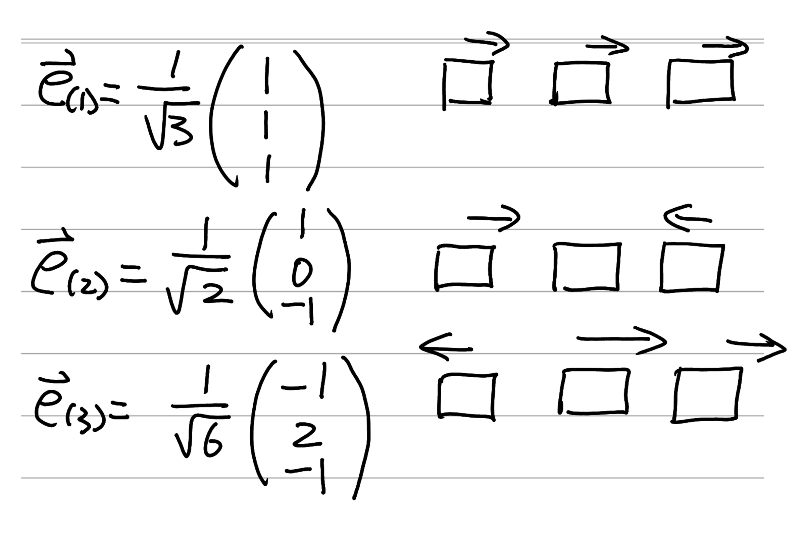

# Coupled Oscillators

> **转写说明：** 本文依据 [20CoupledOscillators.pdf](20CoupledOscillators.pdf) 的全部 21 页手写内容进行视觉识别，保留英文原文、推导顺序及原图，统一数学排版和少量语法。章节标题与目录为整理时添加；明显笔误已在正文校正，并在[校订说明](#8-transcription-and-correction-notes)中逐项列出。各段的原 PDF 页码保存在 Markdown 源文件的注释中。

## Table of Contents

1. [Two Blocks and Three Springs](#1-two-blocks-and-three-springs)
   - [1.1 Lagrangian and Equations of Motion](#11-lagrangian-and-equations-of-motion)
   - [1.2 Decoupling the Equations](#12-decoupling-the-equations)
   - [1.3 Complex Solutions and Real Motion](#13-complex-solutions-and-real-motion)
   - [1.4 The Two Normal Modes](#14-the-two-normal-modes)
2. [Normal Modes as an Eigenvalue Problem](#2-normal-modes-as-an-eigenvalue-problem)
   - [2.1 Characteristic Frequencies](#21-characteristic-frequencies)
   - [2.2 Eigenvectors and Orthogonality](#22-eigenvectors-and-orthogonality)
3. [A Particular Initial-Value Problem](#3-a-particular-initial-value-problem)
4. [Weak Coupling](#4-weak-coupling)
5. [Strong Coupling](#5-strong-coupling)
6. [Three Blocks and Four Springs](#6-three-blocks-and-four-springs)
   - [6.1 Equations of Motion](#61-equations-of-motion)
   - [6.2 Characteristic Frequencies](#62-characteristic-frequencies)
   - [6.3 Normal Modes and General Solution](#63-normal-modes-and-general-solution)
7. [No Walls](#7-no-walls)
   - [7.1 Equations of Motion](#71-equations-of-motion)
   - [7.2 Characteristic Frequencies](#72-characteristic-frequencies)
   - [7.3 Normal Modes](#73-normal-modes)
8. [Transcription and Correction Notes](#8-transcription-and-correction-notes)

---

## 1. Two Blocks and Three Springs

### 1.1 Lagrangian and Equations of Motion

<!-- Source: PDF page 1 -->

Two blocks, each of mass $m$, are on a frictionless surface. The outer springs have spring constant $k$, and the spring between the blocks has spring constant $k'$.

**Figure 1:** Two blocks of mass $m$, with displacements $x_1$ and $x_2$ directed to the right. The spring constants are $k$, $k'$, and $k$ (original drawing, PDF p. 1).

When the blocks are at rest, the springs are unstretched. Displace blocks 1 and 2 from their equilibrium positions by $x_1$ and $x_2$.

$$
\begin{aligned}
L&=T(\dot x_1,\dot x_2)-U(x_1,x_2)\\
&=\frac12m\dot x_1^2+\frac12m\dot x_2^2
-\frac12kx_1^2-\frac12k'(x_2-x_1)^2-\frac12kx_2^2.
\end{aligned}
$$

<!-- Source: PDF page 2 -->

The equations of motion are

$$
m\ddot x_1=-kx_1+k'(x_2-x_1),\tag{1}
$$

$$
m\ddot x_2=-kx_2-k'(x_2-x_1).\tag{2}
$$

Each equation involves both $x_1$ and $x_2$. We need to **decouple** (解耦) them.

------

### 1.2 Decoupling the Equations

Adding (1) and (2), we obtain

$$
m\ddot x_1+m\ddot x_2=-k(x_1+x_2).
$$

Subtracting (1) from (2), we obtain

$$
\begin{aligned}
m\ddot x_2-m\ddot x_1
&=-k(x_2-x_1)-2k'(x_2-x_1)\\
&=(-k-2k')(x_2-x_1).
\end{aligned}
$$

Introduce composite coordinates

$$
\eta_1=x_2+x_1,\qquad \eta_2=x_2-x_1.
$$

Then

$$
\boxed{
\begin{aligned}
m\ddot\eta_1&=-k\eta_1,\\
m\ddot\eta_2&=-(k+2k')\eta_2.
\end{aligned}}
\tag{*}
$$

These are decoupled simple harmonic oscillators.

------

### 1.3 Complex Solutions and Real Motion

<!-- Source: PDF page 3 -->

We write the complex solutions as

$$
\eta_1=C_1e^{i\omega_1t},\qquad
\eta_2=C_2e^{i\omega_2t}.
$$

Their imaginary and real parts independently satisfy equations (*). The physical solutions are the real parts:

$$
\eta_1^{\mathrm{phys}}=\operatorname{Re}\!\left(C_1e^{i\omega_1t}\right),
\qquad
\eta_2^{\mathrm{phys}}=\operatorname{Re}\!\left(C_2e^{i\omega_2t}\right).
$$

$C_1$ and $C_2$ are complex. Let

$$
C_1=A_1-iB_1,\qquad C_2=A_2-iB_2.
$$

For example,

$$
\begin{aligned}
\eta_1
&=(A_1-iB_1)(\cos\omega_1t+i\sin\omega_1t)\\
&=A_1\cos\omega_1t+B_1\sin\omega_1t
+i\left(A_1\sin\omega_1t-B_1\cos\omega_1t\right).
\end{aligned}
$$

Therefore,

$$
\begin{aligned}
\operatorname{Re}(\eta_1)&=A_1\cos\omega_1t+B_1\sin\omega_1t,\\
\operatorname{Re}(\eta_2)&=A_2\cos\omega_2t+B_2\sin\omega_2t.
\end{aligned}
$$

The four constants $(A_1,B_1,A_2,B_2)$ are determined by the initial positions and velocities.

<!-- Source: PDF page 4 -->

Substituting $\eta_1$ and $\eta_2$ into equations (*) gives

$$
(k-m\omega_1^2)C_1=0,
\qquad
\left[(k+2k')-m\omega_2^2\right]C_2=0.
$$

Hence the two frequencies are

$$
\boxed{\omega_1=\sqrt{\frac{k}{m}},\qquad
\omega_2=\sqrt{\frac{k+2k'}{m}}.}
$$

------

### 1.4 The Two Normal Modes

If $C_2=0$, then $\eta_2=x_2-x_1=0$, and

$$
x_1=x_2=\frac{\eta_1}{2}=\frac{C_1}{2}e^{i\omega_1t}.
$$

Each block oscillates with the same frequency $\omega_1$, **in phase** (同相). This is the **first normal mode** (第一简正模式).

<!-- Source: PDF page 5 -->

If $C_1=0$, then $\eta_1=x_1+x_2=0$, and

$$
x_2=-x_1=\frac{C_2}{2}e^{i\omega_2t}.
$$

Each block oscillates with the same frequency

$$
\omega_2=\sqrt{\frac{k+2k'}{m}},
$$

with equal but opposite amplitudes. This is the **second normal mode** (第二简正模式), which is **out of phase** (反相).

With more general initial conditions, and general $C_1$ and $C_2$, the evolution of $x_1$ and $x_2$ is a linear combination of the two normal modes.

What we have done is to **diagonalize** (对角化) a system of linear equations.

------

## 2. Normal Modes as an Eigenvalue Problem

### 2.1 Characteristic Frequencies

<!-- Source: PDF page 6 -->

Let us understand a normal mode. By definition, each block oscillates with the same frequency in a normal mode:

$$
x_1=b_1e^{i\omega t},\qquad x_2=b_2e^{i\omega t}.
$$

Substituting into the equations of motion,

$$
\begin{aligned}
-m\omega^2b_1&=-kb_1+k'(b_2-b_1),\\
-m\omega^2b_2&=-kb_2-k'(b_2-b_1).
\end{aligned}
$$

Thus,

$$
\begin{aligned}
\left[-m\omega^2+(k+k')\right]b_1-k'b_2&=0,\\
-k'b_1+\left[-m\omega^2+(k+k')\right]b_2&=0,
\end{aligned}
$$

or, in matrix form,

$$
\begin{pmatrix}
k+k'-m\omega^2&-k'\\
-k'&k+k'-m\omega^2
\end{pmatrix}
\begin{pmatrix}b_1\\b_2\end{pmatrix}
=\begin{pmatrix}0\\0\end{pmatrix}.
$$

<!-- Source: PDF page 7 -->

Nontrivial solutions require

$$
\begin{vmatrix}
k+k'-m\omega^2&-k'\\
-k'&k+k'-m\omega^2
\end{vmatrix}=0.
$$

Hence

$$
\left[(k+k')-m\omega^2\right]^2-(k')^2=0,
$$

$$
(k+k')-m\omega^2=\pm k',
$$

and therefore

$$
\omega_1=\sqrt{\frac{k}{m}},\qquad
\omega_2=\sqrt{\frac{k+2k'}{m}}.
$$

These are the **characteristic frequencies** or **eigenfrequencies** (本征频率), also called “frequency eigenvalues” in the notes.

------

### 2.2 Eigenvectors and Orthogonality

<!-- Source: PDF page 8 -->

With $\omega_1$ and $\omega_2$, we can find the **eigenvectors** (本征向量).

For $\omega=\omega_1$,

$$
\begin{pmatrix}k'&-k'\\-k'&k'\end{pmatrix}
\begin{pmatrix}b_1\\b_2\end{pmatrix}=0.
$$

Thus

$$
k'b_1-k'b_2=0,\qquad -k'b_1+k'b_2=0
\quad\Longrightarrow\quad b_1=b_2.
$$

For $\omega=\omega_2$,

$$
\begin{pmatrix}-k'&-k'\\-k'&-k'\end{pmatrix}
\begin{pmatrix}b_1\\b_2\end{pmatrix}=0
\quad\Longrightarrow\quad b_1=-b_2.
$$

The normalized eigenvectors are

$$
\boxed{
\mathbf e_{(1)}=\frac{1}{\sqrt2}\begin{pmatrix}1\\1\end{pmatrix},
\qquad
\mathbf e_{(2)}=\frac{1}{\sqrt2}\begin{pmatrix}-1\\1\end{pmatrix}.}
$$

<!-- Source: PDF page 9 -->

It is easy to check that

$$
\mathbf e_{(1)}^{\mathsf T}\mathbf e_{(1)}
=\mathbf e_{(2)}^{\mathsf T}\mathbf e_{(2)}=1,
$$

$$
\mathbf e_{(1)}^{\mathsf T}\mathbf e_{(2)}
=\mathbf e_{(2)}^{\mathsf T}\mathbf e_{(1)}=0.
$$

Here $\mathsf T$ denotes the transpose.

- Each eigenvector tells us the relative amplitudes of the two blocks.
- Each eigenvector is normalized to unity: **normalization** (归一性).
- The eigenvectors are mutually orthogonal: **orthogonality** (正交性).

The differential equations are linear, so we may take arbitrary linear combinations:

$$
\begin{pmatrix}x_1(t)\\x_2(t)\end{pmatrix}
=\operatorname{Re}\!\left[
C_1\mathbf e_{(1)}e^{i\omega_1t}
+C_2\mathbf e_{(2)}e^{i\omega_2t}
\right].
$$

<!-- Source: PDF page 10 (opening statement) -->

The normal-mode vectors form an **orthonormal set** (标准正交组); their associated motions span the space of solutions.

> **Notation.** As in the original notes, $C_1,C_2$ are reused here for the coefficients of the normalized eigenvectors. Their normalization differs from that of the coefficients in $\eta_1=C_1e^{i\omega_1t}$ and $\eta_2=C_2e^{i\omega_2t}$ above. Physical displacements are always the real parts of complex expressions.

------

## 3. A Particular Initial-Value Problem

<!-- Source: PDF page 10 -->

Let us look at a particular case with initial conditions

$$
x_1(0)=x_2(0)=0,\qquad
\dot x_1(0)=v_1,\qquad \dot x_2(0)=v_2.
$$

Remember that

$$
\begin{pmatrix}x_1(t)\\x_2(t)\end{pmatrix}
=\operatorname{Re}\!\left[
C_1\mathbf e_{(1)}e^{i\omega_1t}
+C_2\mathbf e_{(2)}e^{i\omega_2t}\right].
$$

The initial positions give

$$
0=\operatorname{Re}(C_1)\mathbf e_{(1)}
+\operatorname{Re}(C_2)\mathbf e_{(2)}.
$$

In components,

$$
\operatorname{Re}(C_1)-\operatorname{Re}(C_2)=0,
\qquad
\operatorname{Re}(C_1)+\operatorname{Re}(C_2)=0,
$$

so

$$
\operatorname{Re}(C_1)=\operatorname{Re}(C_2)=0.
$$

The initial velocities give

$$
\begin{pmatrix}v_1\\v_2\end{pmatrix}
=-\omega_1\mathbf e_{(1)}\operatorname{Im}(C_1)
-\omega_2\mathbf e_{(2)}\operatorname{Im}(C_2).
$$

<!-- Source: PDF page 11 -->

Therefore,

$$
\begin{aligned}
\begin{pmatrix}v_1\\v_2\end{pmatrix}
&=-\frac{\omega_1\operatorname{Im}(C_1)}{\sqrt2}
\begin{pmatrix}1\\1\end{pmatrix}
-\frac{\omega_2\operatorname{Im}(C_2)}{\sqrt2}
\begin{pmatrix}-1\\1\end{pmatrix}\\
&=\frac{1}{\sqrt2}
\begin{pmatrix}
-\omega_1\operatorname{Im}(C_1)+\omega_2\operatorname{Im}(C_2)\\
-\omega_1\operatorname{Im}(C_1)-\omega_2\operatorname{Im}(C_2)
\end{pmatrix}.
\end{aligned}
$$

Hence

$$
\operatorname{Im}(C_1)=-\frac{v_1+v_2}{\sqrt2\,\omega_1},
\qquad
\operatorname{Im}(C_2)=-\frac{v_2-v_1}{\sqrt2\,\omega_2},
$$

and, since the real parts vanish,

$$
C_1=-i\frac{v_1+v_2}{\sqrt2\,\omega_1},
\qquad
C_2=-i\frac{v_2-v_1}{\sqrt2\,\omega_2}.
$$

The complex displacement of the first block is

$$
x_1^{\mathrm c}(t)=\frac{1}{\sqrt2}C_1e^{i\omega_1t}
-\frac{1}{\sqrt2}C_2e^{i\omega_2t}.
$$

Taking its real part,

$$
x_1(t)=\frac{1}{\sqrt2}\frac{v_1+v_2}{\sqrt2\,\omega_1}\sin\omega_1t
-\frac{1}{\sqrt2}\frac{v_2-v_1}{\sqrt2\,\omega_2}\sin\omega_2t.
$$

<!-- Source: PDF page 12 -->

Similarly,

$$
x_2^{\mathrm c}(t)=\frac{1}{\sqrt2}C_1e^{i\omega_1t}
+\frac{1}{\sqrt2}C_2e^{i\omega_2t},
$$

$$
x_2(t)=\frac{1}{\sqrt2}\frac{v_1+v_2}{\sqrt2\,\omega_1}\sin\omega_1t
+\frac{1}{\sqrt2}\frac{v_2-v_1}{\sqrt2\,\omega_2}\sin\omega_2t.
$$

The real solutions are therefore

$$
\boxed{
\begin{aligned}
x_1(t)&=\frac12\left[
\frac{v_2+v_1}{\omega_1}\sin\omega_1t
-\frac{v_2-v_1}{\omega_2}\sin\omega_2t
\right],\\
x_2(t)&=\frac12\left[
\frac{v_2+v_1}{\omega_1}\sin\omega_1t
+\frac{v_2-v_1}{\omega_2}\sin\omega_2t
\right].
\end{aligned}}
$$

If $v_2=0$,

$$
\begin{aligned}
x_1(t)&=\frac{v_1}{2}\left[
\frac{\sin\omega_1t}{\omega_1}
+\frac{\sin\omega_2t}{\omega_2}\right],\\
x_2(t)&=\frac{v_1}{2}\left[
\frac{\sin\omega_1t}{\omega_1}
-\frac{\sin\omega_2t}{\omega_2}\right].
\end{aligned}
$$

Define the mean frequency and half the frequency difference:

$$
\omega=\frac{\omega_1+\omega_2}{2},\qquad
\Delta\omega=\frac{\omega_2-\omega_1}{2}.
$$

Then

$$
x_{1,2}(t)=\frac{v_1}{2}\left[
\frac{\sin[(\omega-\Delta\omega)t]}{\omega-\Delta\omega}
\pm\frac{\sin[(\omega+\Delta\omega)t]}{\omega+\Delta\omega}
\right],
$$

where the upper sign is for $x_1$ and the lower sign is for $x_2$.

------

## 4. Weak Coupling

<!-- Source: PDF page 13 -->

For **weak coupling** (弱耦合),

$$
k'\ll k,\qquad \frac{k'}{k}\ll1.
$$

Then

$$
\begin{aligned}
\omega_2
&=\sqrt{\frac{k+2k'}{m}}
=\sqrt{\frac{k}{m}}\sqrt{1+\frac{2k'}{k}}\\
&\simeq\omega_1\left(1+\frac{k'}{k}\right).
\end{aligned}
$$

Here we use the first-order expansion of $f(x)=\sqrt{1+x}$, for which

$$
\frac{df}{dx}=\frac{1}{2\sqrt{1+x}}.
$$

Thus

$$
\Delta\omega=\frac{\omega_2-\omega_1}{2}
\simeq\frac{\omega_1k'}{2k}
\simeq\frac{\omega k'}{2k}.
$$

For the initial conditions $v_2=0$, we have

$$
\begin{aligned}
x_{1,2}(t)
&=\frac{v_1}{2}\left[
\frac{\sin[(\omega-\Delta\omega)t]}{\omega-\Delta\omega}
\pm\frac{\sin[(\omega+\Delta\omega)t]}{\omega+\Delta\omega}
\right]\\
&\simeq\frac{v_1}{2\omega}\left[
\sin[(\omega-\Delta\omega)t]
\pm\sin[(\omega+\Delta\omega)t]
\right].
\end{aligned}
$$

Therefore,

$$
\boxed{
\begin{aligned}
x_1(t)&\simeq\frac{v_1}{\omega}\cos(\Delta\omega t)\sin\omega t,\\
x_2(t)&\simeq-\frac{v_1}{\omega}\sin(\Delta\omega t)\cos\omega t.
\end{aligned}}
$$

<!-- Source: PDF page 14 -->

We have used

$$
\sin A\pm\sin B
=2\cos\left(\frac{A\mp B}{2}\right)
\sin\left(\frac{A\pm B}{2}\right).
$$

The motion contains a slow factor and a fast factor:

$$
x_1(t)\simeq\frac{v_1}{\omega}
\underbrace{\cos(\Delta\omega t)}_{\text{slow}}
\underbrace{\sin\omega t}_{\text{fast}},
$$

$$
x_2(t)\simeq-\frac{v_1}{\omega}
\underbrace{\sin(\Delta\omega t)}_{\text{slow}}
\underbrace{\cos\omega t}_{\text{fast}}.
$$

With $v_2=0$ and $v_1\ne0$, when the amplitude envelope of $x_1$ is maximal, the envelope of $x_2$ is zero. At

$$
\Delta\omega t=\frac{\pi}{2},
$$

$x_2$ has a large amplitude and the envelope of $x_1$ vanishes.

<!-- Source: PDF page 15 (opening paragraph) -->

For weakly coupled oscillators, the energy of oscillation is gradually exchanged from one oscillator to the other and back again.

------

## 5. Strong Coupling

<!-- Source: PDF page 15 -->

For **strong coupling** (强耦合),

$$
k'\gg k.
$$

The frequencies satisfy

$$
\omega_1=\sqrt{\frac{k}{m}},
$$

$$
\begin{aligned}
\omega_2
&=\sqrt{\frac{k+2k'}{m}}
=\sqrt{\frac{k}{m}}\sqrt{1+\frac{2k'}{k}}\\
&\simeq\omega_1\sqrt{\frac{2k'}{k}}.
\end{aligned}
$$

For the same initial conditions with $v_2=0$,

$$
\begin{aligned}
x_{1,2}(t)
&=\frac{v_1}{2}\left[
\frac{\sin\omega_1t}{\omega_1}
\pm\frac{\sin\omega_2t}{\omega_2}\right]\\
&\simeq\frac{v_1}{2\omega_1}\left[
\sin\omega_1t
\pm\sqrt{\frac{k}{2k'}}
\sin\left(\omega_1\sqrt{\frac{2k'}{k}}\,t\right)
\right].
\end{aligned}
$$

The second term has a small amplitude and a high frequency. Again, the upper sign is for $x_1$ and the lower sign is for $x_2$.

------

## 6. Three Blocks and Four Springs

### 6.1 Equations of Motion

<!-- Source: PDF page 16 -->

Consider three blocks, each of mass $m$, connected by four springs of spring constant $k$ between two fixed walls.

**Figure 2:** Three blocks and four springs, with displacements $x_1,x_2,x_3$ measured to the right (original drawing, PDF p. 16).

The equations of motion are

$$
\begin{aligned}
m\ddot x_1&=-kx_1+k(x_2-x_1),\\
m\ddot x_2&=-k(x_2-x_1)+k(x_3-x_2),\\
m\ddot x_3&=-kx_3-k(x_3-x_2).
\end{aligned}
$$

Let us first find the normal modes. Set

$$
x_1=b_1e^{i\omega t},\qquad
x_2=b_2e^{i\omega t},\qquad
x_3=b_3e^{i\omega t}.
$$

Then

$$
\begin{pmatrix}
2k-m\omega^2&-k&0\\
-k&2k-m\omega^2&-k\\
0&-k&2k-m\omega^2
\end{pmatrix}
\begin{pmatrix}b_1\\b_2\\b_3\end{pmatrix}
=\begin{pmatrix}0\\0\\0\end{pmatrix}.
\tag{**}
$$

------

### 6.2 Characteristic Frequencies

<!-- Source: PDF page 17 -->

Nontrivial solutions require

$$
\begin{vmatrix}
2k-m\omega^2&-k&0\\
-k&2k-m\omega^2&-k\\
0&-k&2k-m\omega^2
\end{vmatrix}=0.
$$

Expanding the determinant,

$$
\begin{aligned}
&(2k-m\omega^2)\left[(2k-m\omega^2)^2-k^2\right]
+k\left[-k(2k-m\omega^2)\right]=0,\\
&\Longrightarrow\quad
(2k-m\omega^2)\left[(2k-m\omega^2)^2-2k^2\right]=0.
\end{aligned}
$$

The first factor gives

$$
\omega^2=\frac{2k}{m}
\quad\Longrightarrow\quad
\omega_1=\sqrt{\frac{2k}{m}}.
$$

The second factor gives

$$
2k-m\omega^2=\pm\sqrt2\,k,
$$

and hence

$$
\boxed{
\omega_1=\sqrt{\frac{2k}{m}},\qquad
\omega_2=\sqrt{\frac{(2-\sqrt2)k}{m}},\qquad
\omega_3=\sqrt{\frac{(2+\sqrt2)k}{m}}.}
$$

> **Notation.** The mode numbering follows the original notes; it is not in ascending frequency order.

------

### 6.3 Normal Modes and General Solution

<!-- Source: PDF page 18 -->

We can find the three normal-mode motions by solving for the eigenvectors. Substitute $\omega=\omega_1,\omega_2,\omega_3$ into (**):

$$
\begin{array}{lll}
\omega=\omega_1:&b_2=0,&b_3=-b_1,\\
\omega=\omega_2:&b_3=b_1,&b_2=\sqrt2\,b_1,\\
\omega=\omega_3:&b_3=b_1,&b_2=-\sqrt2\,b_1.
\end{array}
$$

Thus the normalized eigenvectors are

$$
\boxed{
\mathbf e_{(1)}=\frac{1}{\sqrt2}\begin{pmatrix}1\\0\\-1\end{pmatrix},
\qquad
\mathbf e_{(2)}=\frac12\begin{pmatrix}1\\\sqrt2\\1\end{pmatrix},
\qquad
\mathbf e_{(3)}=\frac12\begin{pmatrix}1\\-\sqrt2\\1\end{pmatrix}.}
$$

**Figure 3:** The three normal modes with fixed ends (original drawing, PDF p. 18). In mode 1 the middle block remains at rest; in mode 2 all three blocks move in phase; in mode 3 the middle block moves oppositely to the outer blocks.

<!-- Source: PDF page 19 (opening equation) -->

The general solution is

$$
\begin{pmatrix}x_1(t)\\x_2(t)\\x_3(t)\end{pmatrix}
=\operatorname{Re}\!\left[
C_1\mathbf e_{(1)}e^{i\omega_1t}
+C_2\mathbf e_{(2)}e^{i\omega_2t}
+C_3\mathbf e_{(3)}e^{i\omega_3t}
\right].
$$

------

## 7. No Walls

### 7.1 Equations of Motion

<!-- Source: PDF page 19 -->

Remove the walls and the two outer springs. The three blocks remain connected by the two internal springs. The equations of motion become

$$
\begin{aligned}
m\ddot x_1&=k(x_2-x_1),\\
m\ddot x_2&=-k(x_2-x_1)+k(x_3-x_2),\\
m\ddot x_3&=-k(x_3-x_2).
\end{aligned}
$$

With

$$
x_1=b_1e^{i\omega t},\qquad
x_2=b_2e^{i\omega t},\qquad
x_3=b_3e^{i\omega t},
$$

we obtain

$$
\begin{pmatrix}
k-m\omega^2&-k&0\\
-k&2k-m\omega^2&-k\\
0&-k&k-m\omega^2
\end{pmatrix}
\begin{pmatrix}b_1\\b_2\\b_3\end{pmatrix}
=\begin{pmatrix}0\\0\\0\end{pmatrix}.
$$

------

### 7.2 Characteristic Frequencies

<!-- Source: PDF page 20 -->

The characteristic equation is

$$
\begin{vmatrix}
k-m\omega^2&-k&0\\
-k&2k-m\omega^2&-k\\
0&-k&k-m\omega^2
\end{vmatrix}=0.
$$

Expanding,

$$
\begin{aligned}
&(k-m\omega^2)
\left[(2k-m\omega^2)(k-m\omega^2)-k^2\right]
+k\left[-k(k-m\omega^2)\right]=0,\\
&\Longrightarrow\quad
(k-m\omega^2)
\left[(2k-m\omega^2)(k-m\omega^2)-2k^2\right]=0.
\end{aligned}
$$

The expression in square brackets is

$$
\begin{aligned}
(-m\omega^2)^2-3km\omega^2+2k^2-2k^2
&=-m\omega^2(-m\omega^2+3k).
\end{aligned}
$$

Multiplying the resulting equation by $-1$, we may write

$$
(k-m\omega^2)m\omega^2(3k-m\omega^2)=0.
$$

Thus

$$
\boxed{
\omega_1=0,\qquad
\omega_2=\sqrt{\frac{k}{m}},\qquad
\omega_3=\sqrt{\frac{3k}{m}}.}
$$

------

### 7.3 Normal Modes

<!-- Source: PDF page 21 -->

The normalized eigenvectors are

$$
\boxed{
\mathbf e_{(1)}=\frac{1}{\sqrt3}\begin{pmatrix}1\\1\\1\end{pmatrix},
\qquad
\mathbf e_{(2)}=\frac{1}{\sqrt2}\begin{pmatrix}1\\0\\-1\end{pmatrix},
\qquad
\mathbf e_{(3)}=\frac{1}{\sqrt6}\begin{pmatrix}-1\\2\\-1\end{pmatrix}.}
$$

**Figure 4:** Normal modes without walls (original drawing, PDF p. 21). The last arrow in the original bottom sketch is inconsistent with its eigenvector: the two outer blocks should move in the same direction, opposite to the middle block.

- **Mode 1:** All three blocks move together; this is the zero-frequency translation mode.
- **Mode 2:** The outer blocks move oppositely, while the middle block remains at rest.
- **Mode 3:** The outer blocks move together, opposite to the middle block; the middle block has twice their displacement amplitude.

> **补充说明（原稿未展开）：** 零频模不表示周期振动，其模态坐标满足 $\ddot q_1=0$，故一般为 $q_1(t)=a+bt$，对应整体平移。不能仅用 $C_1e^{i0t}$ 表示这一模态的全部初值解。

------

## 8. Transcription and Correction Notes

以下记录正文中的数学校订；原图保留手写原貌。普通英文拼写、标点及排版已统一，不逐项列出。

| PDF 页码 | 原稿情况 | 本文处理 |
| --- | --- | --- |
| 3 | $(A_1-iB_1)(\cos\omega_1t+i\sin\omega_1t)$ 的虚部写成 $-i(B_1\cos\omega_1t+A_1\sin\omega_1t)$。 | 改为 $i(A_1\sin\omega_1t-B_1\cos\omega_1t)$；原稿的实部结果正确。 |
| 5 | 在 $\eta_2=x_2-x_1=C_2e^{i\omega_2t}$ 的定义下，写成 $x_2=-x_1=-(C_2/2)e^{i\omega_2t}$。 | 改为 $x_2=-x_1=(C_2/2)e^{i\omega_2t}$，与既定坐标定义一致。 |
| 9、10、19 | 多处把实位移直接等同于复指数表达式。 | 对物理位移显式添加 $\operatorname{Re}$；需展示复数中间量时使用上标 $\mathrm c$。 |
| 10–11 | 由 $e^{i\omega t}$ 求初速度时，把 $\operatorname{Re}(iC)$ 当成 $\operatorname{Im}(C)$，并写成 $C_j=\operatorname{Im}(C_j)$。 | 使用 $\operatorname{Re}(iC)=-\operatorname{Im}(C)$；纯虚系数应为 $C_j=i\operatorname{Im}(C_j)$。相应修正中间步骤，保留原稿最终正确的正弦解。 |
| 12 | $\operatorname{Re}(x_2)$ 的首个展开式中漏写 $\omega_1,\omega_2$ 分母；该页后面的汇总式已包含这些分母。 | 补齐两个频率分母，与该页最终结果一致。 |
| 12 | 用 $x_{1,2}$ 合写的最后一式只写了减号。 | 改为 $\pm$：$x_1$ 取加号，$x_2$ 取减号，与前两式及第 13 页一致。 |
| 13–14 | 弱耦合的包络近似推导后，部分公式使用等号。 | 统一为近似号 $\simeq$，明确已采用 $\omega\pm\Delta\omega\simeq\omega$ 的分母近似；保留快、慢因子及能量交换的原意。 |
| 16 | 固定端三振子的矩阵左上角写成 $k-m\omega^2$。 | 改为 $2k-m\omega^2$，由该页运动方程可直接得到，也与第 17 页行列式一致。 |
| 21 | 自由端第三模态的最右箭头朝右，与同页本征向量 $(-1,2,-1)^{\mathsf T}/\sqrt6$ 不符。 | 保留原图，在图注中指出该箭头应朝左；文字描述以本征向量为准。 |

> **符号说明：** $\eta_1,\eta_2$ 对应原稿手写的组合坐标；$\operatorname{Re}$ 和 $\operatorname{Im}$ 分别对应原稿的实部与虚部记号。$k'$ 是中间弹簧的劲度系数，不是导数。不同例题中的 $\omega_j$ 和 $\mathbf e_{(j)}$ 均按该例题重新定义。
