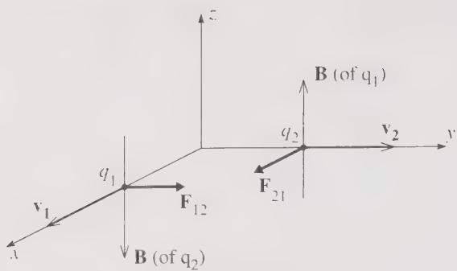
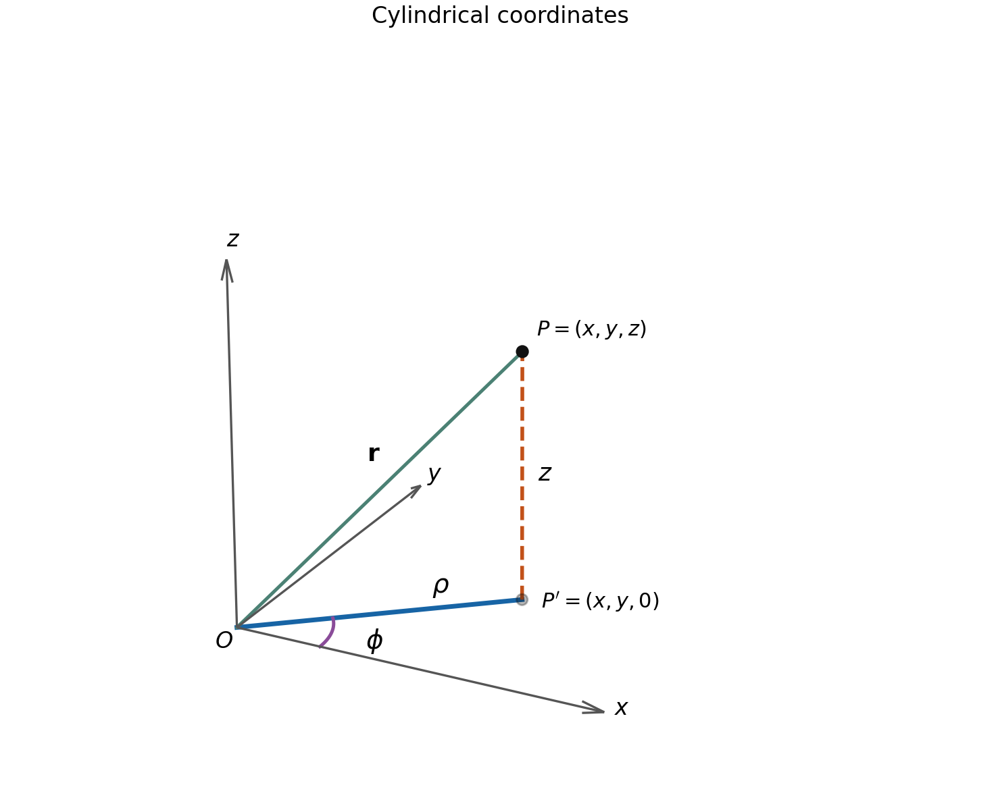
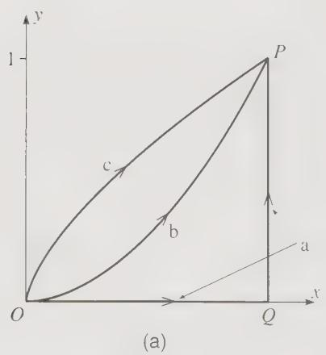
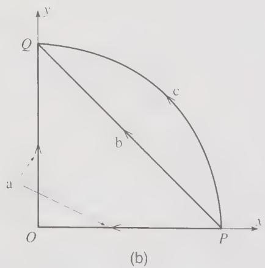
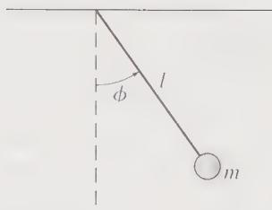
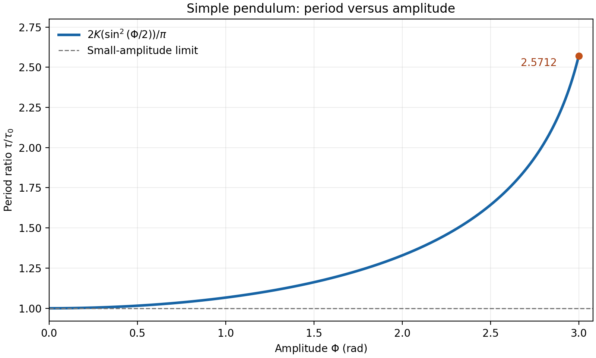
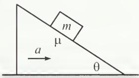

# Problem Set 1 — Worked Solutions

## 1. Taylor 1.32 — Magnetic and electric forces [10 points]

### Problem statement

If you have some experience in electromagnetism, you could do the following problem concerning the curious situation illustrated in Figure 1.8. The electric and magnetic fields at a point $\mathbf r_1$ due to a charge $q_2$ at $\mathbf r_2$ moving with constant velocity $\mathbf v_2$ (with $v_2\ll c$) are

$$
\mathbf E(\mathbf r_1)=\frac{1}{4\pi\epsilon_0}\frac{q_2}{s^2}\hat{\mathbf s},
\qquad
\mathbf B(\mathbf r_1)=\frac{\mu_0}{4\pi}\frac{q_2}{s^2}
\mathbf v_2\times\hat{\mathbf s},
$$

where $\mathbf s=\mathbf r_1-\mathbf r_2$ is the vector pointing from $\mathbf r_2$ to $\mathbf r_1$. (The first of these you should recognize as Coulomb's law.) If $F_{12}^{\mathrm{el}}$ and $F_{12}^{\mathrm{mag}}$ denote the electric and magnetic forces on a charge $q_1$ at $\mathbf r_1$ with velocity $\mathbf v_1$, show that

$$
F_{12}^{\mathrm{mag}}\le\frac{v_1v_2}{c^2}F_{12}^{\mathrm{el}}.
$$

This shows that in the non-relativistic domain it is legitimate to ignore the magnetic force between two moving charges.

*Figure 1.8 Each of the positive charges $q_1$ and $q_2$ produces a magnetic field that exerts a force on the other charge. The resulting magnetic forces $\mathbf F_{12}$ and $\mathbf F_{21}$ do not obey Newton's third law.*

### Solution

**Step 1: Calculate the electric-force magnitude.**

$$
F_{12}^{\mathrm{el}}=\lvert q_1\rvert E
=\frac{\lvert q_1q_2\rvert}{4\pi\epsilon_0s^2}.
$$

**Step 2: Bound the magnetic force.**

Using $\lvert\mathbf a\times\mathbf b\rvert\le\lvert\mathbf a\rvert\lvert\mathbf b\rvert$,

$$
B\le\frac{\mu_0\lvert q_2\rvert}{4\pi s^2}v_2,
$$

and therefore

$$
F_{12}^{\mathrm{mag}}
=\lvert q_1\rvert\,\lvert\mathbf v_1\times\mathbf B\rvert
\le\frac{\mu_0\lvert q_1q_2\rvert}{4\pi s^2}v_1v_2.
$$

**Step 3: Compare the magnitudes.**

Since $\mu_0\epsilon_0=1/c^2$,

$$
\boxed{
F_{12}^{\mathrm{mag}}
\le\frac{v_1v_2}{c^2}F_{12}^{\mathrm{el}}.
}
$$

For two nonrelativistic point charges, $v_1v_2/c^2\ll1$, so the magnetic force is much smaller than the electric force. Figure 1.8 is not needed for this bound.

---

## 2. Taylor 1.33 — Forces between steady current loops [10 points]

### Problem statement

If you have some experience in electromagnetism and with vector calculus, prove that the magnetic forces, $\mathbf F_{12}$ and $\mathbf F_{21}$, between any two steady current loops obey Newton's third law. [Hints: Let the two currents be $I_1$ and $I_2$ and let typical points on the two loops be $\mathbf r_1$ and $\mathbf r_2$. If $d\mathbf r_1$ and $d\mathbf r_2$ are short segments of the loops, then according to the Biot–Savart law, the force on $d\mathbf r_1$ due to $d\mathbf r_2$ is

$$
\frac{\mu_0}{4\pi}\frac{I_1I_2}{s^2}
d\mathbf r_1\times(d\mathbf r_2\times\hat{\mathbf s}),
$$

where $\mathbf s=\mathbf r_1-\mathbf r_2$. The force $\mathbf F_{12}$ is found by integrating this around both loops. You will need to use the “BAC − CAB” rule to simplify the triple product.]

### Solution

Assume the ideal thin-wire loops do not intersect. Orient each loop along its current and define $C=\mu_0I_1I_2/(4\pi)$.

**Step 1: Expand the triple product.**

Using

$$
\mathbf a\times(\mathbf b\times\mathbf c)
=\mathbf b(\mathbf a\cdot\mathbf c)-\mathbf c(\mathbf a\cdot\mathbf b),
$$

we obtain

$$
\mathbf F_{12}
=C\oint_{C_2}\oint_{C_1}
\left[
d\mathbf r_2\frac{d\mathbf r_1\cdot\mathbf s}{s^3}
-\frac{\mathbf s}{s^3}(d\mathbf r_1\cdot d\mathbf r_2)
\right].
$$

**Step 2: Show that the first term integrates to zero.**

Holding $\mathbf r_2$ fixed,

$$
d_1\left(\frac1s\right)
=-\frac{\mathbf s\cdot d\mathbf r_1}{s^3}.
$$

The integral of this exact differential around a closed loop vanishes:

$$
\oint_{C_1}\frac{\mathbf s\cdot d\mathbf r_1}{s^3}=0.
$$

Thus

$$
\mathbf F_{12}
=-C\oint_{C_2}\oint_{C_1}
\frac{\mathbf s}{s^3}(d\mathbf r_1\cdot d\mathbf r_2).
$$

**Step 3: Exchange the labels.**

Interchanging 1 and 2 changes $\mathbf s$ to $-\mathbf s$ but leaves the scalar product unchanged. Hence

$$
\boxed{\mathbf F_{21}=-\mathbf F_{12}}.
$$

This result concerns the total forces between complete steady closed loops. The forces between individual pairs of current elements need not be equal and opposite.

---

## 3. Taylor 1.39 — Projectile motion over an inclined plane [10 points]

### Problem statement

A ball is thrown with initial speed $v_0$ up an inclined plane. The plane is inclined at an angle $\phi$ above the horizontal, and the ball's initial velocity is at an angle $\theta$ above the plane. Choose axes with $x$ measured up the slope, $y$ normal to the slope, and $z$ across it. Write down Newton's second law using these axes and find the ball's position as a function of time. Show that the ball lands a distance

$$
R=\frac{2v_0^2\sin\theta\cos(\theta+\phi)}{g\cos^2\phi}
$$

from its launch point. Show that for given $v_0$ and $\phi$, the maximum possible range up the inclined plane is

$$
R_{\max}=\frac{v_0^2}{g(1+\sin\phi)}.
$$

### Solution

Take the launch point as the origin, with the initial velocity in the $xy$ plane and $0\le\phi<\pi/2$.

**Step 1: Resolve gravity and integrate.**

$$
m\ddot x=-mg\sin\phi,\qquad
m\ddot y=-mg\cos\phi,\qquad m\ddot z=0.
$$

The initial velocity components are $v_0\cos\theta$, $v_0\sin\theta$, and zero. Therefore,

$$
\boxed{
x(t)=v_0\cos\theta\,t-\frac12g\sin\phi\,t^2,
}
$$

$$
\boxed{
y(t)=v_0\sin\theta\,t-\frac12g\cos\phi\,t^2,
\qquad z(t)=0.
}
$$

**Step 2: Find the landing time and range.**

The plane is $y=0$. The nonzero solution is

$$
T=\frac{2v_0\sin\theta}{g\cos\phi}.
$$

Substituting into $x(t)$,

$$
\begin{aligned}
R
&=\frac{2v_0^2}{g\cos^2\phi}
\left(\sin\theta\cos\theta\cos\phi-\sin^2\theta\sin\phi\right)\\
&=\boxed{\frac{2v_0^2\sin\theta\cos(\theta+\phi)}
{g\cos^2\phi}}.
\end{aligned}
$$

This is a signed displacement along the slope. For an uphill landing, take $0<\theta<\pi/2-\phi$.

**Step 3: Maximize the range.**

Use

$$
2\sin\theta\cos(\theta+\phi)
=\sin(2\theta+\phi)-\sin\phi.
$$

Thus

$$
R=\frac{v_0^2}{g\cos^2\phi}
[\sin(2\theta+\phi)-\sin\phi].
$$

The maximum occurs at $2\theta+\phi=\pi/2$, giving

$$
\boxed{\theta_{\mathrm{opt}}=\frac\pi4-\frac\phi2},
$$

and

$$
\boxed{
R_{\max}
=\frac{v_0^2(1-\sin\phi)}{g\cos^2\phi}
=\frac{v_0^2}{g(1+\sin\phi)}.
}
$$

The optimal launch angle relative to the horizontal is $\pi/4+\phi/2$. For a horizontal plane, the usual $45^\circ$ result is recovered.

---

## 4. Taylor 1.40 — A projectile whose distance keeps increasing [10 points]

### Problem statement

A cannon shoots a ball at an angle $\theta$ above the horizontal ground.

(a) Neglecting air resistance, use Newton's second law to find the ball's position as a function of time. (Use axes with $x$ measured horizontally and $y$ vertically.)

(b) Let $r(t)$ denote the ball's distance from the cannon. What is the largest possible value of $\theta$ if $r(t)$ is to increase throughout the ball's flight? [Hint: Using your solution to part (a) you can write down $r^2$ as $x^2+y^2$, and then find the condition that $r^2$ is always increasing.]

### Solution

Let the launch speed be $v_0$, and assume the ball lands at its launch height. Take $0<\theta\le\pi/2$.

**(a) Position.**

From $\ddot x=0$ and $\ddot y=-g$,

$$
\boxed{
x(t)=v_0\cos\theta\,t,\qquad
y(t)=v_0\sin\theta\,t-\frac12gt^2.
}
$$

The flight time is

$$
T=\frac{2v_0\sin\theta}{g}.
$$

**(b) Monotonicity of the distance.**

$$
r^2=v_0^2t^2-v_0g\sin\theta\,t^3+\frac14g^2t^4,
$$

so

$$
\frac{d(r^2)}{dt}
=t\left(2v_0^2-3v_0g\sin\theta\,t+g^2t^2\right).
$$

For $0<t<T$, $r>0$, so the signs of $dr/dt$ and $d(r^2)/dt$ agree. The quadratic factor

$$
Q(t)=g^2t^2-3v_0g\sin\theta\,t+2v_0^2
$$

has its minimum at

$$
t_*=\frac{3v_0\sin\theta}{2g}=\frac34T.
$$

This lies inside the flight interval. Thus the necessary and sufficient condition is

$$
Q(t_*)=v_0^2\left(2-\frac94\sin^2\theta\right)\ge0.
$$

Therefore,

$$
\boxed{
\theta_{\max}
=\arcsin\left(\frac{2\sqrt2}{3}\right)
\approx70.5288^\circ.
}
$$

At this limiting angle, $dr/dt=0$ at one isolated instant, but $r(t)$ is still strictly increasing. If “increase throughout” is interpreted as $dr/dt>0$ at every intermediate instant, the condition is instead $\theta<\theta_{\max}$, with this value as the supremum.

---

## 5. Taylor 1.47 — Cylindrical coordinates and acceleration [10 points]

### Problem statement

Let the position of a point $P$ in three dimensions be given by the vector $\mathbf r=(x,y,z)$ in rectangular (or Cartesian) coordinates. The same position can be specified by cylindrical polar coordinates, $\rho,\phi,z$, which are defined as follows: Let $P'$ denote the projection of $P$ onto the $xy$ plane; that is, $P'$ has Cartesian coordinates $(x,y,0)$. Then $\rho$ and $\phi$ are defined as the two-dimensional polar coordinates of $P'$ in the $xy$ plane, while $z$ is the third Cartesian coordinate, unchanged.

(a) Make a sketch to illustrate the three cylindrical coordinates. Give expressions for $\rho,\phi,z$ in terms of the Cartesian coordinates $x,y,z$. Explain in words what $\rho$ is (“$\rho$ is the distance of $P$ from _____”). There are many variants in notation. For instance, some people use $r$ instead of $\rho$. Explain why this use of $r$ is unfortunate.

(b) Describe the three unit vectors $\hat{\boldsymbol\rho},\hat{\boldsymbol\phi},\hat{\mathbf z}$ and write the expansion of the position vector $\mathbf r$ in terms of these unit vectors.

(c) Differentiate your last answer twice to find the cylindrical components of the acceleration $\mathbf a=\ddot{\mathbf r}$ of the particle. To do this, you will need to know the time derivatives of $\hat{\boldsymbol\rho}$ and $\hat{\boldsymbol\phi}$. You could get these from the corresponding two-dimensional results (1.42) and (1.46), or you could derive them directly as in Problem 1.48.

### Solution

**(a) Coordinates and geometry.**

Here $OP'=\rho$, $\phi$ is measured from the positive $x$ axis in the $xy$ plane, and $z$ is the signed vertical coordinate.

$$
x=\rho\cos\phi,\qquad y=\rho\sin\phi,
$$

so

$$
\boxed{
\rho=\sqrt{x^2+y^2},\qquad
\phi=\operatorname{atan2}(y,x),\qquad z=z.
}
$$

The azimuth is defined modulo $2\pi$, and is undefined on the axis $\rho=0$.

$\rho$ is the distance from $P$ to the **$z$ axis**. The distance from the origin is instead

$$
r=\lvert\mathbf r\rvert=\sqrt{\rho^2+z^2}.
$$

Using $r$ for the cylindrical radius can therefore confuse these two different distances.

**(b) Unit vectors and position.**

The unit vectors point in the directions of increasing $\rho,\phi,z$:

$$
\hat{\boldsymbol\rho}
=\cos\phi\,\hat{\mathbf x}+\sin\phi\,\hat{\mathbf y},
$$

$$
\hat{\boldsymbol\phi}
=-\sin\phi\,\hat{\mathbf x}+\cos\phi\,\hat{\mathbf y},
\qquad
\hat{\mathbf z}=\text{fixed vertical unit vector}.
$$

They form a right-handed orthonormal basis. The position is

$$
\boxed{\mathbf r=\rho\hat{\boldsymbol\rho}+z\hat{\mathbf z}}.
$$

There is no azimuthal component; the azimuth is already encoded in the direction of $\hat{\boldsymbol\rho}$.

**(c) Velocity and acceleration.**

As derived in Problem 1.48,

$$
\dot{\hat{\boldsymbol\rho}}=\dot\phi\hat{\boldsymbol\phi},
\qquad
\dot{\hat{\boldsymbol\phi}}=-\dot\phi\hat{\boldsymbol\rho},
\qquad
\dot{\hat{\mathbf z}}=0.
$$

Differentiating once,

$$
\mathbf v=\dot\rho\hat{\boldsymbol\rho}
+\rho\dot\phi\hat{\boldsymbol\phi}
+\dot z\hat{\mathbf z}.
$$

Differentiating again and collecting components,

$$
\boxed{
\mathbf a
=(\ddot\rho-\rho\dot\phi^2)\hat{\boldsymbol\rho}
+(\rho\ddot\phi+2\dot\rho\dot\phi)\hat{\boldsymbol\phi}
+\ddot z\hat{\mathbf z}.
}
$$

Both the scalar coordinates and the rotating unit vectors must be differentiated.

---

## 6. Taylor 1.48 — Time derivatives of cylindrical unit vectors [10 points]

### Problem statement

Find expressions for the unit vectors $\hat{\boldsymbol\rho},\hat{\boldsymbol\phi},\hat{\mathbf z}$ of cylindrical polar coordinates (Problem 1.47) in terms of the Cartesian $\hat{\mathbf x},\hat{\mathbf y},\hat{\mathbf z}$. Differentiate each of these expressions with respect to time to find $d\hat{\boldsymbol\rho}/dt$, $d\hat{\boldsymbol\phi}/dt$, and $d\hat{\mathbf z}/dt$.

### Solution

The Cartesian basis is fixed. Starting from

$$
\hat{\boldsymbol\rho}=\cos\phi\,\hat{\mathbf x}+\sin\phi\,\hat{\mathbf y},
\qquad
\hat{\boldsymbol\phi}=-\sin\phi\,\hat{\mathbf x}+\cos\phi\,\hat{\mathbf y},
$$

differentiate directly:

$$
\begin{aligned}
\frac{d\hat{\boldsymbol\rho}}{dt}
&=-\dot\phi\sin\phi\,\hat{\mathbf x}
+\dot\phi\cos\phi\,\hat{\mathbf y}\\
&=\boxed{\dot\phi\hat{\boldsymbol\phi}},
\end{aligned}
$$

$$
\begin{aligned}
\frac{d\hat{\boldsymbol\phi}}{dt}
&=-\dot\phi\cos\phi\,\hat{\mathbf x}
-\dot\phi\sin\phi\,\hat{\mathbf y}\\
&=\boxed{-\dot\phi\hat{\boldsymbol\rho}}.
\end{aligned}
$$

The vertical unit vector is fixed, so

$$
\boxed{\frac{d\hat{\mathbf z}}{dt}=0}.
$$

If needed, a further differentiation yields

$$
\ddot{\hat{\boldsymbol\rho}}
=\ddot\phi\hat{\boldsymbol\phi}-\dot\phi^2\hat{\boldsymbol\rho},
\qquad
\ddot{\hat{\boldsymbol\phi}}
=-\ddot\phi\hat{\boldsymbol\rho}-\dot\phi^2\hat{\boldsymbol\phi}.
$$

---

## 7. Taylor 1.49 — A puck between concentric cylinders [10 points]

### Problem statement

Imagine two concentric cylinders, centered on the vertical $z$ axis, with radii $R\pm\epsilon$, where $\epsilon$ is very small. A small frictionless puck of thickness $2\epsilon$ is inserted between the two cylinders, so that it can be considered a point mass that can move freely at a fixed distance from the vertical axis. If we use cylindrical polar coordinates $(\rho,\phi,z)$ for its position (Problem 1.47), then $\rho$ is fixed at $\rho=R$, while $\phi$ and $z$ can vary at will. Write down and solve Newton's second law for the general motion of the puck, including the effects of gravity. Describe the puck's motion.

### Solution

**Step 1: Resolve Newton's second law.**

The frictionless contact force is radial. Let its signed radial component be $N_\rho$, and take $z$ upward. Since $\rho=R$,

$$
\boxed{
-mR\dot\phi^2=N_\rho,\qquad
mR\ddot\phi=0,\qquad m\ddot z=-mg.
}
$$

**Step 2: Integrate with general initial conditions.**

Let $\phi(0)=\phi_0$, $\dot\phi(0)=\omega_0$, $z(0)=z_0$, and $\dot z(0)=v_{z0}$. Then

$$
\boxed{
\rho=R,\qquad
\phi=\phi_0+\omega_0t,\qquad
z=z_0+v_{z0}t-\frac12gt^2.
}
$$

The net contact force is

$$
\boxed{\mathbf N=-mR\omega_0^2\hat{\boldsymbol\rho}},
$$

providing the centripetal acceleration.

**Step 3: Describe the trajectory.**

$$
x=R\cos(\phi_0+\omega_0t),\qquad
y=R\sin(\phi_0+\omega_0t),\qquad
z=z_0+v_{z0}t-\frac12gt^2.
$$

The horizontal projection is uniform circular motion, while the vertical motion has constant downward acceleration. If $\omega_0=0$, the puck moves along a vertical generator of the cylinder. Otherwise it winds around the cylinder, but generally is not a constant-pitch helix because its vertical velocity changes with time.

---

## 8. Taylor 4.2 — Work along three paths [10 points]

### Problem statement

Evaluate the work done

$$
W=\int_O^P\mathbf F\cdot d\mathbf r
=\int_O^P(F_x\,dx+F_y\,dy). \tag{4.100}
$$

by the two-dimensional force $\mathbf F=(x^2,2xy)$ along the three paths joining the origin to the point $P=(1,1)$ as shown in Figure 4.24(a) and defined as follows:

(a) This path goes along the $x$ axis to $Q=(1,0)$, and then straight up to $P$. (Divide the integral into two pieces, $\int_O^P=\int_O^Q+\int_Q^P$.)

(b) On this path $y=x^2$, and you can replace the term $dy$ in (4.100) by $dy=2x\,dx$ and convert the whole integral into an integral over $x$.

(c) This path is given parametrically as $x=t^3$, $y=t^2$. In this case rewrite $x$, $y$, $dx$, and $dy$ in (4.100) in terms of $t$ and $dt$, and convert the integral into an integral over $t$.

*Figure 4.24 (a) Problem 4.2.*

### Solution

**(a) Two straight segments.**

Along $OQ$, $y=0$ and $dy=0$, so

$$
W_{OQ}=\int_0^1x^2\,dx=\frac13.
$$

Along $QP$, $x=1$ and $dx=0$, so

$$
W_{QP}=\int_0^1 2y\,dy=1.
$$

Therefore,

$$
\boxed{W_a=\frac43.}
$$

**(b) The parabola $y=x^2$.**

Substituting $y=x^2$ and $dy=2x\,dx$ gives

$$
W_b=\int_0^1\left[x^2+2x(x^2)(2x)\right]dx
=\int_0^1(x^2+4x^4)\,dx.
$$

Hence

$$
\boxed{W_b=\frac13+\frac45=\frac{17}{15}.}
$$

**(c) The parametrized curve.**

The endpoints correspond to $t=0$ and $t=1$. Since

$$
dx=3t^2\,dt,\qquad dy=2t\,dt,\qquad
F_x=t^6,\qquad F_y=2t^5,
$$

we obtain

$$
W_c=\int_0^1(3t^8+4t^6)\,dt
=\frac13+\frac47.
$$

Thus

$$
\boxed{W_c=\frac{19}{21}.}
$$

**Conclusion.** The three answers differ: the work is path dependent. This agrees with

$$
(\nabla\times\mathbf F)_z
=\frac{\partial F_y}{\partial x}-\frac{\partial F_x}{\partial y}
=2y,
$$

which is not identically zero. The written path descriptions are sufficient even without Figure 4.24(a).

---

## 9. Taylor 4.3 — Work between two points [10 points]

### Problem statement

Do the same as in Problem 4.2, but for the force $\mathbf F=(-y,x)$ and for the three paths joining $P$ and $Q$ shown in Figure 4.24(b) and defined as follows:

(a) This path goes straight from $P=(1,0)$ to the origin and then straight to $Q=(0,1)$.

(b) This is a straight line from $P$ to $Q$. (Write $y$ as a function of $x$ and rewrite the integral as an integral over $x$.)

(c) This is a quarter-circle centered on the origin. (Write $x$ and $y$ in polar coordinates and rewrite the integral as an integral over $\phi$.)

*Figure 4.24 (b) Problem 4.3.*

### Solution

The work element is

$$
dW=-y\,dx+x\,dy.
$$

**(a) Via the origin.**

On the horizontal segment, $y=0$ and $dy=0$. On the vertical segment, $x=0$ and $dx=0$. Both contributions vanish:

$$
\boxed{W_a=0.}
$$

**(b) Along the straight line.**

The line is $y=1-x$, with $dy=-dx$. The direction from $P$ to $Q$ means that $x$ decreases from $1$ to $0$. Therefore,

$$
W_b=\int_1^0[-(1-x)-x]\,dx
=-\int_1^0dx.
$$

Thus

$$
\boxed{W_b=1.}
$$

**(c) Along the quarter-circle.**

For the first-quadrant arc from $P$ to $Q$,

$$
x=\cos\phi,\qquad y=\sin\phi,\qquad
0\leq\phi\leq\frac{\pi}{2}.
$$

Consequently,

$$
-y\,dx+x\,dy
=\sin^2\phi\,d\phi+\cos^2\phi\,d\phi=d\phi,
$$

and

$$
\boxed{W_c=\int_0^{\pi/2}d\phi=\frac{\pi}{2}.}
$$

**Conclusion.** The work is path dependent, consistent with $(\nabla\times\mathbf F)_z=2$. The quarter-circle is taken to be the counterclockwise first-quadrant arc specified by the endpoints.

---

## 10. Taylor 4.22 — The Coulomb force in spherical coordinates [10 points]

### Problem statement

The proof in Example 4.5 (page 119) that the Coulomb force is conservative is considerably simplified if we evaluate $\nabla\times\mathbf F$ using spherical polar coordinates. Unfortunately, the expression for $\nabla\times\mathbf F$ in spherical polar coordinates is quite messy and hard to derive. However, the answer is given inside the back cover, and the proof can be found in any book on vector calculus or mathematical methods. Taking the expression inside the back cover on faith, prove that the Coulomb force $\mathbf F=\gamma\hat{\mathbf r}/r^2$ is conservative.

### Solution

**Step 1: Identify the spherical components.**

Let $\theta$ be the polar angle and $\phi$ the azimuthal angle. For $r>0$,

$$
F_r=\frac{\gamma}{r^2},\qquad F_\theta=F_\phi=0.
$$

**Step 2: Evaluate the curl.**

The spherical-coordinate formula is

$$
\begin{aligned}
\nabla\times\mathbf F
={}&\frac{1}{r\sin\theta}
\left[
\frac{\partial(\sin\theta F_\phi)}{\partial\theta}
-\frac{\partial F_\theta}{\partial\phi}
\right]\hat{\mathbf r}\\
&+\frac1r
\left[
\frac{1}{\sin\theta}\frac{\partial F_r}{\partial\phi}
-\frac{\partial(rF_\phi)}{\partial r}
\right]\hat{\boldsymbol\theta}\\
&+\frac1r
\left[
\frac{\partial(rF_\theta)}{\partial r}
-\frac{\partial F_r}{\partial\theta}
\right]\hat{\boldsymbol\phi}.
\end{aligned}
$$

The angular components vanish, and $F_r$ has no angular dependence. Every term is therefore zero:

$$
\boxed{\nabla\times\mathbf F=\mathbf0\qquad(r>0).}
$$

The apparent coordinate singularities on the polar axis do not represent singularities of the force there; the actual force singularity is at the origin.

**Step 3: Exhibit a potential energy.**

A direct confirmation is

$$
\boxed{U(r)=\frac{\gamma}{r}+C,}
$$

because

$$
-\nabla U=-\frac{dU}{dr}\hat{\mathbf r}
=\frac{\gamma}{r^2}\hat{\mathbf r}=\mathbf F.
$$

Thus the force is conservative throughout its domain $r>0$. Taking $U(\infty)=0$ sets $C=0$. The sign of $\gamma$ determines whether the interaction is repulsive or attractive.

---

## 11. Taylor 4.24 — Gravitational field of an infinite rod [10 points]

### Problem statement

An infinitely long, uniform rod of mass $\mu$ per unit length is situated on the $z$ axis.

(a) Calculate the gravitational force $\mathbf F$ on a point mass $m$ at a distance $\rho$ from the $z$ axis. (The gravitational force between two point masses is given in Problem 4.21.)

(b) Rewrite $\mathbf F$ in terms of the rectangular coordinates $(x,y,z)$ of the point and verify that $\nabla\times\mathbf F=0$.

(c) Show that $\nabla\times\mathbf F=0$ using the expression for $\nabla\times\mathbf F$ in cylindrical polar coordinates given inside the back cover.

(d) Find the corresponding potential energy $U$.

### Solution

**(a) Integrate the gravitational force.**

By translation symmetry, place the point mass at height $z=0$. A rod element at height $z'$ has mass $dm=\mu\,dz'$ and produces

$$
d\mathbf F
=-Gm\mu\,
\frac{\rho\hat{\boldsymbol\rho}-z'\hat{\mathbf z}}
{(\rho^2+z'^2)^{3/2}}\,dz'.
$$

The $z$ component is odd in $z'$ and integrates to zero. Hence

$$
F_\rho=-Gm\mu\rho
\int_{-\infty}^{\infty}
\frac{dz'}{(\rho^2+z'^2)^{3/2}}.
$$

Using

$$
\int\frac{dz'}{(\rho^2+z'^2)^{3/2}}
=\frac{z'}{\rho^2\sqrt{\rho^2+z'^2}},
$$

the definite integral is $2/\rho^2$. Therefore,

$$
\boxed{\mathbf F=-\frac{2Gm\mu}{\rho}\hat{\boldsymbol\rho}.}
$$

The force points toward the rod and is independent of height and azimuth.

**(b) Check the curl in Cartesian coordinates.**

Since $\rho^2=x^2+y^2$ and $\rho\hat{\boldsymbol\rho}=x\hat{\mathbf x}+y\hat{\mathbf y}$,

$$
\boxed{
\mathbf F=-\frac{2Gm\mu}{x^2+y^2}
(x\hat{\mathbf x}+y\hat{\mathbf y}).
}
$$

Write $a=2Gm\mu$. Then $F_x=-ax/(x^2+y^2)$, $F_y=-ay/(x^2+y^2)$, and $F_z=0$. There is no $z$ dependence, so the first two components of the curl vanish. For the third,

$$
\frac{\partial F_y}{\partial x}
=\frac{2axy}{(x^2+y^2)^2}
=\frac{\partial F_x}{\partial y}.
$$

Thus

$$
\boxed{\nabla\times\mathbf F=\mathbf0\qquad(\rho>0).}
$$

**(c) Check the curl in cylindrical coordinates.**

The cylindrical-coordinate expression is

$$
\begin{aligned}
\nabla\times\mathbf F
={}&\frac1\rho
\left[
\frac{\partial F_z}{\partial\phi}
-\frac{\partial(\rho F_\phi)}{\partial z}
\right]\hat{\boldsymbol\rho}\\
&+\left[
\frac{\partial F_\rho}{\partial z}
-\frac{\partial F_z}{\partial\rho}
\right]\hat{\boldsymbol\phi}\\
&+\frac1\rho
\left[
\frac{\partial(\rho F_\phi)}{\partial\rho}
-\frac{\partial F_\rho}{\partial\phi}
\right]\hat{\mathbf z}.
\end{aligned}
$$

Here $F_\phi=F_z=0$, and $F_\rho=-2Gm\mu/\rho$ depends only on $\rho$. All three components vanish.

**(d) Find the potential energy.**

Using $F_\rho=-dU/d\rho$,

$$
\frac{dU}{d\rho}=\frac{2Gm\mu}{\rho}.
$$

Choose a finite reference radius $\rho_*>0$ at which $U=0$. Then

$$
\boxed{U(\rho)=2Gm\mu\ln\left(\frac{\rho}{\rho_*}\right).}
$$

**Domain of the potential.** For an infinite rod, the potential grows logarithmically as $\rho\to\infty$, so one cannot choose a finite potential with $U(\infty)=0$. The rod axis $\rho=0$ is excluded. The explicit, single-valued potential above establishes conservativeness on the entire remaining domain.

---

## 12. Taylor 4.34 — The simple pendulum [10 points]

### Problem statement

An interesting one-dimensional system is the simple pendulum, consisting of a point mass $m$, fixed to the end of a massless rod (length $l$), whose other end is pivoted from the ceiling to let it swing freely in a vertical plane, as shown in Figure 4.26. The pendulum's position can be specified by its angle $\phi$ from the equilibrium position. (It could equally be specified by its distance $s$ from equilibrium — indeed $s=l\phi$ — but the angle is a little more convenient.)

(a) Prove that the pendulum's potential energy (measured from the equilibrium level) is

$$
U(\phi)=mgl(1-\cos\phi). \tag{4.101}
$$

Write down the total energy $E$ as a function of $\phi$ and $\dot\phi$.

(b) Show that by differentiating your expression for $E$ with respect to $t$ you can get the equation of motion for $\phi$ and that the equation of motion is just the familiar $\Gamma=I\alpha$ (where $\Gamma$ is the torque, $I$ is the moment of inertia, and $\alpha$ is the angular acceleration $\ddot\phi$).

(c) Assuming that the angle $\phi$ remains small throughout the motion, solve for $\phi(t)$ and show that the motion is periodic with period

$$
\tau_0=2\pi\sqrt{\frac lg}. \tag{4.102}
$$

(The subscript “0” is to emphasize that this is the period for small oscillations.)

*Figure 4.26 Problem 4.34.*

### Solution

**(a) Potential and total energy.**

The angle is measured from the vertically downward equilibrium position. At angle $\phi$, the mass is raised by

$$
h=l-l\cos\phi=l(1-\cos\phi).
$$

Therefore,

$$
\boxed{U(\phi)=mgl(1-\cos\phi).}
$$

Its speed is $v=l\lvert\dot\phi\rvert$, so

$$
\boxed{
E=\frac12ml^2\dot\phi^2+mgl(1-\cos\phi).
}
$$

**(b) Equation of motion.**

The pivot is fixed and the ideal constraint does no work; hence $E$ is constant. Differentiation gives

$$
0=\frac{dE}{dt}
=ml^2\dot\phi\ddot\phi+mgl\sin\phi\,\dot\phi
=\dot\phi(ml^2\ddot\phi+mgl\sin\phi).
$$

Where $\dot\phi\neq0$, division by $\dot\phi$ yields

$$
\boxed{\ddot\phi+\frac gl\sin\phi=0.}
$$

For a smooth nonstatic trajectory, the equation also holds at isolated turning points by continuity. Energy differentiation alone does not determine the acceleration of a particle assumed to stay at rest; the torque law supplies the equation directly in all cases.

Indeed, the gravitational torque and moment of inertia about the pivot are

$$
\Gamma=-mgl\sin\phi,\qquad I=ml^2.
$$

Thus $\Gamma=I\ddot\phi$ gives precisely the same equation.

**(c) Small oscillations.**

For $\lvert\phi\rvert\ll1$ in radians, $\sin\phi\approx\phi$. Defining $\omega_0=\sqrt{g/l}$ gives

$$
\ddot\phi+\omega_0^2\phi=0.
$$

With initial conditions $\phi(0)=\phi_0$ and $\dot\phi(0)=\dot\phi_0$,

$$
\boxed{
\phi(t)=\phi_0\cos(\omega_0t)
+\frac{\dot\phi_0}{\omega_0}\sin(\omega_0t).
}
$$

Therefore,

$$
\boxed{\tau_0=\frac{2\pi}{\omega_0}=2\pi\sqrt{\frac lg}.}
$$

This is the small-amplitude period. The finite-amplitude correction is calculated in the next problem.

---

## 13. Taylor 4.38 — The pendulum period at finite amplitude [20 points]

### Problem statement

[Computer] Consider the simple pendulum of Problem 4.34. You can get an expression for the pendulum's period (good for large oscillations as well as small) using the method discussed in connection with (4.57), as follows:

(a) Using (4.101) for the PE, find $\dot\phi$ as a function of $\phi$. Next use (4.57), in the form $t=\int d\phi/\dot\phi$, to write the time for the pendulum to travel from $\phi=0$ to its maximum value (the amplitude) $\Phi$. Because this time is a quarter of the period $\tau$, you can now write down the period. Show that

$$
\begin{aligned}
\tau
&=\tau_0\frac1\pi\int_0^\Phi
\frac{d\phi}{\sqrt{\sin^2(\Phi/2)-\sin^2(\phi/2)}}\\
&=\tau_0\frac2\pi\int_0^1
\frac{du}{\sqrt{1-u^2}\sqrt{1-A^2u^2}}.
\end{aligned} \tag{4.103}
$$

where $\tau_0$ is the period (4.102) (Problem 4.34) for small oscillations and $A=\sin(\Phi/2)$. [To get the first expression you will need to use the trig identity for $1-\cos\phi$ in terms of $\sin^2(\phi/2)$. To get the second you need to make the substitution $\sin(\phi/2)=Au$.] These integrals cannot be evaluated in terms of elementary functions. However, the second integral is a standard integral called the complete elliptic integral of the first kind, sometimes denoted $K(A^2)$, whose values are tabulated and are known to computer software such as Mathematica [which calls it EllipticK($A^2$)].

(b) If you have access to computer software that knows this function, make a plot of $\tau/\tau_0$ for amplitudes $0\leq\Phi\leq3$ rad. Comment. What becomes of $\tau$ as the amplitude of oscillation approaches $\pi$? Explain.

**Additional assignment instruction:** Use Python to produce the plot.

### Solution

**(a), Step 1: Obtain the angular velocity from energy conservation.**

At the turning point $\phi=\Phi$, $\dot\phi=0$, so

$$
E=mgl(1-\cos\Phi).
$$

At a general angle,

$$
\frac12ml^2\dot\phi^2+mgl(1-\cos\phi)
=mgl(1-\cos\Phi),
$$

which gives

$$
\dot\phi^2
=\frac{2g}{l}(\cos\phi-\cos\Phi)
=\frac{4g}{l}
\left[\sin^2\left(\frac{\Phi}{2}\right)
-\sin^2\left(\frac{\phi}{2}\right)\right].
$$

For the outward part of the motion from $0$ to $\Phi$,

$$
\boxed{
\dot\phi=2\sqrt{\frac gl}
\sqrt{\sin^2(\Phi/2)-\sin^2(\phi/2)}.
}
$$

The negative square root applies on the return leg.

**Step 2: Integrate over one quarter-cycle.**

For $0<\Phi<\pi$,

$$
\frac{\tau}{4}
=\int_0^\Phi\frac{d\phi}{\dot\phi}
=\frac12\sqrt{\frac lg}
\int_0^\Phi
\frac{d\phi}{\sqrt{\sin^2(\Phi/2)-\sin^2(\phi/2)}}.
$$

Since $\tau_0=2\pi\sqrt{l/g}$,

$$
\boxed{
\tau=\frac{\tau_0}{\pi}
\int_0^\Phi
\frac{d\phi}{\sqrt{\sin^2(\Phi/2)-\sin^2(\phi/2)}}.
}
$$

The singularity at the upper limit is integrable for every $\Phi<\pi$.

**Step 3: Transform the integral.**

Let $A=\sin(\Phi/2)$ and $\sin(\phi/2)=Au$. Then

$$
d\phi=\frac{2A\,du}{\sqrt{1-A^2u^2}},
\qquad
\sqrt{A^2-\sin^2(\phi/2)}=A\sqrt{1-u^2}.
$$

The endpoints become $u=0$ and $u=1$. Therefore,

$$
\boxed{
\tau=\tau_0\frac2\pi
\int_0^1\frac{du}{\sqrt{1-u^2}\sqrt{1-A^2u^2}}.
}
$$

Define the complete elliptic integral using its **parameter** $m$:

$$
K(m)=\int_0^{\pi/2}\frac{d\psi}{\sqrt{1-m\sin^2\psi}}.
$$

Putting $u=\sin\psi$ gives the compact result

$$
\boxed{
\frac{\tau}{\tau_0}
=\frac2\pi K\left(\sin^2\frac{\Phi}{2}\right).
}
$$

**Elliptic-integral convention.** Some references instead define $K$ as a function of the modulus $k=\sin(\Phi/2)$. Here, and in SciPy's ellipk function, the input is the parameter $m=k^2$, so the required argument is $\sin^2(\Phi/2)$.

**(b), Step 1: Plot with Python.**

The following code produces the requested curve:

~~~python
import numpy as np
import matplotlib.pyplot as plt
from scipy.special import ellipk

amplitude = np.linspace(0.0, 3.0, 601)
parameter = np.sin(amplitude / 2.0)**2
period_ratio = (2.0 / np.pi) * ellipk(parameter)

fig, ax = plt.subplots(figsize=(7, 4.5))
ax.plot(amplitude, period_ratio, linewidth=2)
ax.set_xlabel(r"Amplitude $\Phi$ (rad)")
ax.set_ylabel(r"$\tau/\tau_0$")
ax.set_title("Simple pendulum: period versus amplitude")
ax.grid(alpha=0.3)
fig.tight_layout()
fig.savefig("pendulum_period.png", dpi=200)
fig.savefig("pendulum_period.svg")
plt.show()
~~~

The supplied hw1_plots.py generates this plot and the cylindrical-coordinate illustration used in Problem 5.

Representative values are:

| Amplitude (rad) | Period ratio |
| ---: | ---: |
| 0.0 | 1.000000 |
| 0.5 | 1.015853 |
| 1.0 | 1.066334 |
| 1.5 | 1.161969 |
| 2.0 | 1.328904 |
| 2.5 | 1.642982 |
| 3.0 | 2.571234 |

At $\Phi=0$, the plotted value is the limiting period ratio; a pendulum exactly at rest has no nontrivial oscillation.

**Step 2: Explain the amplitude dependence.**

The period increases with amplitude. In the small-amplitude limit,

$$
\frac{\tau}{\tau_0}
=1+\frac{\Phi^2}{16}+O(\Phi^4),
$$

so the result approaches the small-oscillation period from above.

As $\Phi\to\pi^-$, $m=\sin^2(\Phi/2)\to1^-$, and

$$
K(m)\sim\ln\left(\frac4{\sqrt{1-m}}\right).
$$

Since $\sqrt{1-m}=\cos(\Phi/2)\sim(\pi-\Phi)/2$,

$$
\boxed{
\frac{\tau}{\tau_0}
\sim\frac2\pi\ln\left(\frac8{\pi-\Phi}\right)
\longrightarrow\infty.
}
$$

The divergence is logarithmic. Near the unstable upright position, the gravitational torque becomes very small, and the pendulum spends increasingly long near its turning point. At the critical energy, a trajectory approaching the top takes infinite time to reach it. A pendulum placed exactly at rest at the top would remain there in the ideal model.

---

## 14. Morin 3.36 — Comparing the times [10 points]

### Problem statement

A block of mass $m$ is projected up along the surface of a plane inclined at an angle $\theta$. The initial speed is $v_0$, and the coefficients of static and kinetic friction are both equal to $\mu$. The block reaches a highest point and then slides back down to the starting point.

(a) Show that for the block to in fact slide back down instead of remaining at rest at the highest point, $\tan\theta$ must be greater than $\mu$.

(b) Assuming that $\tan\theta>\mu$, is the total up and down time longer or shorter than the total time it would take if the plane were frictionless? Or does the answer depend on what $\theta$ and $\mu$ are?

(c) Assuming that $\tan\theta>\mu$, show that for a given $\theta$, the value of $\mu$ that yields the minimum total time is given by $\mu\approx(0.397)\tan\theta$. (You will need to solve something numerically.) This minimum time turns out to be about 90% of the time it would take if the plane were frictionless.

*Figure 3.26 Problem 3.36.*

### Solution

Assume $0<\theta<\pi/2$, $\mu\geq0$, and $v_0>0$.

**(a) Condition for sliding back down.**

The normal force is $N=mg\cos\theta$. At the highest point, the downslope gravitational force is $mg\sin\theta$, while static friction can oppose it with a maximum magnitude $\mu mg\cos\theta$.

The block must start sliding down if

$$
mg\sin\theta>\mu mg\cos\theta.
$$

Therefore,

$$
\boxed{\tan\theta>\mu.}
$$

At equality, static friction can maintain rest, so the inequality must be strict to guarantee spontaneous descent.

**(b), Step 1: Calculate the upward and downward times.**

During ascent, both gravity and friction act downslope. The magnitude of the deceleration is

$$
a_\uparrow=g(\sin\theta+\mu\cos\theta).
$$

Thus

$$
t_\uparrow=\frac{v_0}{g(\sin\theta+\mu\cos\theta)},
\qquad
s=\frac{v_0^2}{2g(\sin\theta+\mu\cos\theta)}.
$$

During descent, friction points upslope, giving

$$
a_\downarrow=g(\sin\theta-\mu\cos\theta)>0.
$$

Starting from rest and descending the same distance $s$,

$$
t_\downarrow=\sqrt{\frac{2s}{a_\downarrow}}
=\frac{v_0}{g\sqrt{\sin^2\theta-\mu^2\cos^2\theta}}.
$$

The total time is therefore

$$
\boxed{
T=\frac{v_0}{g}
\left[
\frac1{\sin\theta+\mu\cos\theta}
+\frac1{\sqrt{\sin^2\theta-\mu^2\cos^2\theta}}
\right].
}
$$

For the frictionless plane with the same initial speed and inclination,

$$
T_0=\frac{2v_0}{g\sin\theta}.
$$

**Step 2: Compare the two times.**

Introduce the dimensionless parameter

$$
p=\frac{\mu}{\tan\theta},\qquad 0\leq p<1.
$$

Then

$$
\boxed{
f(p)\equiv\frac{T}{T_0}
=\frac12\left[\frac1{1+p}+\frac1{\sqrt{1-p^2}}\right].
}
$$

To locate the boundary between shorter and longer times, solve $f(p)=1$:

$$
\frac1{\sqrt{1-p^2}}=\frac{1+2p}{1+p}.
$$

Both sides are positive on the allowed interval, so squaring introduces no sign ambiguity. Rearranging gives

$$
2p(1+p)(1-2p^2)=0.
$$

The allowed solutions are $p=0$ and $p=1/\sqrt2$. Evaluating the sign between these points gives

$$
\boxed{
\begin{aligned}
T<T_0&\quad &&\text{if }0<\mu<\frac{\tan\theta}{\sqrt2},\\
T=T_0&\quad &&\text{if }\mu=0
\text{ or }\mu=\frac{\tan\theta}{\sqrt2},\\
T>T_0&\quad &&\text{if }\frac{\tan\theta}{\sqrt2}<\mu<\tan\theta.
\end{aligned}
}
$$

Thus the answer depends on $\mu/\tan\theta$. Friction shortens the uphill distance, but it also reduces the downhill acceleration. Either effect can dominate the total time.

**(c) Minimize the total time.**

For fixed $\theta$, minimizing $T$ is equivalent to minimizing $f(p)$:

$$
f'(p)=\frac12
\left[-\frac1{(1+p)^2}+\frac{p}{(1-p^2)^{3/2}}\right].
$$

The stationary-point condition is

$$
p(1+p)^2=(1-p^2)^{3/2}.
$$

Squaring and cancelling the positive factor $(1+p)^3$ yields

$$
p^2(1+p)=(1-p)^3,
$$

or

$$
2p^3-2p^2+3p-1=0.
$$

This polynomial is strictly increasing because

$$
6p^2-4p+3=6\left(p-\frac13\right)^2+\frac73>0.
$$

It therefore has exactly one root in $(0,1)$. Since $f'(0)<0$ and $f'(p)>0$ sufficiently near $1$, that root gives the global minimum.

A numerical solution gives

$$
p_*=0.3966082527\ldots.
$$

Hence

$$
\boxed{\mu_*=0.3966082527\ldots\,\tan\theta
\approx0.397\tan\theta.}
$$

Substitution into $f(p)$ gives

$$
\boxed{\frac{T_{\min}}{T_0}=0.9026796533\ldots,}
$$

or approximately $90.27\%$ of the frictionless time.

For example, these numbers can be reproduced with:

~~~python
from scipy.optimize import brentq
from math import sqrt

p = brentq(lambda p: 2*p**3 - 2*p**2 + 3*p - 1, 0, 1)
ratio = 0.5 * (1/(1+p) + 1/sqrt(1-p*p))
print(p, ratio)
~~~

---

## 15. Morin 3.53 — Projectile with drag [10 points]

### Problem statement

A ball is thrown with speed $v_0$ at an angle $\theta$. Let the drag force from the air take the form $\mathbf F_d=-\beta\mathbf v=-m\alpha\mathbf v$.

(a) Find $x(t)$ and $y(t)$.

(b) Assume that the drag coefficient takes the value that makes the magnitude of the initial drag force equal to the weight of the ball. If your goal is to have $x$ be as large as possible when $y$ achieves its maximum value (you don't care what this maximum value actually is), show that $\theta$ should satisfy $\sin\theta=(\sqrt5-1)/2$, which just happens to be the inverse of the golden ratio.

### Solution

Choose the launch point as the origin, with $x$ horizontal and $y$ upward. Assume a constant $\alpha=\beta/m>0$, and

$$
x(0)=y(0)=0,\qquad
\dot x(0)=v_0\cos\theta,\qquad
\dot y(0)=v_0\sin\theta.
$$

**(a), Step 1: Solve the velocity equations.**

Newton's second law gives

$$
\dot v_x+\alpha v_x=0,\qquad
\dot v_y+\alpha v_y=-g.
$$

Solving with the initial conditions,

$$
v_x(t)=v_0\cos\theta\,e^{-\alpha t},
$$

$$
v_y(t)=\left(v_0\sin\theta+\frac g\alpha\right)e^{-\alpha t}
-\frac g\alpha.
$$

**Step 2: Integrate once more.**

Integrating from $0$ to $t$ gives

$$
\boxed{
x(t)=\frac{v_0\cos\theta}{\alpha}
(1-e^{-\alpha t}),
}
$$

$$
\boxed{
y(t)=\frac{v_0\sin\theta+g/\alpha}{\alpha}
(1-e^{-\alpha t})-\frac{gt}{\alpha}.
}
$$

As $\alpha\to0$, expanding the exponential recovers

$$
x(t)\to v_0\cos\theta\,t,\qquad
y(t)\to v_0\sin\theta\,t-\frac12gt^2,
$$

as required.

**(b), Step 1: Impose the given drag condition.**

The initial drag magnitude is $m\alpha v_0$. Setting it equal to $mg$ gives

$$
\boxed{\alpha=\frac g{v_0}.}
$$

The maximum height occurs at time $t_h$, where $v_y(t_h)=0$. Thus

$$
e^{-\alpha t_h}
=\frac{g}{g+\alpha v_0\sin\theta}
=\frac1{1+\sin\theta},
$$

or

$$
t_h=\frac1\alpha\ln(1+\sin\theta).
$$

**Step 2: Express the horizontal position at the apex.**

Substituting $t_h$ into $x(t)$,

$$
x_h
=\frac{v_0\cos\theta}{\alpha}
\left(1-\frac1{1+\sin\theta}\right)
=\frac{v_0^2}{g}\,
\frac{\sin\theta\cos\theta}{1+\sin\theta}.
$$

For an upward launch to the right, $0\leq\theta\leq\pi/2$. Put $s=\sin\theta$. Then

$$
x_h=\frac{v_0^2}{g}\,
s\sqrt{\frac{1-s}{1+s}},
\qquad 0\leq s\leq1.
$$

**Step 3: Maximize with respect to the angle.**

In the interior $0<s<1$, logarithmic differentiation gives

$$
\frac{d}{ds}\ln\left(s\sqrt{\frac{1-s}{1+s}}\right)
=\frac1s-\frac1{2(1-s)}-\frac1{2(1+s)}
=\frac1s-\frac1{1-s^2}.
$$

Setting this to zero yields

$$
1-s^2=s,\qquad s^2+s-1=0.
$$

The only root in $(0,1)$ is

$$
\boxed{\sin\theta=\frac{\sqrt5-1}{2}.}
$$

Since $x_h$ is zero at both endpoints and positive in between, this unique stationary point is the global maximum. Numerically,

$$
\boxed{\theta\approx38.17^\circ.}
$$

The quantity optimized here is the horizontal position **at maximum height**, as requested, rather than the horizontal distance at landing.

---

## 16. Potential energies for positive power-law forces [10 points]

### Problem statement

A particle moves in one dimension subject to the power-law force $F=-kx^n$, where the coefficient $k$ is positive, and $n$ is a positive integer. Please find the potential energy of the particle and also the maximum distance $x_{\max}$ it can reach from the origin, in terms of its maximum speed $v_{\max}$. The maximum distance is the turning point of the particle, because as the particle approaches this position it slows down, stops at $x_{\max}$, and turns around and heads in the opposite direction.

### Solution

**Step 1: Find the potential energy.**

For a one-dimensional conservative force,

$$
F=-\frac{dU}{dx}.
$$

Therefore,

$$
\frac{dU}{dx}=kx^n,
$$

and integration gives

$$
\boxed{U(x)=\frac{k}{n+1}x^{n+1}+C.}
$$

Choosing $U(0)=0$ sets $C=0$.

**Step 2: Obtain the intended turning-point formula for a restoring force.**

If $n$ is **odd**, $n+1$ is even and $U(x)\geq0$, with a minimum at the origin. The force points toward the origin on both sides. The speed is therefore greatest at $x=0$, where

$$
E=\frac12mv_{\max}^2.
$$

At a turning point, the speed is zero, so

$$
E=\frac{k}{n+1}x_{\max}^{n+1}.
$$

Equating these two expressions gives

$$
\boxed{
x_{\max}
=\left[\frac{(n+1)m v_{\max}^2}{2k}\right]^{1/(n+1)}
\qquad(n\text{ odd}).
}
$$

The two turning-point coordinates are $x=\pm x_{\max}$, and $x_{\max}$ is the largest distance from the origin.

For example, when $n=1$,

$$
x_{\max}=\sqrt{\frac mk}\,v_{\max}
=\frac{v_{\max}}{\omega},
\qquad \omega=\sqrt{\frac km},
$$

which is the familiar harmonic-oscillator relation.

**Step 3: Explain the ambiguity when $n$ is even.**

If $n$ is **even**, then $x^n\geq0$, so $F=-kx^n$ points in the negative $x$ direction on both sides of the origin. Also,

$$
U(x)=\frac{k}{n+1}x^{n+1}\longrightarrow-\infty
\qquad\text{as }x\to-\infty.
$$

The origin is not a potential minimum, and the force does not produce bounded oscillations.

For example, a particle launched from $x=0$ with velocity $v_0>0$ initially moves right and stops at

$$
\boxed{
x_+=\left[\frac{(n+1)m v_0^2}{2k}\right]^{1/(n+1)}.
}
$$

It then turns left, crosses the origin with speed $v_0$, and continues to negative $x$, where its speed grows beyond $v_0$. Thus:

- $x_+$ is the greatest **coordinate** reached on this trajectory.
- It is not the greatest distance from the origin over the complete motion.
- A finite global maximum speed $v_{\max}$ does not exist on that trajectory.

**Conclusion.** The potential-energy formula is valid for every positive integer $n$. The requested formula in terms of a global maximum speed describes bounded motion for **odd $n$**. If even $n$ is intended, the question needs an additional restriction on the motion or a different restoring-force convention.

One possible intended force law for all positive integers is

$$
F=-k\lvert x\rvert^{n-1}x.
$$

For that modified force,

$$
U(x)=\frac{k}{n+1}\lvert x\rvert^{n+1},
$$

and the same formula for $x_{\max}$ holds for every positive integer $n$. This alternative is included for completeness; the solution above keeps the force law as stated.
