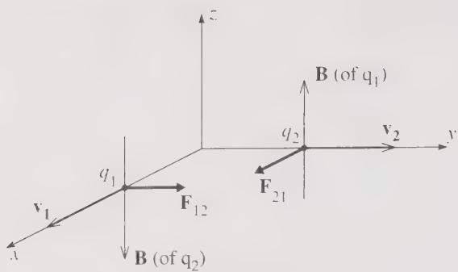
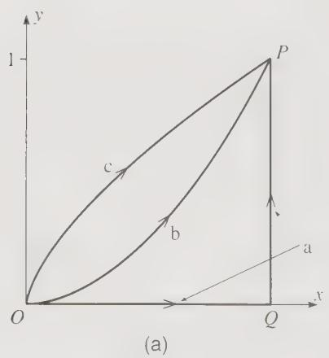
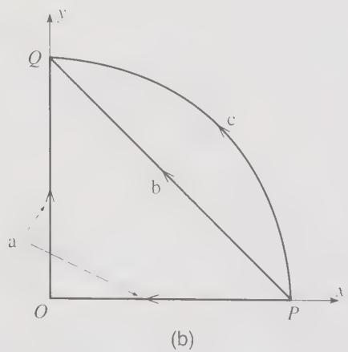
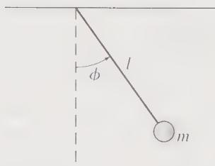
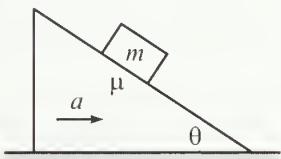

# Problem Set 1

---

**Total Points: 170 points**  
**Deadline: 9:00 pm, September 22nd, 2026**

All answers must be **handwritten**, then scanned or photographed, and submitted via Canvas.

**Late submissions will incur a penalty of 5 points per day. Submissions more than 3 days late will not be accepted.**

---

The Taylor problems below carry 10 points each, except 4.38, which carries 20 points. The two Morin problems carry 10 points each; in 3.36 the plane is not movable. The final problem on positive power-law forces carries 10 points.

Each statement is reproduced from the textbook, and the original figure is included wherever the statement refers to one.

---

## 1. Taylor 1.32 — Magnetic and electric forces [10 points]

If you have some experience in electromagnetism, you could do the following problem concerning the curious situation illustrated in Figure 1.8. The electric and magnetic fields at a point $\mathbf r_1$ due to a charge $q_2$ at $\mathbf r_2$ moving with constant velocity $\mathbf v_2$ (with $v_2\ll c$) are

$$
\mathbf E(\mathbf r_1)=\frac{1}{4\pi\epsilon_0}\frac{q_2}{s^2}\hat{\mathbf s},
\qquad
\mathbf B(\mathbf r_1)=\frac{\mu_0}{4\pi}\frac{q_2}{s^2}
\mathbf v_2\times\hat{\mathbf s},
$$

where $\mathbf s=\mathbf r_1-\mathbf r_2$ is the vector pointing from $\mathbf r_2$ to $\mathbf r_1$. (The first of these you should recognize as Coulomb's law.) If $F_{12}^{\mathrm{el}}$ and $F_{12}^{\mathrm{mag}}$ denote the electric and magnetic forces on a charge $q_1$ at $\mathbf r_1$ with velocity $\mathbf v_1$, show that

$$
F_{12}^{\mathrm{mag}}\le\frac{v_1v_2}{c^2}F_{12}^{\mathrm{el}}.
$$

This shows that in the non-relativistic domain it is legitimate to ignore the magnetic force between two moving charges.

*Figure 1.8 Each of the positive charges $q_1$ and $q_2$ produces a magnetic field that exerts a force on the other charge. The resulting magnetic forces $\mathbf F_{12}$ and $\mathbf F_{21}$ do not obey Newton's third law.*

## 2. Taylor 1.33 — Forces between steady current loops [10 points]

If you have some experience in electromagnetism and with vector calculus, prove that the magnetic forces, $\mathbf F_{12}$ and $\mathbf F_{21}$, between any two steady current loops obey Newton's third law. [Hints: Let the two currents be $I_1$ and $I_2$ and let typical points on the two loops be $\mathbf r_1$ and $\mathbf r_2$. If $d\mathbf r_1$ and $d\mathbf r_2$ are short segments of the loops, then according to the Biot–Savart law, the force on $d\mathbf r_1$ due to $d\mathbf r_2$ is

$$
\frac{\mu_0}{4\pi}\frac{I_1I_2}{s^2}
d\mathbf r_1\times(d\mathbf r_2\times\hat{\mathbf s}),
$$

where $\mathbf s=\mathbf r_1-\mathbf r_2$. The force $\mathbf F_{12}$ is found by integrating this around both loops. You will need to use the “BAC − CAB” rule to simplify the triple product.]

## 3. Taylor 1.39 — Projectile motion over an inclined plane [10 points]

A ball is thrown with initial speed $v_0$ up an inclined plane. The plane is inclined at an angle $\phi$ above the horizontal, and the ball's initial velocity is at an angle $\theta$ above the plane. Choose axes with $x$ measured up the slope, $y$ normal to the slope, and $z$ across it. Write down Newton's second law using these axes and find the ball's position as a function of time. Show that the ball lands a distance

$$
R=\frac{2v_0^2\sin\theta\cos(\theta+\phi)}{g\cos^2\phi}
$$

from its launch point. Show that for given $v_0$ and $\phi$, the maximum possible range up the inclined plane is

$$
R_{\max}=\frac{v_0^2}{g(1+\sin\phi)}.
$$

## 4. Taylor 1.40 — A projectile whose distance keeps increasing [10 points]

A cannon shoots a ball at an angle $\theta$ above the horizontal ground.

(a) Neglecting air resistance, use Newton's second law to find the ball's position as a function of time. (Use axes with $x$ measured horizontally and $y$ vertically.)

(b) Let $r(t)$ denote the ball's distance from the cannon. What is the largest possible value of $\theta$ if $r(t)$ is to increase throughout the ball's flight? [Hint: Using your solution to part (a) you can write down $r^2$ as $x^2+y^2$, and then find the condition that $r^2$ is always increasing.]

## 5. Taylor 1.47 — Cylindrical coordinates and acceleration [10 points]

Let the position of a point $P$ in three dimensions be given by the vector $\mathbf r=(x,y,z)$ in rectangular (or Cartesian) coordinates. The same position can be specified by cylindrical polar coordinates, $\rho,\phi,z$, which are defined as follows: Let $P'$ denote the projection of $P$ onto the $xy$ plane; that is, $P'$ has Cartesian coordinates $(x,y,0)$. Then $\rho$ and $\phi$ are defined as the two-dimensional polar coordinates of $P'$ in the $xy$ plane, while $z$ is the third Cartesian coordinate, unchanged.

(a) Make a sketch to illustrate the three cylindrical coordinates. Give expressions for $\rho,\phi,z$ in terms of the Cartesian coordinates $x,y,z$. Explain in words what $\rho$ is (“$\rho$ is the distance of $P$ from _____”). There are many variants in notation. For instance, some people use $r$ instead of $\rho$. Explain why this use of $r$ is unfortunate.

(b) Describe the three unit vectors $\hat{\boldsymbol\rho},\hat{\boldsymbol\phi},\hat{\mathbf z}$ and write the expansion of the position vector $\mathbf r$ in terms of these unit vectors.

(c) Differentiate your last answer twice to find the cylindrical components of the acceleration $\mathbf a=\ddot{\mathbf r}$ of the particle. To do this, you will need to know the time derivatives of $\hat{\boldsymbol\rho}$ and $\hat{\boldsymbol\phi}$. You could get these from the corresponding two-dimensional results (1.42) and (1.46), or you could derive them directly as in Problem 1.48.

## 6. Taylor 1.48 — Time derivatives of cylindrical unit vectors [10 points]

Find expressions for the unit vectors $\hat{\boldsymbol\rho},\hat{\boldsymbol\phi},\hat{\mathbf z}$ of cylindrical polar coordinates (Problem 1.47) in terms of the Cartesian $\hat{\mathbf x},\hat{\mathbf y},\hat{\mathbf z}$. Differentiate each of these expressions with respect to time to find $d\hat{\boldsymbol\rho}/dt$, $d\hat{\boldsymbol\phi}/dt$, and $d\hat{\mathbf z}/dt$.

## 7. Taylor 1.49 — A puck between concentric cylinders [10 points]

Imagine two concentric cylinders, centered on the vertical $z$ axis, with radii $R\pm\epsilon$, where $\epsilon$ is very small. A small frictionless puck of thickness $2\epsilon$ is inserted between the two cylinders, so that it can be considered a point mass that can move freely at a fixed distance from the vertical axis. If we use cylindrical polar coordinates $(\rho,\phi,z)$ for its position (Problem 1.47), then $\rho$ is fixed at $\rho=R$, while $\phi$ and $z$ can vary at will. Write down and solve Newton's second law for the general motion of the puck, including the effects of gravity. Describe the puck's motion.

## 8. Taylor 4.2 — Work along three paths [10 points]

Evaluate the work done

$$
W=\int_O^P\mathbf F\cdot d\mathbf r
=\int_O^P(F_x\,dx+F_y\,dy). \tag{4.100}
$$

by the two-dimensional force $\mathbf F=(x^2,2xy)$ along the three paths joining the origin to the point $P=(1,1)$ as shown in Figure 4.24(a) and defined as follows:

(a) This path goes along the $x$ axis to $Q=(1,0)$, and then straight up to $P$. (Divide the integral into two pieces, $\int_O^P=\int_O^Q+\int_Q^P$.)

(b) On this path $y=x^2$, and you can replace the term $dy$ in (4.100) by $dy=2x\,dx$ and convert the whole integral into an integral over $x$.

(c) This path is given parametrically as $x=t^3$, $y=t^2$. In this case rewrite $x$, $y$, $dx$, and $dy$ in (4.100) in terms of $t$ and $dt$, and convert the integral into an integral over $t$.

*Figure 4.24 (a) Problem 4.2.*

## 9. Taylor 4.3 — Work between two points [10 points]

Do the same as in Problem 4.2, but for the force $\mathbf F=(-y,x)$ and for the three paths joining $P$ and $Q$ shown in Figure 4.24(b) and defined as follows:

(a) This path goes straight from $P=(1,0)$ to the origin and then straight to $Q=(0,1)$.

(b) This is a straight line from $P$ to $Q$. (Write $y$ as a function of $x$ and rewrite the integral as an integral over $x$.)

(c) This is a quarter-circle centered on the origin. (Write $x$ and $y$ in polar coordinates and rewrite the integral as an integral over $\phi$.)

*Figure 4.24 (b) Problem 4.3.*

## 10. Taylor 4.22 — The Coulomb force in spherical coordinates [10 points]

The proof in Example 4.5 (page 119) that the Coulomb force is conservative is considerably simplified if we evaluate $\nabla\times\mathbf F$ using spherical polar coordinates. Unfortunately, the expression for $\nabla\times\mathbf F$ in spherical polar coordinates is quite messy and hard to derive. However, the answer is given inside the back cover, and the proof can be found in any book on vector calculus or mathematical methods. Taking the expression inside the back cover on faith, prove that the Coulomb force $\mathbf F=\gamma\hat{\mathbf r}/r^2$ is conservative.

## 11. Taylor 4.24 — Gravitational field of an infinite rod [10 points]

An infinitely long, uniform rod of mass $\mu$ per unit length is situated on the $z$ axis.

(a) Calculate the gravitational force $\mathbf F$ on a point mass $m$ at a distance $\rho$ from the $z$ axis. (The gravitational force between two point masses is given in Problem 4.21.)

(b) Rewrite $\mathbf F$ in terms of the rectangular coordinates $(x,y,z)$ of the point and verify that $\nabla\times\mathbf F=0$.

(c) Show that $\nabla\times\mathbf F=0$ using the expression for $\nabla\times\mathbf F$ in cylindrical polar coordinates given inside the back cover.

(d) Find the corresponding potential energy $U$.

## 12. Taylor 4.34 — The simple pendulum [10 points]

An interesting one-dimensional system is the simple pendulum, consisting of a point mass $m$, fixed to the end of a massless rod (length $l$), whose other end is pivoted from the ceiling to let it swing freely in a vertical plane, as shown in Figure 4.26. The pendulum's position can be specified by its angle $\phi$ from the equilibrium position. (It could equally be specified by its distance $s$ from equilibrium — indeed $s=l\phi$ — but the angle is a little more convenient.)

(a) Prove that the pendulum's potential energy (measured from the equilibrium level) is

$$
U(\phi)=mgl(1-\cos\phi). \tag{4.101}
$$

Write down the total energy $E$ as a function of $\phi$ and $\dot\phi$.

(b) Show that by differentiating your expression for $E$ with respect to $t$ you can get the equation of motion for $\phi$ and that the equation of motion is just the familiar $\Gamma=I\alpha$ (where $\Gamma$ is the torque, $I$ is the moment of inertia, and $\alpha$ is the angular acceleration $\ddot\phi$).

(c) Assuming that the angle $\phi$ remains small throughout the motion, solve for $\phi(t)$ and show that the motion is periodic with period

$$
\tau_0=2\pi\sqrt{\frac lg}. \tag{4.102}
$$

(The subscript “0” is to emphasize that this is the period for small oscillations.)

*Figure 4.26 Problem 4.34.*

## 13. Taylor 4.38 — The pendulum period at finite amplitude [20 points]

[Computer] Consider the simple pendulum of Problem 4.34. You can get an expression for the pendulum's period (good for large oscillations as well as small) using the method discussed in connection with (4.57), as follows:

(a) Using (4.101) for the PE, find $\dot\phi$ as a function of $\phi$. Next use (4.57), in the form $t=\int d\phi/\dot\phi$, to write the time for the pendulum to travel from $\phi=0$ to its maximum value (the amplitude) $\Phi$. Because this time is a quarter of the period $\tau$, you can now write down the period. Show that

$$
\begin{aligned}
\tau
&=\tau_0\frac1\pi\int_0^\Phi
\frac{d\phi}{\sqrt{\sin^2(\Phi/2)-\sin^2(\phi/2)}}\\
&=\tau_0\frac2\pi\int_0^1
\frac{du}{\sqrt{1-u^2}\sqrt{1-A^2u^2}}.
\end{aligned} \tag{4.103}
$$

where $\tau_0$ is the period (4.102) (Problem 4.34) for small oscillations and $A=\sin(\Phi/2)$. [To get the first expression you will need to use the trig identity for $1-\cos\phi$ in terms of $\sin^2(\phi/2)$. To get the second you need to make the substitution $\sin(\phi/2)=Au$.] These integrals cannot be evaluated in terms of elementary functions. However, the second integral is a standard integral called the complete elliptic integral of the first kind, sometimes denoted $K(A^2)$, whose values are tabulated and are known to computer software such as Mathematica [which calls it EllipticK($A^2$)].

(b) If you have access to computer software that knows this function, make a plot of $\tau/\tau_0$ for amplitudes $0\leq\Phi\leq3$ rad. Comment. What becomes of $\tau$ as the amplitude of oscillation approaches $\pi$? Explain.

**Additional assignment instruction:** Use Python to produce the plot.

## 14. Morin 3.36 — Comparing the times [10 points]

A block of mass $m$ is projected up along the surface of a plane inclined at an angle $\theta$. The initial speed is $v_0$, and the coefficients of static and kinetic friction are both equal to $\mu$. The block reaches a highest point and then slides back down to the starting point.

(a) Show that for the block to in fact slide back down instead of remaining at rest at the highest point, $\tan\theta$ must be greater than $\mu$.

(b) Assuming that $\tan\theta>\mu$, is the total up and down time longer or shorter than the total time it would take if the plane were frictionless? Or does the answer depend on what $\theta$ and $\mu$ are?

(c) Assuming that $\tan\theta>\mu$, show that for a given $\theta$, the value of $\mu$ that yields the minimum total time is given by $\mu\approx(0.397)\tan\theta$. (You will need to solve something numerically.) This minimum time turns out to be about 90% of the time it would take if the plane were frictionless.

*Figure 3.26 Problem 3.36.*

## 15. Morin 3.53 — Projectile with drag [10 points]

A ball is thrown with speed $v_0$ at an angle $\theta$. Let the drag force from the air take the form $\mathbf F_d=-\beta\mathbf v=-m\alpha\mathbf v$.

(a) Find $x(t)$ and $y(t)$.

(b) Assume that the drag coefficient takes the value that makes the magnitude of the initial drag force equal to the weight of the ball. If your goal is to have $x$ be as large as possible when $y$ achieves its maximum value (you don't care what this maximum value actually is), show that $\theta$ should satisfy $\sin\theta=(\sqrt5-1)/2$, which just happens to be the inverse of the golden ratio.

## 16. Potential energies for positive power-law forces [10 points]

A particle moves in one dimension subject to the power-law force $F=-kx^n$, where the coefficient $k$ is positive, and $n$ is a positive integer. Please find the potential energy of the particle and also the maximum distance $x_{\max}$ it can reach from the origin, in terms of its maximum speed $v_{\max}$. The maximum distance is the turning point of the particle, because as the particle approaches this position it slows down, stops at $x_{\max}$, and turns around and heads in the opposite direction.
