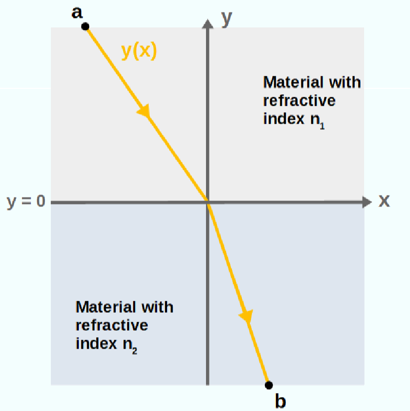
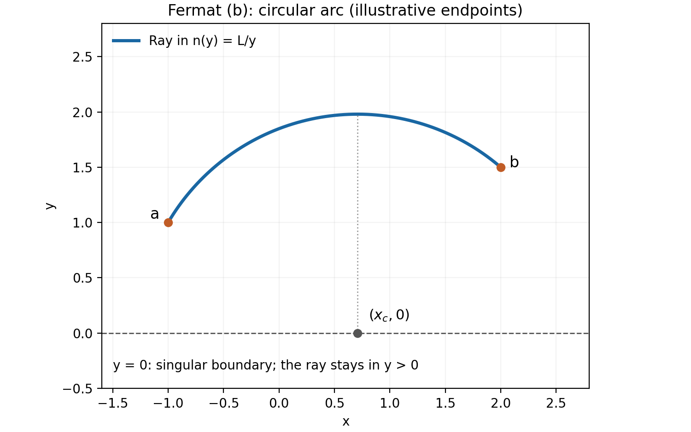
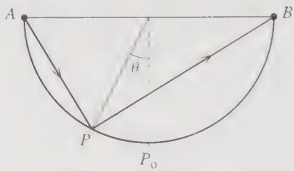
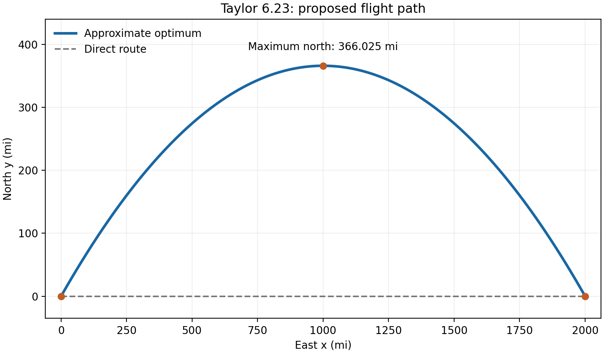
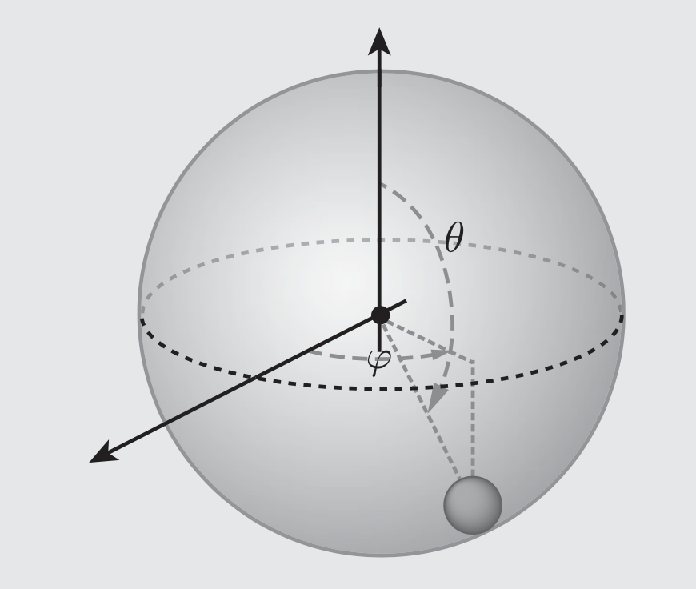

# Problem Set 2 — Worked Solutions

## 1. Fermat's principle [25 points]

### Problem statement

One of the most foundational principles in optics known as Fermat's principle, which states: “The path taken by a light ray between any two points is the path that minimizes the travel time between the points.”

(a) Derive an expression for the total travel time of a light ray moving from point $a$ to point $b$, $T=\int_a^b dt$. Then, apply Fermat's Principle and use the calculus of variations to derive Snell's Law:

$$
\frac{\sin\theta_1}{\sin\theta_2}=\frac{n_2}{n_1}.
$$

[10 points]

*Diagram for part (a): the interface is $y=0$, with index $n_1$ above and $n_2$ below; the ray travels from $a$ above the interface to $b$ below it.*

(b) Suppose the refractive index of a material varies with vertical position $y$ as $n(y)=L/y$, where $L$ is a constant. Using Fermat's Principle, derive the path that a light ray takes when traveling from point $a$ to point $b$. [15 points]

### Solution

**(a) Travel time and Snell's law.**

**Step 1: Form the travel-time functional.**

Since the local speed is $v=c/n$,

$$
dt=\frac{ds}{v}=\frac nc\,ds,
\qquad
\boxed{T[\Gamma]=\frac1c\int_\Gamma n(\mathbf r)\,ds}.
$$

For a planar path $y=y(x)$ with increasing $x$,

$$
\boxed{
T[y]=\frac1c\int_{x_a}^{x_b}
n(x,y)\sqrt{1+y'^2}\,dx.
}
$$

The general variational condition is $\delta T=0$.

**Step 2: Find the path inside each uniform medium.**

Ignoring the constant factor $1/c$, take $F=n\sqrt{1+y'^2}$. For constant $n$, the Euler–Lagrange equation is

$$
\frac{d}{dx}\left(\frac{ny'}{\sqrt{1+y'^2}}\right)=0.
$$

Thus $y'$ is constant, and the ray is straight within each medium.

**Step 3: Vary the interface crossing point.**

Write

$$
a=(x_a,y_a),\quad y_a>0,\qquad
b=(x_b,y_b),\quad y_b<0,
$$

and let the crossing point be $(\xi,0)$. For the left-to-right geometry in the diagram,

$$
\ell_1=\sqrt{(\xi-x_a)^2+y_a^2},
\qquad
\ell_2=\sqrt{(x_b-\xi)^2+y_b^2}.
$$

Hence

$$
T(\xi)=\frac1c(n_1\ell_1+n_2\ell_2),
$$

and

$$
\delta T=\frac1c
\left[
n_1\frac{\xi-x_a}{\ell_1}
-n_2\frac{x_b-\xi}{\ell_2}
\right]\delta\xi.
$$

Since $\delta\xi$ is arbitrary,

$$
n_1\frac{\xi-x_a}{\ell_1}
=n_2\frac{x_b-\xi}{\ell_2}.
$$

The angles are measured **from the interface normal**, so the two geometric ratios are $\sin\theta_1$ and $\sin\theta_2$. Therefore,

$$
\boxed{n_1\sin\theta_1=n_2\sin\theta_2}.
$$

For nonzero angles this is equivalent to the required ratio. At normal incidence, use the product form to avoid $0/0$.

The variation of the crossing point supplies the interface condition. A differential equation assuming smooth $n$ should not be applied across a discontinuous interface without this condition.

For this two-medium geometry,

$$
T''(\xi)=\frac1c
\left(\frac{n_1y_a^2}{\ell_1^3}
+\frac{n_2y_b^2}{\ell_2^3}\right)>0,
$$

so the stationary path is indeed a minimum.

**(b) The ray for $n(y)=L/y$.**

**Step 1: Specify the domain.**

Assume $L>0$ and both endpoints lie in $y>0$. For $x_a<x_b$,

$$
T[y]=\frac Lc\int_{x_a}^{x_b}\frac{\sqrt{1+y'^2}}{y}\,dx.
$$

Drop the constant prefactor and set

$$
F(y,y')=\frac{\sqrt{1+y'^2}}{y}.
$$

**Step 2: Derive and integrate the Euler–Lagrange equation.**

$$
F_y=-\frac{\sqrt{1+y'^2}}{y^2},
\qquad
F_{y'}=\frac{y'}{y\sqrt{1+y'^2}}.
$$

Substitution into $dF_{y'}/dx-F_y=0$ gives

$$
\boxed{yy''+1+y'^2=0}.
$$

Since $(yy')'=yy''+y'^2$, we have

$$
(yy')'=-1,\qquad yy'=-x+x_c.
$$

Integrating once more,

$$
y^2=-x^2+2x_cx+C.
$$

Rearranging the constants,

$$
\boxed{(x-x_c)^2+y^2=\mathcal R^2}.
$$

**Step 3: Determine the circle from the endpoints.**

For $x_a\ne x_b$,

$$
\boxed{
x_c=\frac{x_b^2+y_b^2-x_a^2-y_a^2}{2(x_b-x_a)},
\qquad
\mathcal R=\sqrt{(x_a-x_c)^2+y_a^2}.
}
$$

Thus the ray is the upper-half-plane arc

$$
\boxed{y(x)=\sqrt{\mathcal R^2-(x-x_c)^2}}
$$

connecting the endpoints. Its circle has its center on $y=0$ and intersects that boundary orthogonally when extended.

The endpoints in this illustration are examples, not additional data from the question.

**Step 4: Include the vertical-path case.**

If $x_a=x_b$, the ray is the vertical segment

$$
\boxed{x=x_a}.
$$

This case is not represented by a regular graph $y(x)$; it can instead be obtained by using $x=x(y)$.

**Final result and domain limitation.**

The rays are **circular arcs centered on $y=0$, or vertical straight segments**, within $y>0$.

The part (a) diagram should not be interpreted as a crossing path for part (b). The index $L/y$ changes sign and is singular at $y=0$. Even replacing it with $L/\lvert y\rvert$ would give an infinite crossing time because

$$
\int n\,ds\ge L\int\frac{\lvert dy\rvert}{\lvert y\rvert}\to\infty.
$$

A finite-time crossing would require a different or regularized index model.

---

## 2. Taylor 6.5 — A stationary maximum of travel time [10 points]

### Problem statement

Fermat's principle is often stated as “the travel time of a ray of light, moving from point $A$ to $B$, is minimum along the actual path.” Strictly speaking it should say that the time is stationary, not minimum. In fact one can construct situations for which the time is maximum along the actual path. Here is one: Consider the concave, hemispherical mirror shown in Figure 6.10, with $A$ and $B$ at opposite ends of a diameter. Consider a ray of light traveling in a vacuum from $A$ to $B$ with one reflection at $P$, in the same vertical plane as $A$ and $B$. According to the law of reflection, the actual path goes via point $P_0$ at the bottom of the hemisphere ($\theta=0$). Find the time of travel along the path $APB$ as a function of $\theta$ and show that it is maximum at $P=P_0$.

*Figure 6.10 Problem 6.5.*

### Solution

Figure 6.10 is absent from the assignment PDF. Its geometry was checked against the local Taylor textbook, printed page 232: $\theta$ measures the radius to $P$ relative to the downward vertical.

**Step 1: Choose coordinates.**

Let the mirror radius be $R$, with

$$
A=(-R,0),\quad B=(R,0),\quad
P=(R\sin\theta,-R\cos\theta),
\qquad -\frac\pi2\le\theta\le\frac\pi2.
$$

Reversing the sign convention for $\theta$ does not change the final result.

**Step 2: Compute the path length.**

$$
AP=R\sqrt{2(1+\sin\theta)},
\qquad
PB=R\sqrt{2(1-\sin\theta)}.
$$

On the stated interval,

$$
\sqrt{1+\sin\theta}=\cos\frac\theta2+\sin\frac\theta2,
\qquad
\sqrt{1-\sin\theta}=\cos\frac\theta2-\sin\frac\theta2.
$$

Consequently,

$$
AP+PB=2\sqrt2R\cos\frac\theta2.
$$

**Step 3: Find and classify the stationary time.**

$$
\boxed{T(\theta)=\frac{2\sqrt2R}{c}\cos\frac\theta2}.
$$

Its derivatives are

$$
T'(\theta)=-\frac{\sqrt2R}{c}\sin\frac\theta2,
\qquad
T''(\theta)=-\frac{\sqrt2R}{2c}\cos\frac\theta2.
$$

Thus $T'(0)=0$, and $T''<0$ throughout the interior of the interval.

**Final result.**

$$
\boxed{T_{\max}=T(0)=\frac{2\sqrt2R}{c}}.
$$

This is a maximum within the specified family of planar, single-reflection paths $A\to P\to B$. It illustrates why Fermat's principle requires stationarity rather than a minimum in every situation.

---

## 3. Taylor 6.6 — Arc-length elements [10 points]

### Problem statement

In many problems in the calculus of variations, you need to know the length $ds$ of a short segment of a curve on a surface, as in the expression (6.1). Make a table giving the appropriate expressions for $ds$ in the following eight situations: (a) A curve given by $y=y(x)$ in a plane, (b) same but $x=x(y)$, (c) same but $r=r(\phi)$, (d) same but $\phi=\phi(r)$; (e) curve given by $\phi=\phi(z)$ on a cylinder of radius $R$, (f) same but $z=z(\phi)$; (g) curve given by $\theta=\theta(\phi)$ on a sphere of radius $R$, (h) same but $\phi=\phi(\theta)$.

### Solution

**Step 1: Start with the appropriate line elements.**

In Cartesian and polar coordinates in the plane,

$$
ds^2=dx^2+dy^2,
\qquad
ds^2=dr^2+r^2d\phi^2.
$$

On a cylinder of fixed radius $R$,

$$
ds^2=R^2d\phi^2+dz^2.
$$

On a sphere of fixed radius $R$,

$$
ds^2=R^2d\theta^2+R^2\sin^2\theta\,d\phi^2.
$$

Here $\theta$ is the polar angle measured from the positive $z$ axis.

**Step 2: Substitute the derivative of the dependent coordinate.**

For example, in (e), $d\phi=(d\phi/dz)\,dz$. Substituting this into the cylindrical line element gives the result below. All eight cases follow in the same way.

For reliable mathematical display, the requested entries are listed individually rather than placed inside table cells.

**(a) Plane curve $y=y(x)$**

$$
\boxed{
ds=\sqrt{1+\left(\frac{dy}{dx}\right)^2}\,\lvert dx\rvert
}
$$

**(b) Plane curve $x=x(y)$**

$$
\boxed{
ds=\sqrt{1+\left(\frac{dx}{dy}\right)^2}\,\lvert dy\rvert
}
$$

**(c) Plane polar curve $r=r(\phi)$**

$$
\boxed{
ds=\sqrt{\left(\frac{dr}{d\phi}\right)^2+r^2}\,\lvert d\phi\rvert
}
$$

**(d) Plane polar curve $\phi=\phi(r)$**

$$
\boxed{
ds=\sqrt{1+r^2\left(\frac{d\phi}{dr}\right)^2}\,\lvert dr\rvert
}
$$

**(e) Cylinder: $\phi=\phi(z)$**

$$
\boxed{
ds=\sqrt{1+R^2\left(\frac{d\phi}{dz}\right)^2}\,\lvert dz\rvert
}
$$

**(f) Cylinder: $z=z(\phi)$**

$$
\boxed{
ds=\sqrt{R^2+\left(\frac{dz}{d\phi}\right)^2}\,\lvert d\phi\rvert
}
$$

**(g) Sphere: $\theta=\theta(\phi)$**

$$
\boxed{
ds=R\sqrt{\left(\frac{d\theta}{d\phi}\right)^2+\sin^2\theta}\,\lvert d\phi\rvert
}
$$

**(h) Sphere: $\phi=\phi(\theta)$**

$$
\boxed{
ds=R\sqrt{1+\sin^2\theta\left(\frac{d\phi}{d\theta}\right)^2}\,\lvert d\theta\rvert
}
$$

**Interpretation.**

Arc length is nonnegative, which explains the absolute values. If the integration parameter increases along a segment, the corresponding absolute value can be omitted. If it is not monotonic along the path, split the integral into monotonic segments or use a general parameter.

---

## 4. Taylor 6.12 — A stationary path involving hyperbolic functions [10 points]

### Problem statement

Show that the path $y=y(x)$ for which the integral

$$
\int_{x_1}^{x_2}x\sqrt{1-y'^2}\,dx
$$

is stationary is a sinh function.

### Solution

**Step 1: State the regularity and domain assumptions.**

For the usual real, differentiable variational problem, assume $\lvert y'\rvert<1$. Initially take $0<x_1<x_2$ with fixed endpoint values of $y$; the problem supplies no specific interval or endpoints.

**Step 2: Use the absence of $y$ from the integrand.**

For

$$
F=x\sqrt{1-y'^2},
$$

the Euler–Lagrange equation is

$$
\frac{d}{dx}F_{y'}=0,
\qquad
-\frac{xy'}{\sqrt{1-y'^2}}=C.
$$

Define $a=-C$. Solving and retaining the sign required by the unsquared equation gives, for $x>0$,

$$
\boxed{y'=\frac{a}{\sqrt{x^2+a^2}}}.
$$

**Step 3: Integrate.**

For $a\ne0$,

$$
\boxed{
y(x)=a\,\operatorname{arsinh}\left(\frac{x}{\lvert a\rvert}\right)+b.
}
$$

Here

$$
\operatorname{arsinh}u=\ln\left(u+\sqrt{1+u^2}\right)
$$

is the inverse hyperbolic sine. If $a=0$, the solution is $y=b$.

For specified endpoints, $a$ is determined by

$$
y_2-y_1
=a\left[
\operatorname{arsinh}\left(\frac{x_2}{\lvert a\rvert}\right)
-\operatorname{arsinh}\left(\frac{x_1}{\lvert a\rvert}\right)
\right],
$$

and either endpoint then determines $b$.

**Step 4: Invert the relation.**

For $a\ne0$,

$$
\boxed{
x=\lvert a\rvert\sinh\left(\frac{y-b}{a}\right).
}
$$

**Final result and interpretation.**

The literal functional gives an **inverse hyperbolic sine for $y(x)$**, while its inverse **$x(y)$ is a hyperbolic sine**. The original phrase “is a sinh function” is therefore imprecise if it specifically refers to $y$ as a function of $x$. It may refer to the inverted form; it does not justify writing $y=A\sinh(Bx+C)$.

If the interval lies entirely in $x<0$, the same first-integral constant $a$ gives

$$
y'=-\frac{a}{\sqrt{x^2+a^2}},
\qquad
y=-a\,\operatorname{arsinh}\left(\frac{x}{\lvert a\rvert}\right)+b.
$$

If the interval crosses $x=0$ and the solution is smooth with $\lvert y'\rvert<1$, the conserved quantity must vanish at $x=0$, so only a constant regular stationary path is possible.

Finally, the question asks for a stationary value, not a minimum. For $x>0$,

$$
F_{y'y'}=-\frac{x}{(1-y'^2)^{3/2}}<0.
$$

Thus an admissible smooth stationary solution maximizes this strictly concave functional over the corresponding fixed-endpoint admissible class.

---

## 5. Taylor 6.13 — Straight radial paths in rapidity space [10 points]

### Problem statement

In relativity theory, velocities can be represented by points in a certain “rapidity space” in which the distance between two neighboring points is

$$
ds=\frac{2}{1-r^2}\sqrt{dr^2+r^2d\phi^2},
$$

where $r$ and $\phi$ are polar coordinates, and we consider just a two-dimensional space. (An expression like this for distance in a non-Euclidean space is often called the metric of the space.) Use the Euler–Lagrange equation to show that the shortest distance from the origin to any other point is a straight line.

### Solution

**Step 1: Write the length functional.**

Work inside the unit disk, $0\le r<1$, where the given line element is positive. Let the endpoint be $(r_b,\phi_b)$. For a radially monotonic path $\phi=\phi(r)$,

$$
S[\phi]=\int_0^{r_b}
\frac{2}{1-r^2}\sqrt{1+r^2\phi'^2}\,dr,
\qquad \phi'=\frac{d\phi}{dr}.
$$

Since the integrand does not contain $\phi$ explicitly,

$$
\frac{\partial F}{\partial\phi'}
=\frac{2r^2\phi'}{(1-r^2)\sqrt{1+r^2\phi'^2}}
=C.
$$

**Step 2: Determine the constant using the origin.**

For $r>0$,

$$
\lvert C\rvert
=\frac{2r}{1-r^2}
\frac{\lvert r\phi'\rvert}{\sqrt{1+r^2\phi'^2}}
\le\frac{2r}{1-r^2}.
$$

Taking $r\to0^+$ forces $C=0$. This argument does not require $\phi'$ to remain finite at the coordinate singularity.

For $r>0$, the first integral then implies $\phi'=0$. Hence

$$
\boxed{\phi(r)=\phi_b},
$$

which is the radial straight line from the origin to the endpoint.

**Step 3: Establish global minimality.**

Every path satisfies

$$
ds\ge\frac{2\lvert dr\rvert}{1-r^2}.
$$

Therefore,

$$
S\ge\int_\Gamma\frac{2\lvert dr\rvert}{1-r^2}
\ge\left\lvert\int_\Gamma\frac{2\,dr}{1-r^2}\right\rvert
=\int_0^{r_b}\frac{2\,dr}{1-r^2}.
$$

A radial path with no backtracking attains this lower bound. Integration gives

$$
\boxed{
S_{\min}=2\operatorname{artanh}r_b
=\ln\frac{1+r_b}{1-r_b}.
}
$$

**Final result.**

The shortest path **from the origin** is a radial straight segment in the disk coordinates. Its length is not the Euclidean distance $r_b$. The boundary $r=1$ is infinitely far away in this metric.

This result does not imply that all shortest paths between arbitrary pairs of points are Euclidean straight lines.

---

## 6. Taylor 6.1 — Length of a path on a sphere [15 points combined with 6.16]

### Problem statement

The shortest path between two points on a curved surface, such as the surface of a sphere, is called a geodesic. To find a geodesic, one first has to set up an integral that gives the length of a path on the surface in question. This integral will always be similar to the integral (6.2) but may be more complicated (depending on the nature of the surface) and may involve different coordinates than $x$ and $y$. To illustrate this, use spherical polar coordinates $(r,\theta,\phi)$ to show that the length of a path joining two points on a sphere of radius $R$ is

$$
L=R\int_{\theta_1}^{\theta_2}
\sqrt{1+\sin^2\theta\,\phi'(\theta)^2}\,d\theta
\tag{6.41}
$$

if $(\theta_1,\phi_1)$ and $(\theta_2,\phi_2)$ specify the two points and we assume that the path is expressed as $\phi=\phi(\theta)$. (You will find how to minimize this length in Problem 6.16.)

### Solution

**Step 1: Use the spherical-coordinate line element.**

In Euclidean space,

$$
ds^2=dr^2+r^2d\theta^2+r^2\sin^2\theta\,d\phi^2.
$$

On a sphere, $r=R$ and $dr=0$, giving

$$
ds^2=R^2d\theta^2+R^2\sin^2\theta\,d\phi^2.
$$

**Step 2: Substitute the path relation.**

Since $d\phi=\phi'(\theta)\,d\theta$,

$$
ds=R\sqrt{1+\sin^2\theta\,\phi'(\theta)^2}\,\lvert d\theta\rvert.
$$

For a segment traversed with increasing $\theta$,

$$
\boxed{
L=R\int_{\theta_1}^{\theta_2}
\sqrt{1+\sin^2\theta\,\phi'(\theta)^2}\,d\theta.
}
$$

**Parameterization.**

The prime means differentiation with respect to $\theta$, not time. If $\theta$ is not monotonic, split the curve into suitable segments or use an arbitrary increasing parameter $u$:

$$
\boxed{
L=R\int
\sqrt{\left(\frac{d\theta}{du}\right)^2
+\sin^2\theta\left(\frac{d\phi}{du}\right)^2}\,du.
}
$$

---

## 7. Taylor 6.16 — Great-circle geodesics [15 points combined with 6.1]

### Problem statement

Use the result (6.41) of Problem 6.1 to prove that the geodesic (shortest path) between two given points on a sphere is a great circle. [Hint: The integrand $f(\phi,\phi',\theta)$ in (6.41) is independent of $\phi$, so the Euler–Lagrange equation reduces to $\partial f/\partial\phi'=c$, a constant. This gives you $\phi'$ as a function of $\theta$. You can avoid doing the final integral by the following trick: There is no loss of generality in choosing your $z$ axis to pass through the point 1. Show that with this choice the constant $c$ is necessarily zero, and describe the corresponding geodesics.]

### Solution

**Step 1: Obtain the first integral.**

The constant factor $R$ does not affect stationarity. For

$$
F=\sqrt{1+\sin^2\theta\,\phi'^2},
$$

the absence of $\phi$ gives

$$
\boxed{
\frac{\sin^2\theta\,\phi'}
{\sqrt{1+\sin^2\theta\,\phi'^2}}=C.
}
$$

Away from singular cases, this can be solved as

$$
\phi'=\frac{C}{\sin\theta\sqrt{\sin^2\theta-C^2}}.
$$

The suggested coordinate rotation avoids integrating this expression.

**Step 2: Put the first endpoint at the north pole.**

By spherical symmetry, choose the polar axis so that endpoint 1 has $\theta=0$. The conserved quantity obeys

$$
\lvert C\rvert
=\sin\theta
\frac{\lvert\sin\theta\,\phi'\rvert}
{\sqrt{1+\sin^2\theta\,\phi'^2}}
\le\sin\theta.
$$

As the path approaches the pole, $\theta\to0^+$, and therefore $C=0$.

For $0<\theta<\pi$,

$$
\phi'=0,\qquad \phi=\phi_0.
$$

**Step 3: Interpret the curve geometrically.**

A curve with constant azimuth lies in a plane through the polar axis and hence through the center of the sphere. The intersection of a sphere with a plane through its center is a great circle.

Thus the stationary path is a great-circle arc. Rotating the axes back does not change this conclusion.

**Step 4: Identify the shortest arc.**

With endpoint 1 at the north pole, let endpoint 2 have polar angle $\gamma\in[0,\pi]$. For every path,

$$
ds\ge R\lvert d\theta\rvert,
\qquad
L\ge R\int\lvert d\theta\rvert\ge R\gamma.
$$

A monotonic meridian arc attains this bound. Therefore,

$$
\boxed{
L_{\min}=R\gamma,\qquad
\gamma=\arccos\left(\frac{\mathbf r_1\cdot\mathbf r_2}{R^2}\right).
}
$$

**Final result and endpoint cases.**

For distinct, non-antipodal endpoints, the unique shortest path is the **shorter great-circle arc**. Antipodal endpoints have infinitely many minimizing semicircles, each of length $\pi R$. Coincident endpoints have minimum length zero.

A longer great-circle arc or a path making extra revolutions is not globally shortest.

---

## 8. Taylor 6.23 — Minimum-time flight in a wind shear [20 points]

### Problem statement

An aircraft whose airspeed is $v_0$ has to fly from town $O$ (at the origin) to town $P$, which is a distance $D$ due east. There is a steady gentle wind shear, such that $\mathbf v_{\mathrm{wind}}=Vy\,\hat{\mathbf x}$, where $x$ and $y$ are measured east and north respectively. Find the path, $y=y(x)$, which the plane should follow to minimize its flight time, as follows:

(a) Find the plane's ground speed in terms of $v_0,V,\phi$ (the angle by which the plane heads to the north of east), and the plane's position.

(b) Write down the time of flight as an integral of the form $\int_0^D f\,dx$. Show that if we assume that $y'$ and $\phi$ both remain small (as is certainly reasonable if the wind speed is not too large), then the integrand $f$ takes the approximate form

$$
f=\frac{1+\frac12y'^2}{1+ky}
$$

(times an uninteresting constant) where $k=V/v_0$.

(c) Write down the Euler–Lagrange equation that determines the best path. To solve it, make the intelligent guess that $y(x)=\lambda x(D-x)$, which clearly passes through the two towns. Show that it satisfies the Euler–Lagrange equation, provided

$$
\lambda=\frac{\sqrt{4+2k^2D^2}-2}{kD^2}.
$$

How far north does this path take the plane, if $D=2000$ miles, $v_0=500$ mph, and the wind shear is $V=0.5$ mph/mi? How much time does the plane save by following this path? [You'll probably want to use a computer to do this integral.]

### Solution

**(a) Ground velocity and speed.**

Add the air velocity and wind velocity:

$$
\boxed{
\dot x=v_0\cos\phi+Vy,\qquad
\dot y=v_0\sin\phi.
}
$$

Thus

$$
\mathbf v_g=(v_0\cos\phi+Vy)\hat{\mathbf x}
+v_0\sin\phi\,\hat{\mathbf y},
$$

and its magnitude is

$$
\boxed{
v_g=\sqrt{v_0^2+2v_0Vy\cos\phi+V^2y^2}.
}
$$

The slope of the ground track is

$$
\boxed{
y'=\frac{v_0\sin\phi}{v_0\cos\phi+Vy}.
}
$$

In general, the heading angle is not the angle of the ground track.

**(b) Exact and approximate time functionals.**

**Step 1: Write an exact expression.**

For eastward progress,

$$
T=\int_0^D\frac{dx}{v_0\cos\phi+Vy}.
$$

To eliminate $\phi$, set $p=y'$, $w=Vy$, and $u_x=\dot x$. Fixed airspeed requires

$$
(u_x-w)^2+p^2u_x^2=v_0^2.
$$

The eastward branch is

$$
u_x=\frac{w+\sqrt{v_0^2+(v_0^2-w^2)p^2}}{1+p^2}.
$$

Consequently,

$$
\boxed{
T_{\mathrm{exact}}[y]
=\int_0^D
\frac{1+y'^2}
{Vy+\sqrt{v_0^2+(v_0^2-V^2y^2)y'^2}}\,dx.
}
$$

The path evaluated below has $0\le Vy<v_0$, so this branch is admissible throughout.

**Step 2: Obtain the approximation specified in the question.**

For small slope,

$$
ds=\sqrt{1+y'^2}\,dx
\simeq\left(1+\frac12y'^2\right)dx.
$$

With small heading deviations and sufficiently weak wind, neglecting wind–angle-squared coupling gives

$$
v_g\simeq v_0+Vy=v_0(1+ky).
$$

Therefore,

$$
\boxed{
T_{\mathrm{app}}[y]
=\frac1{v_0}\int_0^D\frac{1+\frac12y'^2}{1+ky}\,dx.
}
$$

Dropping the constant factor $1/v_0$, the variational integrand is precisely

$$
\boxed{f(y,y')=\frac{1+\frac12y'^2}{1+ky}}.
$$

**Accuracy of the approximation.** If only $p=y'$ is small while $ky$ is held finite, the exact expansion is

$$
\frac{dt}{dx}
=\frac1{v_0(1+ky)}+\frac{p^2}{2v_0}+O(p^4).
$$

The leading difference from the question's integrand is

$$
\frac{ky\,p^2}{2v_0(1+ky)}.
$$

The stipulated approximation therefore also neglects this wind–slope coupling. It is not a uniformly second-order approximation in slope for arbitrary wind strength.

**(c) The optimal parabola and numerical values.**

**Step 1: Derive the Euler–Lagrange equation.**

$$
f_{y'}=\frac{y'}{1+ky},
\qquad
f_y=-\frac{k(1+\frac12y'^2)}{(1+ky)^2}.
$$

Hence

$$
\frac{d}{dx}\left(\frac{y'}{1+ky}\right)
+\frac{k(1+\frac12y'^2)}{(1+ky)^2}=0.
$$

Multiplying through and simplifying gives

$$
\boxed{(1+ky)y''+k\left(1-\frac12y'^2\right)=0},
\qquad y(0)=y(D)=0.
$$

**Step 2: Substitute the proposed parabola.**

For

$$
y=\lambda x(D-x),\quad
y'=\lambda(D-2x),\quad y''=-2\lambda,
$$

the differential equation becomes

$$
-2\lambda[1+k\lambda x(D-x)]
+k\left[1-\frac{\lambda^2}{2}(D-2x)^2\right]=0.
$$

All terms containing $x$ cancel, leaving

$$
k-2\lambda-\frac{k\lambda^2D^2}{2}=0,
$$

or

$$
kD^2\lambda^2+4\lambda-2k=0.
$$

For $k>0$, select the northward branch that approaches the straight route as $k\to0$:

$$
\boxed{
\lambda=\frac{\sqrt{4+2k^2D^2}-2}{kD^2}
=\frac{2k}{\sqrt{4+2k^2D^2}+2}.
}
$$

The second form avoids subtraction of nearly equal numbers for weak wind.

This is a minimum of the **approximate** functional. In the domain $1+ky>0$,

$$
f_{y'y'}=\frac1{1+ky}>0,
\qquad
\det H_f=\frac{2k^2}{(1+ky)^4}>0\quad(k\ne0).
$$

Thus $f$ is jointly strictly convex in $(y,y')$, and the fixed-endpoint stationary solution is the unique minimum of that approximate problem.

**Step 3: Calculate the maximum northward displacement.**

For the given data,

$$
k=\frac{0.5}{500}=0.001\ \mathrm{mi}^{-1},
$$

$$
\boxed{\lambda=0.0003660254038\ \mathrm{mi}^{-1}}.
$$

The maximum occurs at $x=D/2=1000\ \mathrm{mi}$:

$$
\boxed{
y_{\max}=\frac{\lambda D^2}{4}
=366.0254\ \mathrm{mi}.
}
$$

**Step 4: Evaluate the approximate travel time.**

The direct route along $y=0$ has no wind, so

$$
T_0=\frac D{v_0}=4\ \mathrm h.
$$

For the parabola,

$$
T_{\mathrm{app}}
=\frac1{v_0}\int_0^D
\frac{1+\frac12\lambda^2(D-2x)^2}
{1+k\lambda x(D-x)}\,dx.
$$

Numerical integration gives

$$
\boxed{T_{\mathrm{app}}=3.555772686\ \mathrm h},
$$

and therefore

$$
\boxed{
\Delta T_{\mathrm{app}}
=0.444227314\ \mathrm h
=26.65364\ \mathrm{min}.
}
$$

**Step 5: Assess the approximation for these parameters.**

The maximum slope and wind strength are

$$
\max\lvert y'\rvert=\lambda D=0.73205,
$$

$$
Vy_{\max}=183.0127\ \mathrm{mi/h}=0.36603v_0.
$$

These values are not extremely small. Evaluating the exact velocity-based time integral along **the same parabola** gives

$$
\boxed{
T_{\mathrm{exact,\ same\ path}}=3.575324858\ \mathrm h,
\qquad
\Delta T_{\mathrm{exact,\ same\ path}}=25.48051\ \mathrm{min}.
}
$$

| Evaluation | Flight time (h) | Time saved (min) |
|---|---:|---:|
| Direct route | 4.000000 | 0 |
| Parabola, approximate functional | 3.555773 | 26.65364 |
| Same parabola, exact velocity | 3.575325 | 25.48051 |

**Final result.**

Within the question's prescribed approximation,

$$
\boxed{
y(x)=0.0003660254038\,x(2000-x)
\quad\text{with }x,y\text{ in miles},
}
$$

$$
\boxed{
y_{\max}\simeq366.03\ \mathrm{mi},
\qquad
\Delta T\simeq26.65\ \mathrm{min}.
}
$$

The more exact saving for that same route is about 25.48 minutes. The exact functional has not been re-optimized here, so the parabola is not claimed to be the exact optimum of the full model.

The numerical integration and plotting code is provided in hw2_calculations.py.

---

## 9. Spherical pendulum [10 points]

### Problem statement

A ball of mass $m$ swings on the end of an unstretchable string of length $R$ in the presence of a uniform gravitational field $g$. This is often called the “spherical pendulum,” because the ball moves as though it were sliding on the frictionless surface of a spherical bowl. It is important to note that:

(i) It can move horizontally around a vertical axis passing through the point of support, corresponding to changes in its azimuthal angle $\phi$. (On earth's surface this would correspond to a change in longitude.)

(ii) It can also move in the polar direction, as described by the angle $\theta$. (On earth's surface this would correspond to a change in latitude.)

Please find its equations of motion (a second-order differential equation for the polar angle $\theta$ as a function of time). You do not need to solve the equation of motion.

*Spherical pendulum: the ball moves on a sphere of radius $R$, with polar angle $\theta$ and azimuthal angle $\phi$.*

### Solution

**Step 1: Specify the angular convention.**

Put the support at the origin and take $z$ vertically upward. Following the polar-angle convention in the figure,

$$
x=R\sin\theta\cos\phi,\quad
y=R\sin\theta\sin\phi,\quad
z=R\cos\theta.
$$

Thus $\theta$ is measured from the **upward** vertical, and the lowest position is $\theta=\pi$. Assume the string remains taut so that $R$ is fixed.

**Step 2: Construct the Lagrangian.**

The squared speed is

$$
v^2=R^2(\dot\theta^2+\sin^2\theta\,\dot\phi^2).
$$

Therefore,

$$
T=\frac12mR^2(\dot\theta^2+\sin^2\theta\,\dot\phi^2),
\qquad
U=mgR\cos\theta,
$$

and

$$
\boxed{
\mathcal L
=\frac12mR^2(\dot\theta^2+\sin^2\theta\,\dot\phi^2)
-mgR\cos\theta.
}
$$

**Step 3: Apply the Euler–Lagrange equation to $\theta$.**

$$
\frac{\partial\mathcal L}{\partial\dot\theta}=mR^2\dot\theta,
$$

$$
\frac{\partial\mathcal L}{\partial\theta}
=mR^2\sin\theta\cos\theta\,\dot\phi^2+mgR\sin\theta.
$$

Hence

$$
\boxed{
\ddot\theta=\sin\theta\cos\theta\,\dot\phi^2+\frac gR\sin\theta.
}
$$

**Step 4: Eliminate the azimuthal velocity using its conserved momentum.**

Since $\phi$ is cyclic,

$$
\boxed{
p_\phi=mR^2\sin^2\theta\,\dot\phi=\ell_z=\text{constant}.
}
$$

This is conservation of angular momentum about the vertical axis. Equivalently,

$$
\frac{d}{dt}(\sin^2\theta\,\dot\phi)=0.
$$

For $\sin\theta\ne0$,

$$
\dot\phi=\frac{\ell_z}{mR^2\sin^2\theta}.
$$

Substitution gives the requested second-order equation for $\theta$ alone:

$$
\boxed{
\ddot\theta
=\frac{\ell_z^2\cos\theta}{m^2R^4\sin^3\theta}
+\frac gR\sin\theta.
}
$$

The constant is fixed by the initial data:

$$
\ell_z=mR^2\sin^2\theta(0)\,\dot\phi(0).
$$

No integration of the equation is required.

**Step 5: State the equivalent downward-angle convention.**

If the polar displacement is instead measured from the **downward** vertical, write $\alpha=\pi-\theta$. Then

$$
\boxed{
\ddot\alpha
=\sin\alpha\cos\alpha\,\dot\phi^2-\frac gR\sin\alpha,
}
$$

or, after eliminating $\dot\phi$,

$$
\boxed{
\ddot\alpha
=\frac{\ell_z^2\cos\alpha}{m^2R^4\sin^3\alpha}
-\frac gR\sin\alpha.
}
$$

The different sign of the gravity term results from the angle convention.

**Final result and checks.**

With $\theta$ measured from the upward vertical, the coupled equations are

$$
\boxed{
\begin{cases}
\ddot\theta-\sin\theta\cos\theta\,\dot\phi^2-\dfrac gR\sin\theta=0,\\[4pt]
\dfrac{d}{dt}(\sin^2\theta\,\dot\phi)=0.
\end{cases}
}
$$

For $\dot\phi=0$, the downward-angle equation becomes the ordinary pendulum equation $\ddot\alpha+(g/R)\sin\alpha=0$. For a conical pendulum with constant nonzero downward angle $\alpha_0$, it gives $\dot\phi^2=g/(R\cos\alpha_0)$.

At a polar crossing with $\ell_z=0$, do not directly use the expression containing $1/\sin^3\theta$; use a regular coordinate description or the uneliminated equations.

For a real string, the required tension is

$$
\mathcal T
=mR(\dot\theta^2+\sin^2\theta\,\dot\phi^2)-mg\cos\theta.
$$

If this becomes negative, the taut-string model is no longer applicable; the string cannot push.
