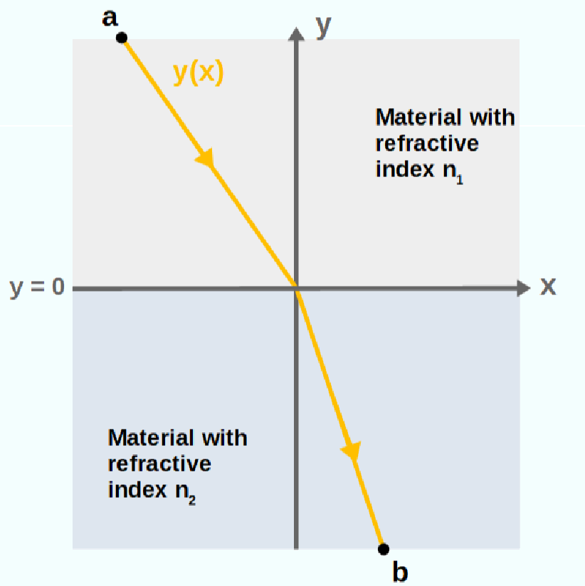
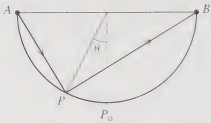
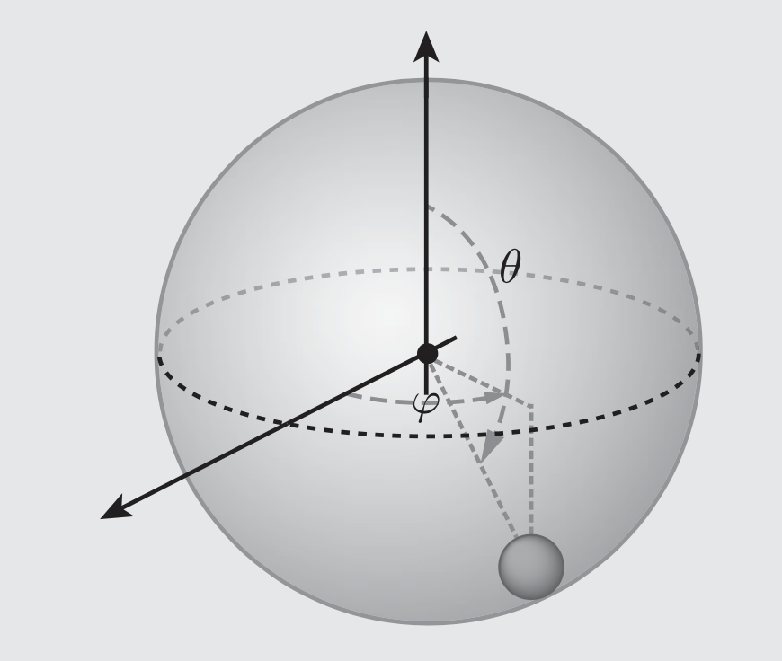

# Problem Set 2

---

**Total Points: 110 points**  
**Deadline: 9:00 pm, October 12th, 2026**

All answers must be **handwritten**, then scanned or photographed, and submitted via Canvas.

**Late submissions will incur a penalty of 5 points per day. Submissions more than 3 days late will not be accepted.**

---

The Taylor Chapter 6 problems carry 10 points each for 6.5, 6.6, 6.12 and 6.13, 15 points for 6.1 and 6.16 together, and 20 points for 6.23. Fermat's principle carries 25 points, and the spherical pendulum carries 10 points.

Each statement is reproduced in full, with the relevant figure included.

---

## 1. Fermat's principle [25 points]

One of the most foundational principles in optics known as Fermat's principle, which states: “The path taken by a light ray between any two points is the path that minimizes the travel time between the points.”

(a) Derive an expression for the total travel time of a light ray moving from point $a$ to point $b$, $T=\int_a^b dt$. Then, apply Fermat's Principle and use the calculus of variations to derive Snell's Law:

$$
\frac{\sin\theta_1}{\sin\theta_2}=\frac{n_2}{n_1}.
$$

[10 points]

*Fermat's principle: a ray travelling from $a$ to $b$ across the interface $y=0$.*

(b) Suppose the refractive index of a material varies with vertical position $y$ as $n(y)=L/y$, where $L$ is a constant. Using Fermat's Principle, derive the path that a light ray takes when traveling from point $a$ to point $b$. [15 points]

## 2. Taylor 6.5 — A stationary maximum of travel time [10 points]

Fermat's principle is often stated as “the travel time of a ray of light, moving from point $A$ to $B$, is minimum along the actual path.” Strictly speaking it should say that the time is stationary, not minimum. In fact one can construct situations for which the time is maximum along the actual path. Here is one: Consider the concave, hemispherical mirror shown in Figure 6.10, with $A$ and $B$ at opposite ends of a diameter. Consider a ray of light traveling in a vacuum from $A$ to $B$ with one reflection at $P$, in the same vertical plane as $A$ and $B$. According to the law of reflection, the actual path goes via point $P_0$ at the bottom of the hemisphere ($\theta=0$). Find the time of travel along the path $APB$ as a function of $\theta$ and show that it is maximum at $P=P_0$.

*Figure 6.10 Problem 6.5.*

## 3. Taylor 6.6 — Arc-length elements [10 points]

In many problems in the calculus of variations, you need to know the length $ds$ of a short segment of a curve on a surface, as in the expression (6.1). Make a table giving the appropriate expressions for $ds$ in the following eight situations: (a) A curve given by $y=y(x)$ in a plane, (b) same but $x=x(y)$, (c) same but $r=r(\phi)$, (d) same but $\phi=\phi(r)$; (e) curve given by $\phi=\phi(z)$ on a cylinder of radius $R$, (f) same but $z=z(\phi)$; (g) curve given by $\theta=\theta(\phi)$ on a sphere of radius $R$, (h) same but $\phi=\phi(\theta)$.

## 4. Taylor 6.12 — A stationary path involving hyperbolic functions [10 points]

Show that the path $y=y(x)$ for which the integral

$$
\int_{x_1}^{x_2}x\sqrt{1-y'^2}\,dx
$$

is stationary is a sinh function.

## 5. Taylor 6.13 — Straight radial paths in rapidity space [10 points]

In relativity theory, velocities can be represented by points in a certain “rapidity space” in which the distance between two neighboring points is

$$
ds=\frac{2}{1-r^2}\sqrt{dr^2+r^2d\phi^2},
$$

where $r$ and $\phi$ are polar coordinates, and we consider just a two-dimensional space. (An expression like this for distance in a non-Euclidean space is often called the metric of the space.) Use the Euler–Lagrange equation to show that the shortest distance from the origin to any other point is a straight line.

## 6. Taylor 6.1 — Length of a path on a sphere [15 points combined with 6.16]

The shortest path between two points on a curved surface, such as the surface of a sphere, is called a geodesic. To find a geodesic, one first has to set up an integral that gives the length of a path on the surface in question. This integral will always be similar to the integral (6.2) but may be more complicated (depending on the nature of the surface) and may involve different coordinates than $x$ and $y$. To illustrate this, use spherical polar coordinates $(r,\theta,\phi)$ to show that the length of a path joining two points on a sphere of radius $R$ is

$$
L=R\int_{\theta_1}^{\theta_2}
\sqrt{1+\sin^2\theta\,\phi'(\theta)^2}\,d\theta
\tag{6.41}
$$

if $(\theta_1,\phi_1)$ and $(\theta_2,\phi_2)$ specify the two points and we assume that the path is expressed as $\phi=\phi(\theta)$. (You will find how to minimize this length in Problem 6.16.)

## 7. Taylor 6.16 — Great-circle geodesics [15 points combined with 6.1]

Use the result (6.41) of Problem 6.1 to prove that the geodesic (shortest path) between two given points on a sphere is a great circle. [Hint: The integrand $f(\phi,\phi',\theta)$ in (6.41) is independent of $\phi$, so the Euler–Lagrange equation reduces to $\partial f/\partial\phi'=c$, a constant. This gives you $\phi'$ as a function of $\theta$. You can avoid doing the final integral by the following trick: There is no loss of generality in choosing your $z$ axis to pass through the point 1. Show that with this choice the constant $c$ is necessarily zero, and describe the corresponding geodesics.]

## 8. Taylor 6.23 — Minimum-time flight in a wind shear [20 points]

An aircraft whose airspeed is $v_0$ has to fly from town $O$ (at the origin) to town $P$, which is a distance $D$ due east. There is a steady gentle wind shear, such that $\mathbf v_{\mathrm{wind}}=Vy\,\hat{\mathbf x}$, where $x$ and $y$ are measured east and north respectively. Find the path, $y=y(x)$, which the plane should follow to minimize its flight time, as follows:

(a) Find the plane's ground speed in terms of $v_0,V,\phi$ (the angle by which the plane heads to the north of east), and the plane's position.

(b) Write down the time of flight as an integral of the form $\int_0^D f\,dx$. Show that if we assume that $y'$ and $\phi$ both remain small (as is certainly reasonable if the wind speed is not too large), then the integrand $f$ takes the approximate form

$$
f=\frac{1+\frac12y'^2}{1+ky}
$$

(times an uninteresting constant) where $k=V/v_0$.

(c) Write down the Euler–Lagrange equation that determines the best path. To solve it, make the intelligent guess that $y(x)=\lambda x(D-x)$, which clearly passes through the two towns. Show that it satisfies the Euler–Lagrange equation, provided

$$
\lambda=\frac{\sqrt{4+2k^2D^2}-2}{kD^2}.
$$

How far north does this path take the plane, if $D=2000$ miles, $v_0=500$ mph, and the wind shear is $V=0.5$ mph/mi? How much time does the plane save by following this path? [You'll probably want to use a computer to do this integral.]

## 9. Spherical pendulum [10 points]

A ball of mass $m$ swings on the end of an unstretchable string of length $R$ in the presence of a uniform gravitational field $g$. This is often called the “spherical pendulum,” because the ball moves as though it were sliding on the frictionless surface of a spherical bowl. It is important to note that:

(i) It can move horizontally around a vertical axis passing through the point of support, corresponding to changes in its azimuthal angle $\phi$. (On earth's surface this would correspond to a change in longitude.)

(ii) It can also move in the polar direction, as described by the angle $\theta$. (On earth's surface this would correspond to a change in latitude.)

Please find its equations of motion (a second-order differential equation for the polar angle $\theta$ as a function of time). You do not need to solve the equation of motion.

*Spherical pendulum with polar angle $\theta$ and azimuthal angle $\phi$.*
