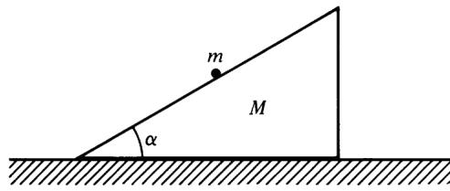

# Problem Set 3 — Worked Solutions

## 1. Non-uniqueness of Lagrangian [15 points]

### Problem statement

Consider a Lagrangian $L'=L+df/dt$, where the Lagrangian is $L=L(q_k,\dot q_k,t)$ and the function $f=f(q_k,t)$.

(a) Show that $L'=L'(q_k,\dot q_k,t)$, that is, $L'$ also depends on $q_k,\dot q_k,$ and $t$. Show that this would not generally be true if $f$ were allowed to depend upon the $\dot q_k$. [10 points]

(b) Show that $L'$ obeys Euler–Lagrange equations if $L$ does, by substituting $L'$ into Euler–Lagrange equations. Therefore, the equations of motion are the same using $L'$ as using $L$, so the Lagrangian of a particle is not unique. [10 points]

### Solution

**(a) Expand the total time derivative.**

For a sufficiently smooth function $f(q_k,t)$, the chain rule gives

$$
\frac{df}{dt}
=\sum_k\frac{\partial f}{\partial q_k}\dot q_k
+\frac{\partial f}{\partial t}.
$$

Thus

$$
\boxed{
L'=L(q,\dot q,t)
+\sum_k f_{q_k}(q,t)\dot q_k+f_t(q,t)
}.
$$

The right-hand side contains only coordinates, velocities, and time, so

$$
\boxed{L'=L'(q_k,\dot q_k,t)}.
$$

If instead $f=f(q_k,\dot q_k,t)$, then

$$
\frac{df}{dt}
=\sum_k f_{q_k}\dot q_k
+\sum_k f_{\dot q_k}\ddot q_k+f_t.
$$

The additional terms generally introduce accelerations. For example,

$$
f=\frac12\dot q^2
\quad\Longrightarrow\quad
\frac{df}{dt}=\dot q\,\ddot q.
$$

Consequently, $L'$ is generally no longer a first-order Lagrangian. This does not mean that every total derivative involving velocities changes the physical motion; such cases require the higher-order variational equations and appropriate endpoint conditions.

**(b) Substitute directly into the Euler–Lagrange equations.**

For an arbitrary coordinate $q_j$,

$$
\frac{\partial L'}{\partial\dot q_j}
=\frac{\partial L}{\partial\dot q_j}+f_{q_j}.
$$

Differentiating with respect to time,

$$
\frac{d}{dt}\frac{\partial L'}{\partial\dot q_j}
=
\frac{d}{dt}\frac{\partial L}{\partial\dot q_j}
+\sum_k f_{q_jq_k}\dot q_k+f_{q_jt}.
$$

Also,

$$
\frac{\partial L'}{\partial q_j}
=
\frac{\partial L}{\partial q_j}
+\sum_k f_{q_kq_j}\dot q_k+f_{tq_j}.
$$

Equality of the mixed partial derivatives gives

$$
\boxed{
\frac{d}{dt}\frac{\partial L'}{\partial\dot q_j}
-\frac{\partial L'}{\partial q_j}
=
\frac{d}{dt}\frac{\partial L}{\partial\dot q_j}
-\frac{\partial L}{\partial q_j}
}.
$$

The additional terms cancel identically. Therefore, $L$ and $L'$ give the same equations of motion.

As a complementary check, their actions differ only by an endpoint term:

$$
S'=S+f(q(t_2),t_2)-f(q(t_1),t_1).
$$

For fixed endpoint coordinates and times, this extra term has zero variation, so $\delta S'=\delta S$.

**Final result.**

$$
\boxed{
L\ \text{and}\ L+\frac{d}{dt}f(q,t)
\ \text{are dynamically equivalent}.
}
$$

The Lagrangian is therefore not unique.

---

## 2. Generalized mechanics [15 points]

### Problem statement

The term generalized mechanics refers to a formulation of classical mechanics in which the Lagrangian contains time derivatives of $q_i$ higher than the first. Problems for which $\dddot x=f(x,\dot x,\ddot x,t)$ have been referred to as “jerky” mechanics. Such equations of motion have interesting applications in chaos theory. By applying the methods of the calculus of variations, show that if there is a Lagrangian of the form $L(q_i,\dot q_i,\ddot q_i,t)$, and Hamilton's principle holds with the zero variation of both $q_i$ and $\dot q_i$ at the end points, then the corresponding Euler–Lagrange equations are

$$
\frac{d^2}{dt^2}\left(\frac{\partial L}{\partial\ddot q_i}\right)
-\frac{d}{dt}\left(\frac{\partial L}{\partial\dot q_i}\right)
+\frac{\partial L}{\partial q_i}=0,
\qquad i=1,2,\ldots,n.
\tag{1}
$$

Apply this result to the Lagrangian

$$
\mathcal L=-\frac m2q\ddot q-\frac k2q^2.
\tag{3}
$$

### Solution

**Step 1: Vary the action.**

The action is

$$
S[q]=\int_{t_1}^{t_2}L(q_i,\dot q_i,\ddot q_i,t)\,dt.
$$

Its first variation is

$$
\delta S
=\sum_i\int_{t_1}^{t_2}
\left(
L_{q_i}\delta q_i
+L_{\dot q_i}\delta\dot q_i
+L_{\ddot q_i}\delta\ddot q_i
\right)dt.
$$

Here

$$
\delta\dot q_i=\frac{d}{dt}\delta q_i,
\qquad
\delta\ddot q_i=\frac{d^2}{dt^2}\delta q_i.
$$

**Step 2: Integrate the velocity term once by parts.**

$$
\int L_{\dot q_i}\delta\dot q_i\,dt
=
\left[L_{\dot q_i}\delta q_i\right]_{t_1}^{t_2}
-\int\frac{dL_{\dot q_i}}{dt}\delta q_i\,dt.
$$

**Step 3: Integrate the acceleration term twice by parts.**

First,

$$
\int L_{\ddot q_i}\delta\ddot q_i\,dt
=
\left[L_{\ddot q_i}\delta\dot q_i\right]_{t_1}^{t_2}
-\int\frac{dL_{\ddot q_i}}{dt}\delta\dot q_i\,dt.
$$

Integrating the remaining term once more gives

$$
\begin{aligned}
\int L_{\ddot q_i}\delta\ddot q_i\,dt
={}&
\left[
L_{\ddot q_i}\delta\dot q_i
-\frac{dL_{\ddot q_i}}{dt}\delta q_i
\right]_{t_1}^{t_2}\\
&+\int\frac{d^2L_{\ddot q_i}}{dt^2}\delta q_i\,dt.
\end{aligned}
$$

**Step 4: Apply the endpoint conditions.**

Combining the terms,

$$
\begin{aligned}
\delta S
={}&\sum_i
\left[
\left(L_{\dot q_i}-\frac{dL_{\ddot q_i}}{dt}\right)\delta q_i
+L_{\ddot q_i}\delta\dot q_i
\right]_{t_1}^{t_2}\\
&+\sum_i\int_{t_1}^{t_2}
\left[
L_{q_i}-\frac{dL_{\dot q_i}}{dt}
+\frac{d^2L_{\ddot q_i}}{dt^2}
\right]\delta q_i\,dt.
\end{aligned}
$$

Both $\delta q_i$ and $\delta\dot q_i$ vanish at the endpoints. The boundary terms therefore vanish. Since the interior variations $\delta q_i$ are arbitrary,

$$
\boxed{
\frac{d^2}{dt^2}\left(\frac{\partial L}{\partial\ddot q_i}\right)
-\frac{d}{dt}\left(\frac{\partial L}{\partial\dot q_i}\right)
+\frac{\partial L}{\partial q_i}=0.
}
$$

**Step 5: Apply the equation to the specified Lagrangian.**

For

$$
\mathcal L=-\frac m2q\ddot q-\frac k2q^2,
$$

we have

$$
\frac{\partial\mathcal L}{\partial\ddot q}=-\frac m2q,
\qquad
\frac{\partial\mathcal L}{\partial\dot q}=0,
\qquad
\frac{\partial\mathcal L}{\partial q}=-\frac m2\ddot q-kq.
$$

Substitution gives

$$
-\frac m2\ddot q-\frac m2\ddot q-kq=0.
$$

Thus

$$
\boxed{m\ddot q+kq=0},
\qquad
\boxed{\omega_0=\sqrt{\frac km}}.
$$

**Interpretation and check.**

Although a general acceleration-dependent Lagrangian can produce fourth-order equations, this example is linear in $\ddot q$. Its derivative with respect to $\ddot q$ contains only $q$, so two time derivatives produce only $\ddot q$.

Indeed,

$$
\frac{d}{dt}(q\dot q)=\dot q^2+q\ddot q,
$$

and hence

$$
\boxed{
\mathcal L
=\left(\frac m2\dot q^2-\frac k2q^2\right)
-\frac{d}{dt}\left(\frac m2q\dot q\right).
}
$$

The given Lagrangian differs from the usual harmonic-oscillator Lagrangian by a total derivative. This total derivative involves velocity, but its endpoint variation vanishes under the endpoint conditions specified in this problem.

**Final result.**

The required generalized Euler–Lagrange equation is established above. For the particular example,

$$
\boxed{\ddot q+\frac kmq=0}.
$$

No additional third- or fourth-order dynamical initial conditions are needed.

---

## 3. Damped harmonic oscillator via time-dependent Lagrangian [15 points]

### Problem statement

In certain situations, particularly one-dimensional systems, it is possible to incorporate frictional effects without introducing the dissipation function. As an example, find the equations of motion for the Lagrangian

$$
L=e^{\gamma t}\left(\frac{m\dot q^2}{2}-\frac{kq^2}{2}\right).
\tag{4}
$$

Are there any constants of motion? Suppose a point transformation is made of the form

$$
s=e^{\gamma t/2}q.
\tag{5}
$$

What is the effective Lagrangian in terms of $s$? Find the equation of motion for $s$.

### Solution

**Step 1: Derive the equation for $q$.**

$$
\frac{\partial L}{\partial\dot q}=me^{\gamma t}\dot q,
\qquad
\frac{\partial L}{\partial q}=-ke^{\gamma t}q.
$$

Therefore,

$$
me^{\gamma t}(\ddot q+\gamma\dot q)+ke^{\gamma t}q=0,
$$

or

$$
\boxed{m\ddot q+m\gamma\dot q+kq=0}.
$$

The corresponding damping force is

$$
\boxed{F_{\mathrm d}=-m\gamma\dot q}.
$$

Thus $\gamma$ has dimensions of inverse time. If the damping force is written as $-b\dot q$, then $b=m\gamma$.

**Step 2: Distinguish mechanical energy from a conserved quantity.**

The physical mechanical energy is

$$
E_{\mathrm{mech}}=\frac m2\dot q^2+\frac k2q^2.
$$

Along the motion,

$$
\frac{dE_{\mathrm{mech}}}{dt}
=\dot q(m\ddot q+kq)
=\boxed{-m\gamma\dot q^2}.
$$

It decreases for positive damping. The energy function associated with the original Lagrangian is

$$
H_q=\dot q\frac{\partial L}{\partial\dot q}-L
=e^{\gamma t}E_{\mathrm{mech}},
$$

and it is also generally not conserved:

$$
\frac{dH_q}{dt}=-\frac{\partial L}{\partial t}=-\gamma L.
$$

Nevertheless, a different conserved combination exists.

**Step 3: Perform the point transformation.**

From $q=e^{-\gamma t/2}s$,

$$
\dot q=e^{-\gamma t/2}\left(\dot s-\frac\gamma2s\right).
$$

Substitution gives

$$
\begin{aligned}
L_s
&=\frac m2\left(\dot s-\frac\gamma2s\right)^2-\frac k2s^2\\
&=\frac m2\dot s^2-\frac{m\gamma}{2}s\dot s
-\frac12\left(k-\frac{m\gamma^2}{4}\right)s^2.
\end{aligned}
$$

The mixed term is a total derivative:

$$
-\frac{m\gamma}{2}s\dot s
=-\frac{d}{dt}\left(\frac{m\gamma}{4}s^2\right).
$$

Dropping it leaves the equivalent effective Lagrangian

$$
\boxed{
L_{\mathrm{eff}}
=\frac m2\dot s^2
-\frac12\left(k-\frac{m\gamma^2}{4}\right)s^2.
}
$$

**Step 4: Obtain the equation for $s$.**

The Euler–Lagrange equation is

$$
m\ddot s+\left(k-\frac{m\gamma^2}{4}\right)s=0,
$$

so

$$
\boxed{
\ddot s+\left(\frac km-\frac{\gamma^2}{4}\right)s=0.
}
$$

Direct substitution into the damped equation for $q$ gives the same result.

**Step 5: Construct a constant of motion.**

Since $L_{\mathrm{eff}}$ has no explicit time dependence,

$$
\boxed{
I=\frac m2\dot s^2
+\frac12\left(k-\frac{m\gamma^2}{4}\right)s^2
=\text{constant}.
}
$$

In the original variables this becomes

$$
I=\frac{e^{\gamma t}}2
\left[
m\left(\dot q+\frac\gamma2q\right)^2
+\left(k-\frac{m\gamma^2}{4}\right)q^2
\right],
$$

or, after cancellation of the $\gamma^2q^2$ terms,

$$
\boxed{
I=\frac{e^{\gamma t}}2
\left(m\dot q^2+m\gamma q\dot q+kq^2\right).
}
$$

A direct check gives

$$
\frac{dI}{dt}
=e^{\gamma t}\left(\dot q+\frac\gamma2q\right)
\left(m\ddot q+m\gamma\dot q+kq\right)=0.
$$

A constant of motion may have explicit time dependence in its expression; its total derivative along a solution must vanish.

**Final results.**

$$
\boxed{
\ddot q+\gamma\dot q+\frac kmq=0,
\qquad
\ddot s+\left(\frac km-\frac{\gamma^2}{4}\right)s=0.
}
$$

The conserved quantity is $I$ above, not the ordinary mechanical energy.

| Condition | Original oscillator | Transformed equation |
|---|---|---|
| $\gamma^2<4k/m$ | Underdamped | Positive squared frequency |
| $\gamma^2=4k/m$ | Critically damped | $\ddot s=0$ |
| $\gamma^2>4k/m$ | Overdamped | Negative squared frequency; exponential solutions |

The invariant remains valid in all three cases. In the overdamped case it is not a positive-definite quadratic form.

---

## 4. Particle sliding on a movable wedge [15 points]

### Problem statement

A particle of mass $m$ slides without friction on a wedge of angle $\alpha$ and mass $M$ that can move without friction on a smooth horizontal surface, as shown in the figure. Treating the constraint of the particle on the wedge by the method of **Lagrange multipliers**, find the equations of motion for the particle and wedge. Also obtain an expression for the forces of constraint. Calculate the work done in time $t$ by the forces of constraint acting on the particle and on the wedge. What are the constants of motion for the system?

*Particle of mass $m$ sliding on a wedge of mass $M$ and angle $\alpha$; the wedge is free to move on the horizontal floor.*

### Solution

**Step 1: Choose coordinates and specify the constraint.**

Use a laboratory inertial frame with $x$ positive to the right and $y$ positive upward. Let $(x,y)$ be the particle coordinates, and let $X$ be the horizontal coordinate of the wedge's lower-left corner. Assume $0<\alpha<\pi/2$.

The surface equation is

$$
y=(x-X)\tan\alpha.
$$

Choose the normalized constraint function

$$
\boxed{f=y\cos\alpha-(x-X)\sin\alpha=0}.
$$

Its gradient with respect to the particle coordinates is

$$
(f_x,f_y)=(-\sin\alpha,\cos\alpha),
$$

the outward unit normal to the incline.

**Step 2: Introduce a Lagrange multiplier.**

Since the wedge remains at a fixed height, its gravitational potential energy is constant and may be omitted. The unconstrained Lagrangian is

$$
L_0=\frac m2(\dot x^2+\dot y^2)+\frac M2\dot X^2-mgy.
$$

Set

$$
L_{\mathrm{aug}}=L_0+\lambda f.
$$

The equations for $x,y,X$ are

$$
\boxed{
m\ddot x=-\lambda\sin\alpha,\qquad
m\ddot y=\lambda\cos\alpha-mg,\qquad
M\ddot X=\lambda\sin\alpha,
}
$$

together with $f=0$.

**Step 3: Determine the multiplier.**

Differentiating the constraint twice gives

$$
\ddot y\cos\alpha-(\ddot x-\ddot X)\sin\alpha=0.
$$

Substituting the equations of motion,

$$
\left(\frac{\lambda\cos\alpha}{m}-g\right)\cos\alpha
+\lambda\left(\frac1m+\frac1M\right)\sin^2\alpha=0.
$$

Hence

$$
\lambda\left(\frac1m+\frac{\sin^2\alpha}{M}\right)=g\cos\alpha,
$$

and therefore

$$
\boxed{
\lambda=N=\frac{mMg\cos\alpha}{M+m\sin^2\alpha}.
}
$$

The multiplier equals the normal-force magnitude because the constraint function was normalized using the unit normal. A different scaling of $f$ would rescale $\lambda$.

**Step 4: Obtain explicit accelerations.**

$$
\boxed{
\ddot X=\frac{mg\sin\alpha\cos\alpha}{M+m\sin^2\alpha},
}
$$

$$
\boxed{
\ddot x=-\frac{Mg\sin\alpha\cos\alpha}{M+m\sin^2\alpha},
\qquad
\ddot y=-\frac{(M+m)g\sin^2\alpha}{M+m\sin^2\alpha}.
}
$$

All three accelerations are constant while the particle remains on the inclined surface.

Alternatively, let $u$ measure position relative to the wedge, positive up the incline:

$$
x=X+u\cos\alpha,\qquad y=u\sin\alpha.
$$

Then

$$
\boxed{
\ddot u=-\frac{(M+m)g\sin\alpha}{M+m\sin^2\alpha}.
}
$$

**Step 5: Identify the constraint forces.**

The force of the wedge on the particle is

$$
\boxed{
\mathbf F_{\mathrm c,m}
=N(-\sin\alpha\,\hat{\mathbf x}+\cos\alpha\,\hat{\mathbf y}).
}
$$

The equal and opposite contact force on the wedge is

$$
\boxed{
\mathbf F_{m\to M}
=N(\sin\alpha\,\hat{\mathbf x}-\cos\alpha\,\hat{\mathbf y}).
}
$$

Since the wedge has no vertical acceleration, the floor reaction is

$$
\boxed{
\mathbf R_{\mathrm{floor}}
=(Mg+N\cos\alpha)\hat{\mathbf y}.
}
$$

The floor reaction does no work because the wedge moves horizontally.

**Step 6: Compute the constraint-force powers.**

The velocity constraint is

$$
\dot y\cos\alpha-(\dot x-\dot X)\sin\alpha=0.
$$

Consequently, the power delivered to the particle by the normal force is

$$
\begin{aligned}
P_{\mathrm c,m}
&=N(-\sin\alpha\,\dot x+\cos\alpha\,\dot y)\\
&=\boxed{-N\sin\alpha\,\dot X}.
\end{aligned}
$$

The power delivered to the wedge by the contact force is

$$
\boxed{P_{\mathrm c,M}=N\sin\alpha\,\dot X}.
$$

Thus

$$
\boxed{P_{\mathrm c,m}+P_{\mathrm c,M}=0}.
$$

The normal force generally does work on each body separately. The absence of friction does not make each individual constraint-force work vanish when the wedge moves.

**Step 7: Integrate the powers over time.**

Let

$$
U_0=\dot X(0),\qquad
A=\ddot X=\frac{N\sin\alpha}{M}.
$$

Since $A$ is constant,

$$
X(t)-X(0)=U_0t+\frac12At^2.
$$

Therefore,

$$
\boxed{
W_{\mathrm c,m}(0\to t)
=-N\sin\alpha\left(U_0t+\frac12At^2\right),
}
$$

$$
\boxed{
W_{\mathrm c,M}(0\to t)
=+N\sin\alpha\left(U_0t+\frac12At^2\right).
}
$$

The floor contributes zero work, so the second expression is also the total work of the constraint forces on the wedge. Equivalently,

$$
\boxed{
W_{\mathrm c,M}
=\frac M2\left[\dot X(t)^2-U_0^2\right].
}
$$

If the wedge is initially at rest, $U_0=0$, these simplify to

$$
\boxed{
W_{\mathrm c,M}
=\frac12MA^2t^2
=\frac{Mm^2g^2\sin^2\alpha\cos^2\alpha}
{2(M+m\sin^2\alpha)^2}\,t^2,
\qquad
W_{\mathrm c,m}=-W_{\mathrm c,M}.
}
$$

Because the problem does not specify the initial wedge velocity, the general answer retains $U_0$.

**Step 8: Identify the constants of motion.**

There is no external horizontal force, so total horizontal momentum is conserved:

$$
\boxed{P_x=m\dot x+M\dot X=\text{constant}}.
$$

The total mechanical energy is also conserved:

$$
\boxed{
E=\frac m2(\dot x^2+\dot y^2)
+\frac M2\dot X^2+mgy
=\text{constant}.
}
$$

The floor does no work, the two contact-force powers cancel, and gravity is conservative.

**Final results and check.**

The principal conserved quantities are **total horizontal momentum and total mechanical energy**. The individual mechanical energies are generally not conserved because the contact forces transfer energy between the bodies.

As $M\to\infty$,

$$
\ddot X\to0,\qquad N\to mg\cos\alpha,\qquad
\ddot u\to-g\sin\alpha,
$$

recovering motion on a fixed frictionless incline.

---

## 5. Spring pendulum with impulsive blow [15 points]

### Problem statement

A particle of mass $m$ is suspended by a massless spring of length $L$. It hangs, without initial motion, in a gravitational field of strength $g$. It is struck by an impulsive horizontal blow, which introduces an angular velocity $\omega$. The impulse is used only to set the initial condition,

$$
\theta(0)=0,\qquad\dot\theta(0)=\omega,
\tag{6}
$$

and is not included in the subsequent Lagrangian dynamics. If $\omega$ is sufficiently small, it is obvious that the mass moves as a simple pendulum. If $\omega$ is sufficiently large, the mass will rotate about the support. Use a Lagrange multiplier to determine the conditions under which the string becomes slack (meaning that the **tension drops to zero**) at some point in the motion.

### Solution

**Interpretation of the original statement.** The original statement uses both “spring” and “string,” without giving a spring constant or a natural length. The fixed-length constraint interpretation is therefore an assumption, not a confirmed correction to the question.

The main solution below assumes an **inextensible, massless string of length $L$ that can support tension but cannot push**. The actual-spring interpretation is discussed afterward.

**Step 1: Retain the radial coordinate before imposing the constraint.**

Take the support as the origin, with $\theta=0$ vertically downward:

$$
x=r\sin\theta,\qquad y=-r\cos\theta,
$$

where $y$ is positive upward. During taut motion, $r=L$.

Use the augmented Lagrangian

$$
\boxed{
L_{\mathrm{aug}}
=\frac m2(\dot r^2+r^2\dot\theta^2)
+mgr\cos\theta+\frac{\lambda}{2}(L^2-r^2).
}
$$

With this normalization, $\lambda r$ is the inward constraint-force magnitude.

**Step 2: Obtain the tension and the angular equation.**

The radial Euler–Lagrange equation is

$$
m\ddot r-mr\dot\theta^2-mg\cos\theta+\lambda r=0.
$$

Setting $r=L$ and $\ddot r=0$ gives

$$
\lambda L=mL\dot\theta^2+mg\cos\theta.
$$

Thus the tension is

$$
\boxed{\mathcal T=\lambda L=mL\dot\theta^2+mg\cos\theta}.
$$

The angular equation is

$$
\frac{d}{dt}(mr^2\dot\theta)+mgr\sin\theta=0,
$$

which reduces to

$$
\boxed{\ddot\theta+\frac gL\sin\theta=0}.
$$

These equations apply only while the string is taut. A negative calculated tension is not physically admissible.

**Step 3: Use energy conservation to eliminate $\dot\theta$.**

After the impulse, take the potential energy to be zero at the lowest point:

$$
E=\frac m2L^2\dot\theta^2+mgL(1-\cos\theta)
=\frac m2L^2\omega^2.
$$

Therefore,

$$
\boxed{
\dot\theta^2
=\omega^2-\frac{2g}{L}(1-\cos\theta).
}
$$

Substitution into the tension formula gives

$$
\boxed{\mathcal T=mL\omega^2-2mg+3mg\cos\theta}.
$$

Introduce the dimensionless parameter

$$
\boxed{\beta=\frac{L\omega^2}{g}},
$$

so that

$$
\boxed{\frac{\mathcal T}{mg}=\beta-2+3\cos\theta}.
$$

If $\omega<0$, the motion is reflected to the opposite side; the conditions depend only on $\omega^2$.

**Step 4: Find the zero-tension angle and check accessibility.**

Setting $\mathcal T=0$ gives

$$
\boxed{\cos\theta_s=\frac{2-\beta}{3}}.
$$

A candidate angle must be reachable. At this angle,

$$
\begin{aligned}
\dot\theta_s^2
&=\frac gL(\beta-2+2\cos\theta_s)\\
&=\boxed{\frac g{3L}(\beta-2)}.
\end{aligned}
$$

Thus accessibility requires $\beta\ge2$. The requirement $\cos\theta_s\ge-1$ gives $\beta\le5$. Together,

$$
\boxed{2\le\beta\le5}.
$$

Equivalently,

$$
\boxed{
\frac{2g}{L}\le\omega^2\le\frac{5g}{L}.
}
$$

In terms of the initial speed $v_0=L|\omega|$,

$$
\boxed{2gL\le v_0^2\le5gL}.
$$

**Step 5: Distinguish momentary zero tension from a genuine slack interval.**

| Initial parameter | Motion and tension |
|---|---|
| $0\le\beta<2$ | The turning point is below the horizontal. The string remains taut with positive tension. |
| $\beta=2$ | At the horizontal turning point, $\theta=\pi/2$, both speed and tension vanish. The particle then swings back, and the tension becomes positive again. |
| $2<\beta<5$ | Tension reaches zero at $\pi/2<\theta_s<\pi$ while speed is nonzero. Continuing the circular path would require negative tension, so the particle leaves the circle and the string becomes slack. |
| $\beta=5$ | Marginal complete rotation: tension is zero at the top, where $v_{\mathrm{top}}^2=gL$, and positive at neighboring positions. |
| $\beta>5$ | Complete rotation is possible with strictly positive tension throughout. |

For the strict intermediate interval,

$$
\boxed{
\theta_s=\arccos\left(\frac{2-\beta}{3}\right),
\qquad
v_s^2=\frac{gL}{3}(\beta-2).
}
$$

After genuine slackening, the fixed-radius equations no longer apply. The particle follows projectile motion until the string may become taut again.

**Final results.**

Under the problem's explicit definition, “tension drops to zero at some point,” the answer includes the endpoints:

$$
\boxed{
\sqrt{\frac{2g}{L}}
\le|\omega|\le
\sqrt{\frac{5g}{L}}.
}
$$

If “becomes slack” means that the particle actually leaves the circle and undergoes a nonzero interval of slack-string motion, the condition is

$$
\boxed{
\sqrt{\frac{2g}{L}}
<|\omega|<
\sqrt{\frac{5g}{L}}.
}
$$

The endpoints are limiting cases of momentary zero tension.

**If the word “spring” is intentional.**

An actual spring permits $r(t)$ to vary, so imposing $r=L$ is not valid. For a Hookean spring with natural length $\ell_0$ and stiffness $\kappa$,

$$
L_{\mathrm{spring}}
=\frac m2(\dot r^2+r^2\dot\theta^2)
+mgr\cos\theta-\frac{\kappa}{2}(r-\ell_0)^2.
$$

Its equations are

$$
\boxed{
\ddot r-r\dot\theta^2
=g\cos\theta-\frac{\kappa}{m}(r-\ell_0),
}
$$

$$
\boxed{
\ddot\theta+\frac{2\dot r}{r}\dot\theta+\frac gr\sin\theta=0.
}
$$

The initially suspended equilibrium length is

$$
r_{\mathrm{eq}}=\ell_0+\frac{mg}{\kappa}.
$$

The following information would be needed:

- Whether $L$ denotes the natural length or the suspended equilibrium length.
- The spring constant $\kappa$.
- Whether the spring can support compression, or is instead a tension-only elastic cord.

An ordinary spring passing through zero extension does not automatically become slack. For a tension-only elastic cord, the tension would instead be modeled by

$$
\mathcal T=\max\{\kappa(r-\ell_0),0\}.
$$

Without these specifications, the fixed-string thresholds cannot be claimed as an answer for an actual spring.

---

## 6. Separability of Lagrange's equations [15 points]

### Problem statement

Suppose a mechanical system is described by generalized coordinates $q_i$, and assume that both the kinetic energy and potential energy are separable. By separable, we mean that each coordinate $q_i$ appears only in its own term, with no coupling between different coordinates. Specifically, suppose

$$
T=\sum_i f_i(q_i)\dot q_i^2,
\qquad
V=\sum_i V_i(q_i),
\tag{7}
$$

where $f_i(q_i)$ and $V_i(q_i)$ depend only on the single coordinate $q_i$. Show that each generalized coordinate $q_i$ satisfies its own independent equation of motion, uncoupled from the other coordinates. Then show that, for each coordinate $q_i$, there is a conserved quantity.

### Solution

**Step 1: Separate the Lagrangian.**

$$
L=T-V
=\sum_i\left[f_i(q_i)\dot q_i^2-V_i(q_i)\right]
=\sum_iL_i(q_i,\dot q_i).
$$

Each term involves only one coordinate and its velocity. The stated kinetic energy has no additional factor of $1/2$; such a factor may already be included in $f_i$.

**Step 2: Derive an equation for each coordinate.**

For a given $i$,

$$
\frac{\partial L}{\partial\dot q_i}=2f_i(q_i)\dot q_i,
$$

and hence

$$
\frac{d}{dt}\frac{\partial L}{\partial\dot q_i}
=2f_i\ddot q_i+2f_i'\dot q_i^2.
$$

Also,

$$
\frac{\partial L}{\partial q_i}=f_i'\dot q_i^2-V_i'.
$$

Therefore,

$$
\boxed{
2f_i(q_i)\ddot q_i
+f_i'(q_i)\dot q_i^2+V_i'(q_i)=0.
}
$$

Here the primes denote derivatives with respect to $q_i$, not time.

The equation contains only $q_i,\dot q_i,\ddot q_i$ and no coordinate $q_j$ with $j\ne i$. Thus the equations are uncoupled. Where $f_i\ne0$,

$$
\boxed{
\ddot q_i=-\frac{f_i'\dot q_i^2+V_i'}{2f_i}.
}
$$

For an ordinary nondegenerate kinetic energy, $f_i>0$.

**Step 3: Find a conserved quantity for each coordinate.**

Define

$$
\boxed{E_i=f_i(q_i)\dot q_i^2+V_i(q_i)}.
$$

Then

$$
\begin{aligned}
\frac{dE_i}{dt}
&=f_i'\dot q_i^3+2f_i\dot q_i\ddot q_i+V_i'\dot q_i\\
&=\dot q_i\left(2f_i\ddot q_i+f_i'\dot q_i^2+V_i'\right)\\
&=0.
\end{aligned}
$$

Thus each degree of freedom has its own conserved energy:

$$
\boxed{
E_i=f_i(q_i)\dot q_i^2+V_i(q_i)=\text{constant},
\qquad i=1,\ldots,n.
}
$$

Equivalently, each autonomous $L_i$ has the conserved energy function

$$
\dot q_i\frac{\partial L_i}{\partial\dot q_i}-L_i
=f_i\dot q_i^2+V_i.
$$

**Step 4: Relate these constants to total energy and momentum.**

The total energy is

$$
\boxed{E=\sum_iE_i=T+V}.
$$

Because the degrees of freedom do not exchange energy, every $E_i$ is separately conserved, rather than only their sum.

The generalized momentum

$$
p_i=2f_i(q_i)\dot q_i
$$

is not generally conserved. Momentum conservation would require an additional condition, such as $q_i$ being cyclic.

**Final results.**

$$
\boxed{
2f_i\ddot q_i+f_i'\dot q_i^2+V_i'=0,
\qquad
E_i=f_i\dot q_i^2+V_i=\text{constant}.
}
$$

These statements assume that the $q_i$ are independent generalized coordinates. Unresolved constraints coupling the coordinates would invalidate the inference of independent dynamics.
